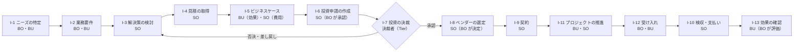
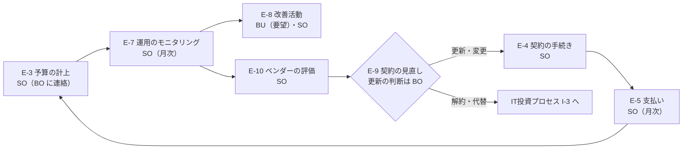

# 予算移管後の役割と業務プロセス（あるべき姿）

| 項目 | 内容 |
|---|---|
| 文書番号 | BTR-APX-01 |
| 版 | 0.6（案） |
| 位置づけ | 参考。予算移管の後の、業務アプリケーションに関する役割・RACI・業務プロセスのあるべき姿。予算移管の手順（Runbook）ではない |
| 所管 | 予算移管事務局 |
| 承認者 | IT部門長 |
| 最終改訂日 | 2026-10-12 |
| 関連文書 | [憲章](../rules/02-charter.docx)、[Runbook 案件担当編](../process/08-runbook-04-case-owner.md)、[用語集](../reference/14-glossary.md) |

---

## 1. 目的と範囲

予算移管の後、業務アプリケーションについて「誰が何に責任を持ち、何を判断し、何をしてはいけないか」をあらかじめ定める。案件担当が移管対象部門とIT関連業務の扱いを合意するときの標準として使う。

| 対象 | 対象外 |
|---|---|
| 移管対象部門の業務アプリケーションと、その関連ツール（予算移管の対象のほぼすべて） | もともと IT部門が管掌している全社横断の領域（インフラ、データ、セキュリティなど）。従来どおり IT部門が担う |

---

## 2. 原則：プロセスオーナー原則（交渉不可）

> 業務アプリケーションの Accountability（最終責任）は、その業務プロセスと便益に責任を持つビジネス側（プロセスオーナー）に残る。IT部門はシステムオーナーとして関与を強めるが、Accountability は引き取らない。

予算の所在が IT部門に移っても、この原則は変わらない。案件ごとの合意で変えることもできない。

根拠の原文と、各ソースに書かれていること・書かれていないことは、[プロセスオーナー原則の根拠](./02-principle-evidence.md)（BTR-APX-02）に示す。下の表はその要約である。

| 対象 | 根拠 | 根拠が示すこと |
|---|---|---|
| GxP 対象の部門 | EU GMP Annex 11（Glossary・2 Personnel） | プロセスオーナー（業務プロセスに責任を持つ者）とシステムオーナー（システムの可用性・保守、データのセキュリティに責任を持つ者）を分けて定義し、両者と IT の密接な協力を求める |
| | PIC/S PI 011-3 | システムの利用者を所有者（owners）とし、社内・社外の供給者と利用者（regulated user businesses）の責任を分けて管理する。責任は文書で明確に定める |
| | 厚生労働省 コンピュータ化システム適正管理ガイドライン | 各組織の責任と権限をコンピュータ化システム管理規定に明確にする |
| 本社機能（財務・経理、人事・総務、法務・経営企画） | GxP 規制下のプロセスオーナー原則を援用する | GxP の対象ではないが、同じ原則を全社共通のメッセージとして適用する |
| | 経済産業省「システム管理基準 追補版（財務報告に係るIT統制ガイダンス）」令和6年12月 | IT統制の評価で、「業務プロセスの責任者」を「開発責任者」「システム管理者」と分けて扱う（第Ⅲ章 図表Ⅲ.5-1、p.Ⅲ-35）。IT部門・ユーザ部門・委託先の役割と責任を職務分掌規程等で定め、周知することを統制の例とする（第Ⅳ章 2-(1)-③、p.Ⅳ-9） |
| | 経済産業省「システム管理基準」令和5年版 | 業務要件は利用者・関係者と合意し、文書化して承認を得る（Ⅱ.3.2）。運用の変更・インシデント対応の優先度・サービスレベルは IT部門と利用部門の間で合意し、インシデント対応は利用部門の判断の下で完了する（Ⅱ.5）。IT に関する権限は、それを行使するのに最適な立場にある者に委ねる（ITガバナンス編、p.19） |
| | 金融庁「財務報告に係る内部統制の評価及び監査の基準」（2023年改訂） | 経営者が内部統制の整備・運用に最終的な責任を持ち、組織内のその他の者も自らの業務との関連で整備・運用に役割を担う（Ⅰ.4(1)・(5)） |
| 共通 | Val IT（ISACA）原則6 | 能力の提供と便益の実現について、関係者に適切な Accountability を割り当てる |

- Annex 11 の改訂案（2025年）では、プロセスオーナーとシステムオーナーの定義がなくなる。代わりに、規制を受ける側が全面的に責任を持ち、社内の IT部門は SLA・KPI で監督される運用の担い手として扱われる（BTR-APX-02 §2.2）。どちらの版でも、本書の原則は変わらない。
- ISPE GAMP 5 は原文を確認できていないため、根拠としては引用しない。

---

## 3. 業務の3つの層

| 層 | 内容 | 例 | 予算移管での扱い |
|---|---|---|---|
| 直接業務 | 組織のミッション・業務分掌に基づく本来の業務 | 業務要件の決定、システムを使った業務、受け入れの確認、部門で行う運用 | 移さない（当然に部門に残る） |
| IT関連業務（中間層） | 直接業務と間接業務の間にあり、予算があったために部門が担ってきた業務 | 投資：予算承認までの企画・見積の取得・申請資料の作成／経費：運用のモニタリング、改善活動、契約の見直しに向けた活動 | **案件ごとに合意する。本書の RACI（After）を標準とする** |
| 間接業務 | 予算に基づく管理と手続き | 予算の管理、契約、発注・検収・支払い | 移す（当然に IT部門に移る） |

---

## 4. 役割の定義

| 役割 | 略号 | 担う者 | 責任 |
|---|---|---|---|
| ビジネスオーナー（プロセスオーナー） | BO | 移管対象部門の部門長 | 業務プロセスと、業務アプリケーションの要否・目的・便益に最終責任（A）を負う。GxP 対象では Annex 11 のプロセスオーナー |
| 部門担当 | BU | 移管対象部門の担当者 | 業務アプリケーションを使って直接業務を行う。要望を出し、受け入れを確かめる |
| システムオーナー | SO | IT部門の担当（普段の窓口のメンバー） | システムの可用性・保守・データのセキュリティに責任を持ち、IT関連業務の実務を広く担う。BO に専門的な判断材料を出し、必要なら異を唱える |
| ベンダーマネジメント担当 | VM | IT部門 | 契約と委託先の管理を一元的に担い、SO を支援する（RACI では SO に含める） |
| 事務担当 | AD | IT部門（既存の事務の体制を増強） | 予算の計上・執行の管理と、発注・検収・支払いの手続きを担い、SO を支援する（RACI では SO に含める） |
| 決裁者 | — | 新しいITガバナンス（Tier）で定める（検討中） | 投資の決裁 |

---

## 5. RACI（標準）

R＝実行、A＝最終責任、C＝相談、I＝連絡。RACI は BO・BU・SO の3役で表す。ベンダーマネジメント担当と事務担当は SO を支援するが、RACI では SO に含める。

**Before（初版は1パターン）**：ビジネス側が単独で行っている状態。全ての活動で BO が A、BU が R で、IT部門は関与しない。実際の Before が違う案件は、合意のときに Before を書き直してから比べる。

**After**：IT部門の関与を強め、直接業務と IT関連業務の A は BO に残す。間接業務は SO が A/R を持つ。

### 5.1 IT投資プロセス（After）

| No. | 活動 | 層 | BO | BU | SO |
|---|---|---|---|---|---|
| I-1 | 課題・ニーズの特定 | 直接 | A | R | C |
| I-2 | 業務要件の定義 | 直接 | A | R | C |
| I-3 | 解決策の検討（システム化の方針、既存システムとの整合） | IT関連 | A | C | R |
| I-4 | ベンダー情報の収集・見積の取得 | IT関連 | A | C | R |
| I-5 | 投資効果と費用の算定（BU は効果、SO は費用） | IT関連 | A | R | R |
| I-6 | 予算要求・投資申請の作成 | IT関連 | A | C | R |
| I-7 | 投資の決裁 | — | 決裁者（Tier。検討中） | | |
| I-8 | ベンダーの選定 | IT関連 | A | C | R |
| I-9 | 契約の締結 | 間接 | I | | A/R |
| I-10 | 発注・検収・支払いの手続き | 間接 | | | A/R |
| I-11 | プロジェクトの推進（進捗・品質） | IT関連 | A | R | R |
| I-12 | 受け入れ（業務要件を満たすか） | 直接 | A | R | C |
| I-13 | 効果の確認（事後評価） | IT関連 | A | R | C |

### 5.2 経費プロセス（定常運用。After）

| No. | 活動 | 層 | BO | BU | SO |
|---|---|---|---|---|---|
| E-1 | システムを使った業務 | 直接 | A | R | |
| E-2 | 部門で行う運用（ユーザー・権限の管理） | 直接 | A | R | C |
| E-3 | 予算の計上・執行の管理 | 間接 | I | | A/R |
| E-4 | 契約の更新・変更・解約の手続き | 間接 | C | | A/R |
| E-5 | 請求書の受領・支払い | 間接 | | | A/R |
| E-6 | 委託先への指示・報告の受領（契約上の管理） | 間接 | | | A/R |
| E-7 | 運用状況のモニタリング（SLA・障害・利用状況） | IT関連 | A | C | R |
| E-8 | 改善活動（BU は要望、SO は整理と実施） | IT関連 | A | R | R |
| E-9 | 契約の見直しに向けた活動（利用実態・ライセンス数・代替案の評価、更新の判断） | IT関連 | A | C | R |
| E-10 | ベンダーの評価 | IT関連 | A | C | R |
| E-11 | GxP の変更管理 | IT関連 | A | R | R |

- E-11 には、本来は品質保証部門の関与が要る。この表では省いている。

### 5.3 カスタマイズの範囲

案件ごとの合意文書では、標準 RACI を次の範囲でだけカスタマイズする。

| 区分 | 扱い |
|---|---|
| 変えられないもの | A の列（直接業務と IT関連業務は BO、間接業務は SO）。直接業務の行の全体。間接業務の行の全体（ただし経過措置を除く） |
| カスタマイズできるもの | IT関連業務の行のうち、R と C を BU と SO のどちらが持つか。SO が R を持ち始める時期（段階的に移してよい） |
| 経過措置 | 今の担当が承認済みの文書や記録で定められていて、担当の変更に正式な手続き（例：GxP の変更管理）が要る業務は、手続きが完了するまで Before の担当のまま行う。IT関連業務の扱いが合意の期限（12/11）までに合意できない部分も、合意できるまで Before のまま行う（憲章 第9条第3項・第4項） |
| 書き方 | 標準との差分、理由、見直しの時期、経過措置の手続きの内容と完了予定を書く。進行役が全案件を横並びで確かめる |

## 6. 業務プロセス

### 6.1 IT投資プロセス

### 6.2 経費プロセス（年間のサイクル）

---

## 7. 判断すべきこと・してはいけないこと

| 役割 | 判断すべきこと | してはいけないこと |
|---|---|---|
| ビジネスオーナー（BO） | 投資の要否・目的・期待効果、業務要件、受け入れの可否、改善の優先順位、契約を続けるかどうか、ベンダーの選定（業務への適合）、効果の評価 | IT部門を通さずにベンダーと契約・発注する、全社横断の領域（インフラ・データ・セキュリティ）の方針を単独で変える、Accountability を IT部門に預ける（「IT に任せた」） |
| 部門担当（BU） | 日々の業務での使い方、要望を出すこと、受け入れの確認 | 委託先に契約外の作業を直接頼む、追加の発注を約束する |
| システムオーナー（SO） | 技術的な解決策と既存システムとの整合、見積の妥当性、運用品質（SLA）の評価と是正の要求、変更の技術的な影響 | 業務要件や優先順位を決める、投資の要否を決める、BO の承認なしに仕様を変える、Accountability を引き取る |
| ベンダーマネジメント担当（VM） | 契約の条件・形態、交渉の進め方、更新・解約の手続きの時期 | 契約を続けるかどうかを単独で決める、業務要件を変える |
| 事務担当（AD） | 支払い・予算執行の手続きが形式を満たしているか | 検収の中身（業務要件を満たすか）を判断する |

---

## 8. 案件ごとの合意のしかた

1. 案件担当は、移管対象部門の今のやり方を Before として確かめる（初版の Before と違えば書き直す）。
2. §5 の After をもとに、§5.3 の範囲で IT関連業務の行をカスタマイズし、標準との差分と理由を書く。
3. 担当の変更に正式な手続きが要る業務を洗い出し、経過措置として手続きの内容と完了予定を書く。
4. 1〜3 を合意文書としてまとめ、移管元の責任者（BO）の承認を得る。A が BO に残ることは合意の対象にしない（§2）。
5. 承認された合意文書を保存し、決定記録に登録する（手順は Runbook 案件担当編 §3.4・§3.5）。

---

## 9. 未定の事項

| 事項 | 状況 |
|---|---|
| 投資の決裁者と決裁の基準 | 新しいITガバナンス（Tier）で検討中 |
| GxP の変更管理への品質保証部門の関与 | 本書では扱っていない |
| Before の複数パターン | 初版は1パターン。必要に応じて追加する |

---

## 出典

- [EU GMP Annex 11: Computerised Systems（European Commission）](https://health.ec.europa.eu/system/files/2016-11/annex11_01-2011_en_0.pdf)
- [PIC/S PI 011-3 Good Practices for Computerised Systems in Regulated GxP Environments](https://picscheme.org/docview/3444)
- [厚生労働省 コンピュータ化システム適正管理ガイドライン（法令等データベース）](https://www.mhlw.go.jp/web/t_doc?dataId=00tb6573&dataType=1&pageNo=1)
- [システム管理基準 追補版（財務報告に係るIT統制ガイダンス）令和6年12月（経済産業省）](https://www.meti.go.jp/policy/netsecurity/docs/secgov/2024_ZaimuHoukokuNiKakaruITTouseiGuidance.pdf)
- [システム管理基準 令和5年版（経済産業省）](https://www.meti.go.jp/policy/netsecurity/sys-kansa/sys-kanri-2023.pdf)
- [財務報告に係る内部統制の評価及び監査の基準・実施基準の改訂について（金融庁、2023）](https://www.fsa.go.jp/news/r4/sonota/20230407/1.pdf)
- [Val IT（Wikipedia）](https://wikipedia.com/wiki/Val_IT)
- [EU Annex 11 の2025年改訂案（SimplerQMS）](https://simplerqms.com/eu-annex-11/)

---

## 改訂履歴

| 版 | 日付 | 改訂内容 | 改訂者 | 承認者 |
|---|---|---|---|---|
| 0.6 | 2026-10-12 | 参考資料から原文の写し（reference/_sources/）への言及を削除した | 予算移管事務局 | |
| 0.5 | 2026-10-12 | RACI を BO・BU・SO の3役にした（VM・AD は SO に含める）。カスタマイズの範囲と経過措置（§5.3）を定め、合意のしかた（§8）を改めた。12/11 までに合意できない場合の扱いを決めた | 予算移管事務局 | |
| 0.4 | 2026-10-12 | 「中間業務」を「IT関連業務（中間層）」に改めた | 予算移管事務局 | |
| 0.3 | 2026-10-12 | GxP 側の根拠に PIC/S PI 011-3 と厚生労働省のガイドラインを加え、GAMP 5 を外した。Annex 11 改訂案の影響を注記した | 予算移管事務局 | |
| 0.2 | 2026-10-12 | 本社機能の根拠を、Three Lines Model から国内の一次資料（IT統制ガイダンス、システム管理基準、内部統制基準）に差し替えた | 予算移管事務局 | |
| 0.1 | 2026-10-12 | 初版（案） | 予算移管事務局 | |
