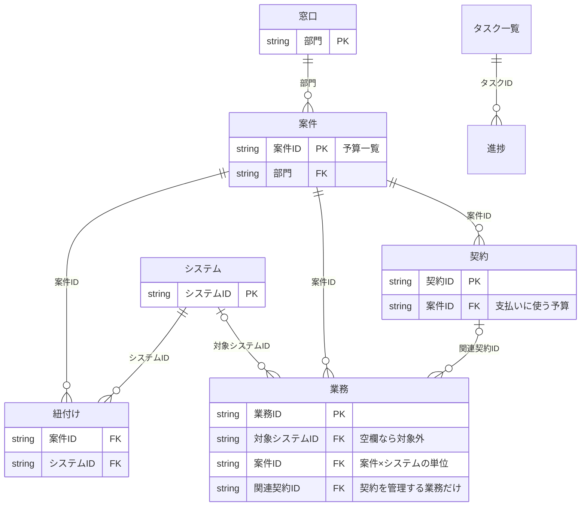

# 予算移管シート 仕様（budget_transfer_sheet.xlsx）

予算移管シートのシート構成、データモデル、自動判定のしくみを定める。シートの列や数式を変えるときは、先にこの仕様を直す。

- 判定の基準そのもの（何を移管するか、移管の時期、移管ステータスの条件）は [憲章](../rules/02-charter.docx) 第8条〜第10条を正とする。この仕様は、それをシートでどう実現しているかを書く。
- シートを使う手順は Runbook の役割別のファイルに、進捗の記録のしかたは [Runbook 進行役編](../process/08-runbook-01-transfer-lead.md) §1.6 と [Runbook 案件担当編](../process/08-runbook-04-case-owner.md) §1.6 に書く。

改定：2026-10-12

---

## 1. シートの構成

| シート | 1行の単位 | 役割 | 主な記入者 |
|---|---|---|---|
| 予算一覧 | 案件 | 移管対象部門の予算シートに、部門・予算区分・システム関連・移管対象部門のコメント・移管判定（自動）・経過措置（自動）・移管ステータス・案件担当・投資の区分を足したもの | 進行役（登録・割当て）、案件担当（未確認の項目・移管ステータス） |
| モニタリング | — | 予算一覧の移管ステータス・移管判定を、ステータス別・判定別・部門別に集計する。進捗シートを役割別に集計する（全て数式） | —（自動） |
| 進捗 | タスク（部門・案件・契約ごと） | 役割別のタスクの状態（未着手／進行中／完了／保留）、期限、完了日。期限を過ぎて完了していない行を自動で表示する | 全体と部門の行は進行役が、案件・契約の行は案件担当が作り、それぞれ自分の行を更新する。承認の行は依頼した者（A-03は案件担当、それ以外は進行役）が更新する |
| 窓口 | 部門 | 移管対象部門ごとの移管元の責任者（承認者）・担当者（問い合わせ先）・予算シートの受領日。部門名は予算一覧の「部門」の選択肢になる | 進行役 |
| 紐付け | 案件×システム | 案件とシステムの対応だけを持つ（名前は自動表示） | 案件担当 |
| システム | システム | システムの一覧と、業務の棚卸しの進み具合（自動） | 案件担当 |
| 業務 | 業務 | システムに関わる移管対象部門の業務の棚卸し。業務の種類から直接業務・間接業務を自動で分け、間接業務だけを移管する。困難度・移管の方法を自動で出す。経過措置とする間接業務の完了予定と手続きの内容を記入する | 案件担当 |
| 契約 | 契約 | 契約の基本情報。契約移管判定を自動で出す | 案件担当 |
| タスク一覧 | タスク | Runbook 全体編 §2 のタスク一覧（P-＝進行役・C-＝案件担当・A-＝承認）を1行＝1タスクで並べたもの（タスクID・役割・タスク・Runbook の節・単位）。進捗シートの選択肢になる | 進行役 |
| 判定表 | — | 困難度の基準と、移管判定の説明。緑のセルを書き換えると困難度が変わる | 予算移管事務局 |
| 選択肢 | — | ドロップダウンの選択肢 | 予算移管事務局 |

---

## 2. データモデル

| 関係 | 多重度 | 持ち方 |
|---|---|---|
| 部門 — 案件 | 1:N | 予算一覧の「部門」（窓口シートの部門から選ぶ） |
| 案件 — システム | N:N | 紐付けシート（案件ID × システムID） |
| システム — 業務 | 1:N | 業務の「対象システムID」 |
| 案件 — 業務 | 1:N | 業務の「案件ID」（案件IDと対象システムIDの組み合わせは紐付けにあること。ないと「紐付けにない組み合わせ」と表示し、判定保留にする） |
| 契約 — 業務 | 1:N | 業務の「関連契約ID」（契約を管理する業務だけに書く） |
| 案件 — 契約 | 1:N | 契約の「案件ID」（支払いに使う予算） |
| システム — 契約 | N:N（直接は持たない） | 業務を経由してたどる（システム → 業務 → 関連契約ID） |

- システムと契約は、業務を経由してだけつながる。紐づく業務が0件の契約は、どのシステムの契約かが分からない（Runbook 案件担当編 §3.3 で確認する。新規の投資予算の契約は、業務がなくてよい）。
- 1つの契約を複数の案件の予算から払う場合は、案件ごとに契約の行を分け、契約IDに枝番を付ける（例: CT-2201-1）。契約の案件IDは1つだけ持つ。
- 経費予算の案件は、紐付けたシステムごとに、その案件の間接業務が1行以上必要（ないと AT が1以上になり、AN が判定保留になる）。
- 新規の投資案件は業務を書かない（AN は「—」）。紐付け・システムは既存システムの改修のときだけ書く。
- 契約は、案件ID（支払い）と業務（管理）の2つの経路でつながる。2つの経路が指す案件とシステムが紐付けと食い違わないかは、自動では確認していない。
- 投資予算と経費予算が混在する案件は、予算一覧の行を分ける。
- 1案件に複数のシステム、1システムに複数の案件が紐付くので、対応は **紐付け** だけに書く。紐付けには対応以外の情報を持たせない。
- 業務の「関連契約ID」は、契約を管理する業務（発注・検収・支払いなど）に書く。引継ぎ先を決めるために使い、判定には使わない。
- 業務は案件×システムの単位で書く。同じシステムの業務でも、案件ごとに行を分ける。案件の判定は案件IDで数えるので、他の案件の業務の入力や経過措置は、自分の案件の判定に影響しない。
- 業務シートには直接業務も書く。移管しない業務（部門に残る業務）を明示し、移管の範囲の食い違いを防ぐため。
- 灰色の列は数式なので編集しない。薄い色の行は記入例なので、使うときは削除する。

---

## 3. 判定のしくみ

移すかどうかは、**システム関連かどうか**で決まる。ただし、今年度から続く投資案件（継続）は移管対象部門に残る（憲章 第8条）。移すのは予算・契約と、契約に基づく間接業務で、直接業務は移管対象部門に残る（憲章 第4条第3項）。そのうえで、入力がそろっているかと、経過措置があるかを表示する。

判定の値（全シート共通）：移管／対象外（システムと関係がない、継続している投資案件、または直接業務）／判定保留（入力が足りない）／—（該当しない）

### 3.1 予算一覧（予算移管事務局が記入する列）

| 列 | 内容 |
|---|---|
| AG 部門 | 窓口シートの部門から選ぶ |
| AH 予算区分 | 投資予算（新規・改修。設備投資・プロジェクト）／経費予算（保守・ライセンス・運用） |
| AI 費用の性質 | 経費予算のみ。変動費／固定費／現場固有の増分（移管した費用の配賦に使う。移管判定には使わない） |
| AJ システム関連 | はい／いいえ／未確認。いいえ（書籍の購読など）は対象外 |
| AK 移管対象部門のコメント | 一括移管への懸念や条件（ヒアリングで聞き取る） |
| AY 案件担当（IT部門） | 普段その案件でビジネス部門のカウンターパートを務めている IT部門のメンバー。進行役が割り当てる |
| AZ 投資の区分 | 投資予算のみ。新規（来年度に始まる）／継続（今年度から続く）／未確認。継続は対象外（予算は移管対象部門に残り、1回限りの支出の発注・検収を部門が行う。次の継続は IT部門）。投資予算で空欄・未確認なら判定保留 |

### 3.2 業務・契約

| シート | 判定 |
|---|---|
| 業務 | 業務区分が間接業務なら **移管**、直接業務なら対象外（移管対象部門に残る）。対象システムIDが空欄なら対象外。業務の種類が未選択、またはシステムが未登録なら判定保留 |
| 契約 | 案件がシステム関連なら **移管**、いいえ、または継続している投資案件なら対象外、案件が未登録・未確認なら判定保留 |

業務区分は、業務の種類から自動で決まる（選択肢シート）。分担は全ての案件で同じで、案件ごとに変えない（憲章 第4条第4項）。種類を増やすときは、先にこの表を直す。

| 業務の種類 | 業務区分 |
|---|---|
| 予算の管理 | 間接業務 |
| 契約の管理（締結・更新・解約） | 間接業務 |
| 発注・検収・支払い | 間接業務 |
| 委託先の管理（指示・報告の確認） | 間接業務 |
| 契約に関する監査・規制対応 | 間接業務 |
| 業務要件の決定 | 直接業務 |
| 業務での利用（データの登録・更新） | 直接業務 |
| 受け入れの確認（業務要件を満たすか） | 直接業務 |
| 部門で行う運用（ユーザー管理など） | 直接業務 |
| 利用者への教育 | 直接業務 |

**困難度**は、間接業務の引継ぎの難しさを分類する（判定表の1）。直接業務は移管しないので「—」とする。移管するかどうかは変えず、引継ぎの準備と、経過措置の検討の材料にする。現場の関わり方を基本に、要因（GxP対象・個人情報あり・SOP無のどれか）があれば1段上げる。

| 現場の関わり方 | 要因なし | 要因あり | 移管の方法 |
|---|---|---|---|
| 予算・契約の管理のみ | 低 | 中 | 手続きの引継ぎ |
| 委託先の管理（指示・検収） | 中 | 高 | 委託先管理の引継ぎ |

- 次の場合、困難度は判定保留とする：「棚卸し」が「済」でない／現場の関わり方・GxP対象・個人情報・SOP有無に未記入か「未確認」がある。
- GxP対象でSOPが無いことは起こらないので、入力された場合は「入力エラー」と表示する。

**経過措置の完了予定（S）と手続きの内容（T）**は、今の担当が SOP・規程など承認済みの文書や記録で定められていて、担当の変更に正式な手続き（例：GxP の変更管理）が要る間接業務だけに記入する。その業務は、手続きが完了するまで今の担当のまま行う（経過措置。憲章 第9条第3項）。予算はほかと同じく一括して移す。手続きを起票していれば、完了は一括移管の後でよい。12月末の時点で完了していないことを明確にするための列で、移管判定には使わない（予算一覧の AO に「あり」と表示する。準備完了チェック No.3 で確かめる）。

### 3.3 予算一覧：AL〜AO（移管判定と経過措置。自動）

| 列 | 判定 |
|---|---|
| AL 予算 | システム関連でなければ、または継続している投資案件なら対象外。予算区分・システム関連（投資予算は投資の区分も）が未記入・未確認、または契約・業務が判定保留なら判定保留。それ以外は移管 |
| AM 契約 | システム関連でなければ、または継続している投資案件なら対象外。案件の契約がなければ「—」、あれば移管 |
| AN 間接業務 | 投資予算は「—」（新規の投資案件の発注・検収は、はじめから IT部門が行うので引継ぎがない）。経費予算は、紐付けがない／その案件の間接業務が未登録のシステムがある／その案件の業務（案件IDで数える）に棚卸しが「済」でないものがある場合に判定保留。それ以外は移管 |
| AO 経過措置 | 予算が移管のとき、経過措置の完了予定（業務シート S列）が入った間接業務があれば「あり」、なければ「なし」。予算はどちらも一括して移す。予算が移管でなければ「—」 |

- 集計用の列（AS〜AW）は非表示にしている。AW は経過措置の業務数。AX・BA は使わない（旧: 個別の契約数、保留の案件の来年度予算）。

### 3.4 予算一覧：AP〜AR（移管ステータス）

| 列 | 内容 |
|---|---|
| AP 移管ステータス | 棚卸し中／棚卸し済み／合意済み／準備完了／対象外。条件は憲章 第10条（承認者の承認を含む）。案件担当が随時更新し、部門の案件が全て埋まったら移管の稟議を起票する（移管済み・安定稼働・保留は廃止） |
| AQ ステータス更新日 | 移管ステータスを変えた日 |
| AR 確認（自動） | 移管判定と移管ステータスの食い違いを表示する（下の表）。空欄なら食い違いなし |

| 確認（自動）の表示 | 条件 |
|---|---|
| ステータス未設定 | 移管ステータスが空欄 |
| 判定は対象外 | 移管判定（予算）が対象外なのに、移管ステータスが対象外でない |
| 判定は対象外ではない | 移管判定（予算）が対象外でないのに、移管ステータスが対象外 |
| 判定保留が残っている | 移管判定（予算）が判定保留なのに、移管ステータスが棚卸し中でない |
| 判定保留なし（棚卸し済みへ） | 移管判定（予算）が移管で、移管ステータスが棚卸し中のまま。記入内容を移管対象部門の担当者が確認したら棚卸し済みにする |

表示を見て移管ステータスを直す手順は、Runbook 進行役編 §3.6（抽出と依頼）と Runbook 案件担当編 §3.10（見直し）による。

### 3.5 経過措置

個別移管（予算の一部を時期をずらして移すこと）と、案件の保留はしない。予算は全ての案件で一括移管の実施日に移す（憲章 第9条）。

今の担当が承認済みの文書や記録で定められていて、担当の変更に正式な手続きが要る間接業務だけ、業務シートの S列（完了予定）と T列（手続きの内容）を記入する。予算一覧の AO に「あり」と表示され、モニタリングの「うち経過措置あり」に数えられる。IT関連業務（中間層）の扱いと、その経過措置は、案件ごとの合意文書に書く（シートでは持たない）。

### 3.6 モニタリング

| 表 | 集計 |
|---|---|
| 1. 移管ステータス別 | 移管ステータスごとの案件数と来年度予算（年額）。空欄は「未設定」 |
| 2. 移管判定別 | 移管・うち経過措置あり・対象外・判定保留の案件数と来年度予算（年額） |
| 3. 部門別の移管ステータス | 窓口シートの部門ごとに、移管ステータス別の案件数と、判定保留の案件数 |
| 4. 役割別のタスクの進捗 | 役割ごとに、状態別のタスクの件数と、期限超過の件数 |

### 3.7 進捗

- 1行＝1件のタスク。「対象」には、タスクの単位（タスク一覧の「単位」）に合わせて、部門名・案件ID・契約IDのどれかを書く（全体のタスクは「—」）。
- 行を作るタイミングと更新のしかたは、Runbook 進行役編 §1.6・案件担当編 §1.6 による。
- 役割・タスク・Runbook の節は、タスクIDから自動で表示する。期限を過ぎて状態が「完了」でない行は「期限超過」と表示する。

---

## 改訂履歴

| 版 | 日付 | 改訂内容 |
|---|---|---|
| 1.11 | 2026-10-12 | 個別移管と保留をなくした。予算一覧の AO を「経過措置（自動）」に、業務シートの S・T 列を経過措置の完了予定と手続きの内容に改め、W 列と契約シートの P・Q 列、予算一覧の AX・BA 列を使わないことにした。確認（自動）・選択肢・モニタリング・タスク一覧から保留と個別移管を外した |
| 1.10 | 2026-10-11 | 移管ステータスから移管済み・安定稼働を外した（§3.4、モニタリング、選択肢）。タスク一覧から C-09・A-07 を外した |
| 1.9 | 2026-10-11 | 複数の案件から払う契約の枝番、経費予算の案件の間接業務の行、新規の投資案件の記入範囲を §2 に加えた |
| 1.8 | 2026-10-11 | 業務シートに「変更管理の完了予定」（W）を足した（§3.2）。確認（自動）の「判定保留なし」を、棚卸しの結果の承認を廃止したことに合わせて改めた（§3.4）。個別移管の対象を、GxPの変更管理を起票できないものに限った（§3.5） |
| 1.7 | 2026-10-11 | 業務シートに案件ID（U）・案件名（自動、V）を足し、業務を案件×システムの単位にした。予算一覧の AT・AU・AW と業務移管判定を、案件IDで数えるように改めた |
| 1.6 | 2026-10-11 | 移管ステータスに「保留」を足した（AP・AR・モニタリング）。移管時期（AO）の「一部個別」を「個別」（案件全体を保留）に改め、BA を「保留の案件の来年度予算（自動）」にした。個別移管の理由を GxP の変更管理に限った。紐付け・システム・契約の記入者を案件担当にそろえ、Runbook の参照先を直した |
| 1.5 | 2026-10-11 | 予算移管担当を進行役と案件担当に分けたことに合わせ、記入者・タスク一覧（P-・C-。V-・J- は廃止）・モニタリングの役割を改めた。予算一覧に案件担当・投資の区分・個別移管分の来年度予算（AY〜BA）を足し、継続している投資案件を対象外にした（AL・AM、契約の判定）。財務部門の役割を移管の稟議（部門長同士）に改めた |
| 1.0 | 2026-10-11 | 旧手順書（2026-10-11版）の「シートの構成」「判定のしくみ」を移し、予算一覧・モニタリング・窓口シートの追加に合わせて改めた |
| 1.4 | 2026-10-11 | Runbook を役割別の3ファイル（予算移管担当編・ベンダーマネジメント担当編・事務担当編）にしたことに合わせ、参照先を改めた |
| 1.3 | 2026-10-11 | 実務を予算移管事務局の3名に、承認を承認者に分けたことに合わせ、タスク一覧・窓口・記入者を改めた |
| 1.2 | 2026-10-11 | 「進捗」「タスク一覧」シートを足し、モニタリングに役割別の集計を足した（Runbook の役割別の章に合わせた） |
| 1.1 | 2026-10-11 | 直接業務と間接業務を分け、間接業務だけを移管するようにした。業務シートに「業務区分（自動）」を足し、現場の関わり方「自ら運用・開発」と移管の方法「要員ごと移管」を削除した |
