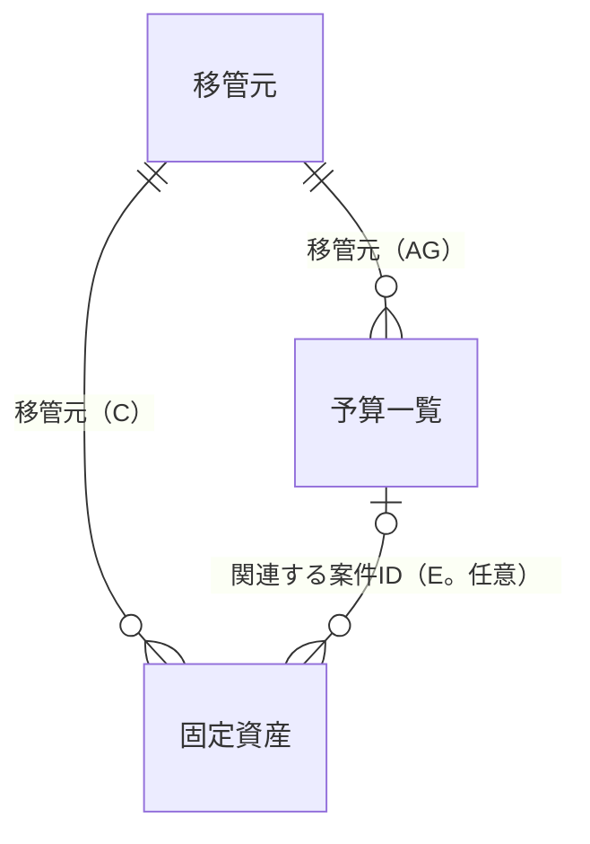

# 予算移管シート 仕様（budget_transfer_sheet.xlsx）

予算移管シートのシート構成、データモデル、自動判定のしくみを定める。シートの列や数式を変えるときは、先にこの仕様を直す。

- 判定の基準そのもの（何を移管するか、移管の時期、ステータスの条件、固定資産の扱い）は [憲章](../rules/02-charter.docx) 第8条〜第10条・第12条を正とする。この仕様は、それをシートでどう実現しているかを書く。
- シートを使う手順は [Runbook S&G編](../process/08-runbook-01-transfer-lead.md) と [Runbook 担当BP編](../process/08-runbook-04-case-owner.md) に書く。

改定：2026-11-07

---

## 1. シートの構成

| シート | 1行の単位 | 役割 | 主な記入者 |
|---|---|---|---|
| 予算一覧 | 案件 | 移管元の予算（予算シート）に、移管元・行の由来・担当BP・予算区分・システム関連・移管判定（自動）・ステータス・完了目処などを足したもの | S&G（登録・担当BP の割当て）、担当BP（判定の入力・ステータス・完了目処） |
| 移管元 | 移管元（ファンクション） | 移管元の責任者・カウンターパート、案件数と移管対象の予算（自動）、既存資産を移さないことの確認日、稟議の申請単位・申請日・承認日 | S&G（責任者・カウンターパート・申請単位・稟議の日付）、担当BP（既存資産の確認日） |
| 固定資産 | 資産の案件 | 取得予定・将来取得・既存資産の改修の案件と、FinanceBP への連絡、財務経理との確認 | 担当BP（案件の特定と連絡）、S&G（財務経理との確認） |
| モニタリング | — | ステータス別・移管判定別・完了目処・移管元別・固定資産の区分別に集計する（全て数式） | —（自動） |
| 選択肢 | — | ドロップダウンの選択肢と定義 | S&G |

- 2026-10-17 版までの「進捗」「タスク一覧」「窓口」「紐付け」「システム」「業務」「契約」「判定表」シートは廃止した。タスクの進み具合は予算一覧のステータスで、移管元の情報は「移管元」シートで扱う。
- 黄色のセルは入力、灰色のセルは数式（編集しない）。記入例の行は削除してから使う。

---

## 2. データモデル

- 予算一覧の1行は、移管元の予算の1行に当たる。投資予算と経費予算が混在する案件は行を分ける（憲章 第8条第2項）。
- 移管の対象ではない行は消さず、ステータスを「対象外」にする。予算にない移管対象は行を追記し、行の由来を「追記」にする（憲章 第8条第6項）。
- 固定資産は、設備投資の予算（予算一覧では対象外）とは別に、取得予定・将来取得・既存資産の改修の案件を1行ずつ持つ。既存資産と長期前払費用は移さないので行を作らない。

---

## 3. 判定のしくみ

### 3.1 予算一覧の列

| 列 | 項目 | 記入者 | 内容 |
|---|---|---|---|
| A〜F | 案件ID・案件名・案件概要・担当者・コストセンター・勘定科目 | S&G | 移管元の予算のとおり |
| G〜S | 今年度実績（見込み含む）1月〜12月・年額（S は自動） | S&G | 会計期間は1月開始 |
| T〜AF | 来年度予算 1月〜12月・年額（AF は自動） | S&G | |
| AG | 移管元（ファンクション） | S&G | 「移管元」シートから選ぶ |
| AH | 行の由来 | S&G・担当BP | 元の予算／追記 |
| AI | 担当BP | S&G | 普段からファンクションの窓口を務める GDS のメンバー |
| AJ | 予算区分 | 担当BP | 経費予算／投資予算 |
| AK | システム関連 | 担当BP | はい／いいえ／未確認 |
| AL | 移管判定（自動） | — | §3.2 |
| AM | ステータス | 担当BP | §3.3 |
| AN | ステータス更新日 | 担当BP | |
| AO | 完了目処（11月末に報告） | 担当BP | 12月第1週に完了／間に合わない |
| AP | 引継ぎの開始時期 | 担当BP | カウンターパートと協議した時期 |
| AQ | 年内の発注 | 担当BP | 要／不要。要のときは移管を待たずに可能な範囲で始める |
| AR | 移管元のコメント（懸念・条件） | 担当BP | |
| AS | 備考 | 担当BP | 要協議のときは理由と見込みを書く |
| AT | 確認（自動） | — | §3.4 |

### 3.2 移管判定（AL）

| 条件（上から順に判定） | 移管判定 |
|---|---|
| 案件ID が空 | （空） |
| システム関連が「いいえ」 | 対象外 |
| 予算区分が空、またはシステム関連が空・「未確認」 | 判定保留 |
| 予算区分が「経費予算」 | 移管 |
| 予算区分が「投資予算」（設備投資） | 対象外 |

- 外部性・共通性・契約期間は判定に使わない（憲章 第8条第5項）。
- 判定は手で上書きしない。判定を変えるときは、入力（AJ・AK）を直す。

### 3.3 ステータス（AM）

憲章 第10条の6つ（未着手・確認中・合意済み・引継ぎ開始・要協議・対象外）から選ぶ。担当BP（経費予算）の12月末の完了の定義を満たすのは「引継ぎ開始」である。

### 3.4 確認（AT）

ステータスと移管判定の食い違いを表示する。空でない案件は、担当BP がステータスか入力を見直す（S&G も随時確かめる）。

| 表示 | 条件 |
|---|---|
| ステータス未設定 | ステータスが空 |
| 判定は対象外 | 移管判定が対象外なのに、ステータスが対象外でない |
| 判定は移管 | 移管判定が移管なのに、ステータスが対象外 |
| 判定保留が残っている | 移管判定が判定保留なのに、ステータスが合意済み・引継ぎ開始 |
| 要協議の理由が未記入 | ステータスが要協議で、備考が空 |

### 3.5 移管元シート

| 列 | 項目 | 記入者・内容 |
|---|---|---|
| A〜D | 移管元・移管元の責任者・カウンターパート・連絡先 | S&G |
| E〜I | 案件数・移管の案件数・移管対象の来年度予算・引継ぎ開始・要協議 | 自動（予算一覧から集計） |
| J | 既存資産を移さないことの確認日 | 担当BP（担当BP（固定資産）の完了の定義 ②） |
| K〜M | 申請単位・稟議の申請日・稟議の承認日 | S&G |
| N | 備考 | |

### 3.6 固定資産シート

| 列 | 項目 | 記入者・内容 |
|---|---|---|
| A〜C | 資産案件ID・案件名・移管元 | 担当BP |
| D | 区分 | 取得予定／将来取得／既存資産の改修 |
| E | 関連する案件ID | 予算一覧の案件ID（あれば） |
| F〜H | 担当BP・状況・本勘定への振替予定（年月） | 担当BP |
| I | FinanceBP に伝えた日 | 担当BP |
| J | 財務経理との確認 | S&G（未確認／確認済み／個別に協議） |
| K | 固定資産管理・償却費（自動） | 区分から、取得予定＝振替の時点から GDS（仮勘定は移管元）、将来取得＝仮勘定の時点から GDS、既存資産の改修＝改修分は GDS（本体は移管元）を表示する（憲章 第12条） |
| L | 備考 | 本体ごと移すかを個別に決める場合などに書く |

### 3.7 モニタリング

| 表 | 集計 |
|---|---|
| 1. ステータス別 | ステータスごとの案件数と来年度予算（年額） |
| 2. 移管判定別 | 移管・対象外・判定保留の案件数と来年度予算 |
| 3. 完了目処 | 移管の案件の、12月第1週に完了・間に合わない・未報告の件数 |
| 4. 移管元別 | 移管元ごとの案件数、移管、ステータス別、判定保留、既存資産の確認 |
| 5. 固定資産 | 区分ごとの案件数、FinanceBP に未連絡、財務経理と確認済み |

---

## 改訂履歴

| 版 | 日付 | 改訂内容 |
|---|---|---|
| 2.0 | 2026-11-07 | 追補「IT予算移管の要点」（2026-11-02）に合わせてシートを作り直した。予算一覧・移管元・固定資産・モニタリング・選択肢の5シートにし、進捗・タスク一覧・窓口・紐付け・システム・業務・契約・判定表を廃止した。移管判定を経費予算＝移管、投資予算（設備投資）＝対象外に改め、経過措置の列をなくした。ステータスを6つ（未着手・確認中・合意済み・引継ぎ開始・要協議・対象外）にし、行の由来・完了目処・引継ぎの開始時期・年内の発注の列を足した |
| 1.12 | 2026-10-17 | IT予算移管ガイドラインに合わせ、進行役を事務局、案件担当を窓口担当に改めた（シートの列名・選択肢も同じ） |
| 1.11 | 2026-10-12 | 個別移管と保留をなくした。予算一覧の AO を「経過措置（自動）」に、業務シートの S・T 列を経過措置の完了予定と手続きの内容に改め、W 列と契約シートの P・Q 列、予算一覧の AX・BA 列を使わないことにした。確認（自動）・選択肢・モニタリング・タスク一覧から保留と個別移管を外した |
| 1.10 | 2026-10-11 | 移管ステータスから移管済み・安定稼働を外した（§3.4、モニタリング、選択肢）。タスク一覧から C-09・A-07 を外した |
| 1.9 | 2026-10-11 | 複数の案件から払う契約の枝番、経費予算の案件の間接業務の行、新規の投資案件の記入範囲を §2 に加えた |
| 1.8 | 2026-10-11 | 業務シートに「変更管理の完了予定」（W）を足した（§3.2）。確認（自動）の「判定保留なし」を、棚卸しの結果の承認を廃止したことに合わせて改めた（§3.4）。個別移管の対象を、GxPの変更管理を起票できないものに限った（§3.5） |
| 1.7 | 2026-10-11 | 業務シートに案件ID（U）・案件名（自動、V）を足し、業務を案件×システムの単位にした。予算一覧の AT・AU・AW と業務移管判定を、案件IDで数えるように改めた |
| 1.6 | 2026-10-11 | 移管ステータスに「保留」を足した（AP・AR・モニタリング）。移管時期（AO）の「一部個別」を「個別」（案件全体を保留）に改め、BA を「保留の案件の来年度予算（自動）」にした。個別移管の理由を GxP の変更管理に限った。紐付け・システム・契約の記入者を案件担当にそろえ、Runbook の参照先を直した |
| 1.5 | 2026-10-11 | 予算移管担当を進行役と案件担当に分けたことに合わせ、記入者・タスク一覧（P-・C-。V-・J- は廃止）・モニタリングの役割を改めた。予算一覧に案件担当・投資の区分・個別移管分の来年度予算（AY〜BA）を足し、継続している投資案件を対象外にした（AL・AM、契約の判定）。財務部門の役割を移管の稟議（部門長同士）に改めた |
| 1.0 | 2026-10-11 | 旧手順書（2026-10-11版）の「シートの構成」「判定のしくみ」を移し、予算一覧・モニタリング・窓口シートの追加に合わせて改めた |
| 1.4 | 2026-10-11 | Runbook を役割別の3ファイル（予算移管担当編・ベンダーマネジメント担当編・事務担当編）にしたことに合わせ、参照先を改めた |
| 1.3 | 2026-10-11 | 実務を予算移管事務局の3名に、承認を承認者に分けたことに合わせ、タスク一覧・窓口・記入者を改めた |
| 1.2 | 2026-10-11 | 「進捗」「タスク一覧」シートを足し、モニタリングに役割別の集計を足した（Runbook の役割別の章に合わせた） |
| 1.1 | 2026-10-11 | 直接業務と間接業務を分け、間接業務だけを移管するようにした。業務シートに「業務区分（自動）」を足し、現場の関わり方「自ら運用・開発」と移管の方法「要員ごと移管」を削除した |
