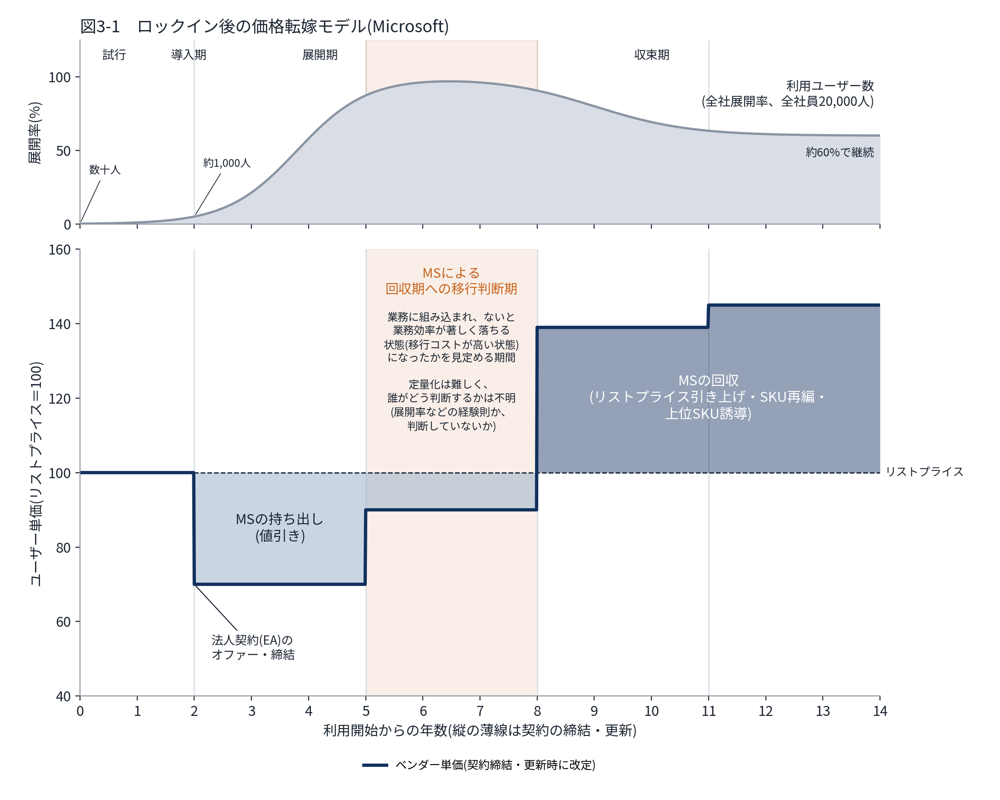
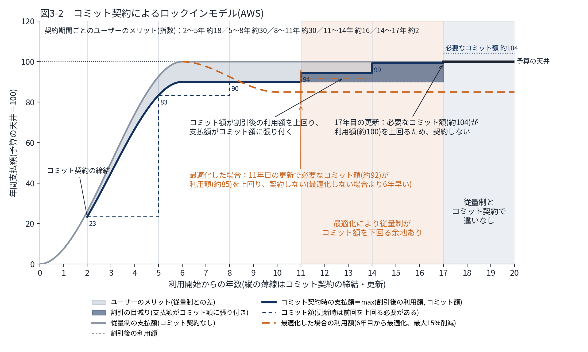

# 3. 一巡した後の課題：ベンダーのロックイン戦略への対応

> **この章の位置づけ**：標準的なFinOps／ベンダーマネジメントの打ち手を実行し切った後に残る、メガベンダーの「先行投資と回収」の構造を、Microsoft・AWSそれぞれのモデルで示し、対応を整理する中核章。
> **対象読者**：経営層／ベンダーマネジメント担当

## 要旨

ライセンス棚卸し・利用率精査・ツール統合・タギング/チャージバックといった標準的な打ち手を一通り実行すると、残るのはベンダーの収益構造に組み込まれたコストである。MicrosoftもAWSも、初期に値引きで利用を広げ(先行投資)、後で回収するという構造は共通しているが、回収の手段が異なる。Microsoftは、ユーザーが業務上手放せなくなったと見込まれる時点のあとの更新で、単価をリストプライス以上に引き上げる。AWSは、更新時に前回を上回るコミット額を求めることで、売上の下限と伸びを契約で確定させる。予算の天井で利用が頭打ちになると、支払額はコミット額に張り付き、割引は目減りしていく。いずれの場合も、対応の要は、各契約が先行投資と回収のどの局面にあるかを把握し、更新のたびに「契約を続ける意味」を自社の基準で判断することにある。

## 3.1 Microsoftのケース：業務への依存を待ってからの価格転嫁

### 構造

Microsoftの戦略は典型的な「land and expand」である。ユーザー数を確保する段階では魅力的な単価を提示し、業務プロセス・データ・ワークフローが深く組み込まれた段階で、基本ライセンス単価の引き上げやSKU再編(機能のバンドル・アンバンドル)によって実質的な値上げを行う。セキュリティ強化ニーズが高まっているタイミングでのE5への誘導(セキュリティ機能をE5にバンドルし、単体製品ではなくアップグレードという形での支出増を選ばせる)や、Copilotのような新規必須SKUの追加によって、複数の予算増加要因を同時に一つのベンダーへ収斂させてくるのも、この戦略の一部である。

この構造を図3-1に示す。利用開始時は法人契約がなく、リストプライスで個別に購入する(従量期)。利用が広がった2年目にベンダーから法人契約(EA)のオファーがあり、値引きされた単価で締結する。以後は3年ごとに更新する。利用ユーザー数は、試行(数十人)から導入期(100〜1,000人)を経て一気に全社員へ展開され、その後は代替製品の登場や利用方法の細分化によって約60％に収束する。

ベンダーは導入期・拡張期にはリストプライスを下回る単価で利用を広げる(MSの持ち出し)。業務に深く組み込まれ、ユーザーが「ないと業務効率が著しく落ちる」と感じる状態になると、値上げされても手放せなくなる。ここでいう移行コストは別製品への乗り換え費用ではなく、この業務上の依存の度合いである。図3-1では、5年目から8年目(2回目の契約期間)を**MSによる回収期への移行判断期**として薄いオレンジで示している。ベンダーはこの期間に、ユーザーがその状態になったかを見定め、次の更新から単価をリストプライスを上回る水準に引き上げて先行投資を回収する(MSの回収)。この時点は定量化が非常に難しく、ベンダー側で誰がどのように見定めているかは分からない。全社員数に対するアカウント数の割合などを経験則として使っている可能性もあるし、特に何も判断していない可能性もある。

*図3-1　ロックイン後の価格転嫁モデル(Microsoft)*

| 要素 | 定義 | 図の設定値 |
|---|---|---|
| 利用ユーザー数 N(t) | N(t) = L(t) ×(1 − 0.4 D(t))。L(t) = 1 ／ (1 + e^(−a_N(t − t_N)))は試行(数十人)→導入期(100〜1,000人)→展開期(全社員)、D(t) = 1 ／ (1 + e^(−a_D(t − t_D)))は代替製品の登場や利用方法の細分化による収束で、収束後は約60％で継続する | 全社員2万人、a_N＝1.63、t_N＝3.8年、a_D＝1.2、t_D＝9年 |
| ベンダー単価 | 従量期はリストプライス。2年目の法人契約で値引き、5年目の更新で値引き縮小、8年目・11年目の更新でリストプライスを上回る水準へ引き上げ | 100 → 70 → 90 → 139 → 145 |
| MSの持ち出し | リストプライスを下回る値引き部分 | ― |
| 回収期への移行判断期 | 2回目の契約期間。ユーザーが業務上手放せない状態になったかを、ベンダーが見定める期間 | 5〜8年目 |
| MSの回収 | リストプライスを上回る部分 | ― |

単価はリストプライスを100とした指数で、数値は構造を示すための仮定値である。図は `src/lock_in_models.py` で生成している。

### 図から読み取れること

- **導入期・拡張期の値引きは、回収を前提とした先行投資である。** 単価だけを見ると割安な期間だが、MSにとっては後で取り戻す前提の持ち出しである。
- **回収を始める時期を決めるのはMSであり、その判断材料はユーザー側の業務依存である。** 移行判断期(5〜8年目)のうちに、依存が一方的に深まらない状態をつくれるかどうかが、回収期の単価を左右する。
- **利用が収束しても単価は下がらない。** 図の上段と下段を重ねると、展開率が約60％に下がる収束期と、単価が最も高い回収期が重なっている。使う人が減った後も、高い単価のライセンスを持ち続ける状態になりやすい。

### 対応

- **局面を把握する。** 契約更新のたびに、現在の契約が持ち出し期・移行判断期・回収期のどこにあるかを確認する。目安として、展開率や業務への組み込みの度合いを自社でも把握しておく。
- **移行判断期のうちに依存を分散する。** 全ユーザーへの一律E3/E5ではなく、利用実態に基づいてF3/E3/E5を混在させる「セグメント化されたライセンス構成」を前提に更新交渉に臨む。Copilotの調達はEA更新のタイミングから切り離す(同じタイミングで交渉すると、Copilotを「今この条件でしか出せない」という形で本体契約の値上げ許容とバーターにされやすい)。
- **信頼できる代替選択肢を持つ。** Google Workspaceや代替セキュリティスタックの評価(RFP水準の情報収集)を並行して進める。実際に切り替えるかどうかは別として、代替案を本気で検討していること自体が交渉力になる。
- **回収期の値上げに備えた条件を、移行判断期の更新で入れる。** 複数年契約を受け入れる場合は、list price連動の自動値上げではなく、CPI連動や上限％を明記したプライスキャップ条項を必須要件とする。回収期に入ってからでは、ベンダーに受け入れる理由がない。
- **収束期にはライセンス数を見直す。** 展開率が下がった分のライセンスを更新時に減らす。EAの年次true-upは増加分のみを反映するため、減らす機会は更新時に限られる(付録A.2)。
- **交渉のタイミングと材料を整える。** 更新のクロージングをMicrosoftの会計年度末(6月)に合わせ、四半期ごとの利用実態モニタリングで、次の更新で削れる箇所のデータを常に持っておく。

## 3.2 AWSのケース：コミット額の下方硬直による売上の確定

### 構造

AWSのコミット契約(EDP／PPAのような枠組み)は、一定期間の支出額をコミットする代わりに割引を得る仕組みである。AWSから見ると、割引を対価に3つのものを手に入れる。利用が減ってもコミット額までは支払われる**売上の下限**、更新時に前回を上回るコミット額を求めることによる**売上の伸び**、そしてワークロードを他社クラウドへ移しても支払いが減らないことによる**移管の抑止**である。

この構造を図3-2に示す。金額はユーザーの予算の天井を100とした指数である。

- **従量制(コミット契約なし)**：支払額は三次曲線(S字)で増えるが、予算の天井があるため6年目に天井に達し、その後は天井に張り付く。
- **コミット契約**：2年目から3年ごとにコミット契約を結ぶと、支払額は割引率(図では10％)の分だけ下がる。同時に、コミット額が支払額の下限になる。
- **コミット額の更新**：更新時のコミット額は前回を上回らなければ締結できない(実務上の聞き取りによる。図では前回比＋5％を下限とした)。このため、下限は23 → 83 → 90 → 94 → 99と階段状に上がる。

従量制の支払額とコミット契約時の支払額の差の面積が、ユーザーにとってのメリットである。利用額が予算の天井で頭打ちになっている一方で、コミット額は更新のたびに上がる。このため、**11年目の更新以降はコミット額が割引後の利用額を上回り、支払額がコミット額に張り付く**。割引の一部はコミット額との差で打ち消され(割引の目減り)、メリットは契約期間ごとに約18 → 約30 → 約30 → 約16 → 約2と、利用が伸びている間は大きく、天井に達したあとは縮んでいく。17年目の更新では、必要なコミット額(約104)が実際の利用額(約100)を上回り、これ以降はコミット契約を結んでも支払額は従量制と変わらない。

図3-2のオレンジの破線は、予算の天井に達した6年目から最適化を始めた場合の利用額である。最適化は小さな施策から始まり、2〜3年目に大きく効いて、4年で利用額を約15％下げ、その後は横ばいになる。コミット額は前回を上回る必要があるため、利用額が下がっても下げられない。その結果、11年目の更新で必要なコミット額(約92)が利用額(約85)を上回る。11年目から17年目は、最適化によって従量制の支払額がコミット額を下回る余地がある期間であり、最適化しない場合(17年目)より**6年早く**コミット契約を見直す判断が必要になる。

*図3-2　コミット契約によるロックインモデル(AWS)*

| 要素 | 定義 | 図の設定値 |
|---|---|---|
| 従量制の支払額 U(t) | U(t) = 100 (3x² − 2x³)、x = min(t／T, 1)。三次曲線で増え、T年目に予算の天井(100)に達して張り付く | T＝6年 |
| 割引後の利用額 V(t) | V(t) = U(t) ×(1 − 割引率) | 割引率＝10％ |
| 必要なコミット額(下限) | 2年目に締結時点の V で初回コミット。以後3年ごとに max(前回 ×(1 ＋ 上乗せ幅), V(更新時点)) | 上乗せ幅＝5％、23 → 83 → 90 → 94 → 99 → (104) |
| 契約するかどうか | 更新時に、必要なコミット額 ＜ 従量制の支払額 U(更新時点) なら契約する。そうでなければ契約せず従量制に戻る | 17年目の更新で必要なコミット額 約104 ＞ 約100 → 契約しない |
| コミット契約時の支払額 | 契約期間中は max(コミット額, V(t))、契約しない期間は U(t) | ― |
| ユーザーのメリット | 契約後の ∫(U(t) − 支払額)dt | ― |
| 最適化ケース | 6年目から最適化を始めた場合の利用額 Uo(t) = U(t) ×(1 − R(t))、R(t) = R_max (3y² − 2y³)、y = min((t − 6)／T_opt, 1)。コミット額・契約判断・支払額は U を Uo に置き換えて同じ規則で計算する | R_max＝15％、T_opt＝4年 → 11年目の更新で契約しない |

図3-2は図3-1と異なり20年間を描いている。数値は構造を示すための仮定値である。とくに、コミット額の上乗せ幅によって、張り付きが始まる時期と従量制に戻る時期は大きく変わる。

### 図から読み取れること

- **コミット契約のメリットは、利用が伸びている間に大きい。** 予算の天井に達した後は、前回を上回るコミット額が割引を少しずつ打ち消していく。
- **利用を減らしても、次回のコミット額は下がらない。** 下がるのは支払額ではなく、コミット契約を続ける意味のほうである。初回のコミット額は、以後のすべての更新の出発点になる。
- **最適化は、コミット契約が役目を終える時期を早める。** 最適化の効果そのものは従量制に戻ればユーザーに残るが、コミット契約を続けている間は、割引の目減りとして打ち消される。最適化の計画とコミットの更新判断は切り離せない。

### 対応

- **更新ごとに「契約を続ける意味」を判定する。** 必要なコミット額と、最適化計画を織り込んだ次の契約期間の利用予測を比べる。張り付きが見込まれる場合は、契約期間の短縮、コミット対象の縮小、従量制への切り替えを検討する。
- **初回コミットを過大にしない。** 締結前に3〜6か月程度のFinOps／アーキテクチャ監査を行い、サーバーレス化・右サイジング・ストレージ階層化などで実現可能な削減額を見積もったうえで、初回のコミット額を決める。
- **上乗せ幅と柔軟性を交渉する。** 更新時に前回を上回る幅、利用が減った場合の減額・繰越の条件、サーバーレスやマネージドサービスへの移行分もコミット消化に充当できる「サービス横断的な消化の柔軟性」を契約条件に組み込む。
- **ワークロードを切り分ける。** 全ワークロードを一括でコミットの対象にせず、「安定的で最適化余地の小さいワークロード」と「今後アーキテクチャ改革を予定しているワークロード」を分け、後者はオンデマンドまたは短期契約のまま残す。
- **最適化計画とコミット判断を一体で行う。** 契約交渉をベンダーマネジメント／調達だけの仕事にせず、最適化の計画を持つエンジニアリング部門と共同で、コミットの更新を判断する体制にする。
- **情報の非対称性を補う。** 他社のEDP/PPA条件のベンチマークを持つ第三者アドバイザリーを一時的に起用する。AI関連のような新規ワークロードについては、Azure/GCPとの比較評価を並行して行う。

## この章の結論

- 標準的な打ち手を一巡した後に残るのは、ベンダーが先行投資を回収する構造に組み込まれたコストである。MicrosoftとAWSはこの構造を共通に持つが、回収の手段が異なる。
- Microsoftは、ユーザーが業務上手放せなくなったと見込まれる時点のあとの更新で、単価をリストプライス以上に引き上げて回収する。その判断の基準と時期は外からは分からないため、移行判断期のうちにライセンスのセグメント化、Copilot調達の分離、代替選択肢の保持、プライスキャップ条項で依存と値上げ余地を抑えておく必要がある。
- AWSは、更新時に前回を上回るコミット額を求めることで、売上の下限と伸びを確定させる。利用が予算の天井で頭打ちになると支払額はコミット額に張り付き、最適化はその時期を早める。初回コミットを過大にせず、更新ごとに最適化計画を織り込んだ利用予測と必要なコミット額を比べて、契約を続けるかを判断する必要がある。
- 両社に共通する対応の要は、各契約が先行投資と回収のどの局面にあるかを把握し、更新のたびに「契約を続ける意味」を自社の基準で判断することである。

---

**参照**：第2章(全体方針)、第4章(Azureへの適用)、第5章(ビジネスアプリケーション領域)、付録A(AWS・Microsoftの契約体系)
