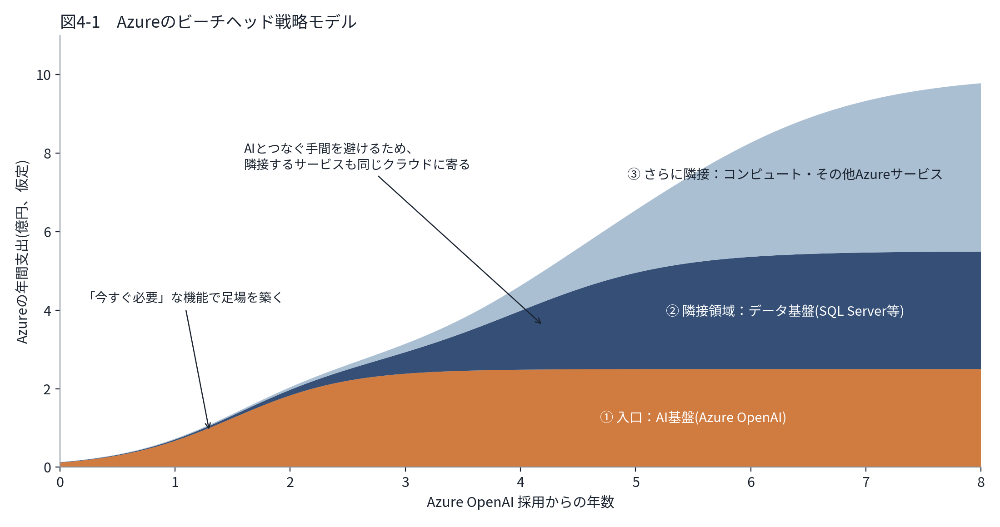
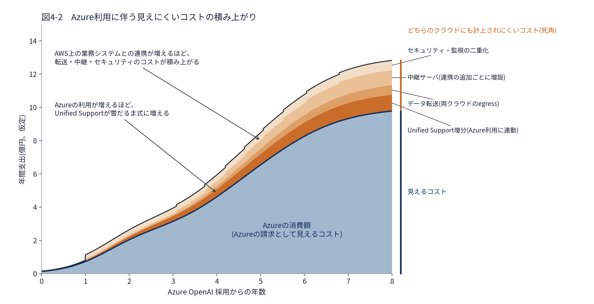

# 4. Azureの伸長とビーチヘッド戦略

> **この章の位置づけ**：第3章に続き、Azureが「ビーチヘッド戦略」で伸長している構造と、それに伴うリスクを分析する(管掌外のため分析の視点の提供にとどめる)。
> **対象読者**：経営層／IT部門／ベンダーマネジメント担当

## 要旨

クラウド戦略の初期段階でAWSをエンタープライズクラウドとして選択した一方、生成AIブームの中でAzure OpenAIを早期採用したため、AI基盤はAzure・データ基盤はMicrosoftという構成になっている。AWS(年間6億円)に対しAzure(2億円)は絶対額こそ小さいが伸長率は右肩上がりであり、AIを入口にインフラ全体のシェアを広げる「ビーチヘッド戦略」の典型として進行している。重要なのは、AWSやMicrosoftライセンスのように既にロックインが完成した後の防戦とは異なり、Azureはまだ「先手を打てる」数少ない局面にあるという点である。

## 4.1 二つの拡大戦略：land and expand とビーチヘッド

ベンダーが一つの顧客の中で利用を広げる戦略には、代表的なものが二つある。第3章で扱ったMicrosoftライセンスは **land and expand**、本章で扱うAzureは **ビーチヘッド戦略** にあたる。

**land and expand**　少数のユーザーや一部の部門で製品を導入し(land)、その同じ製品の利用者数・席数・上位エディションを広げていく(expand)戦略である。サブスクリプション型のソフトウェアで典型的に見られ、利用が広がった後の値上げやSKU再編によって先行投資を回収する(第3.1章)。

**ビーチヘッド戦略**　「ビーチヘッド(beachhead)」は軍事用語で、上陸作戦でまず確保する海岸の拠点(橋頭堡)を指す。ビジネスでは、ジェフリー・ムーアが『キャズム(Crossing the Chasm)』(1991年)で、強いニーズを持つ狭い市場をまず押さえ、そこから隣接市場へ順に広げる考え方として用いた。本資料ではこれを一つの顧客の中に当てはめ、「今すぐ必要」な製品を入口に足場を築き、そこから隣接する製品分野へ利用を広げていく戦略として扱う。なお、Azureがこの戦略をとっているというのは本資料としての解釈であり、Microsoftが公表しているものではない。

| 観点 | land and expand | ビーチヘッド戦略 |
|---|---|---|
| 起点 | 少数ユーザー・一部部門での導入 | 「今すぐ必要」な入口の製品(他と比較されにくい機能) |
| 広がる方向 | 同じ製品の利用者数・席数・上位エディション | 入口の製品から、隣接する製品分野 |
| 広がる理由 | 全社標準化、業務への組み込み | 入口の製品と連携させる手間を避けるため、隣接サービスも同じベンダーに寄せる |
| ロックインの源泉 | 業務への依存(ないと業務効率が著しく落ちる) | 製品間の連携とデータの集積(データには重力がある) |
| 回収の手段 | 値上げ・SKU再編・上位SKU誘導 | 利用領域の拡大そのもの。支出の大半が入口以外の領域になる |
| 見落としやすい点 | 回収期への移行時期をベンダーが決める | 入口だけを見て判断すると、隣接領域の採用が個別判断で積み上がる |
| 本資料での例 | Microsoftライセンス(M365・E3/E5、第3.1章) | Azure(Azure OpenAI → データ基盤 → コンピュート) |

ビーチヘッド戦略の構造を図4-1に示す。Azure OpenAIを採用した時点を起点に、Azureの年間支出を領域別に積み上げている。入口のAI基盤が先に立ち上がり、AIとつなぐ手間を避けるため、データ基盤、コンピュート・その他のAzureサービスが遅れて同じクラウドに寄っていく。図の仮定では、8年目にはAI基盤はAzure支出の約4分の1にとどまり、入口はAIでも支出の大部分はAI以外の領域が占めるようになる。

*図4-1　Azureのビーチヘッド戦略モデル*

| 要素 | 定義 | 図の設定値 |
|---|---|---|
| ① AI基盤(Azure OpenAI) | 上限 ÷ (1 + e^(−k(t − 中間点)))。入口として最初に立ち上がる | 上限2.5億円、k＝2.0、中間点1.5年 |
| ② データ基盤(SQL Server等) | 同じ形で、AI基盤より遅れて立ち上がる | 上限3.0億円、k＝1.5、中間点4.0年 |
| ③ コンピュート・その他Azureサービス | 同じ形で、さらに遅れて立ち上がる | 上限4.5億円、k＝1.2、中間点5.5年 |

金額はAzureの年間支出(億円)で、数値は構造を示すための仮定値である。図は `src/azure_beachhead_model.py` で生成している。

## 4.2 状況整理

クラウド戦略の初期段階(Shift & Lift)においてAWSをエンタープライズクラウドとして選択したため、ビジネスシステム関連のサーバー群の大半はAWS上にあり、SaaSとの組み合わせおよびデータ中継サーバによる連携が行われている。一方、生成AIブームの中でAzure OpenAIを早期に採用したため、AI基盤はAzure、データ基盤はSQL Server等Microsoftのデータベースサービスという構成になっている。AWSが年間6億円、Azureが2億円という現状の絶対額に対し、Azureの伸長率は右肩上がりであり、新規システム構築においてAI機能が必須となるケースが増えているため、AI基盤としてだけでなくAzureの他サービスが採用されるケースも増加している。Azureについては、Microsoft Unified Supportは既に適用済みであり、Microsoftおよび代理店との交渉を開始している段階である。

## 4.3 リスクの構造

Azureの拡大は、AI(Azure OpenAI)という「今すぐ必要不可欠な機能」を入口に、インフラ全体のシェアを静かに広げる「ビーチヘッド戦略」の典型である。特定の強い必要性を持つ入口でまず接点を作り、そこから隣接領域(データ基盤、コンピュート、その他Azureサービス)へと利用範囲を拡張していく構図であり、この拡張が意図的なマルチクラウド戦略の結果ではなく、「新規システム構築にAI機能が必須になったので、統合の手間を避けるためAzureに寄せる」という現場レベルの積み上げの結果として起きている点が重要である。経営が意思決定していないうちに、実質的なクラウド配置戦略が現場の個別判断の集積によって決まってしまう状態であり、数年後に「気づいたらAzureが主インフラになっていた」という事態になりかねない。

- 成長率の差を踏まえると、AWS(6億円)とAzure(2億円)という現状の絶対額は数年で逆転、あるいは大きく縮小する可能性がある。
- Azure OpenAIとSQL Server／Microsoftデータベース群という組み合わせは、AI基盤とデータ基盤が一体化しているという意味でAWSのコンピュートロックインよりも強力なロックインを生む。データには重力があり、一度Azureネイティブのデータベース・AIパイプラインに大量のデータと連携ロジックが組み込まれると、後から動かすコストはコンピュートの移行より格段に高くなる。
- AWS上のビジネスシステム群とAzure／SaaSとの間のデータ中継サーバによる連携は、クロスクラウドの連携アーキテクチャ自体がコストとして積み上がる、どちらのクラウドコストにも明示的に計上されない死角になりやすい。
- Microsoft Unified Supportは通常、Microsoft全体の消費額(M365、Copilot、Azure、Dynamicsなど)の合計に連動する料金体系であるため、Azureの利用が増えるほど、単体では意識しづらい形でMicrosoft全体との関係性が強化されるという副次的なロックイン効果を持つ。

後半の2点を、時間の経過とともに図4-2に示す。Azureの消費額(図4-1と同じ)の上に、Azureの利用に伴って生じるが、Azureのコストとしては計上されにくい費用を積み上げている。

- **Unified Supportの増分**：Unified SupportはMicrosoft全体の支出額に連動し、Azure/Dynamics系の料率はOffice系より高い(付録A.2)。Azureの利用が増えるほど、サポート費用も雪だるま式に増える。この増分はサポート契約の費用として請求されるため、Azureのコストとしては認識されにくい。
- **クロスクラウド連携のコスト**：AWS上の業務システムとAzureを連携させる構成は、目的をもって複数のクラウドを使い分けるマルチクラウドではなく、二つのクラウドをまたいで一つの業務を動かすクロスクラウドである。両クラウドで発生するデータ転送料(egress)、連携のたびに増設される中継サーバ、IDやネットワーク、監視などのセキュリティ対応の二重化が積み上がる。これらはAWS・Azureどちらのクラウドコストにも明示的に計上されにくい。

図の仮定では、8年目に見えにくいコストはAzureの消費額の約3割に達する。

*図4-2　Azure利用に伴う見えにくいコストの積み上がり*

| 要素 | 定義 | 図の設定値 |
|---|---|---|
| Azureの消費額 | 図4-1の①AI基盤＋②データ基盤＋③コンピュート・その他 | ― |
| Unified Support増分 | Azureの消費額 × 料率 | 料率10％(付録A.2：Azure/Dynamics系は8〜12％) |
| データ転送(両クラウドのegress) | (②データ基盤＋③コンピュート・その他の消費額) × 比率 | 8％ |
| 中継サーバ | 1系統あたりの年間費用 × 系統数。系統数は連携の進み具合に応じて1系統から最大10系統まで増える | 1系統0.1億円 |
| セキュリティ・監視の二重化 | 連携開始(1年目)以降、固定費 ＋ Azureの消費額 × 比率 | 固定費0.2億円、比率4％ |

金額は年間支出(億円)で、数値は構造を示すための仮定値である。図は `src/azure_hidden_cost_model.py` で生成している。

## 4.4 対応の方向性：今が交渉力の強いタイミング

重要なのは、Azureについてはまだ初期のコスト交渉の段階にあるという点である。AWSやMicrosoftライセンスのように、既に大規模なロックインが完成した後に防戦を強いられている状況とは異なり、数少ない「先手を打てる」局面にある。Azureのシェア拡大(特にAI経由でのインフラ全体の奪取)はMicrosoftにとって全社的な最重要戦略の一つであり、Azureの伸長が始まったばかりの今の段階こそ、Microsoft側がボリュームを取りに来る動機が強く、自社側の交渉レバレッジも相対的に高い。この機を逃し、AWSのケースのように「気づいたら成長後の水準が既成事実化していた」という状態になってから交渉に入ると、同じ轍を踏むことになる。

- AI機能の必要性(Azure OpenAI採用)と、コンピュート・データ基盤としてのAzure採用を意思決定として明確に分離する。現場判断を暗黙のデフォルトにせず、アーキテクチャレビューの場で都度明示的に評価するガバナンスを導入する。
- AWSのケース(第3.2章)の教訓をAzureにも適用する。コミット額は更新時に前回を下回れず、利用が頭打ちになったり減ったりしても下げられない。AI関連の利用パターンはまだ発展途上で、モデルコストの低下や代替手段の進展によって数年内に大きく変わる可能性が高い。この不安定な段階の消費実績を基準に長期コミットを結ぶと、利用が変化したときにコミット額だけが残るリスクがある。
- Azure OpenAI(AI消費)の契約と、Azureのその他インフラサービス(コンピュート・データベース等)の契約を交渉上意図的に分離する。AIを入口にインフラ全体のバンドル拡大を図ってくる可能性を踏まえ、AIは使うがそれ以外のインフラ選定は独立して評価するという立場を交渉の前提とする。
- Unified Supportを含め、M365ライセンス・Copilot・Azureという複数のMicrosoft関連契約を社内で別々の担当が個別に交渉するのではなく、Microsoftとの関係全体を一元的に見る体制に統合する。
- データ基盤について、Azure専用機能への依存度が高まる前に、可能な範囲でデータの可搬性(ポータビリティ)を意識したアーキテクチャ設計指針を今のうちに定める。
- AIモデル・プラットフォームについて、Azure OpenAI一本足にせず、技術的な抽象化層(モデルゲートウェイ等)を設けることで、将来的に他プロバイダーへの切り替えや併用が可能な状態を維持する。これは即座の切り替えのためではなく、Azureとの交渉における「クレディブルな代替性」を技術面で担保するためのものである。
- クラウド予算全体における配分方針(どの領域をAWSに残し、どの領域をAzureに寄せるかという意図的な設計)を明文化し、以後の新規システム構築の判断基準とする。

## この章の結論

- Azureの伸長は、AIを入口にインフラ全体のシェアを広げる「ビーチヘッド戦略」の典型であり、現場判断の積み上げによって経営が意思決定しないままクラウド配置戦略が決まりつつある。
- Azure OpenAIとMicrosoftデータベース群の一体化は、AWSのコンピュートロックインより強固なロックインを生む構造にある。
- Azureはまだ大規模ロックインが完成する前の「先手を打てる」数少ない局面にあり、AI消費とその他インフラ契約の分離、Microsoft関連契約の一元管理、データポータビリティの確保などを今のうちに講じるべきである。

---

**参照**：第3章(AWSのケースとの比較・教訓の適用)、第5章(ビジネスアプリケーション領域)、付録C(AWS vs Azure製品比較)
