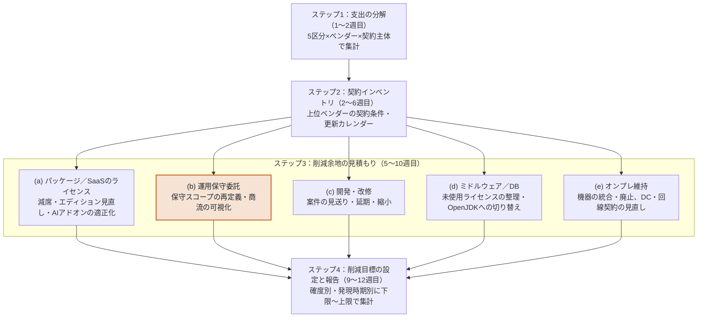

# 5. ビジネスアプリケーション領域

> **この章の位置づけ**：IT予算の約半分を占めるビジネスアプリケーション領域(管掌範囲)について、削減目標を作り報告するための作業計画を示す。
> **対象読者**：経営層／IT部門／ベンダーマネジメント担当／調達部門

## 要旨

IT予算約120億円のうち、**約50％＝約60億円がビジネスアプリケーション関連**である。この領域は管掌範囲であり、分析にとどまらず削減活動を実行し、削減目標を報告する必要がある。しかし現時点では60億円の内訳が把握できておらず、ライセンス、運用保守委託、開発・改修、ミドルウェア・DB、オンプレ維持という性質の異なる支出が一括りになっている。そこで本章では、**支出の分解 → 契約インベントリ → 区分別の削減余地の見積もり → 削減目標の設定と報告**の4ステップを約3か月で進める作業計画を示す。削減目標は施策ごとの「対象額×想定削減率」の積み上げで作り、確度別・発現時期別に下限〜上限の幅で報告する。

## 5.1 状況整理：本資料が扱ってこなかった約60億円

第1章に記載した領域別内訳を金額に換算すると、次のようになる。

| 領域 | 構成比 | 概算金額 | 本資料での扱い |
|---|---|---|---|
| クラウド・EUC | 30％ | 約36億円 | 第3章・第4章(AWS/Azure)、第2章(M365ライセンス) |
| セキュリティ | 10％ | 約12億円 | 第2章で増加要因として言及 |
| データ・AI | 10％ | 約12億円 | 第2章(Copilot)、第4章(Azure OpenAI) |
| ビジネスアプリケーション関連 | 約50％ | **約60億円** | **本章で扱う(管掌範囲)** |

本資料の第3章から第4章が具体的な金額を挙げて論じてきたのは、AWS(年間6億円)とAzure(年間2億円)の合計8億円、すなわちIT予算総額の約7％にあたる部分である。M365ライセンス(E3で2万ユーザー規模)を加えても、詳細に論じた対象は総額の2割前後にとどまる。これは資料の欠陥というより、探索的な検討の順序として妥当な結果であるが、**この構成のまま経営層に提示すると、「予算の半分について何も検討していない」という指摘を受けたときに答えられない**。本章の第一の目的は、その空白を認識として明示し、埋めるための手順を示すことにある。

なお、地域別内訳(日本70％＝約84億円、北米20％＝約24億円、欧州10％＝約12億円)についても、契約主体が地域法人ごとに分かれているのか統合されているのかは本資料では整理できていない。契約統合によるボリュームメリットの追求は第2章で一般的な打ち手として挙げているが、その前提となる現状把握が未了である。この点は本章のRunbookのステップ1に含めている(5.4)。

## 5.2 内訳が把握できていないこと自体が第一の課題

「ビジネスアプリケーション関連」という一括りの中には、少なくとも次の5種類の、性質のまったく異なる支出が混在していると考えられる。本資料では以下、この5区分((a)〜(e))で支出を扱う。

| 区分 | 内容 | コスト構造・値上げ要因 | 潜在的な削減余地(これまで何もしてこなかった場合の目安) | 裏腹にある増加リスク |
|---|---|---|---|---|
| (a) パッケージ／SaaSのライセンス・サブスクリプション費 | ERP、CRM、HCM、ITSMなどのユーザー単位・従業員単位の継続課金 | 席数×単価。値上げは更新タイミングに集中し、ベンダー主導で発生する | **支出の10〜30％**。付与ライセンスの4〜5割が使われていないことが多いが、減席できるのは更新時に限られる場合が多い | 更新時の定価改定・年次アップリフト。AI機能のバンドルや階層再編による上位エディションへの移行。AI従量クレジットの過大購入と超過料金。通知期限を過ぎて自動更新されると、交渉の機会そのものを失う |
| (b) 既存システムの運用保守委託費 | SIerへの年間保守契約 | 人月単価×要員数 | **支出の5〜15％**(仮置き)。保守スコープの再定義と契約形態の見直し(第6章)による。単価の一律引き下げは見込まない | 技術者単価の上昇(労務費の価格転嫁は政策的に後押しされている)。システムの老朽化に伴う障害対応・延命作業の増加。特定の要員への依存が強いシステムでは、要員交代時に引き継ぎ費用が発生する |
| (c) 開発・改修プロジェクト費 | 単年度の投資的支出 | 案件ごとの見積もり。人月単価の上昇が効く | **予算の10〜20％**(仮置き)。優先度の低い案件の見送り・延期・縮小による。ただし多くは翌年度以降への先送りで、恒常的な削減ではない | 見送った案件が翌年度以降に積み上がる。法改正対応や製品の保守終了(例：SAP ECCの標準保守は2027年末で終了)による、見送れない改修が発生する |
| (d) ミドルウェア／データベースのライセンス・保守費 | Oracle Database、Java、アプリケーションサーバー等 | ライセンス＋年間保守料(Oracleはネットライセンス額の年22％)。ライセンス体系が複雑 | **支出の10〜30％**。未使用ライセンスの整理、エディション・構成の見直し、Java SEのOpenJDKへの切り替えによる | ベンダー監査によるライセンス不足の指摘と追加購入。Java SEの課金体系の変更(委託先を含む全従業員数が課金対象)。部分解約しても保守料が下がらない条項 |
| (e) オンプレ資産の維持費 | ハードウェア保守、データセンター費用、回線費用 | 機器の保守料・ラック費用・回線費用 | **支出の10〜20％**(仮置き)。保守切れ機器の統合・廃止、データセンター・回線契約の見直しによる | 保守期限を過ぎた機器の延長保守の割増。電力費・データセンター費用の上昇。機器更新時の価格上昇と為替の影響 |

削減余地はいずれも、これまで最適化を行ってこなかった場合の一般的な桁感である。削減余地と増加リスクは同じ契約・同じシステムの上で同時に起きるため、削減目標はネット(削減額−増加額)で示す必要がある(5.3)。「仮置き」とした区分は外部の根拠が弱く、ステップ3(5.4)で自社のデータにもとづいて置き換える前提の値である。

この5つは、コスト構造も交渉相手も打ち手もそれぞれ異なるため、**一括りのまま議論することができない**。したがって最初のアクションは削減施策の立案ではなく、支出の分解である。

## 5.3 削減目標を作るための作業計画

ビジネスアプリケーション領域は管掌範囲であり、分析にとどまらず、削減活動を実行し、削減目標を報告する必要がある。本節では、来年度のビジネスアプリケーション関連予算(約60億円)について、**根拠のある削減目標を報告できる状態をつくる**ための作業を4つのステップに整理する。報告の期限は予算編成の日程に合わせる(要確認)。以下では約3か月を想定している。

*図5-1　削減目標を作るための作業の流れ*

### 削減目標の考え方

削減目標は、トップダウンの一律削減率ではなく、施策ごとの見積もりの積み上げで作る。

**削減額 ＝ 対象額 × 想定削減率**(施策ごと)

施策ごとに、次の2つを付けて集計する。

- **確度**：「確定(契約条件の変更や解約が合意済み)」「見込み(交渉や棚卸しで実現が見込める)」「検討中(効果が不確実)」の3段階。
- **効果の発現時期**：契約の更新日によって決まる。来年度中に効果が出るか、翌年度以降かを分ける。

報告する目標は、確度の高いものだけを積んだ**下限**と、見込みまで含めた**上限**の幅で示す。あわせて、値上げや労務費の転嫁といった増加要因(第2章の3分類)を差し引き、**ネットでいくら抑えられるか**も示す。なお、主要なSaaSベンダーはAI機能を既存の製品や階層に組み込んで価格を上げているため、請求書の上では「値上げ」と「AI投資」を分けられないことが多い。増加要因は、契約インベントリで確認した単価・エディションの変化から個別に切り分ける。

## 5.4 削減活動のためのRunbook

5.3の削減目標を作るために、次の4ステップを順に実行する。

### ステップ1：支出の分解(1〜2週目)

| 項目 | 内容 |
|---|---|
| 作業 | 会計の支払データを、5区分((a)ライセンス／(b)運用保守委託／(c)開発・改修／(d)ミドルウェア・DB／(e)オンプレ維持)×ベンダー×契約主体(日本／北米／欧州)で集計する。金額上位のベンダーから着手し、支出の8割程度を説明できる範囲まで進める |
| 成果物 | 支出マップ(5区分×ベンダー×契約主体の金額表) |
| 協力先 | 経理部門(支払データ)、調達部門(取引先マスタ) |
| 確認すること | 期限が迫っている製品を使っているか：Oracle Java SE(JDK 21の無償ライセンスは2026年9月末で終了済み)、SAP ECC(標準保守は2027年末で終了)、ServiceNow(旧SKUは2026年7月に販売終了)。該当すれば、ステップ3を待たずに対応する |

### ステップ2：契約インベントリの作成(2〜6週目)

| 項目 | 内容 |
|---|---|
| 作業 | ステップ1で特定した上位ベンダーについて、契約書を確認し、次の項目を一覧にする：①契約金額、②契約更新日、③自動更新条項の有無、④解約・条件変更の通知期限、⑤年次アップリフト条項と上限、⑥監査条項、⑦減席・減額(true-down)の可否と条件、⑧AI従量課金の単位と超過単価 |
| 成果物 | 契約インベントリ、および更新カレンダー(今後18か月の更新日と通知期限) |
| 協力先 | 調達部門・法務部門(契約書)、各システムの所管部門 |
| 確認すること | **④通知期限が最優先**。期限を過ぎた契約は、その年度の交渉機会がすでに失われている可能性がある。来年度中に効果を出せるのは、来年度中に更新日を迎える契約に限られる。この領域はライセンス数と保守料率による固定費で、契約期間中は減額できない、または部分解約しても保守料が下がらない条項がある(例：Oracleの保守条項、Salesforceの減席制限)。削減の機会は更新時にほぼ限られるため、条項と更新日の把握が見積もりの前提になる |

### ステップ3：削減余地の見積もり(5〜10週目)

区分ごとに打ち手と見積もりの方法が異なる。各区分で、対象額・施策・想定削減率(下限〜上限)・確度・発現時期を見積もる。

| 区分 | 主な打ち手 | 見積もりに必要なデータ |
|---|---|---|
| (a) パッケージ／SaaSのライセンス | 未使用・低利用ライセンスの更新時の減席、エディションの見直し、AIアドオン・クレジットの適正化 | 付与数と利用実態(最終ログイン等)、減席の可否(ステップ2の⑦) |
| (b) 運用保守委託 | SES(staff augmentation)として結ばれている契約を、managed services(SLA)またはT&Mへ移す。その前提として保守の対象と作業範囲を明文化する。技術者単価の一律の値下げ要求は、取適法と労務費の価格転嫁を後押しする政策環境のもとでは有効でも適切でもない。移行によってコストが下がるとは限らない | 契約×作業実施会社×要員×作業区分の作業時間(工数調査)、契約上の要員数と契約金額。具体的なアプローチは第6章 |
| (c) 開発・改修 | 案件の優先順位付けによる見送り・延期・縮小 | 来年度の案件一覧と金額、見送った場合の業務影響と翌年度以降の保守負担 |
| (d) ミドルウェア／DB | 未使用ライセンスの整理、Java SEのOpenJDKへの切り替え、エディションの見直し | ライセンス保有数と配備数、Oracleの保守条項の適用有無 |
| (e) オンプレ維持 | 保守切れ機器の統合・廃止、データセンター・回線契約の見直し | 機器ごとの保守期限と保守費、ラック・回線の利用状況 |

なお、(c)の見送り・延期は来年度の削減額としては大きく見えやすいが、翌年度以降に先送りされるだけの場合がある。恒常的な削減と一時的な削減は分けて集計する。

### ステップ4：削減目標の設定と報告(9〜12週目)

| 項目 | 内容 |
|---|---|
| 作業 | ステップ3の見積もりを積み上げ、確度別・発現時期別に集計する。増加要因を差し引いたネットの効果も算出する |
| 成果物 | 削減目標(下限〜上限)と施策一覧 |
| 協力先 | 部門予算統括責任者(予算への反映)、各システムの所管部門(施策の合意) |

報告に用いる施策一覧の形式は次のとおりとする。

| 区分 | ベンダー・契約 | 施策 | 対象額 | 想定削減率 | 削減額(下限〜上限) | 確度 | 発現時期 | 主担当 |
|---|---|---|---|---|---|---|---|---|
| (a)〜(e) | | | 億円 | ％ | 億円 | 確定／見込み／検討中 | 来年度／翌年度以降 | |

## この章の結論

- IT予算約120億円のうち約50％(約60億円)がビジネスアプリケーション関連であり、管掌範囲として削減目標を報告する必要がある。
- 60億円の内訳は現時点で未把握であり、性質の異なる5区分の支出が混在している。最初のアクションは削減施策の立案ではなく、支出の分解である。
- 削減目標は施策ごとの「対象額×想定削減率」の積み上げで作り、確度別(確定／見込み／検討中)・発現時期別に、下限〜上限の幅で示す。増加要因を差し引いたネットの効果もあわせて示す。
- そのために、支出の分解 → 契約インベントリ → 区分別の削減余地の見積もり → 目標の設定と報告、の4ステップを約3か月で進める。この領域は固定費構造で削減の機会が更新時にほぼ限られるため、契約条項と更新日・通知期限の把握が見積もりの前提になる。

---

**参照**：第1章(本資料の対象範囲)、第2章(増加要因の3分類)
