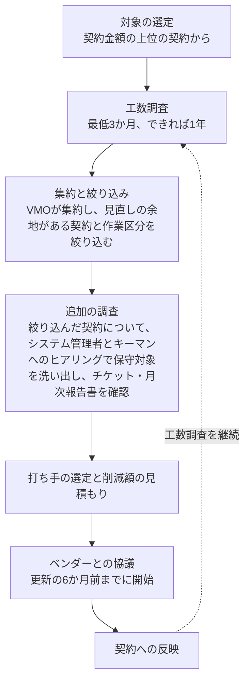

# 6. 運用保守委託費のディープダイブ

> **この章の位置づけ**：第5章の5区分のうち、管掌範囲の中でもコア領域にあたる「(b) 既存システムの運用保守委託費」について、SES(staff augmentation)として結ばれている契約を、本来の業務委託の形態に移すためのアプローチを定義する。
> **対象読者**：ベンダーマネジメント担当(VMO)／各システムの管理者／調達部門

## 要旨

運用保守委託の契約は、多くの場合「どのシステムを委託するか」ではなく「どのベンダーと何人か」で結ばれている。保守の対象とするシステムと必要な人数は、長く自社のシステムに関わっているベンダー側のキーマンが選んで提示しており、契約書には対象システムや委託業務が明記されていないか、契約が見直されないまま保守の対象が広がっている。これは日本でSES、英語ではstaff augmentation(IT contractor staffing)と呼ばれる形態であり、外部の要員に自社の情報システム部員のように動いてもらっている状態である。

本章のキーポイントは、工数の多い少ないを議論することではなく、**こうした契約を本来の業務委託の形態に移すこと**にある。移す先は、サービス水準(SLA)を決めたmanaged services、または委託する範囲を定めたうえで工数に応じて支払うtime and materials(T&M)である。どちらに移しても、結果としてコストが下がるかどうかは分からない。しかし、何に対して支払っているかが説明できるようになり、キーマンへの依存も減らせる。

その準備として、作業区分ごとに全要員の工数を、最低3か月、できれば1年を通して調査する。ベンダーにはコストではなく時間を報告してもらい、IT部門のシステム管理者が内容を確認し、VMOが集約する。調査の結果は、移行先の契約で委託する範囲、SLA、見積もりの根拠を設計するための土台になる。

## 6.1 運用保守契約の実態と費用の分解

### 契約の実態

| 観点 | 実態 |
|---|---|
| 契約の単位 | 「どのシステムの、どの業務を委託するか」ではなく、「どのベンダーと何人」という単位で結ばれていることが多い |
| 保守対象の決まり方 | ベンダー側のキーマン(長く自社のシステムに関わっている要員)が、保守できるシステムを選び、必要な人数を提示して契約している |
| 契約書の記載 | 対象システムや委託する業務が明記されていない。または、契約が見直されないまま、多くのシステムの保守を委託している |
| 結果 | 契約書を見ても、契約とシステムの紐づけに確証が得られない。どのシステムを誰が保守しているかを、IT部門が把握できていない |
| 契約の性格 | 日本でSES、英語ではstaff augmentation(IT contractor staffing)と呼ばれる形態。外部の要員に自社の情報システム部員のように動いてもらっている。法的には準委任契約であることが多い |

この実態は、費用の問題であると同時に、特定のキーマンに保守が依存しているという体制上のリスクでもある。

### 費用の分解

運用保守費は、契約上は要員数で決まっていても、実際には次の作業区分の積み上げでできている。

| 作業区分 | 内容 |
|---|---|
| ① 定常運用 | 監視、ジョブ・バッチ運用、バックアップ、定期作業 |
| ② 障害対応 | 障害の一次・二次対応、原因調査、復旧 |
| ③ 問い合わせ対応 | 利用部門からの問い合わせ、操作支援、データ抽出依頼 |
| ④ 保守内の小規模改修 | 保守契約の範囲内で行う軽微な改修・設定変更 |
| ⑤ 体制の維持 | 待機、知識の維持(①〜④のどれにも当たらない時間) |
| ⑥ 管理 | プロジェクト管理、月次報告、会議 |

契約工数のうち、⑤体制の維持が大きいほど、実際の作業量との乖離が大きい。ここが削減余地の中心になる。

## 6.2 目指す契約形態

| 観点 | 現状：SES(staff augmentation) | managed services | time and materials(T&M) |
|---|---|---|---|
| 何に対して支払うか | 要員の人数(人月) | 合意したサービス水準(SLA)の提供 | 定められた範囲の作業に投入した工数 |
| 委託する範囲 | 明記されていない。キーマンが決めている | 対象システム・業務・SLAを契約に明記する | 対象システム・業務を契約に明記する |
| ベンダーの責任 | 要員を出すこと | SLAを守ること。体制はベンダーが決める | 範囲内の作業を行い、工数を報告すること |
| 体制・人数を決めるのは | ベンダー(キーマン) | ベンダー(SLAを守れる体制) | 作業量の見込みにもとづき、双方で合意する |
| コストの見え方 | 人数×単価。作業量との関係は見えない | SLAの水準と対象範囲で決まる。固定額が多い | 工数×単価。作業量に応じて増減する |
| 向いている業務 | ― | 定常運用、障害対応、問い合わせ対応など、内容が安定している業務 | 小規模改修など、作業量の変動が大きい業務 |
| 移行に必要な準備 | ― | 対象範囲とSLAの定義、現状の作業量と障害・問い合わせの実績 | 対象範囲の定義、作業量の見込み、工数報告の様式 |

一つの契約の中でも、定常運用・障害対応・問い合わせ対応はmanaged servicesに、小規模改修はT&Mに、というように業務ごとに分けることができる。工数調査で作業区分ごとの時間が分かれば、どの業務をどちらに移すかを判断する材料になる。

なお、自社の部員のように要員へ直接作業を指示し続ける必要がある業務は、業務委託(準委任・請負)ではなく労働者派遣で契約すべきものである。業務委託のまま発注側が要員に直接指示すると、偽装請負とみなされるおそれがある。契約類型と偽装請負の判断基準は付録Eにまとめている。

## 6.3 工数調査

| 項目 | 内容 |
|---|---|
| 対象 | 運用保守を委託している全契約の、全要員(再委託先の要員を含む) |
| 期間 | 最低3か月。できれば1年。年次作業・期末作業・障害の偏りなど、季節による変動を捉えるため |
| 報告の単位 | 契約ごと・要員ごと・作業区分(6.1の①〜⑥)ごとの**時間**。コストは報告してもらわない。システム単位の報告は求めない(システムやチケット単位の分析は、この調査で契約・要員単位の実績が把握できた後の段階で行う) |
| 報告の頻度 | 月次(週次の記録を月ごとにまとめて提出) |

**役割分担**

| 役割 | 担当 | 作業 |
|---|---|---|
| 報告 | 外部ベンダーの各要員 | 作業区分ごとの時間を記録し、月次で提出する |
| 確認 | IT部門のシステム管理者 | 報告内容が実態と合っているかを確認する(作業区分の振り分け、時間の妥当性) |
| 集約 | ベンダーマネジメント(VMO) | 確認済みの各シートを集約し、契約・ベンダー横断で集計する |

**ワークシートの形式**

ワークシートは `data/maintenance-effort-survey.xlsx` を使う。契約×ベンダー(作業実施会社)ごとに1枚のシートを作り、次の形で記入する。

| 項目 | 内容 |
|---|---|
| シート上部 | 契約番号、契約名、契約先ベンダー(元請)、作業実施会社、確認者(システム管理者)、調査開始月 |
| 縦軸 | 要員ごとに、作業区分①〜⑥があらかじめ並んでいる(要員IDのみ記入。氏名は記入しない) |
| 横軸 | 年月(調査開始月から12か月分。開始月を入れると自動で入る) |
| 自動計算 | 要員別の月合計、全要員の作業区分別合計・月合計、報告した要員数 |
| 確認欄 | 月ごとに、ベンダーの報告日と、システム管理者の確認日・確認結果(承認／差戻し)・確認コメント |
| 任意の項目 | 保守対象システム(ベンダーの認識で列挙。時間をシステムごとに分ける必要はない)、要員ごとの主な作業指示元(自社のIT部門／自社の利用部門／ベンダー内の責任者／指示なし) |

工数調査の結果が出るまでは、第5章で仮置きした(b)の削減余地(支出の5〜15％)を使って初回の削減目標を報告する。ただし本章の主眼は契約形態の移行であり、移行によってコストが下がるとは限らない。調査の結果が出た時点で、6.6のコストへの影響に置き換える。

## 6.4 調査票で分かること・分からないこと

### 算出できる値

調査票(契約×作業実施会社×要員×作業区分×月の時間)から、契約ごとに次の値を算出する。契約上の要員数・工数と年間契約金額は調査票には含めず、契約書(第5章ステップ2の契約インベントリ)からVMOが補う。

| 値 | 算出方法 | 調査票以外に必要なデータ | 分かること |
|---|---|---|---|
| 要員稼働率 | ①〜④の作業時間 ÷ 契約上の工数 | 契約上の要員数・工数(契約書) | 契約上の体制と実際の作業量の差 |
| ⑤体制の維持・⑥管理の比率 | ⑤・⑥の時間 ÷ 全時間 | なし | 作業に使われていない時間の大きさ |
| 月ごとの変動 | 月合計の最小・最大・平均 | なし | 平常時に必要な体制とピーク時の差。最小月の水準が体制の下限の目安になる |
| 要員ごとの稼働の偏り | 要員別の月合計と、そのうち①〜④の比率 | なし | 稼働の低い要員(兼務化・統合の候補)と、特定の要員への集中 |
| 作業実施会社ごとの比率 | 作業実施会社ごとの時間 ÷ 全時間 | なし | 契約先ベンダー(元請)以外の会社が担っている作業の大きさ |
| 作業指示元の分布(任意項目) | 主な作業指示元ごとの要員数・時間 | なし | 自社が直接指示している要員の大きさ。偽装請負のリスクと、業務委託・労働者派遣のどちらが実態に合うかの判断材料 |
| 1時間あたりの実効単価 | 年間契約金額 ÷ 報告された全時間 | 年間契約金額(契約書) | 契約間での割高・割安の比較。単価交渉ではなく、作業量に対して契約金額が見合っているかの確認に使う |
| 作業区分の構成の比較 | 契約ごとの①〜⑥の比率 | なし | 似た性質の契約の間で、構成が大きく違う契約 |

### 調査票だけでは分からないこと

| 分からないこと | 理由 | 補う方法 |
|---|---|---|
| システムごとの内訳 | 契約単位で報告してもらうため、分けられない。契約書にも対象システムが明記されていないことが多い | 任意項目の「保守対象システム(ベンダー申告)」を出発点に、絞り込んだ契約について、システム管理者とベンダーのキーマンへのヒアリングで保守対象システムの一覧を確定する。そのうえで作業時間を按分する |
| 作業の中身 | 時間だけを報告してもらうため、障害の再発や問い合わせの定型度は分からない | 障害・問い合わせのチケットやSIerの月次報告書を確認する |
| 作業区分の振り分けの正確さ | ベンダーの自己申告であり、⑤体制の維持は少なめに、①〜④は多めに報告されやすい | システム管理者の確認に加え、月次報告書の作業実績と突き合わせる |

したがってこの調査の役割は、**どの契約の、どの作業区分に見直しの余地がありそうかを絞り込むこと**である。打ち手の具体化は、絞り込んだ契約について追加の調査で行う。

## 6.5 打ち手

| 打ち手 | 内容 | 調査票での判断の材料 | 追加の調査 |
|---|---|---|---|
| ① スコープの明文化と再定義 | 契約ごとに、保守の対象システム・委託する業務・サービス水準を初めて文書にし、次の更新で契約に明記する。そのうえで、行われていない作業・重複している作業を外し、サービス水準が業務上必要な水準かを見直す | 作業区分の構成、契約間の比較 | システム管理者とキーマンへのヒアリングによる、保守対象システムと業務の洗い出し |
| ② 契約形態の移行 | SES(ベンダー×人数)の契約から、①で明文化した範囲にもとづくmanaged services(SLA)またはT&Mへ移す(6.2)。あわせて、要員数を実際の作業量に合わせ、複数の契約を一つにまとめる | 要員稼働率、⑤体制の維持の比率、月ごとの変動、要員ごとの稼働の偏り、⑥管理の比率 | 不要 |
| ③ 商流の適正化 | 実作業を担う会社を明らかにし、再委託の条件を契約に入れる | 作業実施会社ごとの比率 | 再委託の契約条件の確認 |
| ④ 作業量そのものの削減 | 再発する障害の根本対策、定型的な問い合わせのFAQ化、定常運用の自動化 | ②障害対応・③問い合わせ対応の時間の大きさ(どこを調べるべきかの見当まで) | チケット・月次報告書による作業の中身の確認 |

本章の中心は②の契約形態の移行である。調査票からは、業務ごとにmanaged servicesとT&Mのどちらに向くか、どの程度の体制が必要かを判断できる。ただし移行には、①で保守の対象と作業範囲が明文化されていることが前提になる。③は調査票で当たりをつけ、再委託の契約条件で確かめる。④は調査票では見当をつけるところまでで、作業の中身の確認が必要になる。

## 6.6 コストへの影響の見積もり

契約形態を移したときのコストは、下がることも上がることもある。

| 下がる要因 | 上がる要因 |
|---|---|
| 実際の作業量に合わせて体制を組むことで、⑤体制の維持の時間が減る | managed servicesでは、SLAを守る責任をベンダーが負う分、リスクの対価が上乗せされる |
| 複数の契約をまとめることで、⑥管理の時間が減る | これまで暗黙に頼んでいた作業を範囲として明記すると、その分が見積もりに乗る |
| T&Mでは、作業量が減った月は支払いも減る | 移行の準備(範囲の定義、引き継ぎ、文書化)に一時的な費用がかかる |

契約ごとに、現行の契約金額と、移行先の見積もりを比べて、コストへの影響を見積もる。

- **現行の契約金額**：契約書の要員数×人月単価(システムとの紐づけは分からなくても、要員数は契約書から把握できる)
- **移行先の見積もり**：managed servicesはSLAと対象範囲にもとづくベンダーの見積もり、T&Mは工数調査の①〜④の作業時間(月平均)に必要最小限の体制維持を加えた工数×単価
- **単価の上昇**：受け入れる前提で見積もりに含める

第5章の削減目標には、コストへの影響を増減の幅で積み上げる。確度は「見込み」とし、ベンダーの見積もりを受けた時点で更新する。

## 6.7 進め方

*図6-1　運用保守委託費の見直しの流れ*

## 6.8 留意点

- **取適法への対応**：受託事業者から価格の協議を求められたときに応じず、一方的に代金を決めることは禁止行為にあたる。単価の協議には応じたうえで、工数と作業範囲の見直しを協議の中心に置く。
- **偽装請負のリスク**：SESの多くは法的には準委任契約であり、発注側が要員に直接作業を指示すると偽装請負とみなされるおそれがある。自社の部員のように直接指示する必要がある業務は、労働者派遣で契約するか、指示を不要にできるよう業務委託の範囲とSLAを定める。
- **工数調査への協力**：時間の報告はベンダー側の負担になる。調査の目的(作業範囲を実態に合わせること)を事前に説明し、可能であれば次回の更新から、作業区分ごとの時間の報告を契約上の義務にする。
- **キーマンへの依存**：保守の対象と体制をベンダー側のキーマンが決めている契約では、要員数を減らす協議がキーマンの判断に左右されやすく、キーマンが離れると保守そのものが続けられなくなるおそれがある。①の明文化で、保守の対象と業務をIT部門側でも把握しておく。
- **自己申告の偏り**：時間はベンダーの自己申告であり、契約上の工数に近い時間が報告されやすい。報告された時間が契約上の工数とほぼ同じでも、それだけで見直しの余地がないとは判断せず、⑤体制の維持の比率と月ごとの変動をあわせて見る。
- **品質と体制の維持**：要員数を減らす場合、障害対応の速度や、特定の担当者に依存している知識の継承に影響が出る。必要最小限の体制維持工数は、システム管理者と合意してから決める。
- **効果の発現時期**：契約の見直しは更新時にしか反映できない。工数調査の期間を考えると、効果が出るのは多くの場合、次の次の更新以降になる。

## この章の結論

- 運用保守の契約は「ベンダー×人数」で結ばれ、保守の対象はベンダー側のキーマンが決めていることが多い。日本でSES、英語ではstaff augmentation(IT contractor staffing)と呼ばれる形態である。
- 本章のキーポイントは、工数の多い少ないではなく、こうした契約を本来の業務委託の形態、すなわちSLAを決めたmanaged services、または範囲を定めたT&Mに移すことである。業務ごとに移行先を分けることもできる。
- 移行には、保守の対象システム・業務・サービス水準の明文化が前提になる。その土台として、契約×作業実施会社×要員×作業区分の時間を、最低3か月、できれば1年かけて調査する。
- 移行によってコストが下がるとは限らない。現行の契約金額と移行先の見積もりを比べ、増減の幅で第5章の削減目標に積み上げる。コストの増減にかかわらず、何に対して支払っているかが説明できるようになり、キーマンへの依存も減らせる。

---

**参照**：第5章(5区分と削減目標の作り方)、付録E(ITの外部委託における契約類型)
