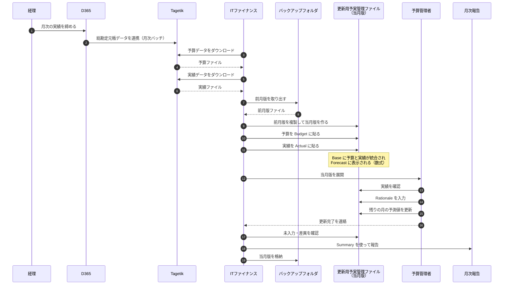
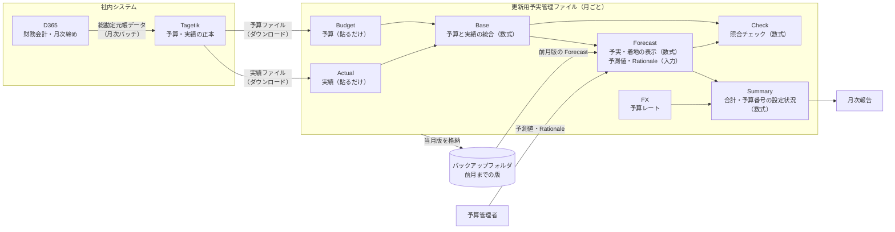
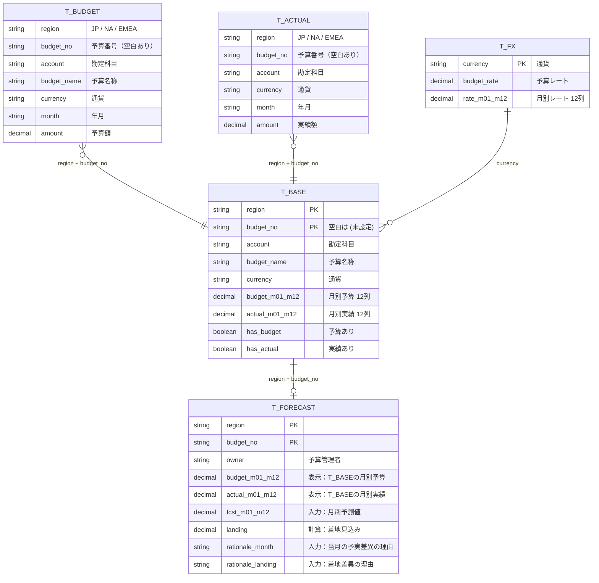
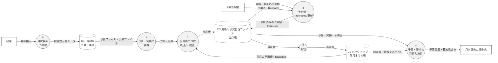

# GDS 予実管理・着地見込み管理 設計書

- 文書種別：設計書（Draft）
- 版数：v1.0
- 作成日：2026-11-15
- 対象要件：`02_requirements.md` v0.6（フェーズ1：日本リージョン）

---

## 1. 設計方針

1. **Tagetikの外に持つのは予測値とRationaleだけ**にする。その正本は月ごとのExcelファイルとする（`../appendix/A_architecture-decisions.md` ADR-001）。予算と実績はTagetikからダウンロードしたものを毎月そのまま貼り、手を加えない。
2. **予算と実績は別々に貼り、数式で1つのテーブル（`Base`）に統合する**。Tagetikからは予算と実績が別のファイルでしか出せないため。
3. **貼るデータと入力するデータを別のテーブルに分ける**。行の並び順に頼らず、キー（リージョン＋予算番号）で結び付ける。こうすれば、実績を貼り替えても予測値は消えず、ずれもしない。
4. **Excelの数式だけで計算する**（Power Query・マクロ・Power BIは使わない）。Web版Excelでも開いて更新できるようにするため。キーの統合に動的配列の関数（`UNIQUE`・`VSTACK`）を使うので、Microsoft 365のExcelを前提とする。
5. 更新用予実管理ファイルは**毎月1ファイル**とする。前月のファイルがそのままバックアップになり、翌月の転記元になる。前月の見込みと比べたいときは、前の版のファイルと見比べる（前月の値をファイルの中に控えない）。
6. **予算番号が空白の明細は、`(未設定)` という1つの予算番号として扱う**。捨てずに予実と着地に含めるので、総額は常にTagetikと一致する。予算番号の設定はTagetik／D365側で直し、このファイルでは補正しない。
7. すべて手作業で運用する前提とし、設定用のシートは持たない。締め月は `Actual` から数式で決め、年度と版はファイル名で表す。

### 1.1 未確定事項の仮置き

要件定義書8章の未確定事項は、次のように仮置きして設計する。決まったら該当する箇所を直す。

| # | 未確定事項 | 仮置き |
|---|---|---|
| 1 | 予測値の入れ方 | 月別に入れる |
| 2 | Tagetikの予算・実績ファイルの形式 | どちらも縦持ち（「月」の項目があり、1行＝予算番号×勘定科目×月の金額）。月は年月（YYYYMM）で入っているものとする |
| 3 | 転記の方法 | 手作業（値の貼り付け）。キーで結び付けるので、貼る位置がずれても結果は変わらない |
| 7 | 予算番号未設定の行の予測値 | ITファイナンスが入力する |

---

## 2. 業務フロー（シーケンス図）

---

## 3. 機能配置（フローチャート）

どの機能がどこにあり、何でつながっているかを示す。

| 機能 | 置き場所 | 担当 | 性質 |
|---|---|---|---|
| 月次締め | D365 | 経理 | 既存 |
| 予算・実績の保持、ファイルの出力 | Tagetik | （自動）／ITファイナンスがダウンロード | 既存。予算と実績は別ファイル |
| 予算の取り込み | `Budget` シート | ITファイナンス | 値を貼るだけ |
| 実績の取り込み | `Actual` シート | ITファイナンス | 値を貼るだけ |
| 予算と実績の統合 | `Base` シート | （数式） | 入力不可 |
| 予実・着地の表示と、予測値・Rationaleの入力 | `Forecast` シート | 予算管理者 | 予算管理者が開くのはこのシートだけ。入力するのは予測値とRationaleのみで、ほかの列は数式 |
| 照合チェック | `Check` シート | （数式） | 入力不可 |
| 為替レートの設定 | `FX` シート | ITファイナンス | 予算レートは期首に設定し、月別レートは毎月の締め後に入れる |
| 集計 | `Summary` シート | （数式） | 入力不可 |
| 保管 | バックアップフォルダ | ITファイナンス | ファイルを置くだけ |

---

## 4. データ設計

### 4.1 テーブルの関係

| テーブル | 中身 | 作り方 | 正本 |
|---|---|---|---|
| `T_BUDGET` | 予算 | Tagetikからダウンロードして貼る | Tagetik（これは写し） |
| `T_ACTUAL` | 実績 | Tagetikからダウンロードして貼る | Tagetik（これは写し） |
| `T_BASE` | 予算と実績を予算番号で1行にまとめたもの | `T_BUDGET`・`T_ACTUAL` から数式で作る | —（作業用） |
| `T_FORECAST` | 予算管理者が開く1枚。予算・実績（`T_BASE` から表示）、予測値・Rationale（入力）、着地見込み（計算）が1行に並ぶ | キー・担当者・入力値は前月版から引き継ぎ、予算・実績・計算は数式 | **予測値・Rationaleはここが正本**（ADR-001） |
| `T_FX` | 通貨ごとの円への予算レートと月別レート | ITファイナンスが期首に入力する | 予算レートの決定元（未確定事項13） |

`T_FORECAST` に入力した予測値は、同じ行の着地見込み、`Summary`、翌月版の `T_FORECAST`（引き継ぎ）に反映される。

サンプル行を使った流れのイメージは `../appendix/B_record-image.html`（ブラウザで開く）を参照。

### 4.2 ER図

`T_BUDGET` と `T_ACTUAL` はTagetikのファイルをそのまま貼るため、同じキーの行が複数ある（月ごと・勘定科目ごとに行が分かれる）。`T_BASE` はその2つのキーを重複なしにまとめたもので、1キー＝1行になる。予算だけの行も、実績だけの行（予算のない実績）も含む。予算番号が空白の明細は `(未設定)` の1行にまとまる。

`T_FORECAST` は `T_BASE` と同じキーで0〜1行が対応し、対応する行がなければ予測値は0として扱う（照合チェックで検出する）。

### 4.3 テーブル定義

`T_BUDGET`・`T_ACTUAL` は月が行に並ぶ縦持ち、`T_BASE` 以降は月が列に並ぶ横持ちとする。`T_BASE` 以降の列の月番号（`m01`〜`m12`）は期首月を1とする会計月の番号で、`T_BUDGET` に含まれる年月を古い順に並べて割り当てる（予算は年度の12か月分がそろっているため、期首月を設定しなくても決まる）。年度と版（締め月）はファイル名 `gds_forecast_YYYYMM.xlsx` で表す。

#### T_BUDGET（Budget シート）

Tagetikの予算ファイルをそのまま値で貼る。列の名前と並びはTagetikの形式に合わせて確定する。

| 列 | 型 | 必須 | 説明 |
|---|---|---|---|
| region | 文字 | ○ | リージョン（JP／NA／EMEA） |
| budget_no | 文字 |  | 予算番号。空白の明細がある（予算番号の適正化の対象） |
| account | 文字 | ○ | 勘定科目（リージョンごとの体系）。予算番号未設定の内訳に使う |
| budget_name | 文字 |  | 予算名称 |
| currency | 文字 | ○ | 通貨（JPY／USD／EUR／GBP） |
| month | 文字 | ○ | 年月（YYYYMM） |
| amount | 数値 | ○ | 予算額 |

#### T_ACTUAL（Actual シート）

Tagetikの実績ファイルをそのまま値で貼る。列の名前と並びはTagetikの形式に合わせて確定する。

| 列 | 型 | 必須 | 説明 |
|---|---|---|---|
| region | 文字 | ○ | リージョン |
| budget_no | 文字 |  | 予算番号。空白の明細がある（予算番号の適正化の対象） |
| account | 文字 | ○ | 勘定科目。予算番号未設定の内訳に使う |
| currency | 文字 | ○ | 通貨 |
| month | 文字 | ○ | 年月（YYYYMM）。締め済みの月だけ行がある |
| amount | 数値 | ○ | 実績額 |

#### T_BASE（Base シート・数式）

予算と実績を統合したテーブル。入力しない。

| 列 | 求め方 |
|---|---|
| region・budget_no | `T_BUDGET` と `T_ACTUAL` のキーを縦に連結し、重複を除く（`UNIQUE(VSTACK(…))`）。予算番号が空白なら `(未設定)` に置き換えてから連結する |
| account・budget_name・currency | `T_BUDGET` の最初の一致行から取る。予算がなければ `T_ACTUAL` から取る。`(未設定)` の行は勘定科目・名称を空欄にする |
| budget_m01〜m12 | `T_BUDGET` の同じキー・同じ年月の `amount` の合計（`SUMIFS`） |
| actual_m01〜m12 | `T_ACTUAL` の同じキー・同じ年月の `amount` の合計（`SUMIFS`） |
| has_budget | `T_BUDGET` に同じキーがあるか |
| has_actual | `T_ACTUAL` に同じキーがあるか |

#### T_FORECAST（Forecast シート）

予算管理者が開く唯一のシート。1行＝1つの予算番号で、予算・実績・予測値・着地見込みが1行に並ぶ。入力するのは予測値とRationaleだけで、ほかの列は数式で表示する。行（キー・担当者・入力値）は前月版から引き継ぐ。

| 列 | 型 | 必須 | 説明 |
|---|---|---|---|
| region | 文字 | ○ | キー |
| budget_no | 文字 | ○ | キー |
| owner | 文字 | ○ | 予算管理者 |
| budget_m01〜m12 | 数値（数式） |  | `T_BASE` の月別予算を表示 |
| actual_m01〜m12 | 数値（数式） |  | `T_BASE` の月別実績を表示 |
| fcst_m01〜m12 | 数値 |  | 月別予測値。**入力**。締め済みの月の値は計算に使わない（残しておいてよい） |
| current_budget・current_actual・current_variance | 数値（数式） |  | 当月予算・当月実績・当月差異（4.4） |
| ytd_budget・ytd_actual・ytd_variance | 数値（数式） |  | YTD予算・YTD実績・YTD差異 |
| annual_budget | 数値（数式） |  | 年間予算 |
| remaining_fcst | 数値（数式） |  | 残り予測（締め月の翌月〜12か月目の予測値の合計） |
| landing・landing_variance | 数値（数式） |  | 着地見込み・着地差異 |
| rationale_month | 文字 |  | 当月の予実差異の理由。差異があれば必須 |
| rationale_landing | 文字 |  | 着地差異の理由。差異があれば必須 |

#### T_FX（FX シート）

円と外貨のあいだを換算するためのレート表。予算レートと月別レートを1行に並べる横持ちとする。レートは「外貨1単位＝何円」で持ち、1本のレートで両方向に換算する。

| 換算 | 計算 |
|---|---|
| 外貨 → 円 | 金額 × レート |
| 円 → 外貨 | 金額 ÷ レート |
| 外貨 → 別の外貨（例：USD→EUR） | いったん円に換算してから、相手の通貨のレートで割る |

逆方向専用のレート（円→外貨のレート）の列は持たない。

| 列 | 型 | 必須 | 説明 |
|---|---|---|---|
| currency | 文字 | ○ | 通貨（USD／EUR／GBPなど）。キー |
| budget_rate | 数値 | ○ | 円への予算レート（期首に固定し、期中は変えない） |
| rate_m01〜m12 | 数値 |  | 円への月別レート（会計月ごと）。締まった月から入れる |

JPYの行は持たない（レート1として扱う）。

### 4.4 計算（Forecast・Summary・Check）

締め月は、`T_ACTUAL` の `month` の最大値とする。締めた月に実績が1件もないと1か月前と判定されるが、現実には起きにくいためこの方式とする。

`Forecast` の各行に、`T_BASE` から同じキーの予算・実績を引いてきて、次の値を数式で出す。予測値を推計するものではなく、合計と差を出すだけである。

| 項目 | 計算 |
|---|---|
| 当月予算・当月実績 | 締め月の `budget_mNN`・`actual_mNN` |
| 当月差異 | 当月実績 − 当月予算 |
| YTD予算・YTD実績 | 1〜締め月の合計 |
| YTD差異 | YTD実績 − YTD予算 |
| 年間予算 | `budget_m01`〜`m12` の合計 |
| 残り予測 | 締め月の翌月〜12月の `fcst_mNN` の合計 |
| 着地見込み | YTD実績 ＋ 残り予測 |
| 着地差異 | 着地見込み − 年間予算 |
| 理由の要否 | 差異が閾値（要件定義書の未確定事項4）を超え、理由が空欄なら目印を付ける |

`Summary` は `Forecast` を合計し、予実・着地の総額を出す（円）。円以外の通貨の行は、`T_BASE` の `currency` で `T_FX` を引き、円に換算してから合計する。予算と予測値は `budget_rate`、実績は同じ月の `rate_mNN` を掛ける（要件定義書の未確定事項13で確定するまでの仮置き）。`Forecast` の各行は現地通貨のまま表示する。あわせて、総額を `T_FX` にある各通貨（USDなど）に逆換算した値も出す（円の総額 ÷ 同じレート）。あわせて、予算番号の設定状況を出す。

| 項目 | 計算 |
|---|---|
| 未設定の予算額 | `(未設定)` 行の年間予算 |
| 未設定の実績額 | `(未設定)` 行のYTD実績 |
| 予算の設定率 | 1 − 未設定の予算額 ÷ 年間予算の合計 |
| 実績の設定率 | 1 − 未設定の実績額 ÷ YTD実績の合計 |

設定率の推移は、前月版のファイルと見比べて確認する。

`Check` は次の4つを数式で一覧にする。

| チェック | 内容 | 対応 |
|---|---|---|
| 予測行なし | `T_BASE` にあって `T_FORECAST` にない予算番号（新しい予算番号） | ITファイナンスが `T_FORECAST` に行を追加する |
| 予算のない実績 | `T_BASE` の `has_budget` がない行 | ITファイナンスが予算管理者に内容を確認する |
| 予算番号の消滅 | `T_FORECAST` にあって `T_BASE` にない予算番号 | 予算管理者に扱いを確認し、不要なら行を削除する |
| 予算番号未設定の内訳 | `T_BUDGET`・`T_ACTUAL` で予算番号が空白の明細を、リージョン＋勘定科目ごとに合計した一覧（金額の大きい順） | Tagetik／D365側で予算番号を設定するよう、関係者に依頼する |

---

## 5. データフロー（DFD）

| 記号 | 種別 | 名称 | 説明 |
|---|---|---|---|
| E1〜E3 | 外部実体 | 経理、予算管理者、報告先 | このファイルの外にいる関係者 |
| 0 | プロセス | 月次締め | D365の既存処理。Tagetikへの連携まで |
| 1 | プロセス | 予算・実績の取得 | Tagetikから予算ファイルと実績ファイルを別々にダウンロードする |
| 2 | プロセス | 当月版の作成 | 前月版を複製し、予算と実績をそれぞれ貼る。`Base` で統合される |
| 3 | プロセス | 予測値・Rationaleの更新 | 予算管理者が `Forecast` を更新する |
| 4 | プロセス | 計算と集計 | `Forecast` の集計列と `Summary` の数式 |
| 5 | プロセス | 保管 | 当月版をバックアップフォルダに置く |
| D1 | データストア | Tagetik | 予算・実績の正本 |
| D2 | データストア | バックアップ | 前月までの更新用予実管理ファイル |
| D3 | データストア | 当月版 | 予測値・Rationaleの正本（当月分） |

---

## 6. ファイルの命名と置き場所

| 対象 | 名前・場所 |
|---|---|
| 更新用予実管理ファイル | `gds_forecast_YYYYMM.xlsx`（YYYYMMは締め月） |
| バックアップフォルダ | 年度ごとのフォルダ（例：`FY2027/`）に月次の版を置く。場所は運用開始時に決める |
| Tagetikの予算・実績ファイル | 取り込み後は保管しない（Tagetikが正本のため） |

## 7. 変更履歴

| 版 | 日付 | 内容 |
|---|---|---|
| v0.1 | 2026-11-15 | 新規作成 |
| v0.2 | 2026-11-15 | `T_SETTINGS`・`T_PREV_LANDING` を削除。締め月は実績から判定し、前月の見込みとの比較は前の版のファイルで行う |
| v0.3 | 2026-11-15 | Tagetikの予算と実績が別ファイルであることに合わせ、`T_SOURCE` を `T_BUDGET`・`T_ACTUAL`（貼る）と `T_BASE`（統合・数式）に分けた。照合チェックに「予算のない実績」を追加 |
| v0.4 | 2026-11-15 | 予算番号が空白の明細を `(未設定)` にまとめる扱いを追加。`Summary` に予算番号の設定状況、`Check` に未設定の内訳を追加 |
| v0.5 | 2026-11-15 | Tagetikの予算・実績ファイルが縦持ち（月の項目＋金額）であることに合わせ、`T_BUDGET`・`T_ACTUAL` の列を変更。`T_BASE` で横持ちに展開する |
| v0.6 | 2026-11-15 | `BvA` を廃止し、予実・着地の表示を `Forecast` に集約。シーケンス図から照合チェックと前月見込みとの比較を削除 |
| v0.7 | 2026-11-15 | ファイル名を 03_design.md に変更。対象をフェーズ1（日本リージョン）に絞り、`T_FX` と3リージョン合計を削除。参照する未確定事項の番号を要件定義書 v0.6 に合わせた |
| v0.8 | 2026-11-15 | 4.1にテーブルの関係と正本を追加。ER図の `T_FORECAST` に表示列・計算列を明記 |
| v0.9 | 2026-11-15 | `T_FX`（通貨ごとの予算レートと月別レート）を復活。`Summary` で円以外の通貨を円に換算して合計する |
| v1.0 | 2026-11-15 | `T_FX` で円→外貨の逆換算も行うことを明記（1本のレートで両方向に換算）。`Summary` に外貨建ての総額を追加 |
