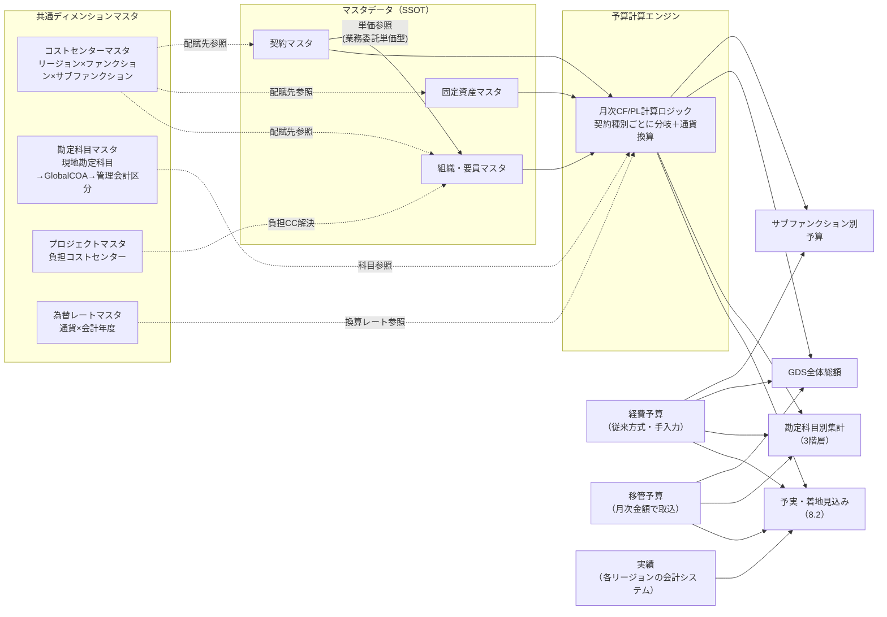

# IT部門 Run予算管理システム 業務要件定義書

- 文書種別：業務要件定義書（Draft）
- 版数：v0.8
- 更新日：2026-10-24
- 作成日：2026-09-12
- 作成：Claude（Hiroyasu氏との検討を基に作成）
- 想定最終アウトプット形式：Excelスプレッドシート（Windows版Excel + Power Query + Power Pivot）。技術選定の根拠は `it_budget_adr.md` を参照

---

## 1. 目的・背景

現状、IT部門の予算管理は静的なExcelでの積み上げ集計に依存しており、契約更新や資産の増減があるたびに手作業でシートを作り直す運用になっている。特にM365ライセンス費用については、契約更新月にIT部門の損益（PL）が一括計上により乱高下し、月次の予実管理が機能しない課題が確認されている（前払費用（BS）を用いた平準化モデルにより解消済み）。

この経験を踏まえ、IT部門の予算管理全体を「契約・資産・要員といった事実を記録したマスタデータから、予算を計算ロジックにより機械的に導出する」方式（Single Source of Truth／SSOT型の予算管理）に切り替えることで、以下を実現することを目的とする。

- マスタデータさえ正しく維持されていれば、誰が計算しても同じ予算数値が得られる（冪等性）
- 予算の誤りの原因を「計算ロジック」ではなく「マスタデータの品質」に一本化できる
- 契約・資産の増減に応じて予算が自動的に更新され、手作業での再構築が不要になる

あわせて、期首に確定した予算に対し、会計システムの**実績**と今期の**着地見込み**を月次で対比・管理できることを目的に含める（v0.6で追加。8.2参照）。チャージバック・ショーバック等の管理会計の仕組みは、現時点では対象としない。

## 2. 対象範囲（スコープ）

### 2.1 対象とする予算（In Scope）

IT部門の「Run予算」（運用・維持のための経常的な予算）を対象とする。具体的には次の4つのマスタ、および経費予算（後述）から構成される。

| マスタ / 区分 | 内容 |
|---|---|
| 契約マスタ | SaaS・保守・通信・業務委託等の契約に基づく費用 |
| 固定資産マスタ | 端末・ネットワーク機器等、購入し資産計上する物品の減価償却費 |
| 組織・要員マスタ | 正社員のFTE按分人件費、および稼働単価が開示されている外部人材費用 |
| 経費予算（従来方式） | T&E、教育費、出張、イベント、謝礼、買い切りソフトウェア、クラウド利用料の完全変動部分等 |
| 移管予算（2027年度〜） | 各ファンクションからGDSへ移管されたIT予算。移管元ファンクションのコストセンターのまま、Opex_Budgetに入力する（前提21、6.4） |

上記の予算は、実績・着地見込みとの月次対比（8.2）の対象とする。

### 2.2 対象外とする予算（Out of Scope）

| 区分 | 理由 |
|---|---|
| プロジェクト・新規投資予算（Grow/Transform予算） | 契約等の確定事実からの導出ではなく、ROIや優先順位に基づく意思決定プロセスに属するため、本モデリング手法とは性質が異なる。別途プロジェクト予算のガバナンスで管理する。**ただし、プロジェクトにアサインされた要員の人件費はRun予算に含める**（前提11）。プロジェクトの開発部分は別途請負契約を締結し、Grow/Transform予算側で予算化する |
| リース資産マスタ | 現時点でリース契約が存在しないため、今回は実装しない。将来リース契約が発生した時点で会計方針（オンバランス処理の要否）を確認のうえ、別途要件定義する |
| チャージバック・ショーバック | いずれ必要になるが、現時点では運用しない。チャージバック比率の項目は将来に備えて残し、既定値0とする（前提16） |

> **境界条件の注意**：プロジェクトが完了し本稼働に入った後の費用（導入したSaaSのライセンス費用、保守費用等）は、Run予算側（契約マスタ等）に引き渡される。引き渡しのタイミング・手続きは運用ルールとして別途定める必要がある（本書「11. 未確定事項」参照）。

## 3. 全体アーキテクチャ

マスタデータ（契約・固定資産・組織要員）が「事実」の記録であり、予算計算エンジンはそこから決定論的に月次の費用を算出する。経費予算（T&E等、クラウド変動費を含む）は従来どおり人による見積もり・入力に依拠し、移管予算は移管元が作成した月次の金額をそのまま取り込む。実績は各リージョンの会計システムから取り込み、予算・着地見込みと対比する。コストセンター・勘定科目・プロジェクト・為替レートの4マスタは、各マスタ／出力の共通ディメンション（軸）として参照される補助マスタであり、費用そのものを生む「事実」データではない。

## 4. 用語定義

| 用語 | 定義 |
|---|---|
| Run予算 | 運用・維持のための経常的な予算（本書の対象） |
| Grow/Transform予算 | 新規投資・変革のための予算（本書の対象外、プロジェクト予算として別管理） |
| SSOT (Single Source of Truth) | 予算計算の唯一の正となる入力データ源。本書では契約マスタ・固定資産マスタ・組織要員マスタを指す |
| 前払一括型契約 | 契約金額を契約開始月に一括でキャッシュアウトし、前払費用（BS）として資産計上した上で、一定期間（通常12ヶ月）かけて均等償却する契約類型 |
| 月額固定型契約 | 毎月一定額が請求され、前払処理を要さずそのまま月次のPLに計上する契約類型 |
| 業務委託単価型 | 稼働率・単価により費用が変動する業務委託契約（フリーランス、常駐型SE等）。契約マスタには単価情報のみを登録し、予算計上は組織・要員マスタ側でFTEに準じた按分により行う |
| チャージバック | IT部門が一旦全額を負担した費用のうち、**IT部門外**の利用部門に再請求（付け替え）する部分。IT部門の予算総額から控除される。本システムでは控除が目的であり、再請求先の識別・金額提示は行わない。**現時点では運用しない**（前提16） |
| 配賦（アロケーション） | IT部門が負担する費用を、GDS内のサブファンクション（15区分）のコストセンターに割り当てること。IT部門の予算総額は変動しない。チャージバックとは明確に区別する。リージョンをまたぐ配賦は行わない（前提20） |
| FTE (Full Time Equivalent) | 従業員の稼働割合を表す指標。1.0が専任稼働相当 |
| ESU (Extended Security Updates) | Windows Server等、サポート終了後もセキュリティ更新を有償で継続する契約 |
| コストセンター | 会計上の費用計上単位。仕訳ごとに指定し、セグメント別PLの作成に用いる。ファンクションとサブファンクションは、いずれもコストセンターを細分化した区分である |
| ファンクション | 部門。営業、研究、生産、本社（財務経理・人事等）、GDS等 |
| サブファンクション | ファンクション内の管理単位。GDSではリージョン（日本／北米／EMEA）×機能組織（アプリケーション／インフラ／データ／セキュリティ／ガバナンス）の15区分 |
| リージョン | 日本／北米／EMEA。それぞれ単体で財務報告を行う。EMEA配下の欧州各国はEMEAに集約して扱う（前提18） |
| 現地勘定科目 | 各リージョンの会計システム上の勘定科目。リージョンごとに体系が異なる。予算は現地勘定科目で作成・提出する（前提19） |
| GlobalCOA | 現地勘定科目をグローバルで集約するための2階層目の勘定科目 |
| 管理会計区分 | GlobalCOAを管理会計の観点で集約する3階層目の区分（人件費、販売管理費等） |
| 当初予算 | 期首に確定した予算。期中は変更しない（8.2） |
| 修正予算 | 期中に正式に承認された予算の増減を当初予算に加えたもの |
| 実績 | 各リージョンの会計システムで月次に確定した計上額 |
| 着地見込み | 締め済み月の実績＋未経過月の見込み。月ごとに版として保存する |
| 現地通貨 | 契約・取得・給与等が実際に発生している通貨（円・ドル・ユーロ・ポンドのいずれか） |
| 表示通貨 | 出力時にユーザーが選択する集計・表示上の通貨（現地通貨のまま、または単一通貨に換算） |

## 5. 前提条件（今回の検討で確定した事項）

| # | 項目 | 決定内容 |
|---|---|---|
| 1 | 会計年度 | 暦年ベース（1月〜12月）。FY25 = 2025年1月〜12月 |
| 2 | 予算対象期間 | 複数年ローリング（3〜5年）。契約マスタの複数年契約（例：M365のFY25〜27）をそのまま活用し、継続的に先の年度まで見通す運用 |
| 3 | 固定資産の減価償却方法 | 定額法・社内耐用年数基準（法定耐用年数とは別に、管理会計上の耐用年数を用いる） |
| 4 | 予算アウトプットの粒度 | サブファンクション別（リージョン×機能組織）の予算、GDS全体の総額、勘定科目別集計（現地勘定科目／GlobalCOA／管理会計区分の3階層）のすべてに対応する |
| 5 | クラウド利用料の扱い | コミット契約部分（AWS Savings Plans、Azure予約等）は契約マスタの月額固定型として扱う（実態は毎月払い＋未達差額精算のため）。完全な変動部分は経費予算で扱う |
| 6 | 買い切り型ソフトウェアライセンス | 金額の大小や会計上の資産計上／一括経費の別に関わらず、予算上は簡便化のため経費予算として扱う |
| 7 | ESU（拡張セキュリティ更新） | 前払一括型契約として契約マスタに計上する（複数年での段階的値上げは、既存の複数年契約ロジックでそのまま対応可能） |
| 8 | 業務委託の扱い | 月額固定で請求されるものは契約マスタ（月額固定型）。稼働管理・単価が開示されるもの（フリーランス、常駐型SE等）は組織・要員マスタに外部人材として計上し、契約マスタ側の単価情報を参照キーで紐付ける |
| 9 | 通貨 | 円・ドル・ユーロ・ポンドの4通貨を扱う。各マスタの金額は発生時の現地通貨で保持し、出力時に「現地通貨表示」と「単一通貨への換算表示」の両方に対応する |
| 10 | コストセンター構造 | 会計上のコストセンターは、ファンクション（部門）とサブファンクションに細分化される。GDSのサブファンクションは日本・北米・EMEAの3リージョン×アプリケーション・インフラ・データ・セキュリティ・ガバナンスの5機能組織＝15区分。各マスタの配賦先は会計上のコストセンターコードで持つ |
| 11 | プロジェクト人件費の扱い | 要員がプロジェクトにアサインされている場合も、その人件費（正社員・外部人材を問わず）はRun予算として計上する。プロジェクトの開発部分は別途請負契約を締結し、Grow/Transform予算側で予算化する |
| 12 | 契約終了日の入力ルール | 書面上の契約終了日ではなく、**実際に契約が終了する時期**を入力する。更新を前提とした自動延長ロジックは実装しない。終了予定がない契約は空欄とし、予算期間の最終月まで継続計上する |
| 13 | 前払一括型の登録単位 | 1回の前払支払につき1行で登録する。複数年契約は契約年度ごとに行を分ける（既存M365モデルの登録方式を踏襲）。同一契約の束ね表示には契約グループIDを用いる |
| 14 | BS（貸借対照表）予算 | 前払費用残高・期末帳簿価額等のBS予算は**出力対象外**とする。計算エンジンは月次のCFとPLのみを算出する |
| 15 | 消費税の扱い | 金額は原則税抜で入力する。税区分の厳密な管理・税額計算は本システムの対象外とし、税込入力が混在しても運用上許容する |
| 17 | 予算の入力単位 | すべての予算はOpex_Budgetに**月別12列**で入力する（v0.6までの上期・下期の2列は廃止）（6.4参照） |
| 16 | チャージバックの管理粒度 | チャージバックは**比率のみ**を保持する。目的はIT部門の予算からの控除であり、再請求先への金額提示は行わないため、再請求先を識別するコード・マスタは持たない。**現時点では運用せず、比率は既定値0とする**（将来必要になった時点で運用を開始する） |
| 18 | リージョン | 日本・北米・EMEAの3リージョン。EMEA配下の欧州各国はEMEAに集約し、国別のセグメント・勘定科目は扱わない |
| 19 | 勘定科目の階層 | 現地勘定科目（リージョンごと）→ GlobalCOA → 管理会計区分の3階層。予算は**現地勘定科目**で作成・提出する。GlobalCOA・管理会計区分は集計用の階層として扱う |
| 20 | リージョンをまたぐ配賦 | 行わない。費用は計上（支払・取得・雇用）するリージョンのコストセンターに計上する。グローバル契約は、まとめて支払うリージョンに全額計上する（例：Microsoft契約は日本）。国をまたいで配置される要員はいないため、人件費も所属リージョン内で完結する |
| 21 | 移管予算のコストセンター | 2027年度から各ファンクションより移管されるIT予算は、当面、**移管元ファンクションのコストセンター**のまま管理する |
| 22 | 予実・着地見込み | 当初予算は期首に確定した版を凍結し、実績・着地見込みと月次で対比する。比較はPL額で、コストセンター×現地勘定科目×月の粒度で行う（8.2） |
| 23 | 入力の運用 | 入力ブックはSharePointのチームサイト上の1ファイルとし、北米・EMEA・各サブファンクションの担当者を含む全員が同じシートを共同編集する。項目名は英語とし、日本語名と日英の説明を項目定義シートに置く（ADR-011） |
| 24 | 入力の分担 | 共有台帳の予算入力シートはOpex_Budgetの1枚に一本化する。契約・固定資産・組織要員のドライバーは入力者ユーティリティで管理し、Exportを値で貼り付ける（6.5、ADR-012） |

## 6. マスタデータ要件

### 6.0 共通ディメンションマスタ

契約マスタ・固定資産マスタ・組織要員マスタから共通して参照される、配賦・集計軸の基礎データ。

**コストセンターマスタ**

| 項目 | 説明 |
|---|---|
| コストセンターコード | 会計上のコストセンターコード（一意キー） |
| リージョン | 日本／北米／EMEA |
| ファンクション | GDS、営業、研究、生産、本社 等 |
| サブファンクション | ファンクション内の管理単位。GDSは機能組織（アプリケーション／インフラ／データ／セキュリティ／ガバナンス） |
| コストセンター名 | 表示用の名称 |

GDSのコストセンターは、リージョン×機能組織の15サブファンクションで構成する（前提10）。契約マスタ・固定資産マスタ・組織要員マスタ・経費予算・移管予算の「配賦先」は、すべてこのコストセンターコードを参照する。移管予算を管理するため、**移管元ファンクションのコストセンター**も登録する（前提21）。チャージバック先（IT部門外の利用部門）は、移管元として登録したものを除き含まない。

**勘定科目マスタ**

| 項目 | 説明 |
|---|---|
| リージョン | 日本／北米／EMEA |
| 現地勘定科目コード | リージョンの会計システム上の科目コード。本マスタのキーは「リージョン＋現地勘定科目コード」 |
| 現地勘定科目名 | 減価償却費、通信費、業務委託費、支払手数料 等 |
| GlobalCOAコード | 2階層目の勘定科目 |
| GlobalCOA名 | |
| 管理会計区分 | 3階層目の区分（人件費、販売管理費 等） |

契約マスタ・固定資産マスタ・組織要員マスタ・経費予算・移管予算の「勘定科目コード」は、すべて**現地勘定科目コード**とし、本マスタを参照する（前提19）。リージョンは配賦先コストセンターから決まるため、配賦先のリージョンに存在しない科目を指定した行は入力エラーとする。

**プロジェクトマスタ**

| 項目 | 説明 |
|---|---|
| プロジェクトコード | 一意キー |
| プロジェクト名 | |
| 負担コストセンターコード | コストセンターマスタを参照。本プロジェクトにアサインされた要員の人件費を計上するコストセンター |
| 期間 | プロジェクトの開始月・終了月 |

組織・要員マスタのFTE配分先としてプロジェクトを指定した場合、その人件費は**本マスタの負担コストセンターに配賦**される（前提11）。プロジェクトコードは分析用の補助軸として保持し、コストセンター別配賦表の集計単位そのものにはしない。

**為替レートマスタ**

| 項目 | 説明 |
|---|---|
| 通貨コード | USD／EUR／GBP／JPY |
| 会計年度 | レートを適用する年度（予算レートは期首固定のため年度単位で持つ） |
| 対円レート | 表示通貨への換算に用いるレート |
| レート区分 | **予算レート（期首固定）を既定とする**（ADR-005）。予実比較では予算・実績・着地見込みのいずれも予算レートで換算し、為替変動を差異に含めない（8.2）。実績レート・月次スポットレートは将来の為替影響分析用に追加可能な構造としておく |

出力時に表示通貨（現地通貨のまま、または指定した単一通貨）を選択できるようにし、単一通貨換算を選んだ場合はこの為替レートマスタのレートで換算する。マスタ自体の金額はすべて発生時の現地通貨で保持し、換算は集計・表示の段階でのみ行う（マスタの原本性を保つため）。

### 6.1 契約マスタ

前払費用処理や月額固定請求など、契約に起因する費用を管理する。契約種別によって必須項目と計算ロジックが分岐する。

**共通項目**

| 項目 | 説明 |
|---|---|
| 契約ID | 一意キー。組織・要員マスタからの参照キーとしても使用 |
| 契約グループID | 任意。複数年契約を年度ごとに複数行で登録する場合に、同一契約として束ねるためのキー（前提13） |
| ベンダー / 契約名 | 例：M365、Windows Server ESU 等 |
| カテゴリ | SaaS、通信、保守、業務委託 等（集計・レポート用のタグ） |
| 契約種別 | 「前払一括型」「月額固定型」「業務委託単価型」のいずれか |
| 契約開始日 | |
| 契約終了日（実効） | **実際に契約が終了する時期**を入力する。書面上の終了日と異なる場合は実態を優先（前提12）。終了予定がない場合は空欄とし、予算期間の最終月まで継続計上する |
| 通貨 | 円／ドル／ユーロ／ポンドのいずれか。金額は本通貨（現地通貨）で保持する |
| 勘定科目コード | 現地勘定科目コード。勘定科目マスタを参照（6.0） |
| 配賦先コストセンターコード | コストセンターマスタを参照。本契約の費用を計上するコストセンター。1契約が複数コストセンターにまたがる場合は、配賦先ごとに契約行を分ける。配賦先は**費用を支払うリージョンのコストセンターに限る**（前提20） |
| チャージバック比率 | **IT部門外**の利用部門へ再請求する比率（4章 用語定義参照）。IT部門内の配賦とは別概念であり、混同しない。再請求先を識別する項目は持たない。**現時点では運用せず、全件0とする**（前提16） |
| 備考 | |

**契約種別ごとの追加項目・計算ロジック**

| 契約種別 | 追加入力項目 | 自動計算項目 |
|---|---|---|
| 前払一括型 | 支払金額（1回あたり。前提13により1行＝1回の支払）、償却月数（既定12） | IT部門負担額 ＝ 支払金額×(1−チャージバック比率)、チャージバック金額 ＝ 支払金額×チャージバック比率、純IT部門負担額/月 ＝ IT部門負担額÷償却月数、償却終了月 |
| 月額固定型 | 月額固定額 | 純IT部門負担額/月 ＝ 月額固定額×(1−チャージバック比率)、年換算額（参考表示） |
| 業務委託単価型 | 単価（基準額）、上限単価（契約書に明記がある場合のみ）、下限単価（契約書に明記がある場合のみ） | なし。**本種別の契約行は予算計上の対象外**とし、単価参照専用のマスタとして扱う（要件7-10）。予算計上は組織・要員マスタ側で行う |

> **前払一括型の登録単位**：既存M365モデルでは、FY25／FY26／FY27の各契約年度をそれぞれ独立した行（契約開始月＋支払金額＋償却月数12）として登録している。この方式を本システムでも踏襲し、支払スケジュールを表す専用項目は設けない（前提13）。複数年契約は「1回の前払支払＝1行」で表現され、計算エンジン側は支払回数を意識する必要がない。
>
> **実装済みの検証**：M365（前払一括型・3ヵ年契約）を題材に、契約マスタ→月次エンジンの計算ロジックはExcelで実装・検証済み（複数年契約の重ね合わせ、契約追加時の自動反映を確認済み）。月額固定型・業務委託単価型は今回新たに要件化する部分。

### 6.2 固定資産マスタ

購入し資産計上する物品（端末、ネットワーク機器等）の減価償却費を管理する。

| 項目 | 説明 |
|---|---|
| 資産ID | 一意キー |
| 資産名 / 用途 | 例：貸与PC、スマートフォン、モバイルWiFi、拠点間ネットワーク機器 |
| 資産区分 | 有形固定資産／無形固定資産等の分類（任意、レポート用） |
| 取得日 | |
| 取得価額 | |
| 通貨 | 円／ドル／ユーロ／ポンドのいずれか。取得時の現地通貨で保持する |
| 社内耐用年数（月数） | **月数で保持する**（例：36＝3年）。年数と月数が混在すると月次償却の計算式が成立しないため、入力段階で月数に統一する（前提3） |
| 配賦先コストセンターコード | コストセンターマスタを参照。資産を取得したリージョンのコストセンターに限る（前提20） |
| 勘定科目コード | 現地勘定科目コード。勘定科目マスタを参照（6.0） |
| 備考 | |

**自動計算項目**：月次減価償却費（取得価額 ÷ 社内耐用年数（月数））、償却終了月。期末帳簿価額はBS予算が出力対象外のため算出しない（前提14）。

> 未確定事項：少額資産の一括償却基準（取得価額の閾値）、除却・売却が発生した場合の減価償却の停止処理（「11. 未確定事項」参照）。

### 6.3 組織・要員マスタ

正社員のFTE按分による人件費、および稼働単価が開示されている外部人材（フリーランス、常駐型SE等）の費用を管理する。

| 項目 | 説明 |
|---|---|
| 要員ID | 一意キー |
| 氏名 / 識別子 | 正社員 or 外部人材の別を含む |
| 種別 | 正社員／外部人材（業務委託単価型） |
| 単価 | 正社員：標準単価（要確認：個人給与実額か、グレード別標準額か）／外部人材：契約マスタの契約IDを参照して単価を取得 |
| 単価通貨 | 円／ドル／ユーロ／ポンドのいずれか（海外拠点の正社員・外部人材向け） |
| 参照契約ID | 外部人材の場合のみ。契約マスタとの連携キー |
| 配分先（複数可） | コストセンターコードまたはプロジェクトコードごとのFTE比率（例：日本アプリケーション50%、Bプロジェクト30%、日本インフラ20%で合計100%）。合計が100%であること、配分先（プロジェクトの場合は負担コストセンター）がすべて要員の所属リージョン内であることを入力検証する（前提20） |
| 適用期間 | 配属期間、契約期間。**年度ごとに異なるFTE比率を設定できること**（例：FY26は1.0、FY27はプロジェクト兼務のため0.7、FY28は1.0）。年度の途中で配分が変わる場合のみ、開始日・終了日で期間を区切る |
| 予算計上額（外部人材のみ） | 自動計算せず手入力。単価に上限・下限がある場合の参考情報として契約マスタの値を参照可能 |

**按分ロジック**：1人の要員が主務部門・兼務先・プロジェクトに複数のFTE比率で配分されている場合、単価×FTE比率を各配分先の費用として計上する。配分先がプロジェクトの場合も**Run予算として計上**し（前提11）、プロジェクトマスタの負担コストセンターに配賦したうえで、プロジェクトコードを分析用の補助軸として保持する。

> 未確定事項：正社員の単価算定基準（「11. 未確定事項」参照）。

### 6.4 予算台帳（Opex_Budget）

共有台帳 `gds_budget_ledger.xlsx` の `Opex_Budget` シートを、GDSの予算を入れる**唯一の場所**とする（前提24）。直接入力した行と、ユーティリティ（6.5）で変換して貼り付けた行が同居する。

**直接入力する主な費用**

- T&E（出張旅費等）、教育費、イベント開催費、謝礼
- 買い切り型ソフトウェアライセンス（Visual Studio、有償OSS等。前提6参照）
- クラウド利用料のうち完全な変動部分（コミットを超過した従量課金分等）
- 移管予算（前提21）。ユーティリティで変換してもよい

| 項目 | 説明 |
|---|---|
| fiscal_year | 会計年度（暦年） |
| region | リージョン |
| owner | 入力責任者 |
| budget_id | 任意。予算行を識別するID（予算移管の案件ID、社内の予算番号等） |
| cost_center_code | コストセンターマスタを参照 |
| account_key | 現地勘定科目（リージョン\|現地科目コード）。勘定科目マスタを参照 |
| cost_category | 費用区分（SaaS・ライセンス／保守／業務委託／クラウド／通信／ハードウェア／人件費／減価償却／出張・研修／その他）。勘定科目とは別に、費用の性質で分類する。必須 |
| system_name | システム名。特定のシステムに紐づかない費用は「Common」。必須 |
| vendor_name | ベンダー名。社内人件費は「Internal」。必須 |
| expense_item | 費目。同一コストセンター・同一勘定科目でも分けて管理できる |
| project_id | 設備投資予算の管理番号。プロジェクト案件の費用の場合は必須 |
| asset_id | 固定資産台帳のID。減価償却費の場合は必須 |
| source_type | MANUAL（直接入力）／CONTRACT・ASSET・WORKFORCE（ユーティリティから貼り付け） |
| currency | 円／ドル／ユーロ／ポンドのいずれか |
| m01〜m12 | 月別の予算額（税抜） |
| note | 備考。ユーティリティから貼り付けた行には変換元のIDが入る |

1行 ＝ 会計年度 × コストセンター × 勘定科目 × 費目。金額は**月別12列**で持つ（前提17）。

### 6.5 入力者ユーティリティ（ドライバーの変換）

契約・固定資産・組織要員（6.1〜6.3）のドライバーは、共有台帳ではなく、入力者が各自で持つユーティリティ `gds_budget_utility.xlsx` に入力する。

| 項目 | 内容 |
|---|---|
| 入力シート | `Contracts`／`Fixed_Assets`／`Workforce`／`FTE_Allocation`。各シートに任意の `budget_id` を持つ |
| 変換 | `Export` シートが、6.1〜6.3の計算ロジック（前払一括型の償却、月額固定型、定額法の減価償却、FTE按分）で、Opex_Budgetと同じ列構成の行を年度ごとに作る。計算はExcelの数式で行う |
| 転記 | 入力者が `Export` の行を、共有台帳のOpex_Budgetに**値で手貼り付け**する。更新時は前回貼り付けた自分の行を削除してから貼り直す。二重計上の自動検知は行わない |
| 共通マスタ | コストセンター・勘定科目・プロジェクト・選択肢は、マスタファイル `gds_master_data.xlsx`（正本。ITファイナンスが管理）からPower Queryで読み込む。共有台帳も同じ方式で読み込む。更新（デスクトップ版Excelでの「すべて更新」）は必要なときだけ行う |
| 対象期間 | 初年度から3年分（`Settings` で初年度を指定） |

### 6.6 実績データ

各リージョンの会計システムから、月次決算の確定後に抽出して取り込む。

| 項目 | 説明 |
|---|---|
| リージョン | 日本／北米／EMEA |
| 年月 | 計上月 |
| コストセンターコード | 仕訳に指定されたコストセンター |
| 勘定科目コード | 現地勘定科目コード |
| 通貨 | 会計システム上の計上通貨 |
| 金額 | PL計上額（税抜） |
| 取引先 / 摘要 | 任意。差異の調査用 |

**抽出範囲**：GDSのコストセンター、および移管元コストセンターのうち移管予算に登録された勘定科目の組み合わせ。移管元コストセンターには移管対象外の費用も計上されるため、コストセンター×勘定科目で絞り込む（切り分けの可否は「11. 未確定事項」参照）。

## 7. 予算計算エンジン要件

| # | 要件 |
|---|---|
| 1 | 契約マスタの契約種別（前払一括型／月額固定型）ごとに異なる計算ロジックを適用し、月次のキャッシュフロー（CF）・損益（PL）を算出する。BS（前払費用残高等）は出力対象外のため算出しない（前提14） |
| 2 | 固定資産マスタから月次減価償却費を算出する |
| 3 | 組織・要員マスタからFTE比率×単価により、コストセンター別・プロジェクト別の人件費（外部人材費用を含む）を算出する。プロジェクト配分分もRun予算として計上し、プロジェクトマスタの負担コストセンターに配賦する（前提11） |
| 4 | 各マスタに行を追加するだけで、既存の計算ロジックが自動的に反映されること（契約数・資産数・要員数の増加に対してロジックの変更が不要な設計） |
| 5 | 同一のマスタ入力からは常に同一の予算数値が算出されること（冪等性）。手動での上書き調整を許容しない（業務委託単価型の「予算計上額」欄のみ、設計上手入力とする） |
| 6 | 会計年度は暦年（1月〜12月）を基準とし、複数年（3〜5年）のローリング表示に対応する |
| 7 | 各マスタに配賦先コストセンターコード・現地勘定科目コードを保持し、コストセンターマスタの階層（リージョン／ファンクション／サブファンクション）と勘定科目マスタの階層（現地勘定科目／GlobalCOA／管理会計区分）で集計できること |
| 8 | 各マスタの金額は発生時の現地通貨（円／ドル／ユーロ／ポンド）で保持し、通貨換算は集計・出力の段階でのみ行う（マスタ本体には換算後の値を持たせない） |
| 9 | 出力時に表示通貨を選択できること。「現地通貨のまま表示」と「指定した単一通貨に換算して表示」の両方に対応し、換算時は為替レートマスタのレートを用いる |
| 10 | 契約種別が「業務委託単価型」の契約行は**予算計上の対象外**とし、単価参照専用として扱う。計算エンジンは本種別の行から費用を生成しない（組織・要員マスタ側との二重計上を防ぐため） |
| 11 | チャージバック比率による控除は、**IT部門外**への再請求に対してのみ適用する。GDS内サブファンクション間の配分は配賦として扱い、IT部門の予算総額を変動させない。チャージバックは比率による控除のみを行い、再請求先別の集計・出力は行わない。現時点では全件0で運用する（前提16） |
| 12 | 契約終了日（実効）が設定されている契約は当該月まで、空欄の契約は予算期間の最終月まで計上する。更新を前提とした自動延長は行わない（前提12） |
| 13 | Opex_Budgetの月別12列を、そのまま月次の予算として扱う（6.4、前提17） |
| 14 | 各行の配賦先コストセンター（FTE配分先・プロジェクトの負担コストセンターを含む）が同一リージョン内であること、勘定科目が当該リージョンの勘定科目マスタに存在することを入力検証する（前提19、20） |
| 15 | 契約・固定資産・組織要員からの月次展開（要件1〜3・10〜12）は、入力者ユーティリティのExportで行う（6.5） |

## 8. 出力要件

### 8.1 予算の出力

| 出力 | 内容 |
|---|---|
| サブファンクション別予算表 | リージョン（日本／北米／EMEA）×機能組織（アプリケーション／インフラ／データ／セキュリティ／ガバナンス）の15サブファンクション単位で、月次・年次のIT関連費用一覧を出力（資産の按分、人件費のFTE按分を集約）。リージョン単位・機能組織単位それぞれでの小計にも対応。移管予算は移管元ファンクション別に表示する |
| GDS全体総額 | GDSが管理する予算（Run予算＋移管予算）の総額（月次・年次） |
| 勘定科目別集計表 | 現地勘定科目・GlobalCOA・管理会計区分の各階層での集計 |

**表示通貨の切り替え**：いずれの出力についても、表示通貨を「現地通貨のまま（複数通貨が混在する明細表示）」と「単一通貨に換算して合算表示」から選択できること。単一通貨換算を選んだ場合の換算レートは為替レートマスタを参照する。

### 8.2 予実・着地見込み管理

事業年度の予算と実績を対比し、今期の着地見込みを月次で管理する。

**数値の区分**

| 区分 | 内容 | 更新 |
|---|---|---|
| 当初予算 | 期首に確定した予算。確定時の計算結果を版として保存し、期中は変更しない | 年1回 |
| 修正予算 | 期中に正式に承認された予算の増減（個別移管分の受け入れ、追加承認等）を当初予算に加えたもの。当初予算とは別に保持する | 承認の都度 |
| 実績 | 各リージョンの会計システムで月次に確定した計上額（6.6） | 毎月 |
| 着地見込み | 締め済み月の実績＋未経過月の見込み。月ごとに版（YYYYMM）として保存する | 毎月 |

**表示と入力（共有台帳の `Budget_vs_Actual` シート）**

- 予算は `Opex_Budget`、実績は `Actuals` から数式で自動表示する。`Opex_Budget` は予算確定後に固定し、`Actuals` は予算管理者が会計システムのデータを毎月手で貼り付ける。
- コストセンター×現地勘定科目ごとに1ブロック（8行）を置く：Budget／Actual／Variance vs Budget／Forecast (input)／Actual + Forecast／Prior Month Forecast／Variance vs Prior Month／Rationale。上の3行で実績の差異を確認し、見込みを入力すると次の3行で見込みの差異が分かり、Rationaleでその理由をまとめて見る。Actual + Forecastの実績部分はActual行から転記する。ブロックのキーは予算確定後にITファイナンスが設定する。
- 着地見込み（Actual + Forecast）は、締め月までは実績、以降は見込み行の値（空欄なら予算額）とする。
- 差異（Variance）は、各月とYTDが「実績−予算」、MTG（Month to Go：締め月より後の残り期間）が「見込み−予算」、FYがその合計。MTGの差異は、残り期間が予算どおり積み上がるか、予定外の支出がありそうかを示す。Variance vs Prior Monthは（実績＋見込み）−前月見込み。理由（Rationale）は1行で、月の列に各月の理由、YTD列とMTG列にそれぞれの合計に対するコメントを書く。
- 上部で会計年度・締め月・表示通貨を指定する。ブロックに入っていない予算・実績はチェック欄に表示する。

**比較のルール**

| # | ルール |
|---|---|
| 1 | 比較はPL額で行う（CFは比較しない） |
| 2 | 比較の粒度はコストセンター×現地勘定科目×月とする。リージョン・ファンクション・サブファンクション、GlobalCOA・管理会計区分は集計軸として使う |
| 3 | 予算・実績・着地見込みは、いずれも予算レート（期首固定）で換算して比較し、為替変動を差異に含めない |
| 4 | 差異の説明は、閾値（率・金額）を超えた行に限って求める |
| 5 | 計上月のずれ（請求書の遅延等）による差異を減らすため、各リージョン経理の未払計上（発生主義）の運用を確認しておく |

**出力**

| 出力 | 内容 |
|---|---|
| 予実対比表（Budget_vs_Actual） | 月別・YTD・MTG・FYについて、予算・実績・実績＋見込みと差異、その理由 |
| 前月見込みとの比較 | Prior Month Forecast行に前月時点の実績＋見込みを表示する。`Prior_Forecast` シートに、Power QueryでActual + Forecast行の控えを取る。ITファイナンスが毎月、①Prior_Forecastを更新、②実績を貼り付け、③締め月を進める（控えの更新は必ず実績の貼り付けより前。このクエリは「すべて更新」の対象外にする） |

**月次サイクル**：各リージョン経理の月次締め → 実績の取り込み → 着地見込みの更新 → 集約・報告。日程は運用で定める。

## 9. 費用分類マッピング表

これまでの検討で洗い出した代表的な費用項目の分類先一覧。

| 費用項目 | 分類先 | 契約種別／備考 |
|---|---|---|
| M365ライセンス費用 | 契約マスタ | 前払一括型（複数年契約） |
| Windows Server等のESU | 契約マスタ | 前払一括型 |
| クラウド利用料（コミット部分：AWS Savings Plans、Azure予約等） | 契約マスタ | 月額固定型 |
| クラウド利用料（完全変動部分） | 経費予算 | マスタ非経由 |
| ハードウェア保守契約 | 契約マスタ | 月額固定型（想定） |
| 通信費（拠点間回線、モバイル回線） | 契約マスタ | 月額固定型（想定） |
| 業務委託（月額固定請求） | 契約マスタ | 月額固定型 |
| 業務委託（フリーランス、常駐型SE等、稼働単価型） | 組織・要員マスタ | 契約マスタの単価情報を参照 |
| 貸与PC・スマートフォン・モバイルWiFi | 固定資産マスタ | 定額法・社内耐用年数 |
| 拠点間ネットワーク機器 | 固定資産マスタ | 定額法・社内耐用年数 |
| 買い切り型ソフトウェアライセンス（Visual Studio、有償OSS等） | 経費予算 | 資産計上／一括経費の別に関わらず経費予算扱い |
| T&E、教育費、出張、イベント、謝礼 | 経費予算 | マスタ非経由 |
| プロジェクトにアサインされた要員の人件費（正社員・外部人材） | 組織・要員マスタ | **Run予算として計上**。プロジェクトマスタの負担コストセンターに配賦（前提11） |
| プロジェクトの開発費用（請負契約） | 対象外 | 別途請負契約を締結し、Grow/Transform予算として別管理（前提11） |
| プロジェクト・新規投資予算（上記以外） | 対象外 | Grow/Transform予算として別管理 |
| リース資産（オペレーティングリース等） | 対象外（今回） | 契約が存在しないため未実装。将来要件定義 |
| 各ファンクションから移管されたIT予算 | 移管予算 | 月次金額で取込。移管元ファンクションのコストセンターで管理（前提21） |

## 10. 技術選定（決定済み・`it_budget_adr.md` 参照）

**Windows版 Excel + Power Query + Power Pivot** を採用することを決定した（ADR-001）。マスタブックと計算ブックを物理的に分離し（ADR-002）、月次展開はPower Query（M言語）、集計・通貨換算はDAXメジャーで実装する（ADR-004）。決定の根拠・却下した選択肢・将来の移行パスは `it_budget_adr.md` を参照のこと。

以下は選定時に用いた考慮事項である（記録として残す）。

| 観点 | 考慮点 |
|---|---|
| データ量 | 契約数・資産数・要員数が今後どの程度の規模になるか（数十件〜数百件で収まるか、それ以上か）によって、Excelの数式ベース集計（SUMPRODUCT等）で十分か、Power Query/Power Pivotやデータベースを要するかが変わる |
| 計算ロジックの複雑性 | 契約種別ごとの分岐、FTEの複数配分先按分、コストセンター別・勘定科目別の多軸集計、多通貨換算など、ロジックが積み上がるほどExcel数式の保守性は低下する。VBA、Power Query（M言語）、外部スクリプト（Python等）による計算処理の分離も選択肢になる |
| 更新頻度・同時編集 | 複数人がマスタを同時に更新する運用があるか（Excelはロック・排他制御に弱い） |
| 監査証跡 | マスタの変更履歴（誰が・いつ・何を変更したか）を残す必要があるか |
| 他システムとの連携 | 契約管理システム、固定資産台帳、人事システム等、既存システムからのデータ連携（手動転記／自動連携）の要否 |
| 可視化・レポーティング | コストセンター別・勘定科目別集計をダッシュボード化する場合、Excel単体よりBIツール（Power BI等）との連携が有利な場合がある |

## 11. 未確定事項・要確認事項一覧

| # | 項目 | 内容 |
|---|---|---|
| 1 | 固定資産：少額資産の一括償却基準 | 取得価額がいくら以下であれば固定資産マスタを経由せず一括経費（経費予算）とするか |
| 2 | 固定資産：除却・売却時の処理 | 耐用年数の途中で資産を除却・売却した場合、減価償却費の計上をいつ停止するか（帳簿価額はBS予算が対象外のため管理しない） |
| 3 | 組織・要員マスタ：正社員の単価算定基準 | 個人の給与実額を使うか、グレード・職種別の標準単価を使うか |
| 4 | 業務委託単価型：予算計上額の更新運用 | 手入力する「予算計上額」を誰が・どのタイミングで更新するか |
| 5 | マスタデータのガバナンス | 契約マスタ・固定資産マスタ・組織要員マスタそれぞれの更新責任者、更新頻度、承認フロー |
| 6 | 初期データ移行元 | 既存の契約台帳・固定資産台帳・人事システム等から、各マスタへの初期データ投入方法 |
| 7 | 為替レートの情報源 | 適用基準は「予算レート（期首固定）」を既定とすることを決定済み（ADR-005）。残課題はレートの情報源（社内公示レート、TTM等）と、改定時の承認フロー |
| 8 | 実績の取り込み方法 | 各リージョンの会計システムからの抽出形式・タイミング・担当（経理との役割分担）。v0.6で予実比較をスコープに含めたことに伴う課題 |
| 9 | 勘定科目マスタ | 3階層（現地勘定科目→GlobalCOA→管理会計区分）の対応表の入手元と更新責任者 |
| 10 | プロジェクト予算からRun予算への引き渡しルール | プロジェクト完了後、導入したSaaS・資産・要員をどのタイミングで各マスタに登録するか |
| 11 | コストセンターマスタの改編運用 | 組織変更（リージョン追加、機能組織の統廃合等）が発生した場合の、コストセンターマスタの更新手順と過去データの扱い（履歴として残すか、遡って付け替えるか） |
| 12 | プロジェクトマスタの登録責任者 | プロジェクトの新設・終了時に、誰がプロジェクトマスタ（負担コストセンターを含む）を登録・更新するか |
| 13 | 予実の対象範囲 | GDSのコストセンターの実績には、Run予算以外の費用（Grow/Transform・投資関連の償却費等）も計上される。予実の対象をRun予算＋移管予算に限るか、GDS予算全体とするか。限る場合の実績の切り分け方 |
| 14 | 移管元コストセンターの実績の切り出し | 移管元コストセンターには移管対象外の費用も計上されるため、コストセンター×勘定科目で切り出せるか（案件単位での識別が必要か） |
| 15 | 未払計上の運用 | 各リージョン経理が発生主義で未払計上しているか。していない場合の計上月ずれの扱い |
| 16 | 予実の運用ルール | 差異説明の閾値（率・金額）、月次サイクルの日程、報告先 |

## 12. 変更履歴

| 版数 | 日付 | 内容 |
|---|---|---|
| v0.1 | 2026-09-12 | 初版作成 |
| v0.2 | 2026-09-12 | コストセンター構造（リージョン×機能組織）、多通貨対応（円／ドル／ユーロ／ポンド、現地通貨表示と単一通貨換算表示）を反映。コストセンターマスタ・為替レートマスタを共通ディメンションマスタとして追加 |
| v0.5 | 2026-09-13 | サンプル実装（`01_sandbox/run-budget`）の構築を通じて判明した欠落・曖昧さを反映。①経費予算のデータ構造を定義（コストセンター単位の年額・上期／下期。前提17、6.4、要件7-13）②固定資産の社内耐用年数を月数に統一（6.2。従来は「月数または年数」で月次償却の計算式が成立しなかった）③要員のFTEを年度ごとに設定できることを明記（6.3） |
| v0.6 | 2026-10-24 | ①予実・着地見込みの月次管理をスコープに追加（1章、8.2、6.6）②コストセンターを会計上のコードとし、ファンクション／サブファンクションの階層を導入（GDSの15区分はサブファンクション）③勘定科目を3階層（現地勘定科目→GlobalCOA→管理会計区分）とし、予算は現地勘定科目で作成（前提19）④リージョンをまたぐ配賦を行わないことを明記（前提20）⑤移管予算を追加（6.5、前提21）⑥チャージバックは現時点で運用しない（前提16）。用語を「IT部門全体」→「GDS全体」等に更新。⑦入力の運用（前提23）を追加、為替レートを年度単位に変更 |
| v0.7 | 2026-10-24 | 共有台帳の予算入力をOpex_Budgetに一本化（月別12列、budget_id・source_typeを追加）。ドライバー（6.1〜6.3）を入力者ユーティリティへ移し、Exportの値貼り付けで転記する方式に変更（6.4、6.5、前提24）。移管予算の専用入力を廃止。着地見込みの作り方を更新 |
| v0.8 | 2026-10-24 | 予実・着地見込みを共有台帳の `Budget_vs_Actual` シートで表示・入力する方式に変更（8.2）。`Forecast_Adjustments` を廃止し、見込みと理由はBudget_vs_Actualに入力する。実績は `Actuals` シートに予算管理者が手で貼り付ける |
| v0.8 | 2026-10-24 | （追記）Opex_Budgetに cost_category・system_name・vendor_name（必須）と project_id・asset_id（条件付き必須）を追加 |
| v0.4 | 2026-09-12 | チャージバックは比率のみを保持し、再請求先の識別・金額提示は行わないことを確定（前提16）。未確定事項からチャージバック先の管理粒度を削除 |
| v0.3 | 2026-09-12 | レビュー指摘への決着を反映。①プロジェクト人件費のRun予算計上（前提11）②契約終了日の実効日入力ルール（前提12）③前払一括型の1支払＝1行ルール（前提13）④BS予算の出力対象外化（前提14）⑤消費税の扱い（前提15）⑥チャージバックをIT部門外への再請求に限定し「配賦」と用語分離⑦業務委託単価型の予算計上対象外を明記（要件7-10）。勘定科目マスタ・プロジェクトマスタを共通ディメンションマスタに追加。技術選定の結論（ADR）を反映。章番号の参照誤り・Mermaid記法・用語表記の揺れを修正 |
