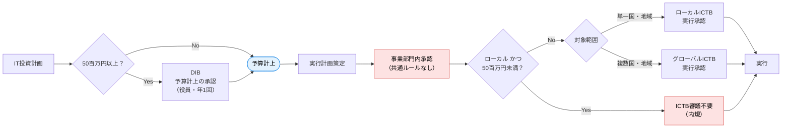
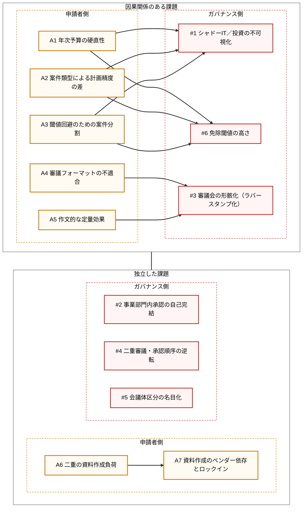
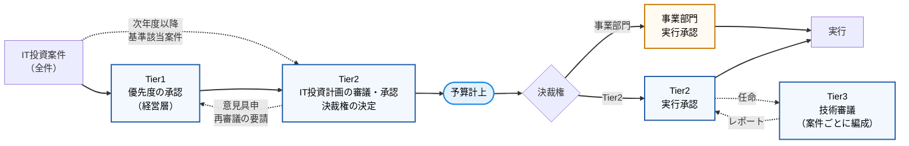

# 新しいIT投資ガバナンスモデルに関する一考察

## 第1章 現状（As-Is）の整理

### 1.1 会議体

| 会議 | 目的 | 承認者 | 対象 | 位置づけ |
|---|---|---|---|---|
| **DIB** | 予算計上の是非 | 役員レベル | 50百万円以上の投資計画（年1回、予算編成前） | 予算承認 |
| **ICTB（ローカル）** | 実行計画の承認 | IT部門責任者 | 単一の国・地域に閉じた案件 | 実行承認 |
| **ICTB（グローバル）** | 実行計画の承認 | IT部門責任者 | 2つ以上の国・地域にまたがる案件 | 実行承認（実態はローカルと同じ） |
| **事業部門内の承認会議** | 自部門予算によるIT投資の承認 | 各事業部門 | 事業部門予算の案件（IT投資の大半が該当） | 共通ルールなし |

補足
- 50百万円未満のローカル案件は、内規によりICTBの審議なしに実行できる。
- 年次予算は策定後、期中に見直さない。

### 1.2 承認の流れ

赤：課題箇所（客観チェックなし／IT部門の関与なし）　青：イベント

### 1.3 課題：ITガバナンス側の視点

| # | 課題名称 | 説明 | 一般的な処方箋 | 当社の状況 |
|---|---|---|---|---|
| 1 | **シャドーIT／投資の不可視化** | IT部門が把握しないIT投資が発生し、全社のIT投資の全体像が見えない | 金額にかかわらず全案件の登録・届出を義務化し、審議の要否とは切り離す。IT投資台帳を一元管理 | 50百万円未満のローカル案件はICTB不要のため、IT部門が関与せず情報すらない案件が存在 |
| 2 | **事業部門内承認の自己完結** | 起案部門と承認部門が同一で、利害から独立した客観的チェックが働かない | 全社共通の審査基準・起案テンプレートを定め、IT部門やPMOによる技術・アーキテクチャ面のレビューを必須化 | 共通ルールがなく、ほとんどの案件が客観チェックなしで承認 |
| 3 | **審議会の形骸化（ラバースタンプ化）** | 審議に必要な情報が不足し、否決や条件付き承認が実質できない | 提出情報の最低要件を定義し、不備は差し戻し。承認・条件付き承認・否決の判断基準を明文化 | IT部門以外の起案案件は情報不足で、ICTBは承認以外の選択肢がない状態 |
| 4 | **二重審議・承認順序の逆転** | 予算・事業側の承認が先行し、後段の審議が追認になる | 審議のゲートと役割を整理（例：構想段階でIT部門が関与するステージゲート化）。後段で変えられない判断は前段に移す | 事業部門で承認済みの案件がICTBに回り、二重審議かつ追認のみ |
| 5 | **会議体区分の名目化** | 区分が形式上存在するが、審議内容・基準に差がない | 区分の目的を再定義するか統合。区分するなら審議観点（グローバル標準・共通基盤への影響など）を変える | ローカル／グローバルICTBは実態として同じ |
| 6 | **免除閾値の高さ** | 審議免除の範囲が広く、ガバナンスの対象外となる投資が大きい | 閾値を見直すとともに、「審議免除」と「報告免除」を分離。少額でも累積・リスク観点（セキュリティ、データ）で対象化 | 50百万円未満のローカル案件は一律免除。事業部門予算主流と重なり空白が拡大 |

#1〜#4は多くの企業で見られる典型的な課題。#6は当社の特徴が強い点。

### 1.4 課題：申請者側の視点

| # | 課題名称 | 説明 | 一般的な処方箋 | 当社の状況 |
|---|---|---|---|---|
| A1 | **年次予算の硬直性** | 期中に予算を見直せないため、翌年度のIT投資をすべて予算編成前に確定させる必要がある | 期中の予算見直し枠や、目的別の枠予算（ポートフォリオ枠）を設け、案件は後から枠内で承認する | 期中見直しなし。DIB時点で全計画の準備が必要 |
| A2 | **案件類型による計画精度の差** | 案件の性質によって、必要性の説明しやすさと計画精度が大きく異なる | 案件類型（RTB／GTB／CTBなど）ごとに審査基準と精度要件を変える。初回は概算で承認し、後続ゲートで精緻化する段階承認 | 継続案件の追加投資は精度・説明性とも高い。EOSL対応は必要性は明確だが精度が低い。CTBは起案自体が困難 |
| A3 | **閾値回避のための案件分割** | 審議を避けるため、案件を分割・改名して閾値未満にする | 同一目的・同一システムの案件は合算判定するルール。全件登録により分割を検知可能にする | CTB案件を50百万円未満に細切れにし、名称を変えてDIBを回避し、事業部内承認で予算計上 |
| A4 | **審議フォーマットの不適合** | IT投資の審議に必要な項目がなく、判断材料が揃わない | IT投資専用の起案フォーマット（アーキテクチャ、セキュリティ、運用体制、TCO、ベンダー、リスクなど） | 経営会議用の汎用フォーマット（設備投資・研究開発と共通）を流用。ビジネスメリット中心 |
| A5 | **作文的な定量効果** | 実態と結びつかない効果が記載され、承認判断にも事後評価にも使えない | 効果を財務効果（PLに反映）と非財務効果に区分して記載させる。承認後の効果追跡（ベネフィットトラッキング） | 工数削減を金額換算するなど、PLに影響しない定量効果が記載される |
| A6 | **二重の資料作成負荷** | 審議の場ごとに別資料を作る必要がある | 起案書を一本化し、同じ資料で事業部門とIT部門が審議（または合同審議） | 事業部門向けとICTB向けに別々に資料を作成 |
| A7 | **資料作成のベンダー依存とロックイン** | 起案作業を外部に委ねることで、社内情報・予算情報がベンダーに集まり交渉力が低下する | 社内の起案支援機能（PMO、ビジネスリレーションシップマネージャー等）の設置。ベンダーへの情報開示範囲のルール化 | 資料作成をベンダーに任せた結果、ベンダーが社内事情と予算に詳しくなり、ロックインが進行 |

### 1.5 課題間の関係

申請者側の課題が、ガバナンス側の課題の原因になっている。

- 年次予算の硬直性（A1）と起案困難（A2）→ 案件分割（A3）→ 不可視化・閾値問題（#1, #6）
- フォーマット不適合（A4）→ 作文化（A5）→ 形骸化（#3）
- 二重作業（A6）→ ベンダー依存（A7）

### 1.6 示唆

- 個々の課題は教科書的だが、複数の課題が重なり、ガバナンスの空白が大きくなっている点が当社の特徴。
- ガバナンス側だけを強化すると、申請者側の回避行動（案件分割など）がさらに増えるリスクがある。両側を同時に手当てする設計が必要。

---

## 第2章 新しいガバナンスモデル

### 2.1 概要

会議体を一新し、Tier1〜Tier3の3階層で構成する。設計の考え方は次の3点。

- **審議の観点を段階ごとに分ける**：経営戦略（Tier1）→ IT投資計画（Tier2）→ 技術（Tier3）の順に、異なる視点で多段階に審議する。
- **金額基準を撤廃する**：全てのIT投資案件をTier1の優先度判断の対象とする。
- **決裁権を明示的に配分する**：予算計上の時点で、実行承認を誰が行うかを案件ごとに決める。

| 会議体 | 参加者 | 審議内容 | 対象 | 決定事項 | 旧会議体 |
|---|---|---|---|---|---|
| **Tier1** | 経営層 | 経営戦略・事業戦略とIT投資の接合性（投資計画の詳細は不要） | 全IT投資案件（金額基準なし） | 優先度 | DIB |
| **Tier2（予算）** | 事業部門長とIT組織の責任者（複数） | IT投資計画 | Tier1で優先度がついた案件 | 予算計上の可否、決裁権（実行承認者） | DIB（予算承認機能） |
| **Tier2（実行）** | 同上 | 実行計画 | 決裁権がTier2にある案件 | 実行承認 | ICTB |
| **Tier3** | 固定メンバーなし。案件ごとにTier2が任命 | 技術面の審議（Tier2の補完） | Tier2が指定した案件 | 審議結果をTier2へレポート | 新設 |
| **事業部門** | 事業部門 | 実行計画 | 決裁権が事業部門に委ねられた案件 | 実行承認 | 事業部門内の承認会議 |

補足
- Tier1で全件を審議するのは初年度に限る。次年度以降は基準をあらかじめ設け、該当案件は最初からTier2で審議することで会議の効率化を検討している。

### 2.2 審議の流れ

旧モデルとの主な違い
- Tier1とTier2は原則として1回ずつ順に実施する。ただし、Tier2の審議でTier1の優先度判断に見直しが必要と判断した場合は、Tier2からTier1へ意見具申を行い、再審議を要請できる。
- 予算計上の前に、IT組織が参加するTier2の審議が必ず入る（旧モデルでは50百万円未満はIT部門の関与なしに予算計上されていた）。
- 実行承認の場は、予算計上時に決めた決裁権に従って一本化される（旧モデルの「事業部門内承認 → ICTB」の二重審議がなくなる）。
- ローカル／グローバルの区分は設けず、審議の観点の違いはTier3の案件別編成で担う。

### 2.3 解決する課題と必要な詳細設計

判定：◎ 解決　○ 部分的に解決（詳細設計次第）　× 対象外（第3章へ）

| 課題 | 判定 | 新モデルでの解決の仕組み | 必要な詳細設計 |
|---|---|---|---|
| #1 シャドーIT／投資の不可視化 | ◎ | 全案件がTier1またはTier2を通るため、IT組織が全IT投資を把握できる | IT投資の定義（対象範囲：SaaS、経費処理案件、保守・更新の扱い）／案件の登録方法と台帳 |
| #6 免除閾値の高さ | ◎ | 金額基準を撤廃し、審議免除の範囲がなくなる | 次年度以降の「Tier2直行」基準（Tier1を省略するだけで、Tier2は省略しない設計とする） |
| A3 閾値回避のための案件分割 | ◎ | 閾値がないため、分割・改名で審議を避ける動機がなくなる | Tier2直行基準が新たな閾値として回避の対象にならないよう、同一目的・同一システムの合算ルールを置く |
| A2 案件類型による計画精度の差 | ◎ | Tier1は詳細不要で戦略との接合性のみを見るため、計画精度の低いCTB案件でも起案できる | Tier1の起案情報（戦略接合性の記載様式）／Tier2で求める計画精度を案件類型（継続・EOSL・CTB）ごとに定義 |
| #4 二重審議・承認順序の逆転 | ◎ | IT組織の関与を予算計上前（Tier2）に前倒しし、実行承認の場は決裁権により一本化 | 予算承認（Tier2）と実行承認（Tier2／事業部門）の審議観点の切り分け |
| #5 会議体区分の名目化 | ◎ | 地域による区分を廃止し、案件の性質に応じてTier3を編成 | Tier3の要否判断とメンバー任命の基準（グローバル標準・共通基盤・セキュリティなど） |
| #2 事業部門内承認の自己完結 | ○ | 予算計上はTier2（事業部門とIT組織の合同）で承認されるため、客観チェックが入る | 決裁権を事業部門に委ねる基準／委ねた案件の報告義務と事後モニタリング（ここが緩いと旧来の自己完結が再現する） |
| #3 審議会の形骸化 | ○ | 観点の異なる多段階審議と、Tier3による技術面の補完で判断材料が揃う | 各Tierの提出情報の最低要件／判断区分（承認・条件付き承認・差し戻し・否決）と基準 |
| A4 審議フォーマットの不適合 | ○ | 会議体の一新に合わせて、IT投資専用の様式を定める前提が整う | Tier1・Tier2・Tier3の各様式（IT投資の審議に必要な項目を含む） |
| A6 二重の資料作成負荷 | ○ | 実行承認の場が一本化され、同一案件を2つの場向けに作り直す必要がなくなる | 段階が進むごとに書き足していく一本の起案書（Tier1の記載をTier2・実行承認で引き継ぐ） |
| A1 年次予算の硬直性 | × | 年次予算の前にTier1・Tier2を行う構造は変わらず、期中の見直しは扱わない | — |
| A5 作文的な定量効果 | × | Tier1が戦略の接合性で優先度を決めるため効果の誇張の動機は弱まるが、効果の定義と追跡は扱わない | — |
| A7 資料作成のベンダー依存とロックイン | × | 起案支援の担い手とベンダーへの情報開示は扱わない | — |

### 2.4 新モデルで新たに生じる論点

- **会議負荷**：初年度はTier1で全件を審議するため、件数に応じた審議方法（一括審議、ポートフォリオ単位の審議など）が必要。
- **スケジュール**：予算編成前にTier1とTier2の2段階を完了させる必要があり、起案開始の時期が前倒しになる。
- **決裁権の委譲が抜け穴になるリスク**：事業部門に決裁権を委ねた案件は、実行段階で旧来と同じ自己完結の構造に戻る。#2の詳細設計が要となる。
- **Tier3の独立性**：Tier2が案件ごとに任命するため、任命の基準と、利害関係者を避ける原則が必要。

### 2.5 第3章への引き継ぎ

新しいガバナンスモデル（会議体の設計）ではカバーできない次の課題を、第3章で扱う。

| 課題 | カバーできない理由 | 一般的な処方箋 | 改善アイデア |
|---|---|---|---|
| A1 年次予算の硬直性 | 予算制度（期中見直しの有無）の問題であり、会議体の設計では変えられない | 期中の予算見直し枠や、目的別の枠予算（ポートフォリオ枠）を設け、案件は後から枠内で承認する | Intakeプロセス（案件受付）の常時運用と、四半期ごとのTier1会議の開催。年次予算では未配分の枠を確保し、四半期のTier1・Tier2で配分する |
| A5 作文的な定量効果 | 効果の定義・測定・事後追跡の仕組みが必要で、承認前の審議だけでは解決しない | 効果を財務効果（PLに反映）と非財務効果に区分して記載させる。承認後の効果追跡（ベネフィットトラッキング） | 起案時に効果指標と測定方法を登録し、財務効果は事業部門の翌年度予算に織り込む。稼働後の効果レビューをTier2の定例議題にする |
| A7 資料作成のベンダー依存とロックイン | 社内の起案支援体制とベンダー管理の問題であり、審議の仕組みの外側にある | 社内の起案支援機能（PMO、ビジネスリレーションシップマネージャー等）の設置。ベンダーへの情報開示範囲のルール化 | IT部門が起案書の作成を支援する窓口を設ける。起案書とベンダーの提案・見積を分離し、予算情報はベンダーに開示しないルールを定める |
