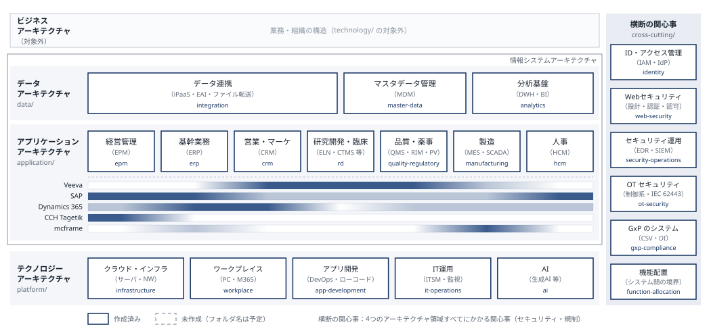
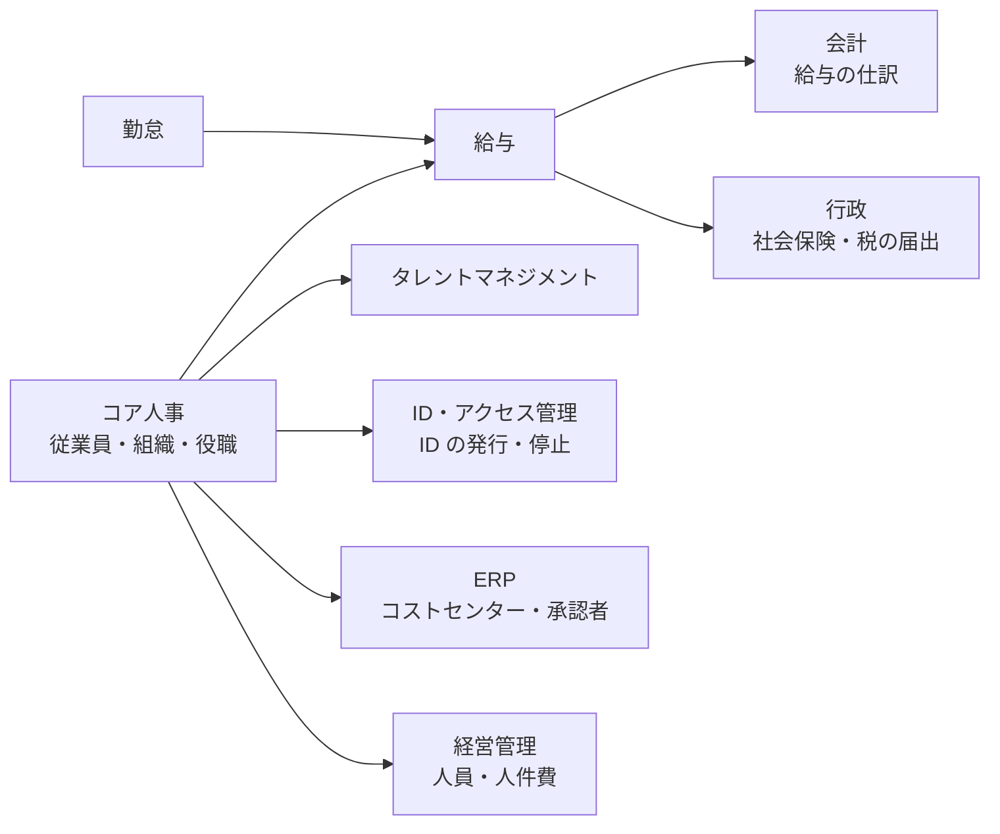
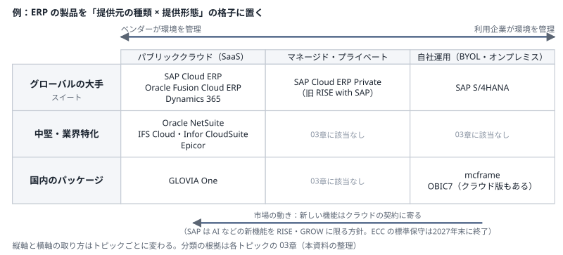
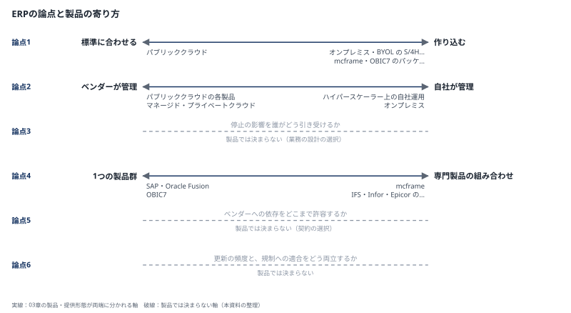
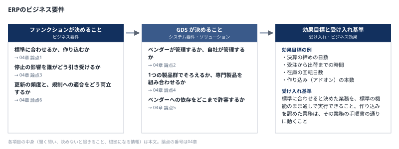
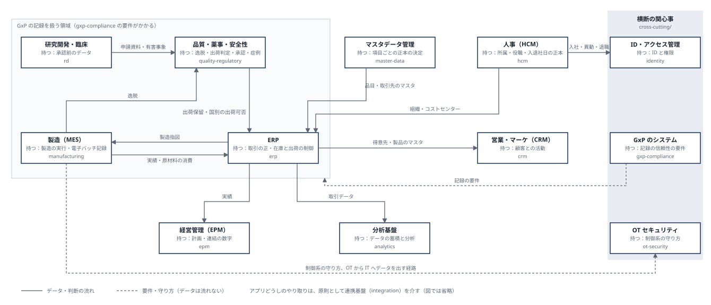

# technology — 技術の地図

技術を体系立てて正しく理解するための知識の整理場所。ソリューション（実現手段）を選ぶための体系資料として、各トピックを同じ観点（01〜05章）で一般論として整理する。トピック間の境界（機能配置）は cross-cutting/function-allocation に1か所でまとめ、当社固有の現状と、それに対する打ち手は各トピックの 06章（と、その補足の付録）にだけ書く。

## 想定読者と使い方

この資料は、ファンクションの窓口を務める担当BPと、インフラまたはセキュリティの担当を読者として想定しています。

担当BPは、04章（主要な論点）と05章（ビジネス要件）を使って、架空の案件を受け付けるロールプレイを行います。持ち込まれた相談を、製品名ではなく何を実現したいのかに問い直し、懸念や要望が04章のどの論点にあたるかを特定したうえで、ソリューションの選定に入ってよいかを判断する、という流れを練習します。

インフラやセキュリティの担当は、テクノロジーアーキテクチャ（platform/）と横断の関心事（cross-cutting/）のトピックを、自分の領域の地図として使います。あわせて、アプリケーションとデータのトピックの02章と機能配置（function-allocation）から、自分が持つ基盤やかける要件が、どのシステムのどこにかかわるかを確かめます。

## 全体像

企業のITを、TOGAF Standard の4つのアーキテクチャ領域（**ビジネス・データ・アプリケーション・テクノロジー**）で捉える。technology/ が扱うのは、このうちビジネスアーキテクチャを除く3つの領域である。ビジネスアーキテクチャ（業務・組織の構造）は technology/ の対象外とする。

TOGAF は、セキュリティアーキテクチャを、4つの領域すべてに関わる**横断の関心事**（cross-cutting concern）として位置づけている。technology/ でもこれに従い、セキュリティを横断の関心事として置く。あわせて、GxP の規制のように、どの領域にも属さずすべての領域のシステムにかかる要件も、横断の関心事に置く。



*図1　TOGAF のアーキテクチャ領域とトピックの位置（実線は作成済み、破線は未作成）*

- **データアーキテクチャ**と**アプリケーションアーキテクチャ**を、TOGAF では合わせて情報システムアーキテクチャと呼ぶ。
- アプリケーションアーキテクチャのトピックは、業務領域ごとに分かれる。各アプリは直接つながず、データアーキテクチャの連携基盤（integration）を介してつなぐ。
- Veeva のように**複数の業務領域にまたがる製品群**は、製品群として1トピックにする。各業務領域のトピックを作ったら、その 03章（製品と提供形態）から製品群のトピックを参照する。
- **テクノロジーアーキテクチャ**のトピックは、すべてのアプリケーションとデータが共通に使う基盤を扱う。
- **横断の関心事**のトピックは、すべての領域のシステムにかかる要件と、それを満たす仕組み（ID の基盤、攻撃の検知と対応、規制への対応など）を扱う。
- トピック間の関係（どのシステムが何を持ち、何を受け渡すか）は、[function-allocation](cross-cutting/function-allocation/function-allocation.md)（機能配置）に1か所でまとめる。各トピックの README から参照する。

## フォルダ構成

```
technology/
├── README.md                    この資料。全体像、フォルダ構成、各章の説明
├── images/
│   └── 00_technology-map.svg    全体図（TOGAF の領域とトピックの位置）
├── data/                        データアーキテクチャ
│   ├── integration/             データ連携：iPaaS・EAI・ファイル転送によるシステム間連携
│   ├── master-data/             マスタデータ管理：品目・取引先・顧客などのマスタと System of Record
│   └── analytics/               分析基盤：DWH・レイクハウス・BI
├── application/                 アプリケーションアーキテクチャ
│   ├── epm/                     経営管理：予算編成、連結、管理会計
│   ├── erp/                     基幹業務：会計・販売・購買・在庫・生産の取引
│   ├── crm/                     営業・マーケティング：医療従事者・医療機関との活動、販促の資材
│   ├── rd/                      研究開発・臨床：ELN・LIMS、CTMS・EDC
│   ├── quality-regulatory/      品質・薬事・安全性：QMS、RIM、PV
│   ├── manufacturing/           製造：ISA-95 の Level 3 以下（MES・SCADA・PLC）、IT と OT の区分
│   ├── hcm/                     人事：人事情報、組織、勤怠・給与
│   └── veeva-platform/          製品群：Veeva（CRM・臨床・品質・薬事にまたがる）
├── platform/                    テクノロジーアーキテクチャ
│   ├── infrastructure/          クラウド・インフラ：IaaS・PaaS、仮想化、ネットワーク
│   ├── workplace/               ワークプレイス：PC、Microsoft 365 などのコラボレーション基盤、端末管理
│   ├── it-operations/           IT運用：ITSM、監視、ジョブ管理
│   ├── app-development/         アプリ開発：DevOps・CI/CD、ローコード、AI のコード支援
│   └── ai/                      AI：生成 AI、LLM、AI エージェント
└── cross-cutting/               横断の関心事
    ├── identity/                ID・アクセス管理：IdP・SSO、ID のライフサイクル、特権 ID
    ├── web-security/            Webセキュリティ：脅威、設計原則、TLS、アプリから見た認証・認可、WAF
    ├── security-operations/     セキュリティ運用：EDR、SIEM、SOC、脆弱性管理
    ├── ot-security/             OT セキュリティ：制御系の守り方、IEC 62443
    ├── gxp-compliance/          GxP のコンピュータ化システム：CSV・CSA、データインテグリティ
    └── function-allocation/     機能配置：システム間の境界（どのシステムが何を持ち、何を受け渡すか）
```

各トピックのフォルダは、同じ構成をとる（function-allocation だけは、全トピックをまたぐ1つの本文で構成する）。

```
<トピック>/
├── README.md                    一言での説明、扱うこと・扱わないこと、ディレクトリ構成、章の作成状況
├── chapters/
│   ├── 01_definition.md         定義と範囲
│   ├── 02_structure.md          構造
│   ├── 03_landscape.md          製品と提供形態
│   ├── 04_tradeoffs.md          主要な論点
│   ├── 05_business-requirements.md  ビジネス要件
│   └── 06_our-company.md        当社の現状（作成したトピックのみ）
├── appendix/                    章に入りきらない詳細（必要なトピックのみ）
└── images/                      構造図など（必要なトピックのみ）
```

## 各章の説明

01〜05章は一般論で、どの会社にも当てはまる内容だけを書く。当社の製品名・構成・経緯・懸念は 06章にだけ書く。

### 01 定義と範囲

01章は、その技術が何であり、どこまでを含んでどこからを含まないかを書く章です。定義に加えて、その技術がなぜ生まれ、どう変わってきたかという成り立ちと、よく使われる用語、扱うものと扱わないものの線引きを書いています。持ち込まれた相談がこのトピックの話なのかを見分けたいときや、関係者のあいだで言葉の意味をそろえたいときに、まずここを開いてください。

### 02 構造

02章は、その技術がどんな部品からできていて、部品のあいだを何が流れるかを、図を中心に示す章です。どのトピックにも構成図を1枚以上入れています（業務の流れを描くときは BPMN を使います）。製品の説明やベンダーの提案を聞くときに、いまどの部品の話をしているのかを位置づけるのに役立ちます。

たとえば HCM（`application/hcm/chapters/02_structure.md`）の「全体の流れ」では、コア人事が持つ従業員と組織の情報が、給与・ID 管理・ERP・経営管理へと渡っていく様子を描いています。



### 03 製品と提供形態



*図2　製品を「提供元の種類 × 提供形態」の格子に置いた例（ERP。本資料の整理）*

03章は、どんな製品があり、それがどの形で提供されているか、そして市場がどう動いているかをまとめた章です。製品の区分ごとの主要な製品と第三者の評価、国内の製品、他の製品に付属する機能、提供形態ごとにベンダーと利用企業がそれぞれ何を管理するか、買収や改称・サポート終了といった市場の動きを書いています。

章の冒頭の図では、製品を一列に並べるのではなく、2つの軸で格子に置いています。縦は製品の区分で、ERP なら提供元の種類（グローバルの大手、中堅・業界特化、国内のパッケージ）です。横は提供形態で、左に行くほどベンダーが環境を管理し、右に行くほど利用企業が管理します。どの形態を選ぶかによって、更新の時期を自社で決められるか、最新の機能を使えるかが変わります。空いている升目は、その組み合わせの製品がないことを表しています。候補を探すときは、自社が求める升目から見ていくとよいでしょう。下の矢印は市場の動きで、升目の中の製品の位置は、買収や提供形態の移行によって動いていきます。

候補の製品を洗い出すときや、提供形態による責任の分担を確かめるときに使ってください。製品と提供形態は変わりやすいため、使う前に各節の日付を確かめてください。

### 04 主要な論点



*図3　04章の論点の図の例（ERP。実線は03章の製品が両端に分かれる軸、破線は製品では決まらない軸）*

04章は、その技術に本質的に伴うトレードオフ、つまり A を取ると何を得て何を失うのかを、「A か B か」という判断の軸として5〜8個にまとめた章です。軸にするのは、どちらを選んでも合理性がある選択だけです。片方が明らかに悪いものは論点とは呼びません。

それぞれの軸には、A と B のそれぞれで得るものと失うものを表で示したうえで、03章の製品が軸のどちら側に寄るかを添えています。図の実線の軸がそれにあたり、ERP の例では、パブリッククラウドは「標準に合わせる」側に、オンプレミスや BYOL は「作り込む」側に寄ります。一方、破線の軸は製品では決まらない選択です。どの製品を選んでも取れるため、製品を比べても差は出ません。

ソリューションを比べるときは、製品の違いが出る実線の軸を並べて比べ、破線の軸は比較に入る前に決めておきます。懸念や要望を聞いたときにも、まずそれがどの軸の話かを特定してください。たとえば「更新のたびに費用がかかる」という声は、ERP の「標準に合わせるか、作り込むか」の軸の話です。

### 05 ビジネス要件



*図4　05章の図の例（ERP）*

05章は、ソリューションを決める前に、ファンクションに何を決めてもらう必要があるかを書いた章です。図のように、ファンクションが決めたビジネス要件（左）をもとに GDS がシステム要件とソリューションを決め（中）、最後に効果目標と受け入れ基準で結果を確かめます（右）。05章は、この流れを技術ごとに具体化したものです。

本文では、04章の論点をファンクションが決めるものと GDS が決めるものに分け、ファンクションが決める項目ごとに、決めること、ファンクションへ投げる問い、決めないままにすると何が起きるか、答えの根拠になる情報を書いています。あわせて、効果目標と受け入れ基準の例と、部門に閉じた案件として扱えない例も載せています。

この章がいちばん役に立つのは、ファンクションから案件が持ち込まれたときです。製品名ではなく、何を実現したいのかを聞き直し、部門に閉じた案件として扱えるかを見極めます。ソリューションの選定に入る前には、図の左の項目と効果目標が決まっているかを確かめ、決まっていなければ選定には入りません。そして稼働したシステムを受け入れるときには、図の右の受け入れ基準で判断してもらいます。

### 06 当社の現状

06章は、当社がこの技術をどう使っていて、何が課題になっているかを書く章です。当社の製品・構成・経緯に加えて、聞き取った懸念が04章のどの論点にあたるかと、それに対する打ち手を書いています。当社の案件を検討するときに、01〜05章の一般論と照らし合わせて、当社がどこに位置しているかを確かめるために使ってください。

## 機能配置

各トピックの05章までは、トピックごとに書く。トピックの間の境界（どのシステムが、どのデータと判断の正本を持ち、何を受け渡すか）は、2つのトピックにまたがるため、`cross-cutting/function-allocation` の1か所にだけ書く。



*図5　機能配置の俯瞰図（重要な関係性だけを抜粋。詳細は [function-allocation](cross-cutting/function-allocation/function-allocation.md)）*

この資料は、どのシステムが、どのデータと判断の正本を持ち、何を受け渡すかを扱います。全体の俯瞰図（図5）に続いて、重要な関係性を3つのパターンで示し、全トピックの境界の一覧、境界を引くときの原則、製品によって動く境界や重なる境界をまとめています。ソリューションを選んだあとで、そのシステムに何を持たせ、何を周りのシステムに任せるかを決めるときに開いてください。
