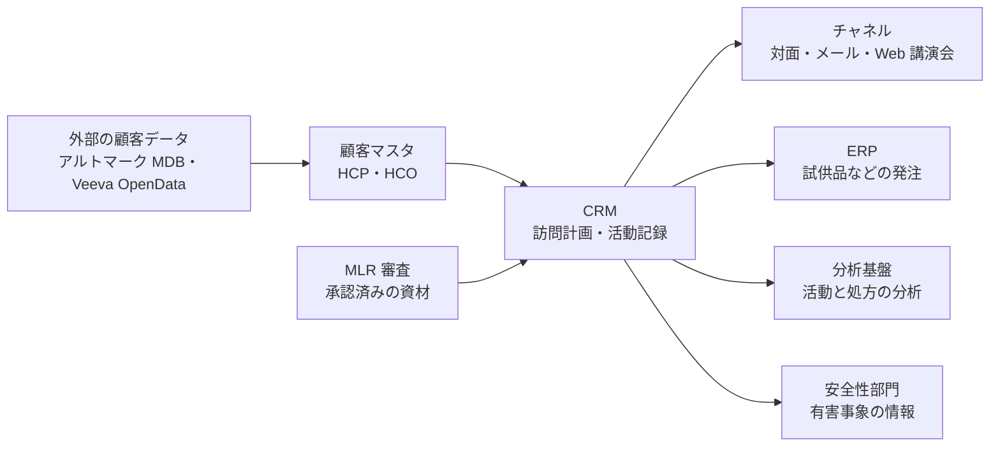

# 02 営業・マーケティング（CRM）の構造

## 要旨

製薬企業の CRM は、**顧客（HCP・HCO）のマスタ**、**活動の記録**、**承認済みの資材**の3つを中心にできている。顧客のマスタは外部のデータベースと結びつき、資材は MLR 審査を通ったものだけが現場に届く。

## 全体の流れ

*図1 製薬企業の CRM の流れ（本資料の整理）*

## CRM が持つデータ

| データ | 内容 |
|---|---|
| 顧客と担当 | どの MR がどの医療従事者・医療機関を担当するか（テリトリー） |
| 活動の記録 | 訪問、メール、講演会への参加。話した製品と使った資材 |
| 計画 | 訪問の頻度の目標、重点の顧客 |
| 同意 | メールなどの連絡を受け取ることへの同意 |
| 試供品 | 渡した試供品の記録 |

## 有害事象の情報

MR が医療従事者から副作用などの情報を聞いた場合は、決められた期限内に安全性部門へ伝える必要がある。CRM の活動記録から安全性部門への連絡の仕組みは、品質・薬事の領域とつながる（本資料の整理、→ quality-regulatory）。

---

**出典**（確認日：2026-11-14）

- 外部の顧客データ：[veeva-platform 付録B](../../veeva-platform/appendix/B_ultmarc-and-japan-hcp-data.md)、[付録H](../../veeva-platform/appendix/H_data-products.md)
- 図1、表の内容は本資料の整理
