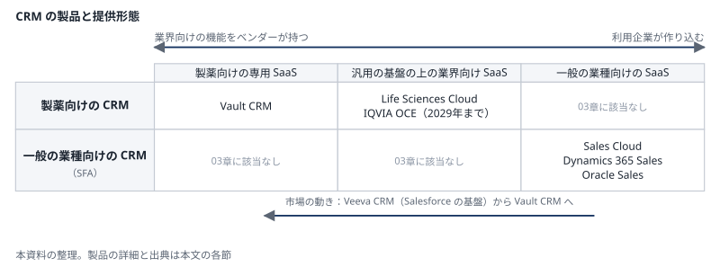

# 03 営業・マーケティング（CRM）の製品と提供形態

## 要旨

製薬企業の CRM は、**製薬向けの専用製品**と**一般の業種向けの CRM（SFA）**に分かれる。製薬向けは、2025年に Veeva と Salesforce の契約が終わってから、Veeva の **Vault CRM** と、Salesforce の **Life Sciences Cloud**（IQVIA の OCE の技術を取り込んだもの）の2つの陣営に分かれた（→ 04章 論点1）。一般の業種向けの CRM は Salesforce・Microsoft・Oracle が中心で、医療従事者の管理や試供品、承認済みの資材の配信などは、製薬向けの製品ほど揃っていない（本資料の整理）。

提供形態はどれも SaaS で、料金は利用者ごとの月額が基本である。旧 Veeva CRM と IQVIA OCE のサポートはいずれも2029年に終わるため、移行の時期が選択の軸になる（→ 04章 論点2）。

*図1　CRM の製品と提供形態（縦は製品の区分、横は提供形態。本資料の整理）*

## 製薬向けの CRM

製薬向けの CRM だけを評価したアナリストの評価は、本資料では確認していない。各社の発表では、次のように陣営が分かれている。

- Veeva は2026年9月、Vault CRM の本番稼働が190社を超え、売上上位20社の製薬企業のうち14社がグローバルでの採用を決めたと発表した。
- Veeva は2025年11月の決算説明会で、上位20社のうち14社が Vault CRM へ移る見込みで、6社は他の製品を選ぶ見込みだと説明した。
- 2025年8月の決算説明会で Veeva は、Salesforce の上位20社からの採用は口頭の合意を含めて3社だと述べた（Veeva 側の発言）。

| 製品 | 提供元 | 補足 |
|---|---|---|
| Vault CRM | Veeva | 旧 Veeva CRM の後継で、Veeva の自社基盤（Vault）上で動く。承認済みの資材（PromoMats）や顧客マスタ（Veeva Network）と同じ基盤でつながる（→ veeva-platform 02章） |
| Veeva CRM（旧製品） | Veeva | Salesforce の基盤上の CRM。2025年9月1日の契約終了で新規の顧客には売れなくなり、サポートは2029年12月31日に終わる（当初の2030年9月から前倒し） |
| Life Sciences Cloud for Customer Engagement | Salesforce | 2025年10月に一般提供。IQVIA から OCE の CRM のソフトウェアのライセンスを受けて開発した。Life Sciences Cloud の各エディションに追加する形で、1人あたり月額 $150 |
| IQVIA OCE（Orchestrated Customer Engagement） | IQVIA | 2017年に始まった製薬向けの CRM。約400社（130か国以上）の顧客を2029年まで支援し、Salesforce の Life Sciences Cloud への移行を両社で進める |

料金は、Salesforce が公表している。Life Sciences Cloud は Enterprise エディションが1人あたり月額 $350（年間契約）で、営業・メディカル向けの Customer Engagement は1人あたり月額 $150 の追加になる。Veeva は価格を公表していない。

## 一般の業種向けの CRM（SFA）

Gartner の Sales Force Automation Platforms の Magic Quadrant 2025年版（2025年7月21日）は13社を評価し、Salesforce・Microsoft・Oracle をリーダーとした。リーダーの顔ぶれは2024年版と同じで、SAP と Pegasystems が Challengers に入った。

| 製品 | 提供元 | 補足 |
|---|---|---|
| Sales Cloud | Salesforce | 製薬向けには、同じ基盤の上に業界向けの Life Sciences Cloud を出している |
| Dynamics 365 Sales | Microsoft | 2025年版で15年連続のリーダー（同社の発表） |
| Oracle Sales | Oracle | 2025年版で9年連続のリーダー（同社の発表） |

製薬企業が一般の業種向けの CRM を使う場合、医療従事者・医療機関のマスタ、テリトリー、試供品、承認済みの資材の配信、有害事象の連絡などを、自社で作り込むことになりやすい（本資料の整理、→ 04章 論点3）。

## 国内の製品と日本固有の要素

製薬向けの国内ベンダーの CRM 製品は、本資料では確認していない。日本の製薬企業も、グローバルの製品を使う例が多い。

- アステラス製薬は2025年6月、Vault CRM をグローバルの CRM に選んだ（中国では Veeva China CRM を使う）。
- 田辺ファーマは2026年5月、Vault CRM と AI の導入を Veeva Japan が発表した。

日本固有の要素は、医療機関・医療従事者のデータ（アルトマークの MDB など）である。どの外部データを顧客マスタに使うかは、04章 論点5 と veeva-platform 付録B に整理している。

## 他の製品に付属する機能

| 機能 | Veeva | Salesforce | 補足 |
|---|---|---|---|
| 資材の承認と配信（MLR） | PromoMats（→ veeva-platform 付録G） | Marketing Cloud Engagement for Life Sciences（追加の製品） | 承認済みの資材だけを現場に届ける仕組み。CRM と同じ陣営で揃えるかが論点になる（→ 04章 論点3） |
| 顧客の外部データ | Veeva OpenData・Veeva Network | IQVIA のデータ（提携による） | 2025年8月の Veeva と IQVIA の和解で、IQVIA のデータを Veeva Network などで使えるようになり、逆も同様になった |

## 提供形態

| 形態 | ベンダーが管理するもの | 利用企業が管理するもの | 例 |
|---|---|---|---|
| 製薬向けの専用 SaaS | 基盤、製薬向けの機能、更新 | テリトリー・権限・入力の画面の設定、外部データと他システムとの連携 | Vault CRM |
| 汎用の基盤の上の業界向け SaaS | 基盤、業界向けのデータモデルと機能、更新 | 上記に加えて、基盤の上での追加の作り込み | Life Sciences Cloud |
| 一般の業種向けの SaaS | 基盤、汎用の営業機能、更新 | 上記に加えて、製薬向けの機能の作り込み | Sales Cloud、Dynamics 365 Sales |

どの形態でも、旧製品からの移行（データ・設定・連携の作り直し）は利用企業の負担になる（本資料の整理、→ 04章 論点2）。

## 市場の動き

| 時期 | できごと |
|---|---|
| 2024年4月8日 | IQVIA と Salesforce が提携を広げ、OCE の技術を Life Sciences Cloud に取り込むと発表した。Salesforce は、製薬向けの営業の自動化の機能を2025年9月1日より後まで販売しないとした |
| 2025年8月13日 | Veeva と IQVIA が2017年からの訴訟を和解し、互いのデータとソフトウェアを顧客が組み合わせて使えるようにした |
| 2025年9月1日 | Veeva と Salesforce の基盤の契約が終わった |
| 2025年10月 | Salesforce が Life Sciences Cloud for Customer Engagement の一般提供を始めた |
| 2026年9月 | Vault CRM の本番稼働が190社を超えた（Veeva の発表） |
| 2029年 | IQVIA OCE の顧客の支援の期限。旧 Veeva CRM のサポートは2029年12月31日に終わる |

## 本資料でまだ扱っていないもの

- 製薬向けの CRM を対象にした、第三者による製品の比較
- Veeva の料金
- 国内の SFA 製品と、日本の製薬企業での採用の全体像
- マーケティングの自動化（MA）の専門製品

---

**出典**（確認日：2026-11-14）

- Vault CRM の本番稼働と上位20社の採用：Veeva Japan（2026-09-30、Veeva の 2026-09-23 の発表の抄訳）— https://www.veeva.com/jp/resources/vault-crm-extends-market-leadership-as-another-top-20-biopharma-chooses-veeva/ 、英語の原文 — https://www.veeva.com/eu/?p=103155
- 上位20社のうち14社が移る見込み：Veeva FY2026 第3四半期の決算説明会（2025-11）の要約 — https://www.alphaspread.com/security/nyse/veev/investor-relations/earnings-call/q3-2026
- Salesforce の上位20社の採用（Veeva 側の発言）：The Motley Fool（2025-08-27、決算説明会の要約）— https://www.fool.com/data-news/2025/08/27/veeva-systems-lifts-outlook-on-crm-wins
- 旧 Veeva CRM のサポート終了の前倒し：Veeva「Fiscal 2026 Fourth Quarter Results」（2026-03-04）— https://ir.veeva.com/news/news-details/2026/Veeva-Announces-Fourth-Quarter-and-Fiscal-Year-2026-Results/default.aspx
- Life Sciences Cloud の一般提供：Salesforce — https://www.salesforce.com/au/life-sciences/cloud/ 、料金：Salesforce の料金表 — https://www.salesforce.com/life-sciences/cloud/pricing/ 、FY26 の料金の資料 — https://www.salesforce.com/en-us/wp-content/uploads/sites/4/Industry%20-%20HLS/FY26-LSC-Pricing-Datasheet-v3.pdf
- IQVIA と Salesforce の提携、OCE の顧客数と支援の期限：IQVIA（2024-04-08）— https://iqvia.com/newsroom/2024/04/iqvia-and-salesforce-expand-global-partnership-to-accelerate-the-development-of-life-sciences-cloud
- Veeva と IQVIA の和解：Veeva の Form 8-K（2025-08-18）の要約 — https://www.boardroomalpha.com/sec/veev-8-k-2025-08-18-0001393052-25-000058 、HLTH（2025-08-20）— https://hlth.com/insights/news/iqvia-and-veeva-systems-end-eight-year-legal-battle-with-strategic-partnership-2025-08-20
- SFA の Magic Quadrant 2025年版：Gartner の要約 — https://www.gartner.com/en/documents/6747034 、評価社数と各象限：CX Today（2025-08-11）— https://www.cxtoday.com/crm/gartner-magic-quadrant-for-sales-force-automation-platforms-sfa-2025-the-rundown/ 、Microsoft — https://www.microsoft.com/en-us/dynamics-365/blog/?p=195074 、Oracle — https://blogs.oracle.com/cx/oracle-named-a-leader-in-the-2025-gartner-magic-quadrant-for-sales-force-automation-platforms-for-the-9th-consecutive-year
- アステラス製薬の採用：PharmaFile（2025-06-04）— https://pharmafile.com/news/astellas-selects-veeva-vault-crm-as-global-commercial-platform/ 、田辺ファーマ：Veeva Japan（2026-05-22）— https://www.veeva.com/jp/resources/tanabe-pharma-has-accelerated-its-transformation-into-a-data-driven-organization-by-implementing-veevas-next-generation-platform/
- 一般の業種向けの CRM で作り込みが要る点、提供形態の表は、上記の出典と 02章をもとにした本資料の整理
- 製品の区分は 2026-11 時点の各社の公表情報による。契約の判断の前には各社の最新の資料で確かめる
