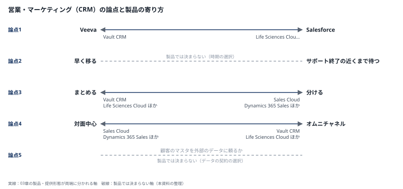

# 04 営業・マーケティング（CRM）の主要な論点

## 要旨

製薬企業の CRM を扱うときに出てくる軸は次の5つである（本資料の整理）。

1. Veeva か、Salesforce か
2. 移行をいつ行うか
3. 営業・メディカル・マーケティングを1つの CRM にまとめるか
4. 対面中心か、オムニチャネルか
5. 顧客のマスタを外部のデータに頼るか

*図1　営業・マーケティング（CRM）の論点と製品の寄り方（実線は03章の製品が両端に分かれる軸、破線は製品では決まらない軸。本資料の整理）*

## 論点1：Veeva か、Salesforce か

| | Veeva（Vault CRM） | Salesforce（Life Sciences Cloud） |
|---|---|---|
| 得るもの | 品質・薬事・臨床と同じ Vault の上で、資材の承認から配信までがつながる | Data Cloud・MuleSoft などで外部のデータとの連携が広い |
| 失うもの | 製品群への依存が深まる（→ veeva-platform 付録D） | 製薬の営業向け製品としての歴史が短い（一般提供は2025年10月） |

詳細は veeva-platform 付録C。

**製品・提供形態との対応**（→ 03章）

| | Veeva（Vault CRM）に寄るもの | Salesforce（Life Sciences Cloud）に寄るもの |
|---|---|---|
| 製品・提供形態 | Vault CRM。品質・薬事・臨床と同じ Vault の上にある | Life Sciences Cloud for Customer Engagement。Salesforce の基盤と Data Cloud の上にある |

## 論点2：移行をいつ行うか

| | 早く移る | サポート終了の近くまで待つ |
|---|---|---|
| 得るもの | 移行の支援を受けやすく、新しい機能を早く使える | 他社の移行の結果を見てから判断できる |
| 失うもの | 製品の成熟を待たずに移ることになる | 期限の近くに移行が集中し、人手と支援が足りなくなる |

大手製薬の移行には2〜3年かかるとされる。

**製品・提供形態との対応**（→ 03章）：製品では決まらない（時期の選択）。期限を決めるのは旧製品の Veeva CRM のサポート終了である（→ 03章「市場の動き」）

## 論点3：営業・メディカル・マーケティングを1つにまとめるか

| | まとめる | 分ける |
|---|---|---|
| 得るもの | 同じ医療従事者への働きかけを部門をまたいで見られ、重複を避けられる | 部門ごとの規制（販促とメディカルの区別）を守りやすい |
| 失うもの | 販促とメディカルの情報の扱いを、権限で厳密に分ける必要がある | 同じ顧客への働きかけが重なる |

**製品・提供形態との対応**（→ 03章）

| | まとめるに寄るもの | 分けるに寄るもの |
|---|---|---|
| 製品・提供形態 | Vault CRM、Life Sciences Cloud、IQVIA OCE。営業・メディカル・資材の機能を1つの製品群で持つ | Sales Cloud、Dynamics 365 Sales、Oracle Sales などの一般の業種向けの SaaS に、部門ごとの仕組みを足す形 |

## 論点4：対面中心か、オムニチャネルか

| | 対面中心 | オムニチャネル |
|---|---|---|
| 得るもの | MR の活動の記録と管理に集中できる | 医療従事者の好む経路で働きかけられる |
| 失うもの | 面会の機会が減ると働きかけが届かない | チャネルごとの同意と、資材の承認の管理が複雑になる |

**製品・提供形態との対応**（→ 03章）

| | 対面中心に寄るもの | オムニチャネルに寄るもの |
|---|---|---|
| 製品・提供形態 | Sales Cloud、Dynamics 365 Sales、Oracle Sales。活動と商談の記録が中心 | Vault CRM、Life Sciences Cloud、IQVIA OCE。チャネルごとの同意と、承認済みの資材の配信の機能を持つ |

## 論点5：顧客のマスタを外部のデータに頼るか

master-data の04章（論点4）と同じ。国内では、アルトマークの MDB などの外部 DB を基準にする例がある（→ veeva-platform 付録B）。

**製品・提供形態との対応**（→ 03章）：製品では決まらない（データの契約の選択）。どの製品も外部の顧客データと組み合わせて使う（→ 03章「顧客の外部データ」）

---

**出典**（確認日：2026-11-14）

- 大手製薬の移行期間：R&D World — https://www.rdworldonline.com/salesforce-brings-agents-to-enterprise-scale-in-life-sciences/
- 5つの軸と各表の内容は、01〜03章と veeva-platform 付録C・D をもとにした本資料の整理
- 各論点の「製品・提供形態との対応」は、03章の製品をもとにした本資料の整理
