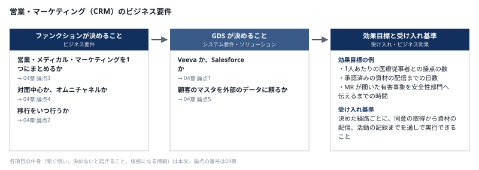

# 05 営業・マーケティング（CRM）のビジネス要件

## 要旨

CRM の製品を選ぶ前に、ファンクション（営業・メディカル・マーケティング）には**どの経路で医療従事者に働きかけ、部門の間で顧客の情報をどこまで共有するか**を決めてもらう。これは販促とメディカルの規制の区別に直結する。

この章は、governance/budget-transfer の kickoff 資料（IT 予算移管の要点）にある役割分担を、この技術について具体化したものである。

*図1　営業・マーケティング（CRM）のビジネス要件（ファンクションが決めたビジネス要件をもとに GDS がシステム要件とソリューションを決め、効果目標と受け入れ基準で確かめる）*

## ファンクションが決めること（ビジネス要件）

### 営業・メディカル・マーケティングを1つにまとめるか

- **決めること**：営業・メディカル・マーケティングで共有する範囲（→ 04章 論点3）
- **聞く問い**：「同じ医療従事者への働きかけを、どの部門まで見られるようにするか。販促とメディカルの情報をどう分けるか」
- **決めないと起きること**：共有の範囲が決まらないまま1つの製品にまとめ、規制の区別を権限で後から作り直すことになる
- **根拠になる情報**：社内の規程（販促とメディカルの区別）、部門の数と人数

### 対面中心か、オムニチャネルか

- **決めること**：働きかけの経路（対面・Web 講演会・メールなど）（→ 04章 論点4）
- **聞く問い**：「今後3年で、対面とそれ以外の比率をどう変えたいか」
- **決めないと起きること**：対面の記録だけの仕組みを選び、オムニチャネルに移るときに作り直しになる
- **根拠になる情報**：面会の件数の推移、医療従事者の好む経路の調査

### 移行をいつ行うか

- **決めること**：移行の時期（→ 04章 論点2）
- **聞く問い**：「新しい CRM を使い始める時期の制約（決算期、組織の変更、営業の繁忙期）は何か」
- **決めないと起きること**：旧製品のサポート終了の近くに移行が集中し、人手と支援が足りなくなる
- **根拠になる情報**：旧製品のサポート終了の時期（→ 03章）、営業の年間の予定

## GDS が決めること

- Veeva か、Salesforce か（→ 04章 論点1）。ファンクションの業務の進め方への影響が大きいため、比較の結果はファンクションと合意する
- 顧客のマスタを外部のデータに頼るか（→ 04章 論点5）

## 効果目標と受け入れ基準

- **効果目標の例**：1人あたりの医療従事者との接点の数、承認済みの資材の配信までの日数、MR が聞いた有害事象を安全性部門へ伝えるまでの時間
- **受け入れ基準**：決めた経路ごとに、同意の取得から資材の配信、活動の記録までを通しで実行できること

## 部門に閉じた案件として扱えないとき

- 顧客のマスタ（医療従事者・医療機関）を全社で共有するため、マスタの連携が必ず生じる
- MR が聞いた有害事象を安全性部門へ伝える入口になり、安全性の業務と規制に関わる
- 医療従事者の個人情報を扱う

境界の詳細（どのシステムが何を持つか）は [function-allocation](../../../cross-cutting/function-allocation/function-allocation.md) を参照。

---

**出典**（確認日：2026-11-15）

- 役割分担の原則と4つの場面：governance/budget-transfer の kickoff 資料（IT 予算移管の要点、2026-11-02 初版）
- 項目の立て方、問い、例は、04章の論点をもとにした本資料の整理
