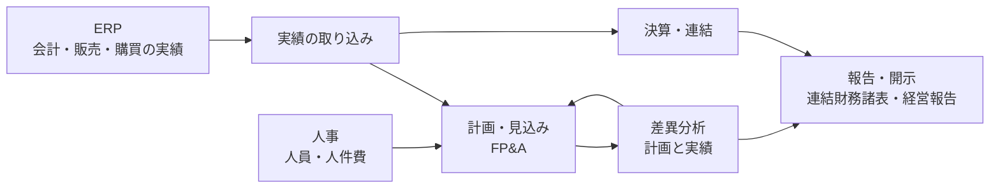

# 02 経営管理（EPM）の構造

## 要旨

EPM は、**計画の流れ**（立てる → 比べる → 見直す）と、**決算の流れ**（各社の数字を集める → 照合・消去する → グループの数字を出す）の2つでできている。どちらも、実績は ERP から受け取る。

## 全体の流れ

*図1 EPM の流れ（本資料の整理）*

## 計画の流れ

| 段階 | 内容 |
|---|---|
| 計画の前提を決める | 為替・成長率・人員などのドライバーと、配賦の基準 |
| 計画を入力・集計する | 部門ごとに入力し、全社で集計。トップダウンの目標とすり合わせる |
| 実績と比べる | 月次で ERP の実績を取り込み、差異を分析する |
| 見込みを更新する | 差異を踏まえて、年度末の見込みや翌期以降の計画を見直す |

## 決算・連結の流れ

| 段階 | 内容 |
|---|---|
| 各社の決算 | 各社が ERP で単体の決算を締める |
| 連結用のデータを集める | 各社から、連結に必要な数字（連結パッケージ）を集める |
| 照合・消去 | グループ内の取引・債権債務を照合し、消去する。為替換算、持分の調整を行う |
| 連結財務諸表を作る | グループ全体の財務諸表と、開示用の資料を作る |

## EPM が持つデータ

| データ | 内容 | 正本（本資料の整理） |
|---|---|---|
| 計画・見込み | 予算、フォーキャスト | EPM |
| 実績 | 勘定科目別・部門別の金額 | ERP（EPM は集計して持つ） |
| 連結の調整 | 消去仕訳、換算差額 | EPM（連結製品） |
| 勘定科目・組織の階層 | 集計の軸 | ERP または MDM（→ master-data） |

---

**出典**（確認日：2026-11-14）

- 計画と決算・連結の流れ、図1、表の内容は、一般的な業務をもとにした本資料の整理
