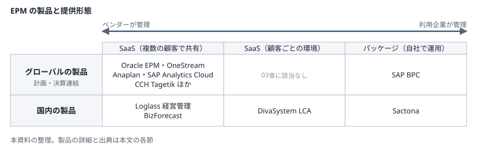

# 03 経営管理（EPM）の製品と提供形態

## 要旨

EPM の製品は、**財務計画（FP&A）**と**決算・連結**の2つの市場に分かれ、Gartner も別々に評価している。グローバルでは、両方を1つの基盤で提供するスイート型（OneStream、Oracle、CCH Tagetik）と、計画を中心にする製品（Anaplan、Board、Jedox、Workday など）がある。日本では、**連結は国内のパッケージ（DivaSystem LCA が市場の約半数）**、**予算は Excel を入出力に使う国内製品**が広く使われている。ERP に付属する機能（SAP の Group Reporting と SAP Analytics Cloud、Dynamics 365 Finance の計画機能）も選択肢になり、専用の製品にするかが選択の軸になる（→ 04章 論点2）。

提供形態は SaaS が主流で、国内の製品もパッケージから SaaS への移行が進んでいる。市場では、投資ファンドによる非公開化（Anaplan、OneStream）と、SAP BPC の保守終了に伴う乗り換えが動いている。

*図1　EPM の製品と提供形態（縦は製品の区分、横は提供形態。本資料の整理）*

## 財務計画（FP&A）

Gartner の Financial Planning Software の Magic Quadrant 2025年版（2025年12月1日）は14社を評価し、8社をリーダーとした。Anaplan の発表によると、リーダーの象限には Oracle・Anaplan・OneStream・SAP・Workday が並び、Challengers には IBM と Vena が入った。Board・Jedox・Wolters Kluwer も、各社の発表でリーダーとされている。

| 製品 | 提供元 | 補足 |
|---|---|---|
| Oracle Fusion Cloud EPM（Planning） | Oracle | 計画・決算連結・勘定照合などを同じ EPM Cloud で提供する。ライセンスは Standard と Enterprise の2段階（下記） |
| OneStream | OneStream（2026年4月に Hg が買収し、非公開化） | 計画と決算・連結を1つの基盤で提供する。2026年版の決算・連結の Magic Quadrant でもリーダー |
| Anaplan | Anaplan（2022年6月に Thoma Bravo が買収し、非公開化） | 財務に限らず、販売・サプライチェーン・人員などの計画をつなげて作る（同社は Connected Planning と呼ぶ） |
| SAP Analytics Cloud（計画） | SAP | SAP Business Data Cloud の一部。S/4HANA・SuccessFactors・IBP と組み合わせた全社の計画を打ち出す。SAP は、新しい計画には SAP Analytics Cloud を第一の選択肢としている（→「他の製品に付属する機能」） |
| CCH Tagetik | Wolters Kluwer | 計画・決算連結・ESG・税務・開示を1つの基盤で提供する。決算・連結の Magic Quadrant でもリーダー |
| Workday Adaptive Planning | Workday | Workday の製品（旧 Adaptive Insights）。機能の違いは本資料では未確認 |
| Board | Board | 2025年版で4年連続のリーダー（同社の発表）。機能の違いは本資料では未確認 |
| Jedox | Jedox | 2026年版の決算・連結の Magic Quadrant でも評価の対象に入っている。機能の違いは本資料では未確認 |

料金は、**利用者（名前付きの利用者）ごとの月額**が基本で、多くの製品は価格を公表していない。Oracle EPM Cloud は、Oracle のパートナーの解説（2023年）によると、Standard（1人あたり月額 $250、10人から）と Enterprise（同 $500、25人から）の2段階がある。Standard は1つの業務（計画、連結など）が対象で、Enterprise は収益性・原価管理、税務報告、マスタ管理（Enterprise Data Management）まで含む。従業員数で課金する方式（Hosted Employee）もある。いずれも Oracle の公式の価格表では確認していない。

## 決算・連結

Gartner の Financial Close and Consolidation Solutions の Magic Quadrant 2026年版（2026年3月9日）は14社を評価した。OneStream・Oracle・Wolters Kluwer（CCH Tagetik）がそれぞれリーダーとされたと発表している。評価の対象には、insightsoftware・Jedox・Planful・Prophix・Vena なども含まれる。2025年版（2025年3月25日、15社を評価）でも、リーダーは同じ3社だった。

| 製品 | 提供元 | 補足 |
|---|---|---|
| Oracle Financial Consolidation and Close | Oracle | EPM Cloud の業務の1つ。複数の ERP の勘定科目の対応づけと消去を自動化することを打ち出す |
| OneStream | OneStream | 2026年版では、評価した14社のうちビジョンの完全性がもっとも高い位置（同社の発表） |
| CCH Tagetik Financial Close & Consolidation | Wolters Kluwer | 単体の決算からグループの連結、制度の開示までを扱い、勘定照合・ESG・グローバル・ミニマム課税にも広げている |

Wolters Kluwer の発表によると、2026年版の Gartner は、この市場の関心が「クラウドへの移行」から「自律的な決算（autonomous close）を支える統合された基盤」へ移ったとしている。

## 国内の製品

日本では、連結会計・予算管理とも、国内のベンダーの製品が広く使われている。ここでは、各社が公表している事実を挙げる。シェアの数字は各社が委託または引用した調査によるもので、第三者が製品を比べたものではない。

### 連結会計

| 製品 | 提供元 | 補足 |
|---|---|---|
| DivaSystem LCA | ディーバ（アバントグループ） | 富士キメラ総研の調査で、連結会計管理ソフトの市場で14年連続1位。2024年度の占有率は、パッケージで49%、SaaS で65.3%。累計の導入は約1,200社で、2020年に始めた SaaS は400社以上（同社の発表、2025年）。SaaS は AWS 上で、顧客ごとに環境を分ける方式（シングルテナント）で運用している |
| STRAVIS | 電通総研 | 連結会計・管理会計・グループ会社からのデータ収集の基盤。サステナビリティの情報の収集も扱う。最新版は Ver.7.1（2025年11月） |
| BizForecast FC | プライマル | 連結会計の SaaS（FC Standard）。予算管理の BizForecast BC と同じシリーズ |

### 予算・計画

| 製品 | 提供元 | 補足 |
|---|---|---|
| Loglass 経営管理 | ログラス | 富士キメラ総研の調査で、予実管理ソフトウェア（SaaS/PaaS）の2025年度の市場シェア1位（同社の発表）。人員計画・設備投資計画・IT 投資管理の製品も出している |
| BizForecast BC | プライマル | 予算管理の SaaS（BC Standard） |
| Sactona | アウトルックコンサルティング（マネーフォワードの子会社） | Excel を入出力の画面に使う。クラウドとオンプレミスの両方で提供する |

グローバルの製品との違いは、**Excel の様式を入出力にそのまま使えること**と、**日本の連結決算・開示の実務に合わせた標準の機能**にある（本資料の整理）。表計算で続けるか製品に移すか（→ 04章 論点1）の中間にあたる選択肢になる。

## 他の製品に付属する機能

ERP のベンダーも、計画と連結の機能を出している。ERP の実績とつなぎやすい一方、ERP の外の会社の数字を扱う場合は、データの収集の仕組みが別に要る（→ 04章 論点2）。

| ERP | 連結 | 計画 | 補足 |
|---|---|---|---|
| SAP S/4HANA | S/4HANA Finance for group reporting。連結を S/4HANA の中で行い、別の決算の工程にしない。S/4HANA の外のデータを集めるには、別のライセンスの Group Reporting Data Collection を使う | SAP Analytics Cloud | 従来の SAP BPC は、10.1（NetWeaver 版）の通常の保守が2027年末に終わり、有償の延長保守は2030年末まで。BW/4HANA 版の最新版は、少なくとも2040年まで保守される。SAP は、新しい計画には SAP Analytics Cloud を第一の選択肢としている |
| Microsoft Dynamics 365 Finance | 同じデータベースの中の法人をまとめる Consolidate online と、消去のルール。報告は Financial reporting で行う | Business performance planning（2023年12月31日に一般提供）。Dataverse の上で動き、Excel と Power BI で入力・分析する | 計画と分析の機能は、Dynamics 365 Finance Premium としてまとめて販売されている |
| Oracle Cloud ERP | Oracle EPM Cloud（上記） | Oracle EPM Cloud（上記） | Oracle Fusion Cloud EPM は Oracle Cloud ERP の一部として提供される |

## 提供形態

| 形態 | ベンダーが管理するもの | 利用企業が管理するもの | 例 |
|---|---|---|---|
| SaaS（複数の顧客で共有） | 基盤、製品の更新 | 計画・連結のモデル（勘定科目・組織の軸、計算のルール、入力の様式）、データ連携、権限 | グローバルの主要製品、Loglass 経営管理 |
| SaaS（顧客ごとに環境を分ける） | 顧客ごとの環境の運用、製品の更新 | 同上 | DivaSystem LCA の SaaS |
| パッケージ（自社で運用） | ソフトウェアの提供と保守 | 上記に加えて、サーバ・データベース・更新の適用 | Sactona のオンプレミス版、SAP BPC |

どの形態でも、**モデルの設計と保守は利用企業に残る**。製品の費用より、モデルを作り直し続ける手間が負担になりやすい（→ 04章 論点1、論点4、本資料の整理）。

## 市場の動き

- 2022年6月：Thoma Bravo が Anaplan の買収を完了（約104億ドル）し、Anaplan は非公開化した。
- 2024年12月：マネーフォワードが、公開買付けで Sactona のアウトルックコンサルティングを子会社にした。2026年1月には、完全子会社化に向けた公開買付けが終了した（報道による）。
- 2026年4月1日：Hg が OneStream の買収を完了（約64億ドル）し、OneStream は上場から2年足らずで非公開化した。
- SAP BPC の保守の終了（上記）に伴い、SAP Analytics Cloud と Group Reporting への移行か、専用の EPM 製品への乗り換えかの検討が進んでいる。
- 国内では、パッケージから SaaS への移行が進んでいる（ディーバの発表）。

## 本資料でまだ扱っていないもの

- Oracle 以外の製品の料金と、国内製品の料金
- Workday・Board・Jedox など、計画を中心にする製品どうしの機能の違い
- 勘定照合・決算タスク管理などの周辺の製品（BlackLine など）
- 国内製品の導入社数・シェアの、第三者による比較（本章の数字は各社の発表による）

---

**出典**（確認日：2026-11-14）

- 財務計画の Magic Quadrant 2025年版（2025-12-01、14社）：Gartner の要約 — https://www.gartner.com/en/documents/7231730 、リーダーの象限の顔ぶれと評価社数：Anaplan（2025-12-04）— https://www.anaplan.com/news/gartner-mq-financial-planning-software-2025/ 、SAP（2025-12）— https://news.sap.com/2025/12/sap-a-leader-gartner-magic-quadrant-financial-planning-software/ 、Board — https://community.board.com/discussion/19782/the-2025-gartner-magic-quadrant-for-financial-planning-software 、Wolters Kluwer — https://www.wolterskluwer.com/cs-cz/expert-insights/gartner-mq-fpa 、Jedox — https://www.jedox.com/en/blog/jedox-leader-in-2025-gartner-magic-quadrant 、Workday — https://newsroom.workday.com/2025-12-04-Workday-Recognized-as-a-Leader-in-2025-Gartner-R-Magic-Quadrant-TM-for-Financial-Planning-Software-for-Fourth-Year-in-a-Row
- 決算・連結の Magic Quadrant 2026年版（2026-03-09、14社）：Gartner の要約（評価の対象の一部）— https://www.gartner.com/en/documents/7561521 、OneStream（2026-03-11）— https://www.onestream.com/news/onestream-named-a-4x-leader-and-placed-furthest-in-vision-in-the-2026-gartner-magic-quadrant-for-financial-close-and-consolidation-solutions/ 、Oracle — https://www.oracle.com/jp/performance-management/gartner-financial-close-magic-quadrant/ 、Wolters Kluwer（2026-03-11、市場の関心の移り変わり）— https://www.wolterskluwer.com/en-ca/news/pr-2026-cch-tagetik-leader-in-gartner-magic-quadrant-for-financial-close-consolidation-solutions
- 決算・連結の Magic Quadrant 2025年版（2025-03-25、15社）：OneStream（2025-04-01）— https://www.onestream.com/news/onestream-again-recognized-as-a-leader-in-the-2025-gartner-magic-quadrant-for-financial-close-and-consolidation-solutions/ 、Wolters Kluwer — https://www.wolterskluwer.com/nb-no/news/pr-2025-cch-tagetik-leader-gartner-magic-quadrant-financial-close-consolidation
- CCH Tagetik の決算・連結の範囲：Wolters Kluwer — https://www.wolterskluwer.com/en-in/expert-insights/gartner-mq-financial-close-consolidation
- SAP Analytics Cloud と SAP Business Data Cloud：SAP（2025-12）— https://news.sap.com/2025/12/sap-a-leader-gartner-magic-quadrant-financial-planning-software/
- Oracle EPM Cloud の Standard と Enterprise：Version 1（Oracle のパートナー、2023-06-03）— https://www.version1.com/oracle-epm-cloud-options-pricing-what-you-need-to-know 、Enterprise の最低25人：Jade Global — https://jadeglobal.com/blog/oracle-epm-cloud-product-and-pricing-evolution 、Hosted Employee の課金方式：Redress Compliance — https://redresscompliance.com/oracle-epm-cloud-licensing-pricing-expert-insights/ 。Oracle の公式の価格表では未確認
- DivaSystem LCA のシェア・導入社数（富士キメラ総研「ソフトウェアビジネス新市場 2025年版」の引用）：アバントグループの発表（PR TIMES）— https://webtan.impress.co.jp/r/prtimes/items/000000479.000016467 、SaaS の運用方式：EnterpriseZine — https://enterprisezine.jp/news/detail/18705
- STRAVIS Ver.7.1（2025-11-20）：クラウド Watch — https://cloud.watch.impress.co.jp/docs/news/2065043.html
- BizForecast BC Standard・FC Standard：プライマル — https://www.primal-inc.com/
- Loglass のシェア（富士キメラ総研「ソフトウェアビジネス新市場 2026年版」の引用）と製品の構成：ログラスの会社紹介資料（2026年1月）— https://speakerdeck.com/loglass2019/whats-loglass
- Sactona の特徴と提供形態：アウトルックコンサルティング 有価証券報告書（EDINET の転載）— https://edinetdb.jp/company/E39126/text 、マネーフォワードによる公開買付け：マネーフォワードの開示（2024-11-13）— https://www2.jpx.co.jp/disc/39940/140120241112519107.pdf 、アウトルックコンサルティングの開示（2024-12-12）— https://www2.jpx.co.jp/disc/55960/140120241212537687.pdf 、完全子会社化に向けた公開買付けの終了：日本M&Aセンターのニュース — https://www.nihon-ma.co.jp/news/20251112_3994-20/
- SAP S/4HANA Finance for group reporting：SAP — https://www.sap.com/products/financial-management/s4hana-financial-consolidation.html 、SAP Learning — https://learning.sap.com/courses/outlining-consolidation-with-group-reporting/outlining-group-reporting_bbf2b6ca-1b18-4d2f-9744-825445c100a8 、Group Reporting Data Collection の別ライセンス：NTT DATA Business Solutions — https://nttdata-solutions.com/us/local-blog/life-after-sap-bpc/
- SAP BPC の保守の期限：SAP Community（2023-01-23）— https://blogs.sap.com/2023/01/23/maintenance-timelines-for-sap-business-planning-and-consolidation-sap-bpc/
- Dynamics 365 Finance の連結：Microsoft Learn「Financial consolidations and currency translation overview」— https://learn.microsoft.com/en-us/dynamics365/finance/general-ledger/financial-consolidations-currency-translation 、計画：Microsoft Learn「Business performance planning overview」— https://learn.microsoft.com/en-us/dynamics365/finance/business-performance-planning/business-performance-planning-overview 、一般提供の日と Finance Premium：Microsoft（2023-12-06）— https://www.microsoft.com/en-us/dynamics-365/blog/business-leader/2023/12/06/enhance-business-performance-agility-with-microsoft-dynamics-365-finance-premium/
- Anaplan の買収の完了（2022-06-22）：Thoma Bravo — https://www.thomabravo.com/press-releases/thoma-bravo-completes-acquisition-of-anaplan
- OneStream の買収の完了（2026-04-01）：OneStream — https://investor.onestream.com/node/9316/pdf 、上場からの期間：ERP Today — https://erp.today/hg-acquires-onestream-to-accelerate-finance-ai-platform-development/
- 国内製品とグローバル製品の違い、提供形態の表、モデルの設計が利用企業に残る点は、上記の出典をもとにした本資料の整理
- 製品の区分は 2026-11 時点の各社の公表情報による。契約の判断の前には各社の最新の資料で確かめる
