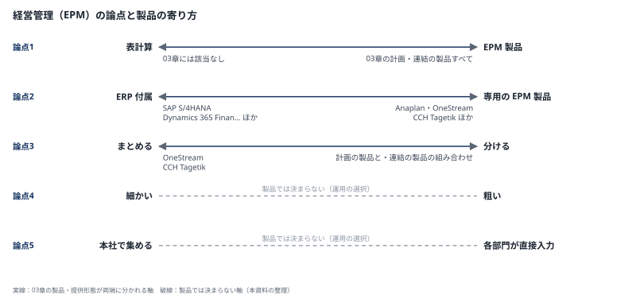

# 04 経営管理（EPM）の主要な論点

## 要旨

EPM を扱うときに出てくる軸は次の5つである（本資料の整理）。

1. 表計算で続けるか、EPM 製品に移すか
2. ERP 付属の機能を使うか、専用の EPM 製品を入れるか
3. 計画と連結を1つの製品にまとめるか、分けるか
4. 細かい粒度で計画するか、粗い粒度にとどめるか
5. 本社で集めて作るか、各部門が直接入力するか

*図1　経営管理（EPM）の論点と製品の寄り方（実線は03章の製品が両端に分かれる軸、破線は製品では決まらない軸。本資料の整理）*

## 論点1：表計算で続けるか、EPM 製品に移すか

| | 表計算 | EPM 製品 |
|---|---|---|
| 得るもの | すぐ作れて、自由に変えられる。費用がかからない | 版の管理、入力の権限、集計の正しさを製品が保つ。実績の取り込みを自動化できる |
| 失うもの | ファイルが増え、どれが最新か分からなくなる。属人化する | 製品の費用。モデルの設計と保守の手間 |

**製品・提供形態との対応**（→ 03章）

| | 表計算に寄るもの | EPM 製品に寄るもの |
|---|---|---|
| 製品・提供形態 | 03章には該当なし（表計算そのもの） | 03章の計画・連結の製品すべて |

典型的な懸念：「予算のファイルが部門ごとに違う版で回っている」

## 論点2：ERP 付属の機能か、専用の EPM 製品か

| | ERP 付属 | 専用の EPM 製品 |
|---|---|---|
| 得るもの | 実績との連携が簡単。製品が増えない | 複数の ERP をまたいだ計画・連結ができる。計画の機能が深い |
| 失うもの | ERP の外の会社（買収した会社など）の数字を扱いにくい | ERP との連携を作る必要がある |

**製品・提供形態との対応**（→ 03章）

| | ERP 付属に寄るもの | 専用の EPM 製品に寄るもの |
|---|---|---|
| 製品・提供形態 | SAP S/4HANA（Group Reporting）、Dynamics 365 Finance、Oracle Cloud ERP。ERP の中に連結・計画の機能を持つ | Anaplan、OneStream、CCH Tagetik、Workday Adaptive Planning、Board、Jedox、DivaSystem LCA、STRAVIS、Loglass、Sactona。ERP に依存しない。Oracle Fusion Cloud EPM と SAP Analytics Cloud は ERP ベンダーの別製品で、自社の ERP との事前定義の連携がある |

## 論点3：計画と連結を1つの製品にまとめるか、分けるか

| | まとめる | 分ける |
|---|---|---|
| 得るもの | 計画と実績の軸（勘定科目・組織）を1か所で管理できる | 各業務に向いた製品を選べる |
| 失うもの | 1つの製品への依存が大きくなる | 軸の定義を2つの製品でそろえ続ける必要がある（→ master-data） |

**製品・提供形態との対応**（→ 03章）

| | まとめるに寄るもの | 分けるに寄るもの |
|---|---|---|
| 製品・提供形態 | OneStream、CCH Tagetik。計画と連結を1つの製品で持つ。Oracle は Planning と Financial Consolidation and Close を同じ EPM の製品群で持つ | 計画の製品（Anaplan、Workday Adaptive Planning、Board、Jedox、Loglass、Sactona、BizForecast BC）と、連結の製品（DivaSystem LCA、STRAVIS、BizForecast FC）の組み合わせ |

## 論点4：細かい粒度か、粗い粒度か

| | 細かい（製品・顧客・月次） | 粗い（部門・四半期） |
|---|---|---|
| 得るもの | 差異の原因を追える | 入力と見直しが速い |
| 失うもの | 入力の手間が増え、計画の作業そのものが重くなる | 差異の原因が分からない |

**製品・提供形態との対応**（→ 03章）：製品では決まらない（運用の選択）。粒度は製品ではなく、利用企業が作るモデルで決まる

## 論点5：本社で集めて作るか、各部門が直接入力するか

| | 本社で集める | 各部門が直接入力 |
|---|---|---|
| 得るもの | 数字の整合を本社が保てる | 現場の見通しが早く反映される。本社の転記が減る |
| 失うもの | 本社の作業が増え、遅くなる | 入力のルールと権限の設計が要る。部門ごとに数字の作り方がばらつく |

**製品・提供形態との対応**（→ 03章）：製品では決まらない（運用の選択）。どの製品も入力の画面と権限を持ち、誰に入力させるかは利用企業が決める

---

**出典**（確認日：2026-11-14）

- 5つの軸と各表の内容は、01〜03章をもとにした本資料の整理
- 各論点の「製品・提供形態との対応」は、03章の製品をもとにした本資料の整理
