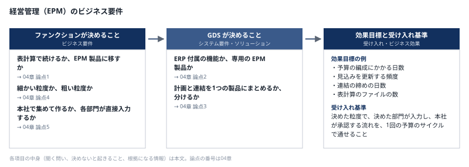

# 05 経営管理（EPM）のビジネス要件

## 要旨

EPM の製品を選ぶ前に、ファンクション（経営企画・経理）には**何を、どの粒度で、誰が入力して管理したいか**を決めてもらう。粒度と入力の分担はモデルの設計そのもので、製品では決まらない。

この章は、governance/budget-transfer の kickoff 資料（IT 予算移管の要点）にある役割分担を、この技術について具体化したものである。

*図1　経営管理（EPM）のビジネス要件（ファンクションが決めたビジネス要件をもとに GDS がシステム要件とソリューションを決め、効果目標と受け入れ基準で確かめる）*

## ファンクションが決めること（ビジネス要件）

### 表計算で続けるか、EPM 製品に移すか

- **決めること**：表計算から移す理由と、移す範囲（→ 04章 論点1）
- **聞く問い**：「いま表計算で困っていることは何か（版の混乱、集計の誤り、締めの遅れ）。どの計画から移すか」
- **決めないと起きること**：表計算で困っていない業務まで移し、モデルの保守の手間だけが増える
- **根拠になる情報**：計画の種類と回数、関わる部門の数、版の混乱の実例

### 細かい粒度か、粗い粒度か

- **決めること**：計画と実績を比べる粒度（→ 04章 論点4）
- **聞く問い**：「差異の原因を、製品・顧客・月のどこまで追いたいか。その粒度で各部門は入力できるか」
- **決めないと起きること**：細かすぎて入力が回らない、または粗すぎて差異の原因が分からない
- **根拠になる情報**：経営会議で見ている資料、部門の入力の負荷

### 本社で集めて作るか、各部門が直接入力するか

- **決めること**：誰が数字を作り、誰が入力するか（→ 04章 論点5）
- **聞く問い**：「本社が集めて作るか、各部門が直接入力するか。部門ごとの数字の作り方をそろえられるか」
- **決めないと起きること**：入力の権限と承認の設計が後回しになり、稼働後に作り直しになる
- **根拠になる情報**：部門の数、入力する人の数、本社の作業の量

## GDS が決めること

- ERP 付属の機能か、専用の EPM 製品か（→ 04章 論点2）。ERP の外の会社（買収した会社など）を扱うかは、ファンクションに確かめる
- 計画と連結を1つの製品にまとめるか、分けるか（→ 04章 論点3）

## 効果目標と受け入れ基準

- **効果目標の例**：予算の編成にかかる日数、見込みを更新する頻度、連結の締めの日数、表計算のファイルの数
- **受け入れ基準**：決めた粒度で、決めた部門が入力し、本社が承認する流れを、1回の予算のサイクルで通せること

## 部門に閉じた案件として扱えないとき

- ERP の実績と HCM の人件費を取り込むため、データ連携が必ず生じる
- 全社の公式の数字になるため、経理と経営企画の両方が関わる

境界の詳細（どのシステムが何を持つか）は [function-allocation](../../../cross-cutting/function-allocation/function-allocation.md) を参照。

---

**出典**（確認日：2026-11-15）

- 役割分担の原則と4つの場面：governance/budget-transfer の kickoff 資料（IT 予算移管の要点、2026-11-02 初版）
- 項目の立て方、問い、例は、04章の論点をもとにした本資料の整理
