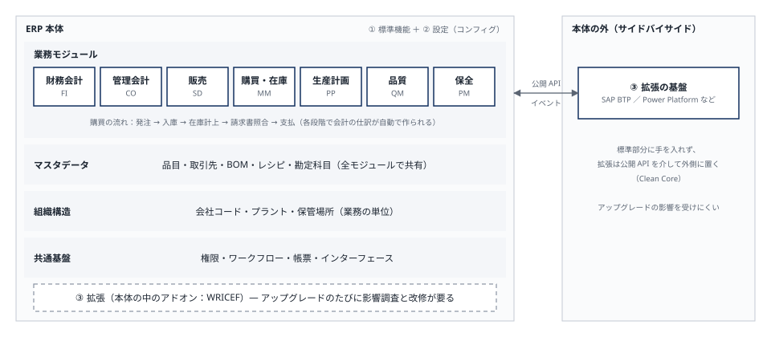

# 02 ERPの構造

## 要旨

ERPは「組織構造・共通マスタ・業務モジュール」で構成される。業務の動き方は **①標準機能 ②設定（コンフィグ） ③拡張（アドオン）** の3層で決まる。どこまでを①②で済ませ、③をどこに置くかが、ERPの設計と保守の中心になる。

*図1　ERP の構成要素と、拡張の置き場所（本資料の整理）*

## 構成要素

| 要素 | 役割 | SAPでの例 |
|---|---|---|
| 組織構造 | 業務の単位を定義する | 会社コード、プラント、保管場所 |
| マスタデータ | 全モジュールが共有する基本データ | 品目、取引先、BOM、レシピ、勘定科目 |
| 業務モジュール | 業務ごとの処理 | 財務会計（FI）、管理会計（CO）、販売（SD）、購買・在庫（MM）、生産計画（PP。プロセス製造向けは PP-PI）、品質（QM）、保全（PM） |
| 共通基盤 | 横断的な仕組み | 権限、ワークフロー、帳票、インターフェース |

## モジュール間の統合

同じデータが業務の流れに沿って受け渡される。

- **購買の流れ**：発注 → 入庫 →（受入検査）→ 在庫計上 → 請求書照合 → 支払。各段階で会計の仕訳が自動で作られる。
- **生産の流れ**：製造指図 → 原材料の出庫 → 製造実績 → 製品の入庫 → 原価差異の計算。

## 振る舞いを決める3層

| 層 | 中身 | 変更の手段 | アップグレード時 |
|---|---|---|---|
| ① 標準機能 | ベンダーが作った業務ロジック | 変更しない | ベンダーが更新する |
| ② 設定（コンフィグ／カスタマイズ） | 標準ロジックに用意された選択肢から選ぶ。例：在庫評価を移動平均にするか標準原価にするか、入庫時に品質検査を挟むか | 設定テーブルに値を入れる。プログラムは変えない（SAPでは IMG。トランザクションコード SPRO） | 原則としてそのまま引き継がれる |
| ③ 拡張（アドオン） | 標準にない機能の追加開発 | プログラムを書く（SAPでは ABAP。名前を Z／Y で始めるため「Zプログラム」とも呼ぶ） | 影響調査と改修が必要になる |

設定の変更も拡張の変更も、開発環境 → 検証環境 → 本番環境へ「移送」という仕組みで運ぶ。

### アドオンの分類（WRICEF）

| 区分 | 中身 |
|---|---|
| W：Workflow | 承認などのワークフロー |
| R：Report | 帳票・照会 |
| I：Interface | 他システムとの連携 |
| C：Conversion | データ移行 |
| E：Enhancement | 標準処理への割り込み |
| F：Form | 出力様式（伝票・ラベルなど） |

アップグレード時に最も影響を受けやすいのは E（Enhancement）である。標準の処理の内側に割り込むため。

## 拡張の置き場所：Clean Core

拡張には「本体の中に作る」か「本体の外に作る」かの2つの置き場所がある。

| 置き場所 | 中身 | 特徴 |
|---|---|---|
| 本体の中（従来型） | ERPの中にアドオンを作る | 自由度は高いが、アップグレードのたびに改修が必要になる |
| 本体の外（サイドバイサイド） | 別の基盤に作り、公開されたAPIやイベントでERPとつなぐ | 標準部分に手を入れないので、アップグレードの影響を受けにくい |

**Clean Core** は、標準部分を改変せず、拡張は公開APIを介して外側に置くという考え方である。SAPでは外側の基盤として **BTP（SAP Business Technology Platform）** を用意しており、拡張開発、システム連携（Integration Suite）、データ分析、AIなどのサービスが載っている。

Dynamics 365（Finance / Supply Chain Management）でも、標準のコードを書き換える方式（オーバーレイ）は使えず、拡張（Extension）として機能を足す方式だけが使える。周辺の業務アプリやワークフローは、連携する Power Platform（Power Apps・Power Automate）で作れる。

## テンプレート

ERPの文脈でいう「テンプレート」は、別のソフトウェアではない。**ERPをどう設定し、どう使うかをあらかじめ決めた「型」の一式**である。

- **中身**：業務プロセスの定義、設定値、マスタデータの設計、アドオン、テストシナリオや文書（規制業種ではバリデーション文書を含むことが多い）
- **種類**：

| 種類 | 作り手 | 例 |
|---|---|---|
| ベストプラクティス | ERPベンダー | SAP Best Practices（SAP Activate のスコープアイテム） |
| 業界テンプレート | SIer・コンサルティング会社 | NTT DATA Business Solutions の it.lifesciences、PwC の Industry Edge for Life Sciences |
| グローバルテンプレート | 自社 | 本社で作った標準を、各拠点・子会社へ展開する（ロールアウト） |

- **Fit to Standard**：テンプレートを基本にし、テンプレートとの差（Gap）だけを議論する導入の進め方。
- テンプレートの価値は、**設定とアドオンの比率**で決まる。アドオンの多いテンプレートは、実質的には「ERPを基盤にした自社開発」に近づく。

---

**出典**（確認日：2026-11-14）

- NTT DATA Business Solutions, SAP S/4HANA Best Practice Approach for the Life Sciences Industry — https://nttdata-solutions.com/se/?p=34144
- PwC, SAP S/4HANA for the life sciences supply chain function — https://www.pwc.com/us/en/technology/alliances/library/sap-s4hana-pharma-life-sciences-supply-chain.html
- SAP Community, Life Sciences — https://pages.community.sap.com/topics/life-sciences
- 図1は、本章の内容をもとにした本資料の整理
