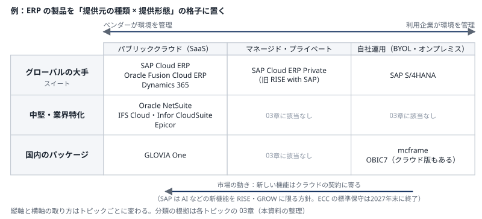

# 03 ERPの製品と提供形態

## 要旨

市場は、**グローバルの大手**（SAP・Oracle・Microsoft など）と、**国産のパッケージ**（mcframe・GLOVIA One・OBIC7 など）に分かれる。Gartner の製造・流通業向けクラウド ERP の2025年の評価では、Oracle・Microsoft・SAP など7製品がリーダーとされた。市場の大きな動きは、SAP ECC の標準保守が2027年末に終わることと、SAP が新しい機能をクラウドの契約に寄せていることである。提供形態は SaaS から自社運用まで4段階あり、どれを選ぶかで **「誰が環境を管理するか」** と **「最新機能を使えるか」** が決まる。

*図1　03章の製品の分類の例（ERP）（縦は提供元の種類、横は提供形態。本資料の整理）*

## 主要な製品

Gartner の Cloud ERP for Product-Centric Enterprises（製造・流通などモノを扱う企業向け）の Magic Quadrant 2025年版（2025-10-14）では、次の7製品がリーダーとされた。前年から評価の対象の顔ぶれは変わらず、チャレンジャーとビジョナリーはいなかった。

| 製品 | ベンダー | 特徴 |
|---|---|---|
| SAP S/4HANA・SAP Cloud ERP | SAP（ドイツ） | 業界機能とテンプレートが厚い。大企業・グローバル展開向け。SaaS 版（旧 S/4HANA Cloud Public Edition）は SAP Cloud ERP と呼ばれ、2025年版でリーダー |
| Oracle Fusion Cloud ERP | Oracle（米国） | SaaS として提供。2025年版でリーダーの中でもっとも高い位置 |
| Oracle NetSuite | Oracle（米国） | 中堅企業向けの SaaS。2025年版でリーダー |
| Microsoft Dynamics 365（Finance / Supply Chain Management） | Microsoft（米国） | SaaS として提供。Microsoft 365 や Power Platform との連携。2025年版でリーダー |
| IFS Cloud | IFS（スウェーデン） | 設備・プロジェクト型の製造業に強い。2025年版でリーダー |
| Infor CloudSuite | Infor（米国） | 業界別の版をそろえる。2025年版でリーダー（5年連続）。同時に出た Critical Capabilities ではプロセス製造など3つの用途で最高点（同社の発表） |
| Epicor Industry ERP Cloud | Epicor（米国） | 中堅の製造・流通業向け。2025年版でリーダー（3年連続） |

課金は、SaaS では利用者1人あたりの年額が基本である。SAP の RISE with SAP（2025年4月以降は SAP Cloud ERP Private の名で提供）は、利用者の種類に重みをつけて1つの数にまとめる **FUE**（Full Use Equivalent）で価格を決める。全機能を使う利用者1人が1 FUE、限られた機能の利用者5人が1 FUE、セルフサービスの利用者30人が1 FUE である。

製品ごとの詳細な比較は [付録A](../appendix/A_erp-market-overview.md) を参照。

## 国内の製品

| 製品 | 提供元 | 補足 |
|---|---|---|
| mcframe | ビジネスエンジニアリング（B-EN-G） | 生産・販売・原価管理を中心とした製造業向けパッケージ。1996年リリース |
| GLOVIA One | 富士通 | 年間売上約30億〜1,000億円の日本企業向けの SaaS。2026年4月に GLOVIA SUMMIT・iZ・きららを統合 |
| OBIC7 | オービック | 会計を軸に、人事・給与・就業、販売、生産までを同じ基盤で扱う。オービックの直接販売。クラウド版もある（→ hcm 03章） |

国内の製品は、Gartner の上記の評価の対象には入っていない（本資料の整理）。

## 他の製品に付属する機能

| 付属する先 | 機能 | 補足（本資料の整理） |
|---|---|---|
| SAP の契約（RISE・GROW） | SAP BTP の利用枠、移行の道具 | 拡張を ERP の外に置くための基盤（→ app-development 03章） |
| Microsoft のライセンス | Power Platform、Microsoft 365 との連携 | Dynamics 365 の拡張に使う |
| ERP の各製品 | 会計・連結・計画の基本機能 | 計画・連結の専用製品との境目は epm 03章を参照 |

## 提供形態

SAP S/4HANA を例にとると、2026年時点で次の4つの形態がある。

| 形態 | ベンダーが管理するもの | 利用企業が管理するもの | 例 |
|---|---|---|---|
| パブリッククラウド（SaaS） | 基盤・アプリ・更新のすべて。複数の顧客で同じ環境を共有する | 設定、マスタ、権限。拡張は限られた方式に絞られる | SAP Cloud ERP（GROW with SAP）、Dynamics 365、Oracle Fusion |
| マネージド・プライベートクラウド | 顧客ごとの専用環境をハイパースケーラー上で運用する。SAP はアプリケーションレベルで99.7%の稼働率 SLA を提示している | 設定、アドオン、権限、更新の時期の判断 | RISE with SAP の Private Cloud Edition（SAP Cloud ERP Private） |
| ハイパースケーラー上の自社運用（BYOL） | ソフトウェアの提供と保守 | 自社のライセンスを持ち込み、AWS・Azure・Google Cloud 上で自社（または委託先）が運用する。アドオンを含めて保持できる | S/4HANA を AWS 上で自社運用する形 |
| オンプレミス | ソフトウェアの提供と保守 | すべて。運用要員（SAP では Basis と呼ぶ基盤運用の担当）が必要 | S/4HANA・ECC のオンプレミス、mcframe のオンプレミス版 |

### 形態と最新機能の関係

SAP は2023年に、AI などの新しい機能は RISE／GROW の利用者にだけ提供し、オンプレミスや自社管理のハイパースケーラー環境には提供しないとの方針を示した。2026年5月に一部を見直し、オンプレミスにも AI 機能を提供するとしたが、特定の商用プラン（Max Success Plan）の契約者に限られる。

つまり、**環境を自社で管理できることと、最新機能を使えることがトレードオフになる**（→ 04章 論点2）。

## 業界向けの機能（ライフサイエンスの例）

SAP には製薬専用の単体製品（Suite）はなく、ライフサイエンス業界向けのポートフォリオとして提供される。

| 製品・機能 | 提供元 | 補足 |
|---|---|---|
| S/4HANA の業界機能 | SAP | レシピ管理（配合ベースの生産）、バッチ管理（ロットの追跡）、コンプライアンス機能 |
| SAP Intelligent Clinical Supply Management | SAP | 治験薬のサプライ（試験の計画、需要の予測、製造、包装・表示、出荷）。S/4HANA の上で動く |
| SAP Batch Release Hub for Life Sciences | SAP | 出荷判定（バッチリリース）を自動化する。SAP BTP 上のパブリッククラウドで提供。治験薬のバッチの判定は Intelligent Clinical Supply Management と連携できる |
| SAP Advanced Track and Trace for Pharmaceuticals | SAP | シリアライゼーション（製品1つずつの追跡） |
| パートナーの業界テンプレート | SAP のパートナー | → 02章 |

Dynamics 365 の業界向け機能は、本資料では未調査。

## 市場の動き

| 時期 | できごと |
|---|---|
| 2020年 | SAP が、ECC 6.0 を含む Business Suite 7 の標準保守を2027年末まで延ばし、2030年末までの延長保守（保守料に2ポイント上乗せ）を設けた |
| 2023年 | SAP が、新しい機能をクラウドの契約（RISE・GROW）の利用者に限る方針を示した |
| 2025年1月 | SAP が「SAP ERP, private edition, transition option」を発表した。2030年末までに SAP HANA 上のプライベート版に移ることなどを条件に、2031〜2033年の利用を認める |
| 2025年4月 | SAP が RISE with SAP の製品パッケージを SAP Cloud ERP Private に置き換えた |
| 2025年10月14日 | Gartner が Cloud ERP for Product-Centric Enterprises の Magic Quadrant 2025年版を出した |
| 2026年4月 | 富士通が GLOVIA One を出し、GLOVIA SUMMIT・iZ・きららを統合した |
| 2026年5月 | SAP が、オンプレミスにも AI 機能を提供すると方針を一部見直した（Max Success Plan の契約者に限る） |
| 2027年12月31日（予定） | SAP ECC 6.0（EHP 6〜8）の標準保守が終わる |

## 本資料でまだ扱っていないもの

- Cloud ERP for Service-Centric Enterprises（サービス業向け）の Gartner の評価
- Dynamics 365 の業界向け機能
- 国内の製品の導入社数とシェア
- 各製品の価格の水準

---

**出典**（確認日：2026-11-14）

- Cloud ERP for Product-Centric Enterprises の Magic Quadrant 2025年版（2025-10-14）：CX Today（リーダー7製品、象限の構成）— https://www.cxtoday.com/customer-data-platform/gartner-magic-quadrant-for-cloud-erp-for-product-centric-enterprises-2025-the-rundown/ 、SAP — https://news.sap.com/2025/10/sap-a-leader-gartner-magic-quadrant-cloud-erp-product-centric-enterprises/ 、Infor（2025-10-24）— https://www.infor.com/news/infor-named-leader-fifth-consecutive-year-2025-gartner-magic-quadrant-critical-capabilities 、Epicor（公表日）— https://www.epicor.com/en/resources/library/corporate/gartner-magic-quadrant/
- FUE：SAP のユーザー会の資料（2021-03-16）— https://assets.dm.ux.sap.com/webinars/sap-user-groups-k4u/pdfs/210316_rise_with_sap_s4hana_cloud_license_overview.pdf 、SAPinsider（重みの比率）— https://sapinsider.org/blogs/understanding-saps-fue-pricing-model-rise-with-sap/
- RISE with SAP の置き換え：The Register（2025-07-11）— https://www.theregister.com/2025/07/11/more_license_upheaval_to_come/
- 提供形態：Redress Compliance, SAP S/4HANA deployment models — https://redresscompliance.com/sap-s4hana-deployment-models-download 、SAP Learning, Introducing RISE with SAP Services — https://learning.sap.com/learning-journeys/applying-the-rise-with-sap-methodology/introducing-rise-with-sap-infrastructure-and-preferred-success-services_f1933236-a4cc-4e60-b5bf-d880e7d8115e
- 新しい機能の提供範囲：SAPinsider, SAP's newest innovations will be cloud-only — https://sapinsider.org/saps-newest-innovations-will-be-cloud-only/ 、The Register, SAP U-turn brings AI features to ECC and on-prem S/4HANA（2026-05-13）— https://www.theregister.com/ai-ml/2026/05/13/sap-u-turn-brings-ai-features-to-ecc-and-on-prem-s/4hana/5239040
- ECC の保守の期限と transition option：The Register（2025-01-28）— https://www.theregister.com/2025/01/28/sap_extends_support_deadline/ 、SAPinsider（2027・2030・2033の条件）— https://sapinsider.org/blogs/sap-support-deadlines-2027-2030-2033/
- ライフサイエンス向けの製品：SAP「Life sciences and healthcare」— https://sap.com/industries/life-sciences-healthcare.html 、SAP Batch Release Hub for Life Sciences — https://www.sap.com/lithuania/products/scm/batch-release-hub.html 、SAP Intelligent Clinical Supply Management の機能範囲（SAP Help Portal）— https://help.sap.com/doc/99114a451ef0493c90acc52704d408d0/2511/en-US/714ced41cc674d468e25ec86459beff3.pdf 、SAP Community, Life Sciences — https://pages.community.sap.com/topics/life-sciences
- mcframe の開発元・リリース年：mcframe Award 2026 のプレスリリース — https://koubo.jp/press-release/prtimes/c53429_r385
- GLOVIA One：富士通 プレスリリース（2026-04-20）— https://global.fujitsu/ja-jp/pr/news/2026/04/20-01
- OBIC7：ISSOH（機能範囲、直接販売）— https://www.issoh.co.jp/column/details/17530/ 、ITreview — https://www.itreview.jp/products/obic7/profile
- 国内の製品が Gartner の評価の対象に入っていない点、付属する機能の表は本資料の整理
- 製品の区分は 2026-11 時点の各社の公表情報による。契約の判断の前には各社の最新の資料で確かめる
