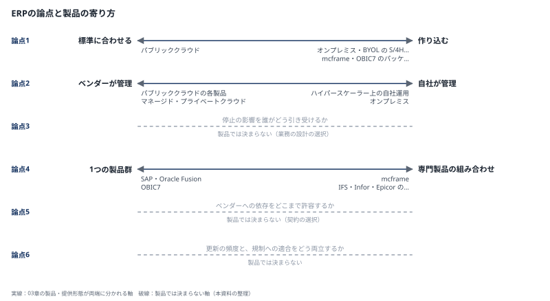

# 04 ERPの主要な論点

## 要旨

ERPを扱うときに必ず出てくる軸は次の6つである。懸念や要望を聞いたときは、まずそれがどの軸の話かを特定する。

1. 標準に合わせるか、作り込むか
2. ベンダーが管理するか、自社が管理するか
3. 停止の影響を誰がどう引き受けるか
4. 1つの製品群でそろえるか、専門製品を組み合わせるか
5. ベンダーへの依存をどこまで許容するか
6. 更新の頻度と、規制への適合をどう両立するか

*図1　ERPの論点と製品の寄り方（実線は03章の製品が両端に分かれる軸、破線は製品では決まらない軸。本資料の整理）*

## 論点1：標準に合わせるか、作り込むか

| | 標準に合わせる（Fit to Standard） | 作り込む（アドオン） |
|---|---|---|
| 得るもの | アップグレードが容易。保守費が小さい。ベンダーの機能追加をそのまま使える | 現行の業務をそのまま再現できる |
| 失うもの | 業務の側を変える必要がある | アップグレードのたびに改修と検証の費用がかかる。ERPを選んだ利点が薄れる |

**製品・提供形態との対応**（→ 03章）

| | 標準に合わせる（Fit to Standard）に寄るもの | 作り込む（アドオン）に寄るもの |
|---|---|---|
| 製品・提供形態 | パブリッククラウド（SAP Cloud ERP、Oracle Fusion Cloud ERP、Oracle NetSuite、Dynamics 365、GLOVIA One）。拡張の方式が限られる | オンプレミス・BYOL の S/4HANA、mcframe・OBIC7 のパッケージ。アドオンを自社で持てる。マネージド・プライベートクラウド（SAP Cloud ERP Private）はその中間 |

典型的な懸念：「機能が足りない」「現場の業務に合わない」「アップグレードのたびに費用がかかる」

作り込みを避けられない場合は、本体の外に置く（Clean Core、→ 02章）。

## 論点2：ベンダーが管理するか、自社が管理するか

| | ベンダーが管理（SaaS、RISE） | 自社が管理（BYOL、オンプレミス） |
|---|---|---|
| 得るもの | 運用の負担が小さい。最新機能を使える | 環境・更新時期・構成を自社で制御できる。中身が見える |
| 失うもの | 環境・更新時期を制御できない。基盤の構成や費用の内訳が見えにくい | 運用要員と運用費が必要。最新機能が使えない場合がある（→ 03章） |

**製品・提供形態との対応**（→ 03章）

| | ベンダーが管理（SaaS、RISE）に寄るもの | 自社が管理（BYOL、オンプレミス）に寄るもの |
|---|---|---|
| 製品・提供形態 | パブリッククラウドの各製品、マネージド・プライベートクラウド（SAP Cloud ERP Private） | ハイパースケーラー上の自社運用（BYOL）、オンプレミス（S/4HANA、mcframe など） |

典型的な懸念：「中身がブラックボックス」「更新を止められない」「価格体系が不透明」

なお、RISE のようなマネージド形態では、基盤にハイパースケーラーを選べても、その契約はERPベンダーが仲介する。

## 論点3：停止の影響を誰がどう引き受けるか

- SaaS でもマネージドでも、SLA を下回ったときの補償は一般に**サービス料の一部返金（サービスクレジット）まで**である。事業上の損失を補償するベンダーは基本的にない。
- したがって、停止のリスクはベンダーに移せない。**ERPが止まっても業務を続けられる設計**（代替手順、製造現場の処理を止めない仕組み）で受け止める。これは自社運用でも同じく必要になる。
- 業務プロセスごとに、許容できる停止時間（RTO）と、失ってよいデータの範囲（RPO）を定義しておく。

**製品・提供形態との対応**（→ 03章）：製品では決まらない（業務の設計の選択）。どの提供形態でも、SLA を下回ったときの補償はサービスクレジットまでである

典型的な懸念：「障害時に補償がない」「事業継続をベンダーに委ねたくない」「製品供給を止められない」

## 論点4：1つの製品群でそろえるか、専門製品を組み合わせるか

| | 1つの製品群（スイート） | 専門製品の組み合わせ（ベスト・オブ・ブリード） |
|---|---|---|
| 得るもの | 連携が少ない。データモデルがそろう | 領域ごとに最も合う製品を選べる |
| 失うもの | 領域によっては機能が弱い | 連携の構築と保守。障害時の責任が分散する |

**製品・提供形態との対応**（→ 03章）

| | 1つの製品群（スイート）に寄るもの | 専門製品の組み合わせ（ベスト・オブ・ブリード）に寄るもの |
|---|---|---|
| 製品・提供形態 | SAP（S/4HANA と業界ソリューション）、Oracle Fusion（ERP・HCM・EPM が同じ基盤）、OBIC7（会計・人事・販売・生産が同じ基盤） | mcframe（生産・販売・原価が中心）、IFS・Infor・Epicor のように業界の機能に寄せた製品。ほかの領域は他社の製品と組み合わせる |

典型的な懸念：「CRMや人事もERPベンダーにそろえるべきか」「連携が多すぎて保守しきれない」

## 論点5：ベンダーへの依存をどこまで許容するか

- 依存が深いほど、値上げや契約条件の変更に対する交渉力が弱まる。
- ERPだけでなく、連携基盤や周辺の拡張基盤まで同じベンダーでそろえると、依存はさらに深まる。
- 撤退のしやすさ（データの取り出し、契約終了時の支援）は、導入時に確認しておかないと後から変えにくい。

**製品・提供形態との対応**（→ 03章）：製品では決まらない（契約の選択）。ただし、ERP・拡張の基盤（SAP BTP、Power Platform）・連携の基盤を同じベンダーでそろえるほど依存は深まる（→ 03章「他の製品に付属する機能」）

典型的な懸念：「値上げに抵抗できない」「やめたくてもやめられない」

## 論点6：更新の頻度と、規制への適合をどう両立するか

- SaaS は更新の頻度が高く、更新を止めることも基本的にできない。
- GxP の対象となる業務では、システムの変更のたびに影響を評価し、必要な検証を行う必要がある。
- 頻繁な更新に追従するには、リスクに応じて検証の範囲を絞る仕組みが必要になる。
- ERPの入れ替えでは、データ移行と再バリデーションがTCOの大きな部分を占める。

**製品・提供形態との対応**（→ 03章）：提供形態で課題の大きさが変わる。パブリッククラウドは更新を止められず、検証の負担がもっとも大きい。オンプレミス・BYOL は更新の時期を自社で決められる。マネージド・プライベートクラウドはその中間

典型的な懸念：「更新のたびにバリデーションが必要になる」「入れ替えの費用が読めない」

## 比較するときの注意

製品を比べるとき、移行コストを最初から含めると「今のままがよい」に、まったく含めないと「変える案がよい」に、結論が構造的に偏る。**あるべき姿の比較**と、**その差が移行コストとリスクに見合うかの判断**を、分けて行うと偏りが減る。

---

**出典**（確認日：2026-11-14）

- SAP Learning, Introducing RISE with SAP Services — https://learning.sap.com/learning-journeys/applying-the-rise-with-sap-methodology/introducing-rise-with-sap-infrastructure-and-preferred-success-services_f1933236-a4cc-4e60-b5bf-d880e7d8115e
- Rimini Street, 10 Things CIOs Must Know About RISE with SAP（ハイパースケーラーとの関係をSAPが仲介する点。第三者保守ベンダーの見解である点に注意） — https://www.riministreet.com/blog/10-things-cios-should-know-about-rise-with-sap/
- SAPinsider, SAP's newest innovations will be cloud-only — https://sapinsider.org/saps-newest-innovations-will-be-cloud-only/
- サービスクレジットが補償の上限となる点：一般的なSaaS契約の慣行（実際の補償範囲は個別の契約による）
- 各論点の「製品・提供形態との対応」は、03章の製品をもとにした本資料の整理
