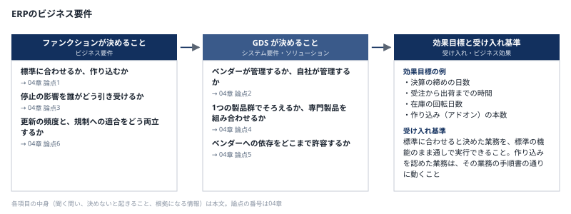

# 05 ERPのビジネス要件

## 要旨

ERP の製品と提供形態を選ぶ前に、ファンクションには**どこまで業務を標準に合わせるか**と、**どれだけの停止と規制の手間を受け入れられるか**を決めてもらう。これが決まらないまま選ぶと、作り込みが増え、ERP を選んだ利点が失われる。

この章は、governance/budget-transfer の kickoff 資料（IT 予算移管の要点）にある役割分担を、この技術について具体化したものである。

*図1　ERPのビジネス要件（ファンクションが決めたビジネス要件をもとに GDS がシステム要件とソリューションを決め、効果目標と受け入れ基準で確かめる）*

## ファンクションが決めること（ビジネス要件）

### 標準に合わせるか、作り込むか

- **決めること**：標準の業務に合わせる範囲と、作り込みを認める業務（→ 04章 論点1）
- **聞く問い**：「標準の業務に合わせられない業務はどれで、合わせられない理由は何か（規制・顧客との契約・競争上の強み）」
- **決めないと起きること**：作り込みが積み上がり、アップグレードのたびに改修と検証の費用がかかる。「GDS が選んだ製品が業務に合わない」となる
- **根拠になる情報**：業務ごとの量と頻度、規制の要求、他社と違う業務かどうか

### 停止の影響を誰がどう引き受けるか

- **決めること**：業務ごとに許容できる停止時間（RTO）と、失ってよいデータの範囲（RPO）（→ 04章 論点3）
- **聞く問い**：「ERP が半日止まったとき、出荷と製造はどこまで続けられるか。止まってはいけない業務はどれか」
- **決めないと起きること**：止まってはいけない業務を前提にしない設計になり、障害のときに製品の供給が止まる。補償はサービスクレジットまでしかない
- **根拠になる情報**：業務の時間帯、代替の手順の有無、製品の供給への影響

### 更新の頻度と、規制への適合をどう両立するか

- **決めること**：GxP の対象とする業務の範囲（→ 04章 論点6）
- **聞く問い**：「ロット・品質の状態・出荷の可否のうち、GMP の記録として扱うものはどれか」
- **決めないと起きること**：対象が広がりすぎて更新のたびの検証が追いつかない、または対象の漏れが査察で見つかる
- **根拠になる情報**：品質保証部門の判断、査察の指摘の履歴

## GDS が決めること

- ベンダーが管理するか、自社が管理するか（→ 04章 論点2）。ファンクションには、更新の時期を選べなくなることへの合意が要る
- 1つの製品群でそろえるか、専門製品を組み合わせるか（→ 04章 論点4）
- ベンダーへの依存をどこまで許容するか（→ 04章 論点5）

## 効果目標と受け入れ基準

- **効果目標の例**：決算の締めの日数、受注から出荷までの時間、在庫の回転日数、作り込み（アドオン）の本数
- **受け入れ基準**：標準に合わせると決めた業務を、標準の機能のまま通しで実行できること。作り込みを認めた業務は、その業務の手順書の通りに動くこと

## 部門に閉じた案件として扱えないとき

- ERP は全社の取引の正本のため、どのファンクションの案件でも部門に閉じた案件として扱わない
- MES・QMS・CRM・HCM など他のシステムとのやり取りが必ず生じる
- ロット・出荷の可否を扱うと GxP の対象になる

境界の詳細（どのシステムが何を持つか）は [function-allocation](../../../cross-cutting/function-allocation/function-allocation.md) を参照。

---

**出典**（確認日：2026-11-15）

- 役割分担の原則と4つの場面：governance/budget-transfer の kickoff 資料（IT 予算移管の要点、2026-11-02 初版）
- 項目の立て方、問い、例は、04章の論点をもとにした本資料の整理
