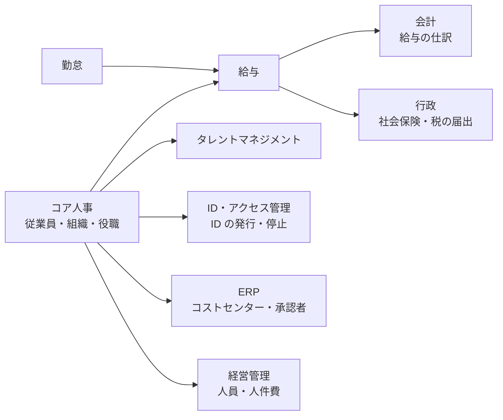

# 02 人事（HCM）の構造

## 要旨

HCM は、**コア人事を中心に、給与・勤怠・タレントマネジメントがその情報を使う**構造である。コア人事の変更（入社・異動・退職）は、社内の多くのシステムに配られる。

## 全体の流れ

*図1 HCM のデータの流れ（本資料の整理）*

## コア人事が持つデータ

| データ | 使う先 |
|---|---|
| 従業員の基本情報 | 給与、ID の発行、社内の各システム |
| 所属・役職・等級 | 承認の経路（ERP・ワークフロー）、権限（identity）、人件費（epm） |
| 組織の階層 | 社内のほぼすべてのシステム |
| 入社日・異動日・退職日 | ID の発行と停止（JML：入社・異動・退職、→ identity） |

## 日本の制度に合わせた処理

| 処理 | 内容 |
|---|---|
| 年末調整 | 年1回、従業員の申告をもとに所得税を精算する |
| 社会保険・雇用保険の手続き | 資格の取得・喪失などの届出 |
| 住民税の特別徴収 | 自治体から通知された税額を給与から差し引く |

これらは国ごとの制度に強く依存するため、グローバルのスイートでも、日本の給与は国内の製品や外部委託で処理する構成がある（本資料の整理）。

---

**出典**（確認日：2026-11-14）

- 図1、表の内容は本資料の整理
- 年末調整・社会保険手続きへの対応の例：BOXIL（COMPANY 給与計算システム）— https://boxil.jp/service/5322/ 、アイミツ（SmartHR）— https://saas.imitsu.jp/cate-hcm/article/h-1684
