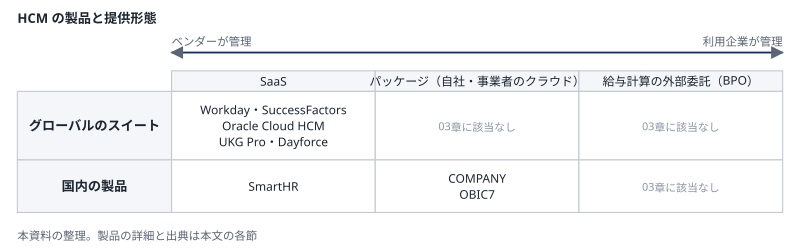

# 03 人事（HCM）の製品と提供形態

## 要旨

HCM の製品は、**グローバルのスイート**（Workday、SAP SuccessFactors、Oracle Cloud HCM など）と、**国内の製品**（COMPANY、SmartHR、OBIC7 など）に分かれる。Gartner の従業員1,000人以上の企業向けの評価の2026年版（2026-08-31、11社）では、Workday・Oracle・SAP が11年連続でリーダーとされた。国内では、大企業向けの統合パッケージと、クラウドの労務管理サービスが併存している。市場の動きとしては、2026年2月に Thoma Bravo が Dayforce を約123億ドルで買い、非上場にした。提供形態の主流は SaaS で、国内の大企業向けパッケージには自社運用の形も残る。

*図1　HCM の製品と提供形態（縦は製品の区分、横は提供形態。本資料の整理）*

## グローバルのスイート

Gartner の Cloud HCM Suites for 1,000+ Employee Enterprises の2026年版（2026-08-31）は11社を評価した。次の各社がリーダーとされたことを発表している。

| 製品 | 提供元 | 補足 |
|---|---|---|
| Workday HCM | Workday | 11年連続のリーダー（同社の発表）。AI の入り口として Sana を組み込んでいる |
| Oracle Fusion Cloud HCM | Oracle | 11年連続のリーダー。「ビジョンの完全性」がもっとも高い位置で、9年連続（同社の発表） |
| SAP SuccessFactors | SAP | 11年連続のリーダー（同社の発表） |
| UKG Pro | UKG | 2026年版でリーダー（同社の発表）。給与・勤怠・シフト管理に強い。現場で働く人（フロントライン）向けを重視 |
| Dayforce | Dayforce | 7年連続のリーダー（同社の発表）。2026年2月に Thoma Bravo が買収を完了し、非上場になった |

2025年版（2025-09-08、11社）でも、上の5社がリーダーとされていた。課金は、従業員1人あたりの年額（PEPY）が一般的である（本資料の整理）。

## 国内の製品

| 製品 | 提供元 | 補足 |
|---|---|---|
| COMPANY | Works Human Intelligence | 大企業向けの統合人事システム。約1,200の大手法人グループが導入（提供元の掲載情報）。ITR の調査で ERP 市場の人事・給与分野の売上シェア1位（同社の発表） |
| SmartHR | SmartHR | クラウドの人事労務。入社手続き、雇用契約、年末調整、給与明細から始まり、タレントマネジメント・勤怠・給与計算・情シスの機能に広げた。2026年7月に ARR（年間の経常収益）が300億円を超えた（同社の公表） |
| OBIC7 人事・給与・就業情報ソリューション | オービック | 統合基幹業務システム OBIC7 の一部で、人事情報・給与情報・就業情報の3つに分かれる。会計・販売と同じ基盤で扱える（→ erp 03章） |

国内の製品は、Gartner の上記の評価の対象には入っていない（本資料の整理）。

## 他の製品に付属する機能

| 付属する先 | 機能 | 補足（本資料の整理） |
|---|---|---|
| ERP の各製品 | 人事・給与の機能 | ERP と同じ基盤で人事を持つ製品がある（Oracle Fusion、OBIC7）。人事を ERP と分けるかどうかは 05章を参照 |
| Microsoft 365 | Entra ID の利用者情報、Viva | 人事の正本ではないが、入退社の ID 管理と連携させる（→ identity 03章） |

## 提供形態

| 形態 | ベンダーが管理するもの | 利用企業が管理するもの | 例 |
|---|---|---|---|
| SaaS | 基盤、製品の更新、法改正への対応（製品が対応する国の範囲で） | 組織・職位・給与のマスタ、業務の流れの設定、権限、他のシステムとの連携 | Workday、SAP SuccessFactors、Oracle Cloud HCM、SmartHR |
| パッケージ（自社で運用、または事業者のクラウド） | ソフトウェアの提供、保守、法改正の修正の提供 | 上記に加えて、サーバ・データベース・修正の適用 | COMPANY、OBIC7 のオンプレミス版 |
| 給与計算の外部委託（BPO） | 計算の業務そのもの | 委託先へのデータの受け渡し、結果の確認 | 本資料ではまだ扱っていない |

日本の給与・社会保険の法改正への対応は、**グローバルのスイートでは日本向けの機能やパートナーの製品に頼ることが多い**。国内の製品は、提供元が対応する（本資料の整理）。

## 市場の動き

| 時期 | できごと |
|---|---|
| 2025年8月21日 | Thoma Bravo が Dayforce の買収に合意した |
| 2025年9月8日 | Gartner が Cloud HCM Suites for 1,000+ Employee Enterprises の Magic Quadrant 2025年版を出した |
| 2025年11月12日 | Dayforce の株主が買収を承認した |
| 2026年2月4日 | Thoma Bravo が Dayforce の買収（約123億ドル）を完了し、Dayforce は上場を廃止した |
| 2026年7月 | SmartHR の ARR が300億円を超えた |
| 2026年8月31日 | Gartner が同じ Magic Quadrant の2026年版を出した（11社） |

## 本資料でまだ扱っていないもの

- 国内での各製品の導入規模の比較
- 給与計算の外部委託（BPO）サービス
- タレントマネジメントの専門製品
- 各製品の価格の水準

---

**出典**（確認日：2026-11-14）

- Gartner の Magic Quadrant 2026年版（2026-08-31）：Workday（11年連続、Sana）— https://newsroom.workday.com/2026-09-02-Workday-Named-a-Leader-in-2026-Gartner-R-Magic-Quadrant-TM-for-Cloud-HCM-Suites-for-1,000-Employee-Enterprises-for-Eleventh-Consecutive-Year 、https://blog.workday.com/en-us/2026-gartner-magic-quadrant-hcm.html 、Oracle（11年連続、ビジョンの位置）— https://www.oracle.com/human-capital-management/gartner-magic-quadrant/ 、SAP（11回連続）— https://news.sap.com/2026/09/sap-leader-gartner-magic-quadrant-hcm-suites-1000-employees/ 、UKG（評価11社）— https://www.ukg.com/node/66796 、Dayforce（7年連続）— https://www.dayforce.com/blog/2026-leader-in-gartner-magic-quadrant-hcm
- Gartner の Magic Quadrant 2025年版：UKG（2025-09-08、評価11社）— https://www.ukg.com/company/newsroom/ukg-recognized-leader-2025-gartnerr-magic-quadranttm-cloud-hcm-suites-1000-employee-enterprises-third-consecutive-year 、Workday — https://newsroom.workday.com/2025-09-11-Workday-Named-a-Leader-in-2025-Gartner-R-Magic-Quadrant-TM-for-Cloud-HCM-Suites-for-1,000-Employee-Enterprises-for-Tenth-Consecutive-Year 、SAP ジャパン — https://news.sap.com/japan/2025/10/1009_sap-leader-gartner-magic-quadrant-cloud-hcm-suites-1000-employee-enterprises/ 、Dayforce — https://www.dayforce.com/blog/2025-leader-in-gartner-magic-quadrant
- Dayforce の買収：Thoma Bravo（2026-02-04）— https://www.thomabravo.com/press-releases/thoma-bravo-completes-acquisition-of-dayforce 、Dayforce の SEC への提出書類 — https://www.sec.gov/Archives/edgar/data/1725057/000114036126003628/ef20064744_ex99-2.htm 、合意日と株主の承認日：PrivSource — https://www.privsource.com/acquisitions/deal/thoma-bravo-completes-acquisition-of-dayforce-inc-9zSbgJ
- COMPANY：ASPIC — https://www.aspicjapan.org/asu/service/8997 、日本の人事部 — https://jinjibu.jp/corporate/works-hi/
- SmartHR：ワンキャリア（会社の紹介、ARR）— https://onecareer.jp/companies/89636 、SmartHR エンジニア向け資料（機能の広がり）— https://speakerdeck.com/smarthr/smarthr-engineering-team-deck
- OBIC7：ISSOH（3つのソリューション、会計との統合）— https://www.issoh.co.jp/column/details/17530/ 、ITトレンド — https://it-trend.jp/hr_payroll_system/article/9-5154
- 課金の単位の一般化、付属する機能の表、提供形態の表、法改正への対応の違い、国内の製品が Gartner の評価の対象に入っていない点は本資料の整理
- 製品の区分は 2026-11 時点の各社の公表情報による。契約の判断の前には各社の最新の資料で確かめる
