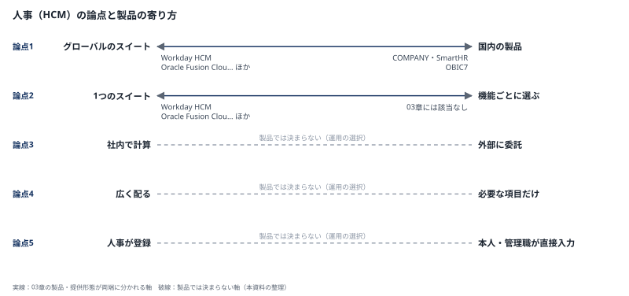

# 04 人事（HCM）の主要な論点

## 要旨

HCM を扱うときに出てくる軸は次の5つである（本資料の整理）。

1. グローバルのスイートか、国内の製品か
2. 1つのスイートでそろえるか、機能ごとに選ぶか
3. 給与を社内で計算するか、外部に委託するか
4. 人事情報を多くのシステムに配るか、必要な項目だけ渡すか
5. 人事が登録してから使うか、従業員・管理職が直接入力するか

*図1　人事（HCM）の論点と製品の寄り方（実線は03章の製品が両端に分かれる軸、破線は製品では決まらない軸。本資料の整理）*

## 論点1：グローバルのスイートか、国内の製品か

| | グローバルのスイート | 国内の製品 |
|---|---|---|
| 得るもの | 海外の拠点を含めて、従業員と組織を1つのデータで見られる | 年末調整・社会保険など日本の制度に標準で対応する。法改正への追従を任せられる |
| 失うもの | 日本の給与・労務への対応を別に用意する必要がある | 海外の拠点は別のシステムになる |

**製品・提供形態との対応**（→ 03章）

| | グローバルのスイートに寄るもの | 国内の製品に寄るもの |
|---|---|---|
| 製品・提供形態 | Workday HCM、Oracle Fusion Cloud HCM、SAP SuccessFactors、UKG Pro、Dayforce | COMPANY、SmartHR、OBIC7。日本の制度への対応を提供元が担う |

## 論点2：1つのスイートか、機能ごとに選ぶか

| | 1つのスイート | 機能ごとに選ぶ |
|---|---|---|
| 得るもの | 従業員の情報が1か所にあり、連携が要らない | 採用・タレントマネジメントなどで、その分野に強い製品を使える |
| 失うもの | 弱い機能も同じ製品で使うことになる | 製品間の連携と、従業員の情報の食い違いを管理する必要がある |

**製品・提供形態との対応**（→ 03章）

| | 1つのスイートに寄るもの | 機能ごとに選ぶに寄るもの |
|---|---|---|
| 製品・提供形態 | Workday HCM、Oracle Fusion Cloud HCM、SAP SuccessFactors、COMPANY、OBIC7。人事・給与・タレントの機能を1つの製品で持つ | 03章には該当なし（採用・タレントマネジメントの専門製品は未扱い） |

## 論点3：給与を社内で計算するか、外部に委託するか

| | 社内で計算 | 外部に委託（BPO） |
|---|---|---|
| 得るもの | 自社の制度に合わせた運用、問い合わせへの即答 | 担当者の確保と法改正への追従を委託先に任せられる |
| 失うもの | 担当者の属人化。年末調整などの繁忙期の負荷 | 委託先への依存。制度変更のたびに委託先との調整が要る |

**製品・提供形態との対応**（→ 03章）：製品では決まらない（運用の選択）。給与計算の外部委託（BPO）は 03章ではまだ扱っていない

## 論点4：人事情報を広く配るか、必要な項目だけ渡すか

| | 広く配る | 必要な項目だけ |
|---|---|---|
| 得るもの | 各システムが同じ組織・役職の情報を使える | 個人情報が広がらない |
| 失うもの | 個人情報が多くのシステムに残る | 渡す項目を、受け取る側ごとに決めて管理する必要がある |

人事情報は個人情報を含むため、連携基盤では中継だけを行い、保持しない設計をとることが多い（→ integration）。

**製品・提供形態との対応**（→ 03章）：製品では決まらない（運用の選択）。どの製品も項目ごとの権限と、他のシステムへの連携の機能を持つ

## 論点5：人事が登録するか、本人・管理職が直接入力するか

| | 人事が登録 | 本人・管理職が直接入力（セルフサービス） |
|---|---|---|
| 得るもの | 入力の品質を人事が保てる | 人事の作業が減り、反映が早い |
| 失うもの | 人事の作業が多く、反映が遅れる | 入力の誤りを防ぐ仕組みと、承認の経路が要る |

**製品・提供形態との対応**（→ 03章）：製品では決まらない（運用の選択）。グローバルのスイートと SmartHR はセルフサービスの入力を前提にした画面を持つ

---

**出典**（確認日：2026-11-14）

- 5つの軸と各表の内容は、01〜03章をもとにした本資料の整理
- 人事情報を連携基盤で保持しない設計：[function-allocation](../../../cross-cutting/function-allocation/function-allocation.md)
- 各論点の「製品・提供形態との対応」は、03章の製品をもとにした本資料の整理
