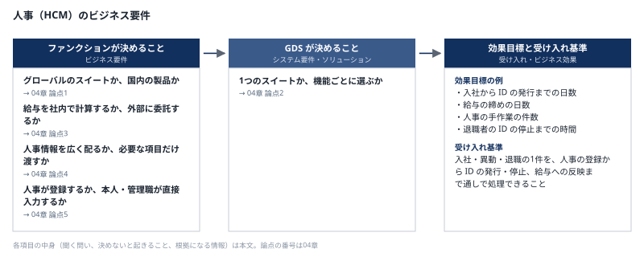

# 05 人事（HCM）のビジネス要件

## 要旨

HCM の製品を選ぶ前に、ファンクション（人事）には**日本と海外の人事をどこまで1つで扱うか**と、**給与の業務を誰が持つか**を決めてもらう。人事情報は ID・承認・人件費の起点になるため、その配り方も人事に決めてもらう。

この章は、governance/budget-transfer の kickoff 資料（IT 予算移管の要点）にある役割分担を、この技術について具体化したものである。

*図1　人事（HCM）のビジネス要件（ファンクションが決めたビジネス要件をもとに GDS がシステム要件とソリューションを決め、効果目標と受け入れ基準で確かめる）*

## ファンクションが決めること（ビジネス要件）

### グローバルのスイートか、国内の製品か

- **決めること**：日本と海外の拠点を1つで扱うか（→ 04章 論点1）
- **聞く問い**：「海外の拠点の従業員を、日本と同じ仕組みで管理したいか。グループで見たい情報は何か」
- **決めないと起きること**：海外拠点を含めるかが決まらないまま選び、後から別の仕組みを足すことになる
- **根拠になる情報**：拠点の数と人数、グループの人事の方針

### 給与を社内で計算するか、外部に委託するか

- **決めること**：給与の計算を社内で持つか、委託するか（→ 04章 論点3）
- **聞く問い**：「給与と年末調整を、社内の担当者で回し続けられるか」
- **決めないと起きること**：担当者の異動・退職で給与が止まるリスクが残る
- **根拠になる情報**：担当者の人数と経験、繁忙期の負荷、委託の費用

### 人事情報を広く配るか、必要な項目だけ渡すか

- **決めること**：人事情報を渡す項目と相手（→ 04章 論点4）
- **聞く問い**：「ID の発行・承認の経路・人件費の計画に、どの項目を渡してよいか」
- **決めないと起きること**：個人情報が多くのシステムに残る、または必要な項目が渡らず ID の発行が遅れる
- **根拠になる情報**：個人情報の取り扱いの規程、受け取る側のシステムの一覧

### 人事が登録するか、本人・管理職が直接入力するか

- **決めること**：本人・管理職に直接入力させる範囲（→ 04章 論点5）
- **聞く問い**：「住所変更・休暇の申請などを、本人・管理職の入力にしてよいか」
- **決めないと起きること**：人事の作業が減らず、反映が遅れる
- **根拠になる情報**：申請の種類と件数、承認の経路

## GDS が決めること

- 1つのスイートか、機能ごとに選ぶか（→ 04章 論点2）

## 効果目標と受け入れ基準

- **効果目標の例**：入社から ID の発行までの日数、給与の締めの日数、人事の手作業の件数、退職者の ID の停止までの時間
- **受け入れ基準**：入社・異動・退職の1件を、人事の登録から ID の発行・停止、給与への反映まで通しで処理できること

## 部門に閉じた案件として扱えないとき

- 人事情報は ID・アクセス管理の起点になるため、identity との連携が必ず生じる
- 従業員全員が利用者になる
- 個人情報を扱う

境界の詳細（どのシステムが何を持つか）は [function-allocation](../../../cross-cutting/function-allocation/function-allocation.md) を参照。

---

**出典**（確認日：2026-11-15）

- 役割分担の原則と4つの場面：governance/budget-transfer の kickoff 資料（IT 予算移管の要点、2026-11-02 初版）
- 項目の立て方、問い、例は、04章の論点をもとにした本資料の整理
