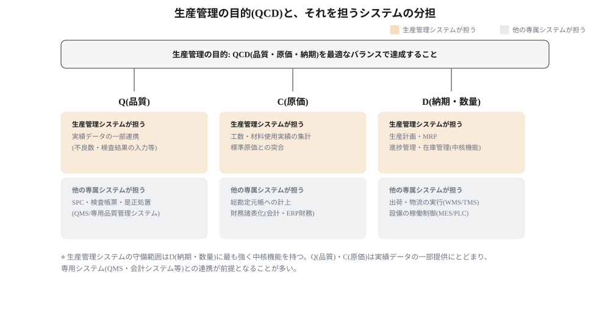
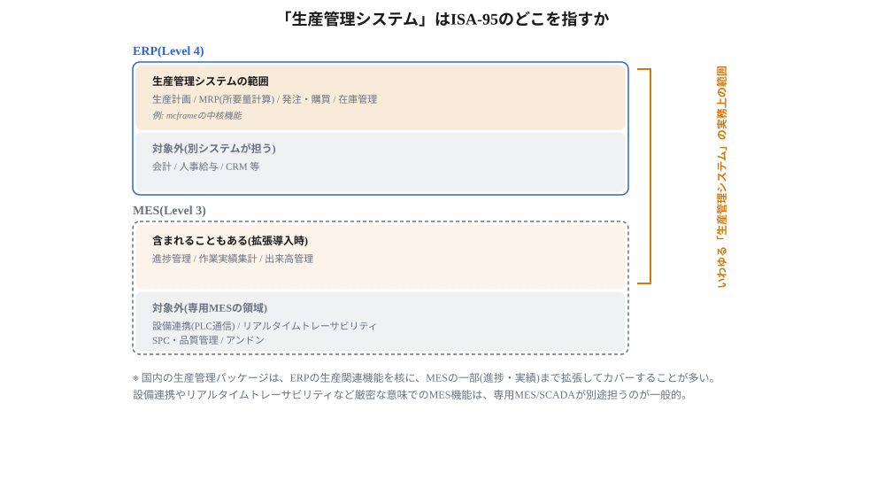

# 01 生産系ITの定義と範囲

## 要旨

生産系ITは、製造業の経営（ERP）から製造オペレーション（MES など）、制御（SCADA・PLC）、機器までをつなぐシステム群であり、ISA-95 の階層で整理される。生産管理の目的は QCD（品質・原価・納期）の達成であり、実務でいう「生産管理システム」は、ERP の生産関連機能を核に MES の一部まで含む、階層をまたぐ用語である。

## 定義

製造業のITアーキテクチャはISA-95モデルにより、ERP(Level4)/MES(Level3)/SCADA・HMI(Level2)/PLC・DCS(Level1)/フィールド機器(Level0)の5階層に整理できる。上に行くほど「経営情報」に、下に行くほど「物理信号」に近づく。各階層の構造は 02章で扱う。

## 生産管理の管理対象と目的

生産管理が「何を」管理するかを整理すると、次の5つに分けられる。このうち進捗・現品・余力は、JIS Z 8141（生産管理用語）で「生産統制」の下に置かれる3つの管理活動（進捗管理・現品管理・余力管理）にあたる。

| 管理対象 | 何を管理するか | 代表的な指標・帳票 |
|---|---|---|
| 進捗 | 計画通りに生産が進んでいるか | 生産進捗率、納期遵守率 |
| 現品 | 仕掛品・完成品が今どこに・いくつあるか | 現品票、在庫ロケーション |
| 余力 | 設備・人の能力と作業量のバランス | 稼働率、負荷率 |
| 品質 | 決められた基準を満たしているか | 不良率、歩留まり |
| 原価 | 目標コストで作れているか | 標準原価差異、実際原価 |

一方、生産管理の目的は、JIS Z 8141 の定義どおり、所定の品質・原価・数量と納期（QCD）で生産すること、またはQCDの最適化を図ることである。生産管理システムが中核的に担うのはD(納期・数量、生産計画・MRP・進捗管理・在庫管理)であり、Q(品質)・C(原価)については実績データの一部提供にとどまり、専用の品質管理システム(QMS)や会計システムとの連携が前提となる。

*図1　生産管理の目的(QCD)と、それを担うシステムの分担*

## 「生産管理システム」の位置づけ

「生産管理システム」は、ISA-95の1階層ではなく、ERPの生産関連機能(生産計画・MRP・発注・在庫)を核に、企業によってはMESの一部機能(進捗管理・実績集計)まで拡張してカバーする、機能横断的な実務用語である。設備連携やリアルタイムトレーサビリティのような狭義のMES機能は、通常この範囲に含まれない。

*図2　「生産管理システム」はISA-95のどこを指すか*

## 範囲（何であり、何でないか）

| 含むもの | 含まないもの（隣接領域） |
|---|---|
| ISA-95 の5階層、Level3（MOM）の4領域、MESA-11、IT/OT の区分、生産管理システムの位置づけ | ERP の構造と製品（→ [erp](../../erp/README.md)）、品質・薬事の製品（→ [veeva-platform](../../veeva-platform/README.md)） |

---

**出典**（2026-11-14 確認）

- JIS Z 8141:2022 生産管理用語（生産管理の定義、生産統制と進捗管理・現品管理・余力管理）— 日本規格協会 規格票プレビュー https://webdesk.jsa.or.jp/preview/pre_jis_z_08141_000_000_2022_j_ed10_ch.pdf 。用語番号と定義は解説記事 https://www.issoh.co.jp/column/details/17020/ で確認
- ISA-95 の階層：02章の出典を参照
- 「生産管理システム」の位置づけ（図2）は、上記の定義と02章の階層をもとにした本資料の整理
