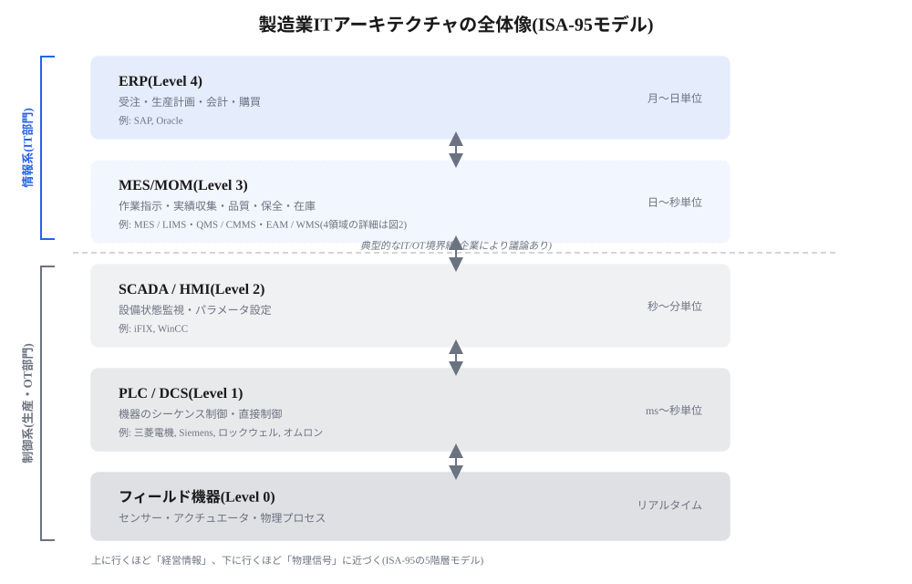
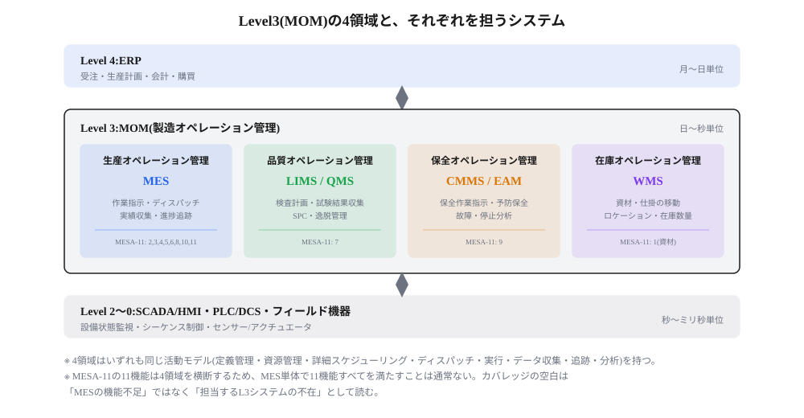

# 02 生産系ITの構造

## 要旨

- 製造業のITアーキテクチャはISA-95モデルにより、ERP(Level4)/MES(Level3)/SCADA・HMI(Level2)/PLC・DCS(Level1)/フィールド機器(Level0)の5階層に整理できる。上に行くほど「経営情報」に、下に行くほど「物理信号」に近づく。
- Level3は「MES」1種類ではない。ISA-95 Part 3はLevel3をMOM(製造オペレーション管理)と定義し、生産(MES)・品質(LIMS/QMS)・保全(CMMS/EAM)・在庫(WMS)の4領域に分ける。
- MESの機能は「MESA-11」という業界標準の11機能で分解でき、生産管理システムがどこまでをカバーしているかを判定する物差しになる。ただし11機能はMOMの4領域を横断するため、MES単体では全てを満たさない。

## ISA-95の5階層

| 階層 | 内容 | 時間粒度 |
|---|---|---|
| ERP(Level4) | 受注・生産計画・会計・購買 | 月・週・日（シフト）単位 |
| MES/MOM(Level3) | 作業指示・実績収集・品質・保全・在庫 | 日・シフト・時間・分・秒単位 |
| SCADA/HMI(Level2) | 設備状態監視・パラメータ設定 | 秒〜分単位 |
| PLC/DCS(Level1) | 機器のシーケンス制御・直接制御 | ms〜秒単位 |
| フィールド機器(Level0) | センサー・アクチュエータ・物理プロセス | リアルタイム |

*図1　製造業ITアーキテクチャの全体像(ISA-95モデル)*

時間粒度のうち Level4・Level3 は ISA-95 の記述による。Level2 以下は一般的な目安である。

なお、**Level3はMESだけではない**。次節を参照。

## Level3の内訳：MOM（製造オペレーション管理）の4領域

ISA-95 Part 3(IEC 62264-3)は、Level3を**MOM(Manufacturing Operations Management)**と定義し、**生産・品質・保全・在庫**の4つのオペレーション領域に分けている。4領域はいずれも同じ活動モデル(定義管理・資源管理・詳細スケジューリング・ディスパッチ・実行・データ収集・追跡・分析)を持つ対称的な構造になっている。

実務では「Level3=MES」と略されがちだが、正確にはMESが担うのは生産オペレーション領域であり、品質・保全・在庫にはそれぞれ別系統のシステムが対応する。

| MOMの4領域 | 主な活動 | 代表システム |
|---|---|---|
| 生産オペレーション管理 | 作業指示・ディスパッチ・実績収集・進捗追跡 | MES |
| 品質オペレーション管理 | 検査計画・試験結果収集・SPC・逸脱管理 | **LIMS / QMS** |
| 保全オペレーション管理 | 保全作業指示・予防保全計画・故障/停止分析 | **CMMS / EAM** |
| 在庫オペレーション管理 | 資材・仕掛の移動、ロケーション、在庫数量 | **WMS** |

*図2　Level3(MOM)の4領域と、それぞれを担うシステム*

この区分から、MESで「品質管理」「保全管理」が対象外となるのは**機能不足ではなく、本来LIMS/QMSとCMMS/EAMという別系統のLevel3システムが担う領域だから**と読める。したがって空白を埋める打ち手は「MESの機能拡張」ではなく「品質・保全・在庫それぞれのL3システムをどう持つか」という問いになる。

## MESA-11：MESの11機能

MESは「計画(ERP)と現場実行の乖離(Execution Gap)を埋める」ためのシステムで、MESA Internationalが1997年9月の White Paper #6「MES Explained: A High Level Vision」で11の標準機能を定義している。

| # | 機能 | 内容 |
|---|---|---|
| 1 | 資源配分・稼働状況管理 | 設備・工具・技能・資材など生産資源の管理 |
| 2 | 詳細スケジューリング | 生産計画に基づく詳細な作業順序計画 |
| 3 | 生産ディスパッチ | 作業指示を現場に展開 |
| 4 | 文書管理 | 作業指示書・図面・レシピの管理 |
| 5 | データ収集 | 実績・稼働データの収集 |
| 6 | 労務管理 | 作業者の稼働・資格管理 |
| 7 | 品質管理 | 検査・SPC・不良管理 |
| 8 | プロセス管理 | 工程の監視・異常検知 |
| 9 | 保全管理 | 設備の予防保全・故障対応 |
| 10 | トラッキング・トレーサビリティ | ロット・シリアル単位の追跡 |
| 11 | パフォーマンス分析 | OEE等の生産性分析 |

MESA-11の11機能はMOMの4領域を横断している。7(品質管理)は品質オペレーション、9(保全管理)は保全オペレーション、1(資源配分)のうち資材にあたる部分は在庫オペレーションに対応し、残りが生産オペレーションにあたる。したがって**MES単体でMESA-11を全て満たすことは通常なく**、LIMS/QMS・CMMS/EAM・WMSとの組み合わせで初めてカバーされる。

## 生産計画・BOM・製造指図の階層対応

同じ用語でも、ERP/MES/現場の各階層で呼び名と粒度が変わる。

| | ERP(Level4) | MES(Level3) | 現場(SCADA/PLC) |
|---|---|---|---|
| 生産計画 | 年間・月次生産計画(S&OP・MPS)、年〜月単位 | 日程計画・詳細スケジューリング、日〜時間単位 | 作業順序・段取り、分単位 |
| BOM | M-BOM(製造部品表)、原価・所要量計算の基準 | 作業BOM(BOP)、工程順序付き部品表 | 部品引当・ピッキング |
| 製造指図 | 製造指図(Production Order) | 作業指示書(ディスパッチリスト) | 実行・実績記録 |

ERP階層の「生産計画」と「M-BOM」を掛け合わせて「製造指図」が生成され(MRP計算)、MESで「作業指示書」へと工程・設備単位に展開される。逆方向は実績データのフィードバックである。

## IT と OT の区分基準

「どの階層か」ではなく、次の7つの観点で判断する。

| 観点 | IT | OT |
|---|---|---|
| 主目的 | 情報処理・経営の意思決定支援 | 物理プロセスの直接制御・監視 |
| 対象 | データ・情報 | 機器・エネルギー・マテリアルそのもの |
| リアルタイム性 | 分〜日単位の遅延は許容範囲 | ms〜秒単位で即応が必須 |
| 障害時の影響 | 業務停止・情報の不整合 | 安全・環境・人身事故に直結し得る |
| セキュリティ優先順位 | 機密性・完全性・可用性（CIA）の順 | 安全を最優先に、可用性・完全性・機密性の順 |
| ライフサイクル | 構成要素は3〜5年程度で更新 | 構成要素は10〜15年程度、システム全体では20年を超えることもある（設備の耐用年数に紐づく） |
| 伝統的な管掌部門 | IT部門 | 生産技術・保全部門 |

ERP/MESは基本的にIT側、SCADA/PLC/フィールド機器はOT側に分類されるのが典型だが、実際のシステムは階層をまたいで機能が混在するため、管掌境界は「システムの種類」ではなく上記の観点でどちらの性質が強いかで判断するのが実務的である。

---

**出典**（2026-11-14 確認）

- IEC 62264-3:2016（ANSI/ISA-95.00.03-2013）Enterprise-control system integration — Part 3: Activity models of manufacturing operations management。目次（生産・保全・品質・在庫の4カテゴリ）https://shop.standards.ie/en-ie/standards/en-62264-3-2017-349554_saig_cenelec_cenelec_798421 、活動モデル（定義管理〜分析の8活動）https://www.din.de/en/wdc-beuth:din21:278536474
- MOM の定義と4領域：Siemens「ISA-95 framework and layers」https://www.sw.siemens.com/en-US/technology/isa-95-framework-layers/
- 各階層の時間粒度：OPC Foundation OPC 10030（ISA-95 Common Object Model）4.2 https://reference.opcfoundation.org/specs/OPC-10030/4.2 、4.2.3 https://reference.opcfoundation.org/specs/OPC-10030/4.2.3
- MESA-11：MESA International White Paper #6「MES Explained: A High Level Vision」（1997年9月）。SAP「What is MES」https://www.sap.com/canada/resources/what-is-mes でも確認
- 「生産計画・BOM・製造指図の階層対応」は、上記の階層モデルをもとにした本資料の整理
- セキュリティ優先順位・ライフサイクル：NIST SP 800-82 Rev. 3「Guide to Operational Technology (OT) Security」（2023年9月）https://csrc.nist.gov/pubs/sp/800/82/r3/final 。要点は解説記事 https://www.acronis.com/en/blog/posts/ot-vs-it-comparison/ で確認
- 7つの観点のうち、主目的・対象・リアルタイム性・障害時の影響・管掌部門は、上記と ISA-95 の階層モデルをもとにした本資料の整理
