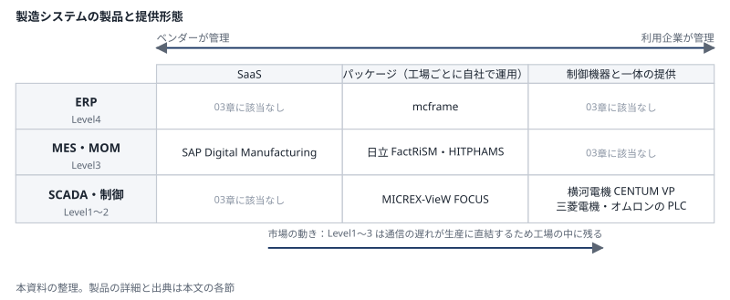

# 03 生産系ITの製品と提供形態

## 要旨

ISA-95 の各階層に、国内・海外の主要ベンダーの製品がある。Level3 は MES のほか、品質（LIMS/QMS）・保全（CMMS/EAM）・在庫（WMS）にそれぞれ別系統の製品がある。MES の第三者評価は、Gartner が2023年まで Magic Quadrant を出し、Siemens・Dassault Systèmes などをリーダーとした。2025年は順位をつけない Market Guide を出している。市場では、制御機器のメーカーが生産のソフトウェアの会社を取り込む動きが続き、2023年1月に Schneider Electric が AVEVA を完全子会社にした。提供形態は、工場ごとに自社で運用するパッケージが今も中心で、SaaS は MES の一部の製品にとどまる（本資料の整理）。

*図1　製造システムの製品と提供形態（縦は製品の区分、横は提供形態。本資料の整理）*

## 主要な製品

### 階層別

| 階層 | 代表製品（国内） | 代表製品（海外） |
|---|---|---|
| ERP(Level4) | mcframe | SAP S/4HANA, Oracle, Microsoft Dynamics |
| MES/MOM(Level3) | 日立 FactRiSM（統合MES）、日立 HITPHAMS（医薬向け）、日立産業制御ソリューションズ ProductNEO（食品・化学向け）、mcframe 7 LiteMES | Siemens Opcenter, SAP Digital Manufacturing, Rockwell FactoryTalk ProductionCentre, AVEVA MES, GE Vernova Proficy Smart Factory |
| SCADA/HMI(Level2) | 富士電機 MICREX-VieW FOCUS、日立産業制御ソリューションズ Integrate SCADA | AVEVA System Platform, Siemens WinCC, GE Vernova iFIX |
| PLC/DCS(Level1) | 三菱電機, オムロン, キーエンス, 富士電機（PLC）／横河電機 CENTUM VP, 日立 HIDIC-AZ/SP G2（DCS） | Siemens, Rockwell Automation, Schneider Electric, ABB |
| フィールド機器(Level0) | 本資料ではまだ扱っていない（センサー・計測機器・アクチュエータ） | 本資料ではまだ扱っていない（同左） |

Level3 の代表製品には MES 製品を挙げているが、Level3 は MES だけではない（→ 02章）。DCS（横河電機 CENTUM VP など）は制御（Level1）と操作監視（Level2）を一体で提供するため、Level1・2 の両方にまたがる。

### MES の第三者評価

Gartner の Manufacturing Execution Systems の Magic Quadrant 2023年版（2023-04-26）は18社を評価した。Siemens（Opcenter Execution、6回連続）と Dassault Systèmes（DELMIA Apriso など）がリーダーとされた。2022年版では Critical Manufacturing・AVEVA・Siemens がリーダーで、SAP はビジョナリーの先頭だった。Gartner は2025年5月5日に MES の Market Guide を出しており、Magic Quadrant の2025年以降の版は本資料では確認していない。

MES の課金は、工場（サイト）・ライン・利用者の数などを組み合わせた、製品ごとに異なる体系である（本資料の整理）。

### Level3（MOM）の領域別

| MOMの領域 | 代表システム | 代表製品（海外） |
|---|---|---|
| 生産オペレーション管理 | MES | Siemens Opcenter Execution, AVEVA MES, SAP Digital Manufacturing |
| 品質オペレーション管理 | **LIMS / QMS** | LabWare LIMS, Thermo Fisher SampleManager, LabVantage, Siemens Opcenter Quality |
| 保全オペレーション管理 | **CMMS / EAM** | IBM Maximo, SAP PM(EAM), HxGN EAM（旧 Infor EAM。2021年に Hexagon が買収） |
| 在庫オペレーション管理 | **WMS** | Manhattan Active Warehouse Management, Blue Yonder Warehouse Management, SAP EWM |

品質・保全・在庫の各領域の国内製品は、まだ調べていないため載せていない。

## 国内の製品

国内の製品は、上の「階層別」の表の「代表製品（国内）」の列に挙げた。医薬向けの MES では日立の HITPHAMS がある。国内の製品の多くは、自社で運用するパッケージとして提供される（本資料の整理）。

## 他の製品に付属する機能

| 付属する先 | 機能 | 補足（本資料の整理） |
|---|---|---|
| ERP（SAP S/4HANA など） | 生産計画・製造指図・品質管理（QM）・保全（PM）・倉庫管理（EWM） | Level4 の製品が Level3 の一部を担う。SAP Digital Manufacturing は S/4HANA と組み合わせる MES |
| DCS（横河電機 CENTUM VP など） | 操作監視（HMI）、バッチ制御 | 制御と操作監視を一体で提供する |
| SCADA の基盤（AVEVA System Platform など） | ヒストリアン（時系列データの蓄積）、簡易な生産の記録 | MES の手前の機能を SCADA 側で持つ構成がある |

## 提供形態

| 形態 | ベンダーが管理するもの | 利用企業が管理するもの | 例 |
|---|---|---|---|
| パッケージ（工場ごとに自社で運用） | ソフトウェアの提供と保守 | サーバ・OS・データベース、設備との接続、マスタ（工程・レシピ）、更新の適用、バリデーション | 日立 FactRiSM・HITPHAMS、Siemens Opcenter Execution、AVEVA MES |
| SaaS | 基盤、製品の更新 | 工場の設備との接続（工場内の中継機器）、マスタ、権限 | SAP Digital Manufacturing |
| 制御機器と一体の提供 | 機器・制御ソフトウェア・保守 | 運転、設定の変更、OT のネットワークの管理（→ ot-security 03章） | 横河電機 CENTUM VP、三菱電機・オムロンの PLC |

工場の設備に近い Level1〜3 は、**通信の遅れや停止が生産に直結する**ため、工場の中に置く形が多い（→ 04章、本資料の整理）。GxP の観点での分担は cross-cutting/gxp-compliance 03章を参照。

## 市場の動き

| 時期 | できごと |
|---|---|
| 2021年 | Hexagon が Infor の EAM 事業を買い、HxGN EAM とした |
| 2023年1月18日 | Schneider Electric が AVEVA の完全子会社化を完了し、AVEVA はロンドン証券取引所の上場を廃止した |
| 2023年4月26日 | Gartner が MES の Magic Quadrant 2023年版を出した（18社） |
| 2023年1月25日 | 富士電機が MICREX-VieW FOCUS のニュースリリースを出した |
| 2024年4月 | 日立産業制御ソリューションズの Integrate SCADA が報じられた（MONOist） |
| 2025年5月5日 | Gartner が MES の Market Guide を出した |

## 本資料でまだ扱っていないもの

- フィールド機器（Level0）の製品
- 品質（LIMS/QMS）・保全（CMMS/EAM）・在庫（WMS）の国内の製品
- MES の SaaS の製品の広がりと、各製品の価格の水準
- LIMS・WMS・EAM の Gartner などの評価

---

**出典**（確認日：2026-11-14）

- 日立 FactRiSM：日立製作所 製品サイト https://www.hitachi.co.jp/products/infrastructure/product_site/factrism/
- 日立 HITPHAMS・ProductNEO：MONOist（2022-11）https://monoist.itmedia.co.jp/mn/spv/2211/16/news003.html
- mcframe 7 LiteMES：mcframe 公式サイト 製品ページ — https://www.mcframe.com/product/7
- 富士電機 MICREX-VieW FOCUS：富士電機 ニュースリリース（2023-01-25）https://www.fujielectric.com/about/news/detail/20230125150015769.html
- 日立産業制御ソリューションズ Integrate SCADA：MONOist（2024-04）https://monoist.itmedia.co.jp/mn/spv/2404/30/news085.html
- 日立 HIDIC-AZ/SP G2：日立製作所 産業分野向け制御システム https://www.hitachi.co.jp/products/it/control_sys/platform/industry_field/index.html
- 横河電機 CENTUM VP：横河電機 プレスリリース（2024-04-09）https://yokogawa.com/news/press-releases/2024/2024-04-09
- GE Vernova iFIX・Proficy：GE Vernova 製品ページ https://gevernova.com/software/products/hmi-scada/ifix
- HxGN EAM：Hexagon プレスリリース（2021）https://hexagon.com/company/newsroom/press-releases/2021/hexagon-acquire-infors-eam-business
- Siemens Opcenter Execution、SAP Digital Manufacturing、Rockwell FactoryTalk ProductionCentre、AVEVA MES：製品が存在し MES として提供されていることを二次資料で確認（Manufacturing Today「Ten MES platforms manufacturers should know」https://manufacturing-today.com/tech-brief/mes-platforms-manufacturing-execution/ ）
- AVEVA System Platform・Siemens WinCC：各社製品ページ（https://www.aveva.com/ja-jp/products/system-platform/ 、https://www.siemens.com/el-gr/products/simatic-wincc/ ）
- LabWare LIMS、Thermo Fisher SampleManager、LabVantage：LIMSwiki ベンダー一覧 https://limswiki.org/index.php/Vendor:LIMS_vendor 、Wikipedia「List of LIMS software packages」
- Manhattan Active Warehouse Management、Blue Yonder Warehouse Management、SAP EWM：Gartner Peer Insights（WMS）の製品名で確認 https://www.gartner.com/reviews/product/blue-yonder-warehouse-management/alternatives
- ERP の海外製品、Siemens Opcenter Quality、IBM Maximo、SAP PM は、製品名を一次資料で個別には確認していない（いずれも一般に知られた製品名）
- MES の Magic Quadrant 2023年版（2023-04-26）：Siemens — https://blogs.sw.siemens.com/opcenter/siemens-and-mendix-recognized-as-leaders-in-manufacturing-execution-systems-and-low-code-application-development/ 、Solutions Review（18社、Dassault Systèmes）— https://solutionsreview.com/enterprise-resource-planning/?p=5578
- MES の Magic Quadrant 2022年版：Solutions Review — https://solutionsreview.com/enterprise-resource-planning/whats-changed-2022-magic-quadrant-for-manufacturing-execution-systems/
- MES の Market Guide（2025-05-05）：Critical Manufacturing — https://www.criticalmanufacturing.com/press-releases/critical-manufacturing-named-as-a-representative-vendor-in-2025-gartner-market-guide-for-mes/
- AVEVA の完全子会社化（2023-01-18）：AVEVA — https://www.aveva.com/en/about/news/press-releases/2023/aveva-announces-the-completion-of-its-acquisition-by-schneider-electric/
- 課金の体系、付属する機能の表、提供形態の表、工場の中に置く形が多い点は本資料の整理
- 製品の区分は 2026-11 時点の各社の公表情報による。契約の判断の前には各社の最新の資料で確かめる
