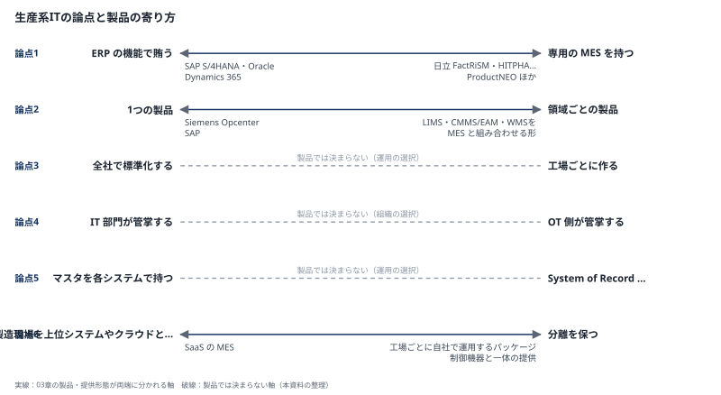

# 04 生産系ITの主要な論点

## 要旨

生産系ITを扱うときに必ず出てくる軸は次の6つである。懸念や要望を聞いたときは、まずそれがどの軸の話かを特定する。

1. 製造現場の機能を ERP で賄うか、専用の MES を持つか
2. Level3 を1つの製品でそろえるか、MOM の領域ごとに別の製品にするか
3. 全社で標準化するか、工場ごとに作るか
4. IT 部門が管掌するか、OT 側が管掌するか
5. マスタを各システムで持つか、System of Record を決めて配るか
6. 製造現場を上位システムやクラウドとつなぐか、分離を保つか

*図1　生産系ITの論点と製品の寄り方（実線は03章の製品が両端に分かれる軸、破線は製品では決まらない軸。本資料の整理）*

## 論点1：製造現場の機能を ERP で賄うか、専用の MES を持つか

ERP 製品の中には、製造現場で作業者が使う機能を持つものがある（例：Dynamics 365 Supply Chain Management の「生産フロア実行インターフェース」）。

| | ERP の機能で賄う | 専用の MES を持つ |
|---|---|---|
| 得るもの | ERP との連携が不要。製造指図と実績が1つのシステムで完結する | MESA-11 の機能（設備からのデータ収集、詳細スケジューリング、トレーサビリティなど）を深く持てる |
| 失うもの | 設備との直接接続や、品質・保全など MOM の他の領域は、別に用意する必要がある | ERP との連携の構築と保守。指図・品目などのマスタを両方で持つことになる |

**製品・提供形態との対応**（→ 03章）

| | ERP の機能で賄うに寄るもの | 専用の MES を持つに寄るもの |
|---|---|---|
| 製品・提供形態 | SAP S/4HANA（生産・QM・PM・EWM）、Oracle、Dynamics 365。ERP の中に製造指図・品質・保全の機能を持つ。SAP Digital Manufacturing は ERP ベンダーの MES で、S/4HANA と組み合わせる | 日立 FactRiSM・HITPHAMS、ProductNEO、mcframe 7 LiteMES、Siemens Opcenter Execution、AVEVA MES、Rockwell FactoryTalk ProductionCentre、GE Vernova Proficy Smart Factory |

典型的な懸念：「ERP の標準機能で足りるのか」「MES を入れると ERP と二重管理になる」

## 論点2：Level3 を1つの製品でそろえるか、MOM の領域ごとに別の製品にするか

Level3 は生産・品質・保全・在庫の4領域に分かれる（→ 02章）。ERP の論点4（スイートか、組み合わせか）の Level3 版である。

| | 1つの製品（MOM スイート） | 領域ごとの製品（MES・LIMS/QMS・CMMS/EAM・WMS） |
|---|---|---|
| 得るもの | Level3 内の連携が少ない。ロット・設備などの ID がそろう | 領域ごとに最も合う製品を選べる |
| 失うもの | 領域によっては機能が弱い | 連携の構築と保守。同じロットが MES の製造ロットと LIMS の検体で別 ID になるなど、Level3 の中でも ID が分かれる |

**製品・提供形態との対応**（→ 03章）

| | 1つの製品（MOM スイート）に寄るもの | 領域ごとの製品（MES・LIMS/QMS・CMMS/EAM・WMS）に寄るもの |
|---|---|---|
| 製品・提供形態 | Siemens Opcenter（Execution と Quality）、SAP（Digital Manufacturing と S/4HANA の QM・PM・EWM）。MES と周辺の領域を同じベンダーで持つ | LIMS（LabWare、SampleManager、LabVantage）、CMMS/EAM（IBM Maximo、HxGN EAM）、WMS（Manhattan、Blue Yonder）を、MES と組み合わせる形 |

典型的な懸念：「MES で品質や保全も管理できないのか」「現場のシステムが多すぎる」

MES で品質・保全が対象外になるのは、機能不足ではなく、別系統の Level3 システムが担う領域だからである（→ 02章）。

## 論点3：全社で標準化するか、工場ごとに作るか

| | 全社で標準化する | 工場ごとに作る |
|---|---|---|
| 得るもの | 保守と展開の費用が小さい。拠点間で実績を比較できる | 工場ごとの設備・工程・製品の違いにそのまま合わせられる |
| 失うもの | 工場の違いを標準に吸収させる必要がある | 拠点間の比較ができない。保守が工場ごとに属人化する |

**製品・提供形態との対応**（→ 03章）：製品では決まらない（運用の選択）。ただし SaaS の MES（SAP Digital Manufacturing）は工場ごとの作り込みの余地が小さく、標準化に寄る

典型的な懸念：「工場ごとに仕組みが違って全体が見えない」「標準を押し付けられると現場が回らない」

実際には、MES の標準機能と ERP 連携は全社で標準化し、工場固有のカスタマイズと設備接続は工場ごとに持つ、という分け方が多い。この分け方は、そのまま論点4の責任の分け方になる。

## 論点4：IT 部門が管掌するか、OT 側が管掌するか

- ERP は IT、SCADA 以下は OT に分かれるのが典型だが、Level3 は両方の性質を持つため、責任が重なりやすい（→ 05章の区分基準）。
- 区分はシステムの種類ではなく機能ごとに決める。たとえば MESA-11 の機能ごとに、現場即応性・設備接続の有無（OT 寄り）と、全社標準・ERP 連携（IT 寄り）の軸で整理する。どちらにも寄らず、品質保証部門などの業務部門が主体となる機能もある。
- 「誰が日常的に運用するか（運用主管）」と「誰が投資を決裁するか（承認主体）」は別の軸である。混ぜて議論すると結論が出ない。

**製品・提供形態との対応**（→ 03章）：製品では決まらない（組織の選択）

典型的な懸念：「同じシステムを2つの部門が管理している」「誰に相談すればよいか分からない」「現場の都合で全社のセキュリティ基準が守られない」

## 論点5：マスタを各システムで持つか、System of Record を決めて配るか

- 同じ物理設備が、ERP（固定資産、会計目的）・MES/CMMS（設備、生産・保全目的）・SCADA/PLC（タグ、制御目的）で別の ID を持つことは、目的が違う以上、構造的に起きる。品目や工程でも同じことが起きる。
- ID を変換する仕組みを作るだけでは足りない。変換の正しさを継続して担保する責任者（オーナー）を決める必要がある。
- マスタごとに、どのシステムが正か（System of Record）、業務側の Data Owner は誰か、変更をどう承認するかを決める。

**製品・提供形態との対応**（→ 03章）：製品では決まらない（運用の選択）。どの製品を選んでも、マスタごとに正とするシステムを決める必要がある

典型的な懸念：「同じ設備なのにシステムごとに番号が違う」「どのマスタが正しいのか分からない」

## 論点6：製造現場を上位システムやクラウドとつなぐか、分離を保つか

- OT のセキュリティでは、安全が最優先で、次に可用性・完全性・機密性の順となる。構成要素の寿命は10〜15年程度と長く、簡単には更新・パッチ適用ができない（→ 05章）。
- つなぐと、現場データの活用や遠隔監視ができる。一方で、攻撃を受ける経路が増え、止められない環境での更新が必要になる。
- つなぐ場合も、ネットワークを階層ごとに区切り、境界での通信を制限する設計（セグメンテーション）が前提になる。守り方の詳細（パデューモデル、IEC 62443 のゾーンとコンジット、補償的な対策）は ot-security にまとめた（→ [ot-security](../../../cross-cutting/ot-security/chapters/02_structure.md)）。

**製品・提供形態との対応**（→ 03章）

| | つなぐに寄るもの | 分離を保つに寄るもの |
|---|---|---|
| 製品・提供形態 | SaaS の MES（SAP Digital Manufacturing）。工場からクラウドへの通信が前提になる | 工場ごとに自社で運用するパッケージ（FactRiSM、Opcenter Execution など）、制御機器と一体の提供（横河電機 CENTUM VP、PLC） |

典型的な懸念：「工場のデータをクラウドで分析したい」「工場の PC が古くて更新できない」「IT のセキュリティルールが現場に合わない」

## 比較するときの注意

論点は互いに連動する。論点1で ERP に寄せれば論点4の管掌は IT 部門に寄り、論点2で領域ごとの製品を選べば論点5のマスタの問題が増える。1つの論点だけで結論を出さず、どの論点に波及するかを合わせて確認する。

---

**出典**（確認日：2026-11-14）

- Dynamics 365 Supply Chain Management の生産フロア実行インターフェース：Microsoft Learn「Configure the production floor execution interface」— https://learn.microsoft.com/en-us/dynamics365/supply-chain/production-control/production-floor-execution-configure
- MOM の4領域、MESA-11：02章の出典を参照
- OT のセキュリティ優先順位・寿命：05章の出典（NIST SP 800-82 Rev. 3）を参照
- 論点の立て方（論点1〜5の軸と典型的な懸念）は、01〜03・05章と、当社の事例（06章）から一般化した本資料の整理
- 各論点の「製品・提供形態との対応」は、03章の製品をもとにした本資料の整理
