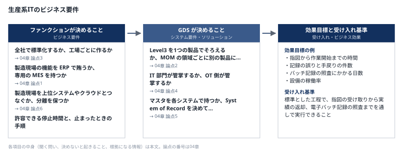

# 05 生産系ITのビジネス要件

## 要旨

生産系IT の製品を選ぶ前に、ファンクション（製造・品質保証）には**工場ごとの違いをどこまで標準に吸収させるか**と、**どの記録を GMP の記録として電子で持つか**を決めてもらう。

この章は、governance/budget-transfer の kickoff 資料（IT 予算移管の要点）にある役割分担を、この技術について具体化したものである。

*図1　生産系ITのビジネス要件（ファンクションが決めたビジネス要件をもとに GDS がシステム要件とソリューションを決め、効果目標と受け入れ基準で確かめる）*

## ファンクションが決めること（ビジネス要件）

### 全社で標準化するか、工場ごとに作るか

- **決めること**：全社で標準化する範囲（→ 04章 論点3）
- **聞く問い**：「工場ごとに違う工程・設備のうち、そろえられるものはどれか。違いを残す理由は何か」
- **決めないと起きること**：工場ごとの作り込みが続き、保守が工場ごとに属人化する
- **根拠になる情報**：工場の数、製品と工程の違い、拠点の間で比べたい指標

### 製造現場の機能を ERP で賄うか、専用の MES を持つか

- **決めること**：製造現場の実行に求めること（→ 04章 論点1）
- **聞く問い**：「指図・作業の記録・電子バッチ記録のどこまでを電子化したいか」
- **決めないと起きること**：ERP の機能で足りるかの判断ができず、MES の要否が決まらない
- **根拠になる情報**：製造の方式（バッチ・連続）、記録の量、現場の端末

### 製造現場を上位システムやクラウドとつなぐか、分離を保つか

- **決めること**：製造現場のデータを上位やクラウドで使う目的（→ 04章 論点6）
- **聞く問い**：「現場のデータを何に使いたいか（品質の分析、遠隔の監視、予知保全）」
- **決めないと起きること**：目的のないまま現場をつなぎ、攻撃の経路だけが増える
- **根拠になる情報**：使いたいデータと頻度、設備の更新の予定

### 許容できる停止時間と、止まったときの手順

- **決めること**：工程ごとに許容できる停止時間と、止まったときの代替の手順
- **聞く問い**：「MES が止まったとき、製造は何時間まで紙で続けられるか」
- **決めないと起きること**：止まってはいけない工程を前提にしない設計になる
- **根拠になる情報**：工程ごとの停止の影響、代替の手順

## GDS が決めること

- Level3 を1つの製品でそろえるか、MOM の領域ごとに別の製品にするか（→ 04章 論点2）
- IT 部門が管掌するか、OT 側が管掌するか（→ 04章 論点4）。管掌の区分は、製造・保全の部門と合意して決める
- マスタを各システムで持つか、System of Record を決めて配るか（→ 04章 論点5）

## 効果目標と受け入れ基準

- **効果目標の例**：指図から作業開始までの時間、記録の誤りと手戻りの件数、バッチ記録の照査にかかる日数、設備の稼働率
- **受け入れ基準**：標準とした工程で、指図の受け取りから実績の返却、電子バッチ記録の照査までを通しで実行できること

## 部門に閉じた案件として扱えないとき

- ERP からの指図と ERP への実績のやり取りが必ず生じる
- 製造の記録は GxP の対象になる
- 制御系（OT）とつながるため、ot-security の判断が要る

境界の詳細（どのシステムが何を持つか）は [function-allocation](../../../cross-cutting/function-allocation/function-allocation.md) を参照。

---

**出典**（確認日：2026-11-15）

- 役割分担の原則と4つの場面：governance/budget-transfer の kickoff 資料（IT 予算移管の要点、2026-11-02 初版）
- 項目の立て方、問い、例は、04章の論点をもとにした本資料の整理
