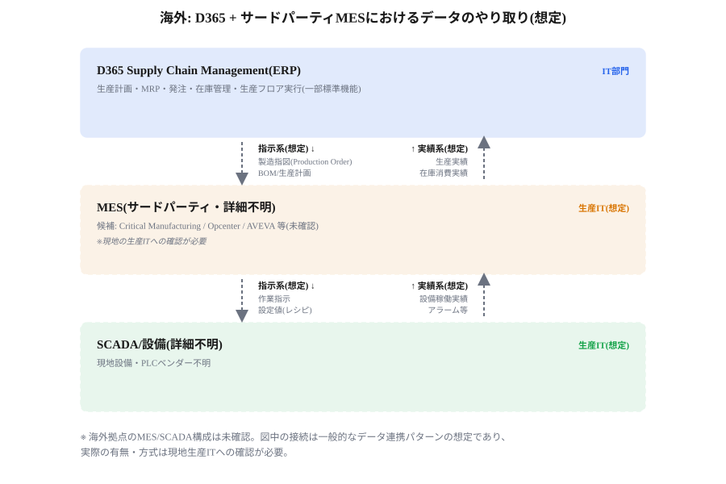
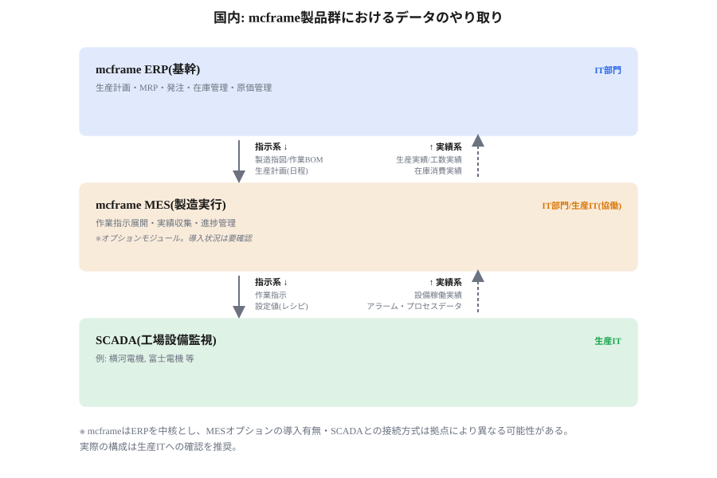
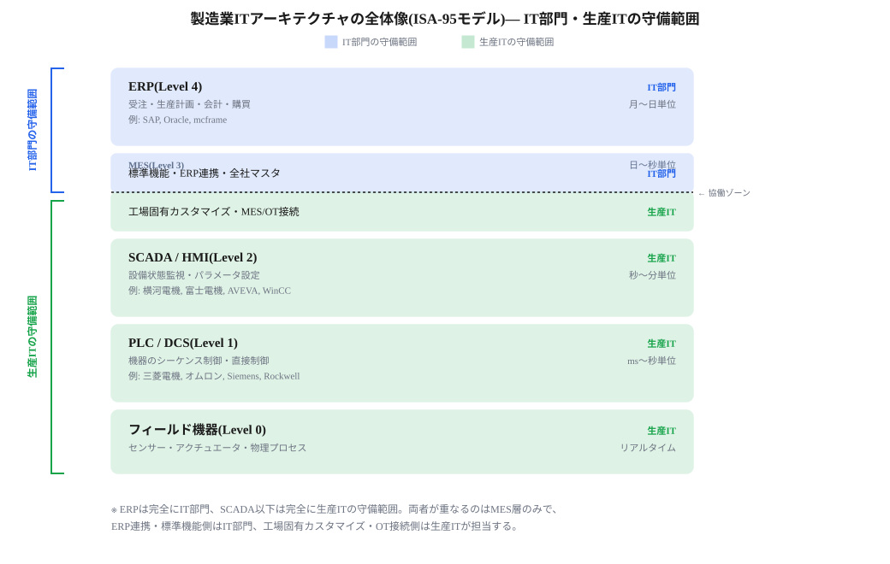
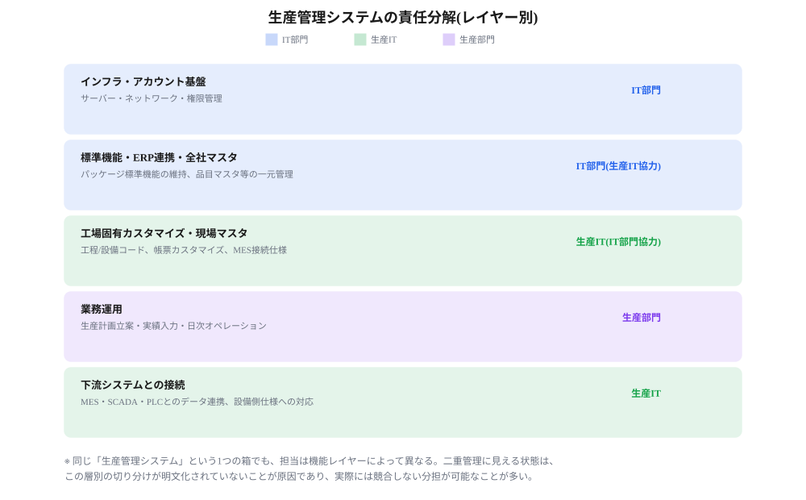
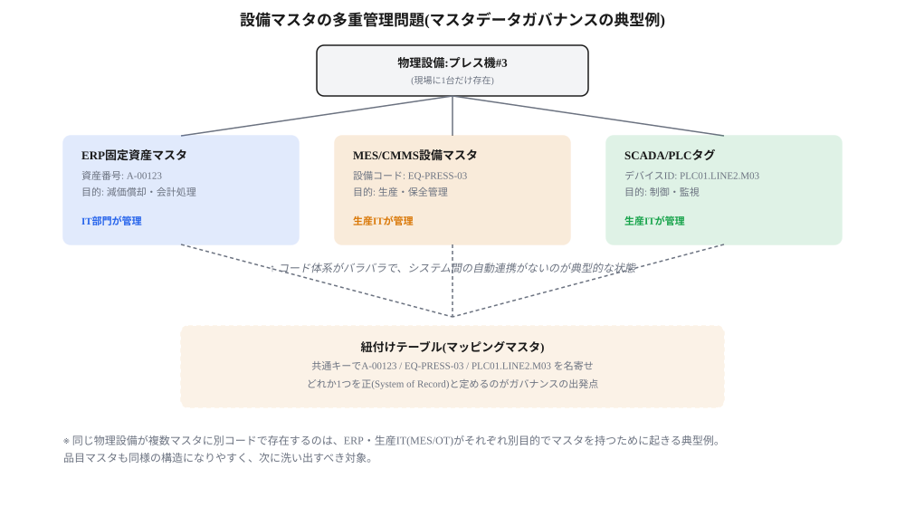
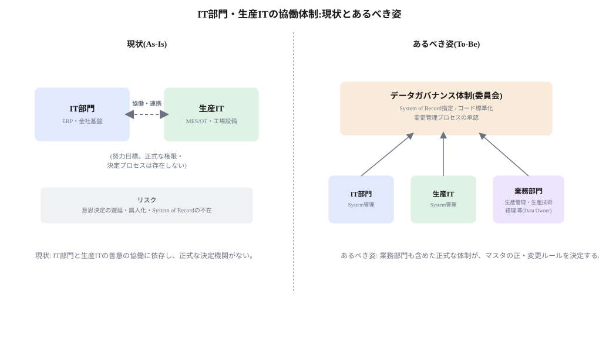

# 06 生産系IT：当社の現状

> 当社固有の情報は、このトピックではこのファイルにだけ書く。01〜05章は一般論として書く。

## 要旨

- ERP は D365（製造・会計）。10年以上前に導入した mcframe は、D365 稼働後は機能のほとんどを使っていないが、停止されていない。
- MES・SCADA の構成は国内・海外とも確認が必要である（国内の mcframe MES の導入状況、海外のサードパーティ MES の詳細）。
- 組織上はIT部門(本社)と生産IT(生産本部内)が並立し、OT(工場設備関連IT)は生産IT、それ以外(ERP・全社インフラ)はIT部門という大枠の合意はあるが、MES層で責任が重なる。
- 同じ物理設備が、ERP・MES/CMMS・SCADA/PLCでそれぞれ別のIDで管理される「マスタの多重管理」が典型的な問題として存在する。
- 現状の協働体制は「努力目標」であり、正式な決定権限を持つガバナンス体制が存在しない。

## 現在の構成

| 対象 | 使っている製品・仕組み | 範囲・備考 |
|---|---|---|
| ERP | Microsoft Dynamics 365（製造・会計） | 拠点ごとの環境構成は未確認。海外は D365 Supply Chain Management |
| 旧生産管理システム | mcframe | 国内。D365 稼働後は機能のほとんどを使っていない。統合マスタとのインターフェース、mcframe 経由のレガシー連携が残っていると想定 |
| MES | 国内：mcframe の製造実行機能（製品名・導入範囲は未確認。→「未確認の事項」）／海外：サードパーティ製品（詳細不明） | |
| SCADA/PLC | 国内：横河電機・富士電機等（想定）／海外：現地設備・PLC ベンダー不明 | |

D365 Supply Chain Managementには「生産フロア実行インターフェース」があり、作業者による作業の開始・完了、実績・材料消費の登録など、MESA-11の一部を標準機能でカバーする（→ 04章 論点1）。保全は保全依頼の登録など一部に限られ、設備との直接接続（OT接続）は含まれない。品質管理やロットの追跡は、生産フロア実行インターフェースではなく、D365 Supply Chain Management の別の機能が担う。海外拠点が標準機能のみで運用しているのか、サードパーティMES(Critical Manufacturing、Siemens Opcenter、AVEVA等が候補)を別途導入しているのか、あるいは紙・Excel運用なのかは未確認であり、現地生産ITへの確認が必要な調査項目である。

*図1　海外:D365+サードパーティMESにおけるデータのやり取り(想定・詳細不明)*

## 経緯

10年以上前に国内で mcframe を導入した。その後 D365 が稼働し、mcframe の機能はほとんど使われなくなった。D365 稼働前の国内の構成は次の図のとおり整理されていた。

*図2　D365 稼働前の国内構成：mcframe 製品群におけるデータのやり取り（2026-08 時点の整理）*

### mcframe の MESA-11 カバレッジ（D365 稼働前の整理・目安）

mcframe で品質・保全などが対象外となるのは、本来別系統の Level3 システム（LIMS/QMS、CMMS/EAM）が担う領域だからである（→ 02章）。

| MESA-11機能 | 当社の状況(目安) |
|---|---|
| 1. 資源配分・稼働状況管理 | 一部(計画上の割当は対象、リアルタイム稼働状況は対象外) |
| 2. 詳細スケジューリング | 対象(mcframeの担当領域) |
| 3. 生産ディスパッチ | 対象(mcframeの担当領域) |
| 4. 文書管理 | 一部(指図書レベルは対象、図面等は対象外) |
| 5. データ収集 | 一部(手入力実績は対象、設備自動収集は対象外) |
| 6. 労務管理 | 一部(工数実績は対象、資格管理等は対象外) |
| 7. 品質管理 | 対象外の可能性大 |
| 8. プロセス管理 | 対象外(SCADA/PLC側の領域) |
| 9. 保全管理 | 対象外(専用CMMS等が必要) |
| 10. トラッキング・トレーサビリティ | 一部(ロット単位は対象、設備単位リアルタイムは対象外) |
| 11. パフォーマンス分析 | 対象外の可能性大 |

「対象外」の領域は、生産ITが何らかの形(スクラッチ開発のシステム、またはExcel・紙でのマニュアル運用)で埋めている可能性が高いが、実態は未確認であり、確認が必要である。

## 組織と用語

| 用語 | 定義 | 役割 |
|---|---|---|
| IT部門 | 本社のIT部門 | ERP・全社インフラ・全社マスタの運用主管。IT投資の承認主体の一方 |
| 生産本部 | 製造を管掌する事業部門。生産IT・生産技術・製造現場を含む | IT投資の承認主体の一方 |
| 生産IT | 生産本部内のITチーム | 工場設備関連IT(OT)およびMES工場固有領域の運用主管 |
| 業務部門 | 業務要件とデータのオーナーとなる部門の総称。生産管理・生産技術・品質保証・経理・人事等 | Data Owner、業務要件の決定主体 |
| 生産部門 | 業務部門のうち、製造現場を持つ部門 | 日々の業務運用の主体 |

「運用主管」(誰がそのシステム・機能を日常的に管理するか)と「承認主体」(誰がその投資を決裁するか)は別の軸である。運用主管はIT部門・生産IT・業務部門の3者で整理し、承認主体はIT部門・生産本部の2者で整理する。生産ITが運用主管となる領域の投資は、承認主体としては生産本部に集約される。

## 組織構造とレイヤー別の責任の重なり

当社は本社にIT部門があり、製造は生産本部が管掌する。生産本部内には生産ITというITチームがあり、工場設備に関するIT(OT)を管掌する。ERPや全社PC・通信インフラはIT部門が主に管理する。

この大枠をISA-95の5階層に当てはめると、ERPは完全にIT部門、SCADA以下は完全に生産ITという明確な分担になる一方、MES層のみ両者が重なる。MES内でも、標準機能・ERP連携・全社マスタはIT部門、工場固有カスタマイズ・MES/OT接続は生産ITという形で、さらに分解できる。

*図3　製造業ITアーキテクチャの全体像(ISA-95モデル)— IT部門・生産ITの守備範囲*

「生産管理システムの二重管理」に見える状態も、同じ構造で説明できる。1つのシステムを2部門が奪い合っているのではなく、インフラ基盤・ERP連携はIT部門、工場固有カスタマイズ・MES/OT接続は生産IT、日々の業務運用は生産部門、というように機能レイヤーごとに責任者が異なるだけである。

*図4　生産管理システムの責任分解(レイヤー別)*

## マスタデータの多重管理という実例

現場に1台しかない設備が、ERP(固定資産マスタ、会計目的)・MES/CMMS(設備マスタ、生産保全目的)・SCADA/PLC(タグ、制御目的)という3つの異なるシステムでそれぞれ別のIDで管理され、自動的な紐付けがない、という典型的な問題がある。同じ構造は品目マスタでも起きやすい。

*図5　設備マスタの多重管理問題(マスタデータガバナンスの典型例)*

主要マスタのSystem of Record(正)と管理主体を整理すると、次のようになる。

| マスタ種別 | System of Record | Data Owner(業務側) | System管理 |
|---|---|---|---|
| 品目マスタ(部品・製品コード) | ERP(D365) | 生産管理部門・購買部門 | IT部門 |
| 標準工程・ルーティング(原価・所要量計算用) | ERP | 生産技術部門 | IT部門 |
| 詳細工程・作業手順(現場ルーティング/BOP) | MES | 生産技術部門・現場 | 生産IT |
| 設備マスタ(会計・固定資産目的) | ERP | 経理部門 | IT部門 |
| 設備マスタ(生産・保全目的) | MES/CMMS | 生産技術・保全部門 | 生産IT |
| 制御タグ・デバイスID | SCADA/PLC設定 | 現場エンジニア | 生産IT |
| 工場・ライン・設備の物理階層 | MES/生産技術台帳 | 生産技術部門 | 生産IT |
| 従業員マスタ | 人事システム | 人事部門 | IT部門 |

## 現状の協働体制

現在は、IT部門と生産ITが「協働・連携しましょう」という努力目標のもとで動いており、正式な決定機関やSystem of Recordを定める権限を持つ体制は存在しない。この状態では、意思決定の遅延や属人化、マスタの不整合が起きやすい。

## 課題への打ち手（提言）

この節は、上で整理した課題（責任の重なり、マスタの多重管理、非公式な協働体制）に対する打ち手を、制度・プロセスとして示す。判断基準の詳細は[付録A](../appendix/A_decision-criteria.md)、運用手順は[付録B](../appendix/B_routing-operation.md)、プロンプト本文は[付録C](../appendix/C_investment-approval-prompts.md)に置く。

- ERP/MES/SCADA/PLCのレイヤーごとに、IT部門・生産IT・業務部門の責任分解の原則を明文化する。
- マスタデータについては、業務部門も含めた正式なデータガバナンス体制を設置し、System of Recordと変更管理プロセスを決定する。
- IT投資案件については、影響度・リスク・技術レイヤーに基づく承認ルーティングの枠組みを導入し、IT部門・生産本部どちらが承認すべきかを機械的に判定できるようにする。

### 責任分解の原則

MESA-11の11機能それぞれについて、現場即応性・OT接続の有無(生産IT寄り)と、全社標準・ERPとの連携(IT部門寄り)という軸で運用主管を整理する。詳細は[付録A](../appendix/A_decision-criteria.md)のマッピング表を参照。

原則として次の3パターンに分類する。

1. **生産IT主体**:現場即応性が高く、OT接続が前提となる機能(資源配分の稼働状況、生産ディスパッチ、データ収集、プロセス管理、保全管理)
2. **共同管理**:ERPとの連携や全社標準化の要素と、現場実装の要素の両方を持つ機能(詳細スケジューリング、労務管理、品質管理、トレーサビリティ、パフォーマンス分析)
3. **業務部門主体**:そもそもIT部門・生産ITのどちらでもなく、品質保証部門や人事部門が主体となるべき機能(現時点では文書管理のみ)。システムはIT部門・生産ITが基盤提供する。

### データガバナンス体制

マスタデータ(品目・設備・工程コード等)は、ERPと、Level3の各システム(MES・LIMS/QMS・CMMS/EAM・WMS)と、OTがそれぞれ別目的でマスタを持つため、同じ物理的実体が複数のIDで管理される「多重管理」が構造的に発生する。Level3がMOMの4領域に分かれている以上、この多重化はL3内部でも起きる(例:同じ製品ロットがMESの製造ロットIDとLIMSの検体IDで別管理される)。これに対処するには、ブリッジ・変換機能を作るだけでは不十分で、変換ロジックの正しさを継続的に担保する責任者(オーナー)を明文化する必要がある。

現状は、IT部門と生産ITの間の「協働・連携」という努力目標に依存しており、正式な決定機関がない。あるべき姿は、IT部門・生産IT・業務部門(生産管理・生産技術・経理等、Data Ownerとしての役割)が参加する正式なデータガバナンス体制を設置し、この体制がマスタごとのSystem of Record指定、コード体系の標準化、変更管理プロセスの承認を担うことである。

*図6　IT部門・生産ITの協働体制:現状とあるべき姿*

### IT投資案件の承認ルーティング

生産本部内のIT投資案件について、IT部門が承認すべきか、生産本部が承認すべきか、または両方かを判定するための枠組みを導入する。ここで判定するのは承認主体(組織)であり、運用主管(IT部門/生産IT/業務部門)とは別の軸である。判定には、既存の案件情報(案件名・案件概要・概算費用・実施しない場合のリスク)だけでは不足しており、対象レイヤー・影響度・リスク・コスト構造に関する追加情報が必要になる。追加すべき項目と、それを用いた判定フローの詳細は[付録A](../appendix/A_decision-criteria.md)を参照。

## 進行中の検討

- **mcframe**：システム入れ替えかサーバ載せ替えかを検討することになっている。
- **連携基盤**：人事用と ERP・製造用でインスタンスを分ける方向（→ [erp/06_our-company.md](../../erp/chapters/06_our-company.md)）。

## 未確認の事項

- 拠点ごとの D365 環境の構成
- 国内の mcframe MES の導入状況・範囲、SCADA との接続方式
- 海外拠点の MES/SCADA 構成（D365 の標準機能のみか、サードパーティ MES か、紙・Excel 運用か）
- mcframe に残っている機能・連携の実態（ログでの確認が必要）、過去の GMP 関連記録の有無
- MESA-11 で対象外の領域（品質・保全・パフォーマンス分析など）を、どのシステム・運用で埋めているか
- 品質・保全・在庫それぞれの Level3 システムの採用状況

---

**情報源**（確認日：2026-11-14）

- 旧 ot/chapters/01（2026-08 時点の整理）：システム構成、組織構造と責任の重なり、マスタの多重管理、協働体制
- 本人の把握している社内の状況（2026-11-14 時点）：ERP（D365）と mcframe の現状
- D365 の生産フロア実行インターフェース：Microsoft Learn — https://learn.microsoft.com/en-us/dynamics365/supply-chain/production-control/production-floor-execution-configure 、品質管理：Microsoft Learn「Quality and nonconformance management overview」— https://learn.microsoft.com/en-us/dynamics365/supply-chain/inventory/quality-management-processes
- 旧 ot/chapters/02〜04・付録1（旧 governance/ot-governance）：課題への打ち手（提言）、付録A〜C
