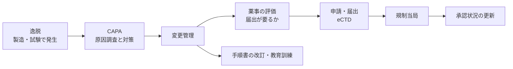
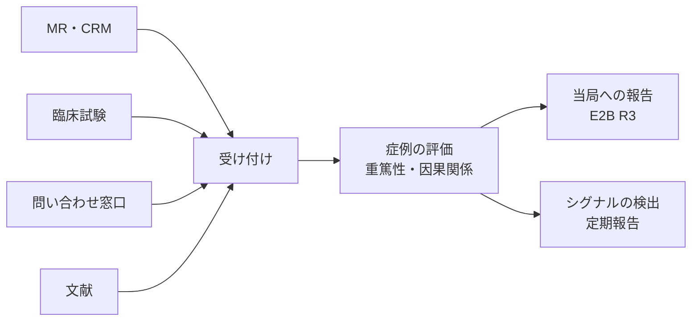

# 02 品質・薬事・安全性の構造

## 要旨

品質・薬事・安全性の3つは、**変更**と**有害事象**でつながる。製造や試験で起きた逸脱は CAPA・変更管理につながり、承認内容に関わる変更は薬事の評価と当局への届出を要する。有害事象の情報は、MR・臨床試験・文献などから安全性データベースに集まり、当局に報告される。

## 品質と薬事：変更のつながり

*図1 品質と薬事のつながり（本資料の整理）*

- QMS で始めた変更管理から、RIM の薬事の評価を自動で起動できる製品がある。
- 逸脱・CAPA・変更管理を親子の記録としてつなぎ、追跡できるようにするのが一般的な作りである。

## 安全性：有害事象の流れ

*図2 有害事象の流れ（本資料の整理）*

## 正本（本資料の整理）

| 情報 | 正本 |
|---|---|
| 品質の記録（逸脱・CAPA・変更） | QMS |
| GxP の文書（手順書など） | 文書管理（QMS の一部、または専用の文書管理） |
| 製品×国の承認状況 | RIM |
| 個別症例 | 安全性データベース |

---

**出典**（確認日：2026-11-14）

- 変更管理から薬事の評価の起動、親子の記録：SoftwareConnect — https://softwareconnect.com/roundups/best-pharmaceutical-qms/
- 図1・図2、正本の表は本資料の整理。Veeva の製品での流れは [veeva-platform 付録E](../../veeva-platform/appendix/E_rd-products.md)
