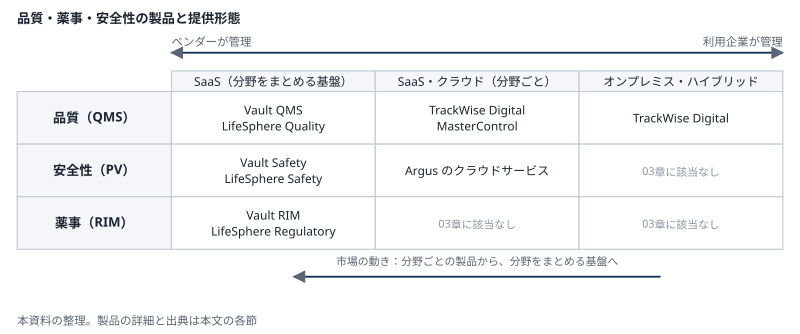

# 03 品質・薬事・安全性の製品と提供形態

## 要旨

品質・薬事・安全性の製品は、**品質（QMS）**、**安全性（PV）**、**薬事（RIM）**の3つの分野に分かれる。3つをまとめて1つの基盤で出すベンダー（Veeva、ArisGlobal）と、分野ごとの専門の製品（Oracle の Argus、Sparta Systems の TrackWise など）があり、そろえるか分野ごとに選ぶかが選択の軸になる（→ 04章 論点1）。

市場では統合が進んでいる。2026年7月に Dassault Systèmes が ArisGlobal の買収を発表し、臨床の Medidata、研究の BIOVIA と同じ会社に安全性・薬事の製品が加わる。QMS の市場は製薬以外の製造業向けの製品も含めて評価されており、製薬向けの機能の深さは製品によって違う（本資料の整理）。

提供形態は SaaS が主流で、どの形態でも検証の最終的な責任は利用企業に残る（→ gxp-compliance 03章）。

*図1　品質・薬事・安全性の製品と提供形態（縦は製品の区分、横は提供形態。本資料の整理）*

## 品質（QMS）

Verdantix は2025年12月17日に、QMS の最初の評価（Green Quadrant: Quality Management Software 2025）を公表した。14社を評価し、9社をリーダーとした。この評価は製薬に限らない製造業全体を対象にしており、ComplianceQuest・Ideagen・Siemens などが、それぞれリーダーとされたと発表している。PTC の Arena と Windchill も評価の対象に入っている。

| 製品 | 提供元 | 補足 |
|---|---|---|
| Vault QMS（Vault Quality） | Veeva | Vault の上で、文書管理（QualityDocs）・研修・RIM と同じ基盤にある（→ veeva-platform 02章） |
| TrackWise Digital | Sparta Systems | Honeywell が2020年12月に13億ドルでの買収を発表した。発表の時点で、Sparta は400社以上の顧客を持ち、売上上位50社の製薬企業のうち42社が含まれていた。オンプレミス・ハイブリッド・SaaS で動く。その後の所有の変化は本資料では未確認 |
| LifeSphere Quality | ArisGlobal | 2023年に Amplexor Life Sciences を買収して QMS の機能を加えた。安全性・薬事と同じ LifeSphere の基盤にある |
| MasterControl | MasterControl | 製薬・医療機器向けの QMS。機能の違いは本資料では未確認 |

ERP にも品質の機能（SAP の QM など）があり、ロットの出荷の可否は ERP が持つ（→ 05章、erp 05章）。

## 安全性（PV）

IDC は2025年7月に、PV の技術とコンサルティングを合わせて評価した IDC MarketScape を公表した。評価の対象には、Oracle・ArisGlobal・Veeva・IQVIA のような製品のベンダーと、Accenture・Cognizant・PwC・TCS・PPD のようなサービスの会社が並ぶ。Oracle はリーダーとされたと発表している。

| 製品 | 提供元 | 補足 |
|---|---|---|
| Argus Safety | Oracle | Oracle の Safety One の中心の製品。日本向けの Argus Safety Japan で PMDA への報告を扱い、国内の製薬企業での採用例も公表されている（協和発酵キリン 2013年、あゆみ製薬 2016年） |
| LifeSphere Safety（MultiVigilance） | ArisGlobal | 安全性の症例の受付から報告までを扱うクラウドの基盤。日本向けの ARISj は、2016年の時点で製薬25社に提供されていた |
| Vault Safety | Veeva | Vault の上の安全性データベース。品質・薬事・臨床と同じ基盤にある |

PV の業務そのものを、CRO や BPO の事業者に委託する形もある。IDC の評価にサービスの会社が多く並ぶのはこのためで、社内で行うか委託するかが選択の軸になる（→ 04章 論点2）。

## 薬事（RIM）

| 製品 | 提供元 | 補足 |
|---|---|---|
| Vault RIM（Registrations・Submissions・Submissions Publishing など） | Veeva | 製品の詳細は veeva-platform 付録E にまとめている |
| LifeSphere Regulatory（RIMS） | ArisGlobal | 2023年に、申請の資料の出版（パブリッシング）と添付文書の管理の機能（Amplexor の買収）と、IDMP の SPOR データの管理（SPORIFY の買収）を加えた |

その他の RIM 製品は、本資料では確認していない。申請の資料を文書として持つか、構造化したデータ（IDMP など）として持つかは、04章 論点5 の軸である。

## 国内の製品と日本固有の要素

品質・薬事・安全性の国内ベンダーの製品は、本資料では確認していない。日本固有の要件には、グローバルの製品の日本向けの版で対応する例が多い。

- PMDA への副作用の報告（E2B(R3) の日本の要件）：Argus Safety Japan、ARISj
- 国ごとの要件を1つのシステムでどこまで扱うかは、04章 論点4 の軸である

## 他の製品に付属する機能

| 付属する先 | 機能 | 補足（本資料の整理） |
|---|---|---|
| ERP（SAP S/4HANA など） | 品質管理（SAP の QM）、ロットの出荷の可否 | 出荷判定の正本は ERP が持つことが多い（→ erp 03章・05章） |
| 臨床の基盤（Oracle Clinical One など） | 重篤な有害事象の報告と、安全性のシステムとの接続 | 臨床の製品から PV の製品へデータを渡す（→ rd 03章） |
| 文書管理の基盤（Vault の QualityDocs など） | SOP・記録の管理 | QMS と同じ基盤に文書管理を置く製品がある |

## 提供形態

| 形態 | ベンダーが管理するもの | 利用企業が管理するもの | 例 |
|---|---|---|---|
| SaaS（品質・薬事・安全性をまとめる基盤） | 基盤、製品の更新、版ごとの検証の資料 | 業務の設定、意図した用途に対する検証、更新ごとの影響の評価 | Veeva Vault、ArisGlobal LifeSphere |
| SaaS・クラウドサービス（分野ごとの製品） | 基盤、製品の更新 | 上記に加えて、他の分野の製品との連携 | Argus のクラウドサービス、TrackWise Digital の SaaS |
| オンプレミス・ハイブリッド | ソフトウェアの提供と保守 | 上記に加えて、サーバ・データベース・更新の適用 | TrackWise Digital のオンプレミス版 |

SaaS では、更新が年に何回も来るため、導入時の検証より更新ごとの影響の評価が負担の中心になる（→ gxp-compliance 03章、04章 論点3）。

## 市場の動き

| 時期 | できごと |
|---|---|
| 2020年12月 | Honeywell が Sparta Systems（TrackWise）の買収を発表した（13億ドル） |
| 2023年 | ArisGlobal が Amplexor Life Sciences（QMS・申請の出版・添付文書）と SPORIFY（SPOR データ）を買収した |
| 2025年7月 | IDC が PV の技術とサービスの評価を公表した |
| 2025年12月 | Verdantix が QMS の最初の評価を公表した |
| 2026年7月23日 | Dassault Systèmes が ArisGlobal を約18億ドル（AI 関連の売上に応じて最大2億ドルを追加）で買収すると発表した。2026年10月の発表では、ArisGlobal は BIOVIA・Medidata と同じライフサイエンスの部門に入る |

## 本資料でまだ扱っていないもの

- MasterControl など、Veeva・ArisGlobal 以外の QMS の機能の違い
- Veeva・ArisGlobal 以外の RIM 製品（IQVIA など）
- 国内ベンダーの製品と、国内での採用の全体像
- 各製品の料金（いずれも公表されていない）

---

**出典**（確認日：2026-11-14）

- QMS の Green Quadrant 2025：Verdantix（2025-12-17）— https://www.verdantix.com/insights/press-release/verdantix-green-quadrant-report-identifies-leading-quality-management-software-platforms-for-scalability--workflow-optimization-and-ai-enabled-transformation 、リーダー9社と評価14社：Ideagen（2026-01-15）— https://www.ideagen.com/thought-leadership/blog/ideagen-named-leader-verdantix-green-quadrant-quality-management-software 、ComplianceQuest（2025-12-18）— https://www.newswire.com/news/compliancequest-recognized-as-a-leader-in-independent-analyst-firms-22694408 、Siemens：IT Brief UK — https://itbrief.co.uk/story/siemens-named-verdantix-leader-for-ai-driven-qms-tools 、評価の対象（PTC）：Verdantix の報告書の目次 — https://www.verdantix.com/insights/report/green-quadrant--quality-management-software-2025
- Sparta Systems の買収：Sparta Systems（Honeywell の発表の転載）— https://www.spartasystems.com/in-the-news/honeywell-expands-life-sciences-and-software-capabilities-through-acquisition-of-sparta-systems/ 、顧客数：CPECN — https://www.cpecn.com/news/honeywell-acquires-sparta-systems-for-1-3-billion/ 、動作する環境：Futurum Group — https://futurumgroup.com/?p=18555
- ArisGlobal の買収（Amplexor・SPORIFY）：ArisGlobal — https://www.arisglobal.com/press-release/drug-development-technology-leader-arisglobal-completes-acquisition-of-amplexor-life-sciences/ 、https://www.arisglobal.com/press-release/arisglobal-acquires-leading-regulatory-data-solution-sporify/
- PV の IDC MarketScape 2025（評価の対象）：PwC が公開した抜粋 — https://www.pwc.com/gx/en/news-room/assets/analyst-citations/idc-pv-2025.pdf 、Oracle（2025-09-30）— https://www.oracle.com/sg/news/announcement/oracle-recognized-as-a-leader-in-2025-idc-marketscape-for-worldwide-life-science-rd-pharmacovigilance-technology-2025-09-30/
- Argus Safety Japan の国内の採用例：ビジネス+IT（2013-03-14）— https://www.sbbit.jp/article/cont1/26066 、IT Leaders（2016）— https://it.impress.co.jp/articles/-/13933
- ARISj の提供実績：薬事日報（2016-08-19）— https://www.yakuji.co.jp/?p=52793
- Dassault Systèmes による ArisGlobal の買収：Dassault Systèmes（2026-07-23）— https://investor.3ds.com/news-releases/news-release-details/dassault-systemes-acquire-arisglobal-creating-unified-ai 、日本語 — https://www.3ds.com/ja/newsroom/press-releases/dassault-systemes-acquire-arisglobal-creating-unified-ai-intelligence-platform-life-sciences-industry-connecting-molecule-patient-and-real-world-outcomes 、部門の位置付け（2026-10-28）— https://www.3ds.com/assets/invest/2026-10/dassault-systemes-takes-life-sciences-ambition-to-next-level-pr-final-28-oct-2026.pdf
- Veeva の製品の基盤の構成：[veeva-platform 02章](../../veeva-platform/chapters/02_structure.md)、[付録E](../../veeva-platform/appendix/E_rd-products.md)
- 製薬向けの機能の深さが製品で違う点、提供形態の表は、上記の出典と gxp-compliance 03章をもとにした本資料の整理
- 製品の区分は 2026-11 時点の各社の公表情報による。契約の判断の前には各社の最新の資料で確かめる
