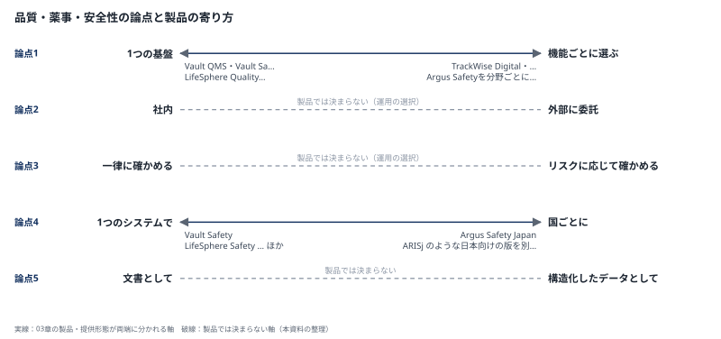

# 04 品質・薬事・安全性の主要な論点

## 要旨

品質・薬事・安全性のシステムを扱うときに出てくる軸は次の5つである（本資料の整理）。

1. 品質・薬事・安全性を1つの基盤にそろえるか、機能ごとに選ぶか
2. 安全性の業務を社内で行うか、外部に委託するか
3. システムの確からしさを一律に確かめるか、リスクに応じて確かめるか
4. 国ごとの要件をどこまで1つのシステムで扱うか
5. 申請の資料を文書として持つか、構造化したデータとして持つか

*図1　品質・薬事・安全性の論点と製品の寄り方（実線は03章の製品が両端に分かれる軸、破線は製品では決まらない軸。本資料の整理）*

## 論点1：1つの基盤にそろえるか、機能ごとに選ぶか

| | 1つの基盤（例：Veeva Vault） | 機能ごとに選ぶ |
|---|---|---|
| 得るもの | 変更管理から薬事の評価までが自動でつながる | 各機能で実績のある製品を使える（例：安全性は Argus） |
| 失うもの | 1社への依存が深まる（→ veeva-platform 付録D） | 品質と薬事の間の連携を自分で作り、保つ必要がある |

**製品・提供形態との対応**（→ 03章）

| | 1つの基盤（例：Veeva Vault）に寄るもの | 機能ごとに選ぶに寄るもの |
|---|---|---|
| 製品・提供形態 | Vault QMS・Vault Safety・Vault RIM（Veeva）、LifeSphere Quality・Safety・Regulatory（ArisGlobal）。品質・安全性・薬事を同じ基盤で持つ | TrackWise Digital・MasterControl（QMS）、Argus Safety（PV）を分野ごとに選ぶ形 |

## 論点2：安全性の業務を社内で行うか、外部に委託するか

| | 社内 | 外部に委託 |
|---|---|---|
| 得るもの | 自社の製品の知識が社内に残る | 症例の件数の増減に合わせられる。人員の確保を任せられる |
| 失うもの | 安全性データベースと人員を自社で持つ | 委託先の品質の監督が必要になる |

**製品・提供形態との対応**（→ 03章）：製品では決まらない（運用の選択）。委託する場合も、安全性データベースを自社で持つか委託先のものを使うかの選択が残る

## 論点3：一律に確かめるか、リスクに応じて確かめるか

QMS・RIM・PV に限らず、GxP の記録を扱うすべてのシステムに共通の論点のため、gxp-compliance 04章（論点1）にまとめた。品質・薬事・安全性のシステムでは、品質の判断や当局への報告に直結する機能が多く、リスクが高いと判断される範囲が広くなりやすい（本資料の整理）。

**製品・提供形態との対応**（→ 03章）：製品では決まらない（運用の選択）。検証の考え方は gxp-compliance 04章 論点1 を参照

## 論点4：国ごとの要件をどこまで1つのシステムで扱うか

| | 1つのシステムで | 国ごとに |
|---|---|---|
| 得るもの | 承認状況と症例を世界で1つに見られる | 国の制度（日本の PMDA 向けの報告など）に深く合わせられる |
| 失うもの | 国ごとの差分の設定と保守が重い | 世界の全体像をまとめる作業が要る |

**製品・提供形態との対応**（→ 03章）

| | 1つのシステムでに寄るもの | 国ごとにに寄るもの |
|---|---|---|
| 製品・提供形態 | Vault Safety、LifeSphere Safety のグローバルの基盤に、国ごとの差分を設定する形 | Argus Safety Japan、ARISj のような日本向けの版を別に持つ形 |

## 論点5：申請の資料を文書として持つか、構造化したデータとして持つか

| | 文書として | 構造化したデータとして（IDMP など） |
|---|---|---|
| 得るもの | 現在の業務をそのまま続けられる | 製品の情報を、品質・薬事・安全性で同じデータとして使える |
| 失うもの | 同じ情報を文書ごとに書き直す | 製品・物質のマスタを整える必要がある（→ master-data） |

**製品・提供形態との対応**（→ 03章）：右（構造化したデータ）に寄るもの：Vault RIM（Registrations で登録の情報をデータとして持つ）、LifeSphere Regulatory（SPORIFY の買収で SPOR のデータを扱う）。左（文書として持つ使い方）は、どの製品でも続けられる

---

**出典**（確認日：2026-11-14）

- 5つの軸と各表の内容は、01〜03章をもとにした本資料の整理
- 各論点の「製品・提供形態との対応」は、03章の製品をもとにした本資料の整理
