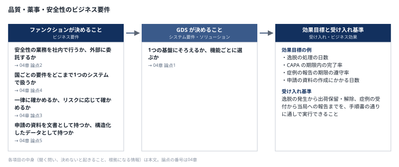

# 05 品質・薬事・安全性のビジネス要件

## 要旨

品質・薬事・安全性の製品を選ぶ前に、ファンクション（品質保証・薬事・安全性）には**国ごとの要件をどこまで1つで扱うか**と、**安全性の業務を誰が担うか**を決めてもらう。これらの記録は当局への説明責任を負うため、検証の範囲も品質保証部門が決める。

この章は、governance/budget-transfer の kickoff 資料（IT 予算移管の要点）にある役割分担を、この技術について具体化したものである。

*図1　品質・薬事・安全性のビジネス要件（ファンクションが決めたビジネス要件をもとに GDS がシステム要件とソリューションを決め、効果目標と受け入れ基準で確かめる）*

## ファンクションが決めること（ビジネス要件）

### 安全性の業務を社内で行うか、外部に委託するか

- **決めること**：安全性の業務を社内で持つか、委託するか（→ 04章 論点2）
- **聞く問い**：「症例の受付から報告までのうち、社内で持ちたいのはどこまでか」
- **決めないと起きること**：委託先の安全性データベースを使うのか、自社で持つのかが決まらず、製品の選定が進まない
- **根拠になる情報**：症例の件数と変動、社内の人員、委託先の候補

### 国ごとの要件をどこまで1つのシステムで扱うか

- **決めること**：国ごとの要件をどこまで1つで扱うか（→ 04章 論点4）
- **聞く問い**：「日本の PMDA 向けの報告や承認の管理を、世界と同じ仕組みで扱いたいか」
- **決めないと起きること**：国ごとの差分の設定が重くなる、または世界の全体像をまとめる作業が残る
- **根拠になる情報**：対象の国と製品の数、国ごとの報告の要件

### 一律に確かめるか、リスクに応じて確かめるか

- **決めること**：確かめる範囲（リスクの判断）（→ 04章 論点3）
- **聞く問い**：「品質の判断や当局への報告に直結する機能はどれか」
- **決めないと起きること**：すべての機能に同じ重さの検証がかかり、更新に追いつかない
- **根拠になる情報**：品質保証部門の方針、過去の査察の指摘

### 申請の資料を文書として持つか、構造化したデータとして持つか

- **決めること**：申請の資料を構造化したデータで持つか（→ 04章 論点5）
- **聞く問い**：「IDMP などのデータでの提出に、いつまでに対応する必要があるか」
- **決めないと起きること**：規制の要求の時期に間に合わず、直前に手作業で整えることになる
- **根拠になる情報**：規制当局の要求の時期、製品・物質のマスタの状態

## GDS が決めること

- 1つの基盤にそろえるか、機能ごとに選ぶか（→ 04章 論点1）。1社への依存を受け入れるかは、ファンクションと合意する

## 効果目標と受け入れ基準

- **効果目標の例**：逸脱の処理の日数、CAPA の期限内の完了率、症例の報告の期限の遵守率、申請の資料の作成にかかる日数
- **受け入れ基準**：逸脱の発生から出荷保留・解除、症例の受付から当局への報告までを、手順書の通りに通しで実行できること

## 部門に閉じた案件として扱えないとき

- 出荷の可否を ERP に渡すため、ERP との連携が必ず生じる
- 記録は GxP の対象で、当局への説明責任を負う
- 症例には患者の個人情報が含まれる

境界の詳細（どのシステムが何を持つか）は [function-allocation](../../../cross-cutting/function-allocation/function-allocation.md) を参照。

---

**出典**（確認日：2026-11-15）

- 役割分担の原則と4つの場面：governance/budget-transfer の kickoff 資料（IT 予算移管の要点、2026-11-02 初版）
- 項目の立て方、問い、例は、04章の論点をもとにした本資料の整理
