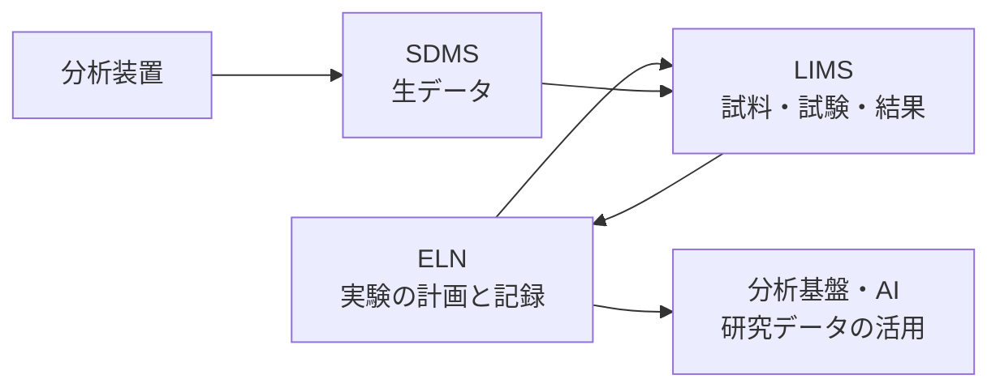
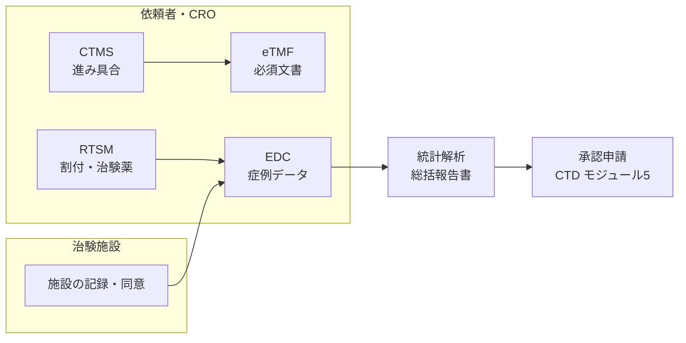

# 02 研究開発・臨床の構造

## 要旨

研究では、**ELN が実験の記録を、LIMS が試料と試験を**持ち、装置のデータは SDMS に集まる。臨床では、**依頼者（製薬企業）・CRO・治験施設**の三者がシステムを分け持ち、EDC に集まった症例データが統計解析を経て承認申請に使われる。

## 研究のデータの流れ

*図1 研究のデータの流れ（本資料の整理）*

ELN と LIMS の機能は近づいており、LIMS の提供元が ELN を、ELN の提供元が試料の管理を加えている。

## 臨床のデータの流れ

*図2 臨床のデータの流れ（本資料の整理）*

- 臨床試験は CRO に委託されることが多く、CRO のシステムを使うか、依頼者のシステムを CRO に使わせるかで連携の形が変わる。
- 試験中に起きた有害事象は、安全性のシステムへ報告される（→ quality-regulatory）。

---

**出典**（確認日：2026-11-14）

- ELN と LIMS の機能の接近：IntuitionLabs — https://intuitionlabs.ai/articles/lims-system-guide-2025
- 臨床の流れ：[veeva-platform 付録E](../../veeva-platform/appendix/E_rd-products.md)
- 図1・図2 は本資料の整理
