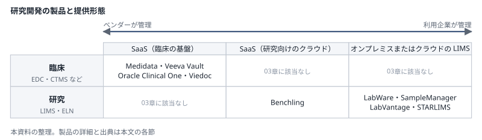

# 03 研究開発・臨床の製品と提供形態

## 要旨

研究開発・臨床の製品は、**臨床（EDC・CTMS・eTMF・RTSM など）**と、**研究（LIMS・ELN）**の2つに分かれる。臨床は **Medidata（Dassault Systèmes）・Veeva・Oracle** が大手の企業向けの中心で、各社とも臨床の製品を1つの基盤でつなぐことを打ち出している（→ 04章 論点1）。研究は、品質管理の試験室に強い LIMS（LabWare、Thermo Fisher、LabVantage、STARLIMS）と、研究向けのクラウド（Benchling など）に分かれる（→ 04章 論点3）。

市場では Dassault Systèmes が、Medidata（臨床）・BIOVIA（研究）に続いて ArisGlobal（安全性・薬事）の買収を発表した。臨床の製品は CRO が使うことも多く、Veeva と IQVIA は2025年に臨床での提携を結んだ（→ 04章 論点2）。

*図1　研究開発の製品と提供形態（縦は製品の区分、横は提供形態。本資料の整理）*

## 臨床（EDC・CTMS など）

臨床の製品だけを対象にした Gartner の Magic Quadrant はない。Everest Group（EDC の PEAK Matrix）や IDC（分散型臨床試験の MarketScape など）が評価を出している。

| 製品 | 提供元 | 補足 |
|---|---|---|
| Medidata Rave（EDC）、Medidata CTMS など | Medidata（Dassault Systèmes） | Rave EDC を中心に、eConsent・eCOA・RTSM・画像のデータを1つの基盤で集めて突き合わせる。2026年7月に、AI を前提にした基盤の Medidata Plus を発表した |
| Veeva Vault EDC・CTMS・eTMF | Veeva | 臨床の製品を Vault の基盤でつなぐ（→ veeva-platform 付録E）。2023年2月、売上上位20社の製薬企業のうち6社が、新しい試験の標準に Vault EDC を選んだと発表した |
| Oracle Clinical One | Oracle | EDC と RTSM を1つにまとめる。2025年8月、電子カルテ（Oracle Health ほか）からデータを直接取り込む AI の接続機能と、E2B(R3) に沿って重篤な有害事象を報告し Argus などの安全性のシステムとつなぐ機能を加えた |
| Viedoc | Viedoc Technologies | 世界75か国以上で使われる EDC。日本では累計2,000件以上の試験で使われ、製造販売後調査（PMS）向けの Viedoc PMS を出している |

料金はどの製品も公表されておらず、試験の規模や契約の形で決まる（本資料では未確認）。

## 研究（LIMS・ELN）

LIMS・ELN を対象にしたアナリストの評価は、本資料では確認していない。

| 製品 | 提供元 | 補足 |
|---|---|---|
| LabWare LIMS・ELN | LabWare | 1987年設立の LIMS の専業ベンダー。日本法人は2008年設立 |
| SampleManager LIMS | Thermo Fisher Scientific | LIMS・SDMS（生データの管理）・LES（手順の実行）・ELN を1つの製品で提供する。約40年の歴史があり、日本語に対応する |
| LabVantage | LabVantage Solutions | Web ベースの LIMS。世界で2,000社以上、国内で50社を超える導入。製薬向けの Pharma Package は検証済みの設定を含む |
| STARLIMS | STARLIMS | 2021年に Abbott から投資会社の Francisco Partners に売却され、2026年1月に Turn/River Capital に再び売却された（報道による） |
| Benchling | Benchling | 研究向けのクラウドの基盤。発見からバイオプロセスまでの研究のデータと実験を1つの基盤で扱う |
| BIOVIA | Dassault Systèmes | 研究向けの製品群。臨床の Medidata と同じ会社 |

品質管理の試験室の LIMS と、研究の ELN を1つにするか分けるかは、04章 論点3 の軸である。

## 国内の製品と日本固有の要素

研究開発・臨床の国内ベンダーの製品は、本資料では確認していない。日本固有の要素には、グローバルの製品の日本向けの機能や国内の体制で対応する例がある。

- 製造販売後調査（PMS）：日本固有の制度で、Viedoc PMS のような専用の製品がある
- 国内の導入と支援：LabVantage（国内50社超）、SampleManager（日本語対応と国内の技術支援）

## 他の製品に付属する機能

| 付属する先 | 機能 | 補足（本資料の整理） |
|---|---|---|
| 臨床の基盤（Medidata・Veeva・Oracle） | EDC・CTMS・eTMF・RTSM を1つの基盤で提供 | 個別の製品を選ぶより、基盤ごとまとめて契約する形になりやすい（→ 04章 論点1） |
| 品質・安全性の製品（Oracle Argus など） | 有害事象の報告の受け取り | 臨床の製品と PV の製品の接続（→ quality-regulatory 03章） |
| ERP（SAP S/4HANA など） | 品質管理の試験の結果の記録（SAP の QM） | 品質管理の試験室では LIMS と ERP の役割の分担が要る |

## 提供形態

| 形態 | ベンダーが管理するもの | 利用企業（または CRO）が管理するもの | 例 |
|---|---|---|---|
| SaaS（臨床の基盤） | 基盤、製品の更新、版ごとの検証の資料 | 試験ごとの画面とデータの設計、権限、他システムとの連携、意図した用途に対する検証 | Medidata、Veeva、Oracle Clinical One |
| SaaS（研究向けのクラウド） | 基盤、製品の更新 | 実験のデータの構造、権限、分析機器との連携 | Benchling |
| オンプレミスまたはクラウドの LIMS | ソフトウェアの提供と保守（クラウド版では基盤も） | 試験の手順・規格の設定、分析機器との連携、検証 | LabWare、SampleManager、LabVantage |

臨床の製品は、試験を委託した CRO がスポンサーの代わりに設計・運用することも多い。誰の契約のシステムを使うかで、データの持ち方と管理の責任が変わる（本資料の整理、→ 04章 論点2）。

## 市場の動き

| 時期 | できごと |
|---|---|
| 2021年7月 | Abbott が STARLIMS を Francisco Partners に売却した |
| 2023年2月 | Veeva が、上位20社のうち6社が Vault EDC を新しい試験の標準に選んだと発表した |
| 2025年8月 | Veeva と IQVIA が和解し、IQVIA が Veeva の CRO 向けの臨床のプログラムに加わった。IQVIA は Veeva の EDC で試験を組めるようになった |
| 2025年8月 | Oracle が Clinical One に電子カルテとの接続と、有害事象の報告の機能を加えた |
| 2026年1月 | STARLIMS が Turn/River Capital に売却された（報道による） |
| 2026年7月 | Medidata が Medidata Plus を発表した。同じ日に Dassault Systèmes が ArisGlobal の買収を発表した（→ quality-regulatory 03章） |

## 本資料でまだ扱っていないもの

- 臨床の製品の料金と、第三者による製品の比較
- Revvity Signals など、その他の ELN 製品
- 申請用のデータ標準（CDISC）と統計解析のツール
- 国内ベンダーの製品と、国内での採用の全体像

---

**出典**（確認日：2026-11-14）

- EDC の PEAK Matrix 2024：Everest Group の要約 — https://www2.everestgrp.com/Libraries/reports/Products/EGR-2024-72-R-6637/MarketingBrochure 、分散型臨床試験の IDC MarketScape 2024：Medidata — https://www.medidata.com/en/idc-analyst-report/
- Medidata Rave の範囲：Medidata — https://www.medidata.com/en/rave-edc/ 、Medidata Plus（2026-07-23）：Dassault Systèmes のプレスリリース一覧 — https://www.3ds.com/newsroom/press-releases
- Vault EDC の採用（2023-02-23）：Veeva — https://s206.q4cdn.com/200001835/files/doc_news/2023/02/1/Six-of-the-Top-20-Pharma-Select-Veeva-Vault-EDC-as-Company-Standard-for-New-Trials-2023.pdf
- Oracle Clinical One の機能の追加（2025-08-27）：Oracle — https://www.oracle.com/apac/news/announcement/oracle-enhances-electronic-data-capture-solution-to-streamline-clinical-trials-2025-08-27/
- Viedoc と Viedoc PMS：薬事日報 — https://www.yakuji.co.jp/?p=123690
- Veeva と IQVIA の臨床での提携：HLTH（2025-08-20）— https://hlth.com/insights/news/iqvia-and-veeva-systems-end-eight-year-legal-battle-with-strategic-partnership-2025-08-20
- LabWare の設立と日本法人：LabWare Japan の会社概要（CareerCross）— https://www.careercross.com/company/pdf-183562 、LabWare — https://www.labware.com/ja/
- SampleManager の構成：Thermo Fisher Scientific — https://www.thermofisher.com/samplemanager 、日本語の製品資料 — https://assets.thermofisher.com/TFS-Assets/DSD/brochures/BR-80060-LIMS-SampleManager-BR80060-ja.pdf 、歴史と日本語対応：イプロス（同社の掲載）— https://mono.ipros.com/product/detail/2000793701
- LabVantage の導入数と Pharma Package：日経BP の特集（2026）— https://special.nikkeibp.co.jp/atclh/TS/26/bio2602/
- STARLIMS の売却（2021）：MassDevice — https://www.massdevice.com/abbott-to-sell-its-starlims-informatics-product-suite/ 、再売却（2026-01）：The Wall Street Journal（2026-01-13）の報道を引用した Wikipedia — https://en.wikipedia.org/wiki/Starlims
- Benchling：同社の製品説明（SourceForge の掲載）— https://www.sourceforge.net/software/compare/Benchling-vs-SampleManager-LIMS
- BIOVIA と Medidata が同じ部門にあること：Dassault Systèmes（2026-10-28）— https://www.3ds.com/assets/invest/2026-10/dassault-systemes-takes-life-sciences-ambition-to-next-level-pr-final-28-oct-2026.pdf
- CRO が運用する場合の責任の違い、提供形態の表は、上記の出典と 04章をもとにした本資料の整理
- 製品の区分は 2026-11 時点の各社の公表情報による。契約の判断の前には各社の最新の資料で確かめる
