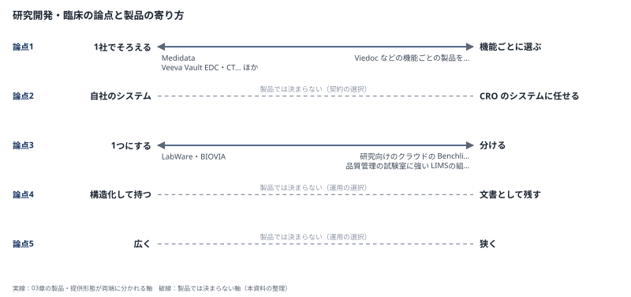

# 04 研究開発・臨床の主要な論点

## 要旨

研究開発・臨床のシステムを扱うときに出てくる軸は次の5つである（本資料の整理）。

1. 臨床の製品を1社でそろえるか、機能ごとに選ぶか
2. 自社のシステムを使うか、CRO のシステムに任せるか
3. ELN と LIMS を1つにするか、分けるか
4. 研究データを構造化して持つか、文書として残すか
5. GxP の管理をどこまで広げるか

*図1　研究開発・臨床の論点と製品の寄り方（実線は03章の製品が両端に分かれる軸、破線は製品では決まらない軸。本資料の整理）*

## 論点1：臨床の製品を1社でそろえるか、機能ごとに選ぶか

| | 1社でそろえる | 機能ごとに選ぶ |
|---|---|---|
| 得るもの | EDC・CTMS・eTMF の間のデータが自動でつながる | 各機能で得意な製品を使える |
| 失うもの | 1社への依存が深まる（→ veeva-platform 付録D） | 製品間の連携と、同じ試験情報の二重入力 |

**製品・提供形態との対応**（→ 03章）

| | 1社でそろえるに寄るもの | 機能ごとに選ぶに寄るもの |
|---|---|---|
| 製品・提供形態 | Medidata（Rave EDC・CTMS など）、Veeva Vault EDC・CTMS・eTMF、Oracle Clinical One（EDC と RTSM）。臨床の製品を1つの基盤でつなぐ | Viedoc などの機能ごとの製品を組み合わせる形 |

## 論点2：自社のシステムか、CRO のシステムか

| | 自社のシステム（CRO に使わせる） | CRO のシステムに任せる |
|---|---|---|
| 得るもの | 試験をまたいでデータと進み具合を自社で見られる。CRO を替えても残る | 構築の手間がなく、CRO の慣れた仕組みで進む |
| 失うもの | 製品の費用と、CRO への教育 | 試験ごとにデータの形がばらつく。終了後のデータの受け取りが要る |

**製品・提供形態との対応**（→ 03章）：製品では決まらない（契約の選択）。IQVIA が Veeva の EDC で試験を組めるようになったように、CRO が利用企業の製品を使う形もとれる（→ 03章「市場の動き」）

## 論点3：ELN と LIMS を1つにするか、分けるか

| | 1つにする | 分ける |
|---|---|---|
| 得るもの | 実験の記録と試料・結果が1か所でつながる | 研究者向けの使いやすい ELN と、厳密な試料管理の LIMS をそれぞれ選べる |
| 失うもの | どちらかの機能が弱くなりやすい | 2つの間の連携が要る |

**製品・提供形態との対応**（→ 03章）

| | 1つにするに寄るもの | 分けるに寄るもの |
|---|---|---|
| 製品・提供形態 | LabWare（LIMS と ELN の両方を持つ）、BIOVIA | 研究向けのクラウドの Benchling と、品質管理の試験室に強い LIMS（SampleManager、LabVantage、STARLIMS）の組み合わせ |

## 論点4：研究データを構造化して持つか、文書として残すか

| | 構造化して持つ | 文書として残す |
|---|---|---|
| 得るもの | 検索・集計・AI での活用ができる（→ ai、analytics） | 研究者の書き方の自由が保たれる |
| 失うもの | 入力の型を決め、守らせる必要がある | 後から再利用しにくい |

**製品・提供形態との対応**（→ 03章）：製品では決まらない（運用の選択）。入力の型をどこまで決めるかは、利用企業の設計による

## 論点5：GxP の管理をどこまで広げるか

| | 広く（研究の初期まで） | 狭く（GLP・GCP・GMP の対象だけ） |
|---|---|---|
| 得るもの | どの段階のデータでも、後から規制の場で使える | 研究の初期は軽く速く動ける |
| 失うもの | バリデーションと記録の手間が研究全体にかかる | 研究データを申請に使うとき、信頼性の説明が難しくなる |

**製品・提供形態との対応**（→ 03章）：製品では決まらない（運用の選択）。どの範囲を GxP の対象にするかは、利用企業が決める

---

**出典**（確認日：2026-11-14）

- 5つの軸と各表の内容は、01〜03章をもとにした本資料の整理
- 各論点の「製品・提供形態との対応」は、03章の製品をもとにした本資料の整理
