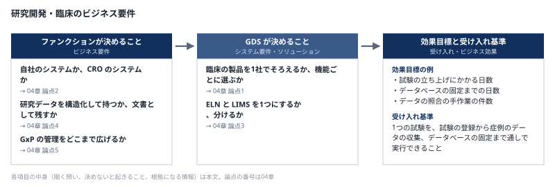

# 05 研究開発・臨床のビジネス要件

## 要旨

研究開発・臨床の製品を選ぶ前に、ファンクション（研究・臨床開発）には**臨床試験のデータを自社で持つか CRO に任せるか**と、**研究データをどこまで構造化して再利用するか**を決めてもらう。

この章は、governance/budget-transfer の kickoff 資料（IT 予算移管の要点）にある役割分担を、この技術について具体化したものである。

*図1　研究開発・臨床のビジネス要件（ファンクションが決めたビジネス要件をもとに GDS がシステム要件とソリューションを決め、効果目標と受け入れ基準で確かめる）*

## ファンクションが決めること（ビジネス要件）

### 自社のシステムか、CRO のシステムか

- **決めること**：試験のデータと進み具合を自社で持つか（→ 04章 論点2）
- **聞く問い**：「CRO を替えても、試験をまたいでデータと進み具合を自社で見たいか」
- **決めないと起きること**：試験ごとにデータの形がばらつき、終了後の受け取りと統合に手間がかかる
- **根拠になる情報**：試験の数、委託する CRO の数、自社で行う試験の割合

### 研究データを構造化して持つか、文書として残すか

- **決めること**：研究データを構造化して持つ範囲（→ 04章 論点4）
- **聞く問い**：「後から検索・集計・AI で使いたい研究データはどれか」
- **決めないと起きること**：研究者の書き方に任せたままになり、後から再利用できない
- **根拠になる情報**：研究の分野、データの種類と量、使いたい分析

### GxP の管理をどこまで広げるか

- **決めること**：GxP の管理を広げる範囲（→ 04章 論点5）
- **聞く問い**：「研究の初期のデータを、後から申請に使う可能性はあるか」
- **決めないと起きること**：申請に使うときに信頼性を説明できない、または研究全体に検証の手間がかかる
- **根拠になる情報**：非臨床試験の計画、申請の方針

## GDS が決めること

- 臨床の製品を1社でそろえるか、機能ごとに選ぶか（→ 04章 論点1）。1社への依存を受け入れるかは、ファンクションと合意する
- ELN と LIMS を1つにするか、分けるか（→ 04章 論点3）

## 効果目標と受け入れ基準

- **効果目標の例**：試験の立ち上げにかかる日数、データベースの固定までの日数、データの照合の手作業の件数
- **受け入れ基準**：1つの試験を、試験の登録から症例のデータの収集、データベースの固定まで通しで実行できること

## 部門に閉じた案件として扱えないとき

- 臨床試験の有害事象を安全性のシステムへ渡すため、quality-regulatory との連携が必ず生じる
- 臨床試験のデータは GCP の対象になる
- 被験者の個人情報を扱う

境界の詳細（どのシステムが何を持つか）は [function-allocation](../../../cross-cutting/function-allocation/function-allocation.md) を参照。

---

**出典**（確認日：2026-11-15）

- 役割分担の原則と4つの場面：governance/budget-transfer の kickoff 資料（IT 予算移管の要点、2026-11-02 初版）
- 項目の立て方、問い、例は、04章の論点をもとにした本資料の整理
