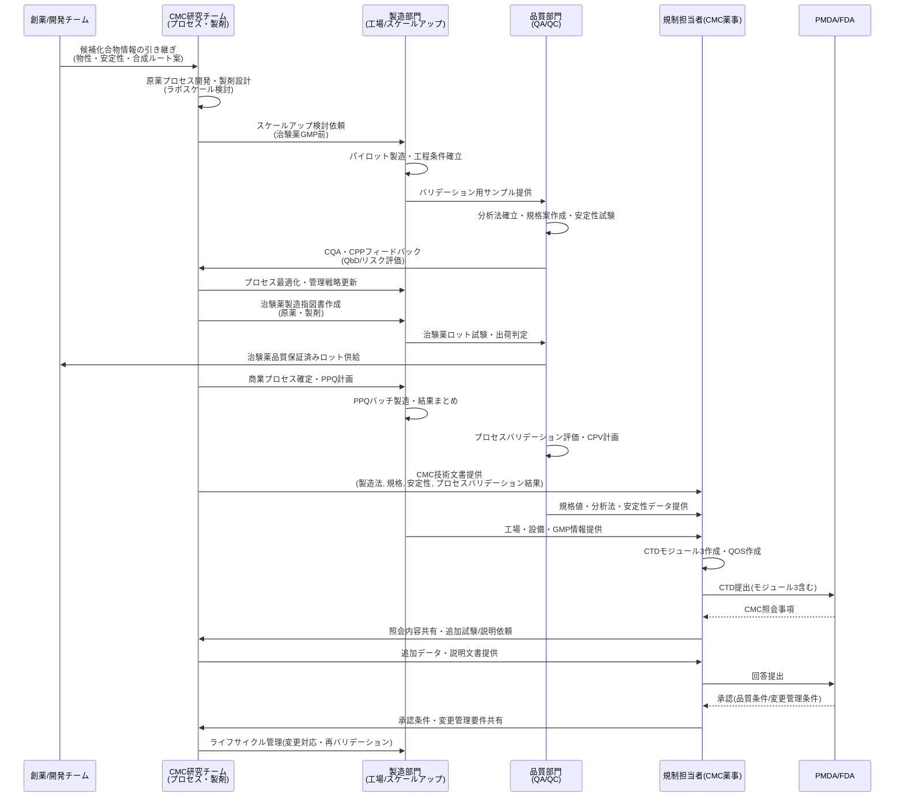
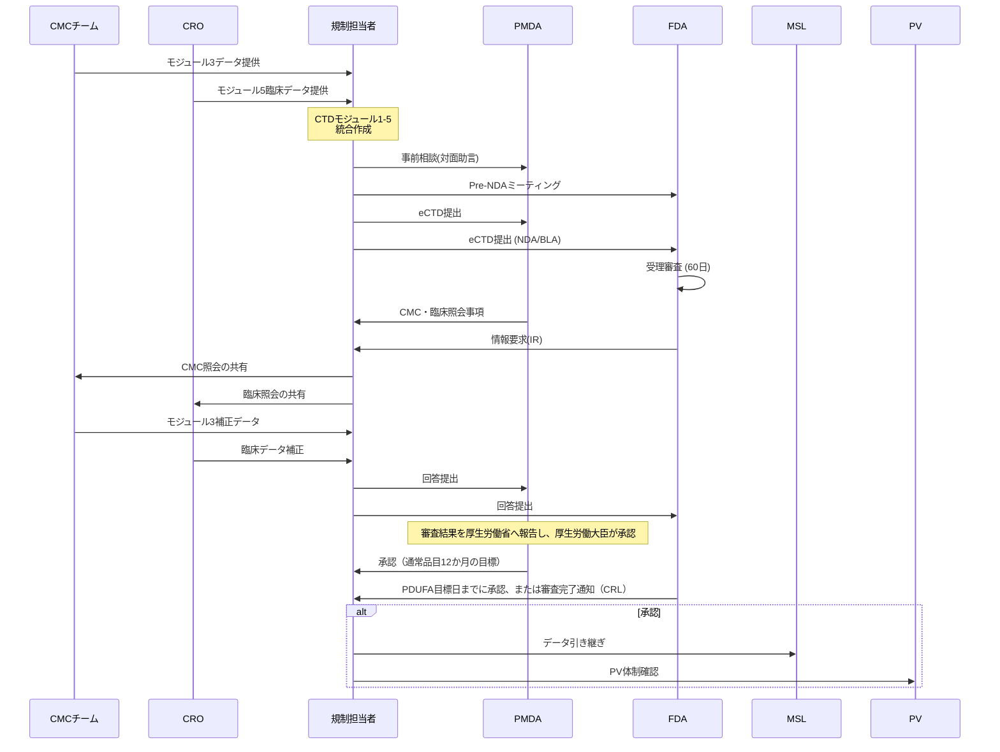

# 付録A　医薬品開発と CMC の詳細

> **参照元**：[01章](../chapters/01_definition.md)、[付録E](E_rd-products.md)

本付録は、[01章](../chapters/01_definition.md)（バリューチェーン）と[付録E](E_rd-products.md)（R&D 領域の製品）の背景となる製薬業務の詳細です。Veeva 製品の理解には必須ではありませんが、臨床・薬事・品質の製品がなぜその形をしているかを理解する助けになります。

| 節 | 内容 |
|----|------|
| A-1 | CMC概論 |
| A-2 | バイオ医薬品CMC |
| A-3 | CMC業務プロセス |
| A-4 | CROの役割 |
| A-5 | 規制当局（PMDA・FDA） |
| A-6 | CTD・eCTD申請プロセス |

> 審査期間などの数値は目安です。最新の規制要件は各当局の公表資料を確認してください。

---

## A-1 CMC概論

### CMCとは何か

CMCは **「Chemistry, Manufacturing and Controls（化学・製造・品質管理）」** の略で、新薬候補を研究段階から患者に届く製品へ橋渡しする役割を担います。

- 探索研究で見つかった「医薬品のタネ」を、効率よく・高品質で作れ・製剤化し・大量生産できるようにするプロセス全体を設計・構築するのがCMC開発の仕事です。
- 創薬側（レシピの発明）と商業製造側（大量調理）の間で、「工場で再現できるレシピ」に落とし込む技術・設計がCMCに当たります。
- 安定して製造でき、安全性と品質が保証されなければ、どんなに優れた候補でも医薬品として承認・上市できないため、CMCは創薬開発の要とみなされています。

### CMCの主な業務領域

| 業務領域 | 内容 |
|----------|------|
| 原薬プロセス研究 | 原薬の合成ルート設計、スケールアップ、安全で再現性ある製造法の確立、原薬の品質属性の把握 |
| 製剤開発研究 | 剤形（錠剤・注射剤など）の設計、添加剤選定、製造条件検討、安定性を考慮した処方設計 |
| 品質評価・分析 | 構造確認、純度・不純物プロファイル、溶出性、物性評価、安定性試験などの分析法確立と規格・試験方法の設定 |
| スケールアップ・工業化 | ラボスケールから治験薬製造、さらに商業生産ラインへのスケールアップ、GMP下で再現できる工程への仕上げ |
| 技術移転と変更管理 | 開発部門から製造部門やCDMO/CMOへの技術移転、サイト変更や設備変更時の品質同等性評価 |

### 規制・薬事（CMC薬事）の観点

- 承認申請ではCTDのCMCパートとして、原薬・製剤の特性、製造方法、品質管理、安定性などの情報を詳細に記載し、科学的根拠を示す必要があります。
- 日本ではPMDA/MHLWの要求がICHガイドライン（例：安定性のICH Q1A(R2)など）と整合しており、製造工程の重要パラメータや製品の品質特性（CQA）を明確にして、変更時にどの程度の手続きが必要かも含めて戦略的に整理します。
- CMC薬事担当は、品質面の専門家として、規格値・試験法・安定性データ等の妥当性を示し、申請・照会対応を技術的にリードします。

### 創薬CMC・製薬CMC・CDMO/CMOの違い

| 区分 | 位置づけ | 主な役割 |
|------|----------|----------|
| 創薬CMC | 開発フェーズの設計者 | 治験薬レベルまで含めたプロセスと分析をつくり込む |
| 製薬CMC | 商業フェーズの品質管理者 | 市販後も含めた品質一貫性やライフサイクル全体の変更管理を担う |
| CDMO（開発受託） | 開発パートナー | スケールアップや工程設計・分析法確立を共に行う |
| CMO（製造受託） | 製造請負者 | 確立済みプロセスを安定して製造する |

---
## A-2 バイオ医薬品CMC

バイオ医薬品CMCは、抗体や融合タンパクなどの生物由来医薬品を対象としたCMCで、低分子薬と異なり細胞培養・精製中心の複雑プロセスを管理します。

### バイオ医薬品CMCの特徴

- バイオ医薬品は遺伝子組み換え細胞で生産されるため、CMCチームがロット間不均一性や不純物（宿主細胞タンパク質、ウイルス）をQbD（品質設計）で管理し、CQA（重要品質特性）を特定します。
- 低分子薬の化学合成に対し、バイオは生細胞依存で再現性確保が難しく、ICH Q8〜Q11（製剤開発・品質リスクマネジメント・医薬品品質システム・原薬の開発と製造）の考え方に沿った工程の理解と管理が求められます。プロセスバリデーションは、FDA のガイダンス（2011年）が示す3段階（Stage 1：工程設計、Stage 2：工程の適格性確認、Stage 3：継続的工程確認）で進めるのが一般的です。

### 主なプロセスフロー

| 工程 | 内容 |
|------|------|
| セルライン開発 | CMCチームが目的遺伝子を導入した安定生産細胞（CHO細胞等）を作成、MCB/WCBをGMP下で構築 |
| アップストリーム（培養） | CMCチームがシード培養→本培養でタンパク生産を最適化（培地、pH、溶存酸素などのCPP制御） |
| ダウンストリーム（精製） | CMCチームが遠心/ろ過→Protein Aクロマト→低pH処理→イオン交換→ウイルス除去ろ過→UF/DFで精製、ウイルス安全性確保 |
| 製剤・充填 | CMCチームが安定化剤添加、最終無菌充填、安定性試験を実施 |

### 低分子CMCとの比較

| 項目 | 低分子CMC | バイオ医薬品CMC |
|------|-----------|----------------|
| 生産方式 | 化学合成（単純再現性高い） | 細胞培養・精製（生物変動大） |
| 品質課題 | 不純物・結晶多形 | 糖鎖異性体、凝集、細胞由来不純物 |
| 管理重点 | 合成ルート最適化 | プロセス耐性（頑健性）、CPV（継続的検証） |
| 主な ICH ガイドライン | Q3A/Q3B（不純物）、Q6A（規格）など | Q5 シリーズ（バイオ医薬品の品質）、Q6B（規格）など。Q8〜Q11（QbD）は両方に共通 |

---
## A-3 CMC業務プロセス

CMC業務は大きく3つの流れで進みます。

- **上流（DS→CMC）**：候補受け取りからプロセス・製剤設計。
- **中流（CMC↔MFG↔QA/QC）**：治験薬〜商業生産のプロセス確立と品質管理。
- **下流（CMC/QA/QC→RA）**：CTDモジュール3作成とPMDA/FDA照会対応。

主なアクターは **CMC研究チーム、製造部門（MFG）、品質部門（QA/QC）、規制担当者（RA）** です。

---
## A-4 CROの役割

CRO（Contract Research Organization）は、製薬企業から臨床試験（治験）業務を委託される専門機関で、開発効率化とデータ信頼性を支えます。

### 定義と役割

- CROが製薬企業から治験（I〜III相）や市販後調査を請け負い、GCP遵守のもと試験の質・スピードを確保します。
- 主にCROがプロジェクト全体をマネジメントし、製薬企業側の内製コスト削減を実現します。

### 主な業務領域

| 業務 | 内容 |
|------|------|
| 試験計画立案 | CROがプロトコル作成、医療機関選定・契約、IRB申請を支援 |
| モニタリング | CRA（CRO に所属することが多い）が医療機関を訪問し、SDV（原資料との照合）と GCP 遵守の確認を行う |
| データ管理 | CROがCRF収集、データベース化、統計解析、総括報告書を作成 |
| 薬事支援 | CROがPMDA相談、ファーマコビジランス、メディカルライティングを実施 |

### 創薬プロセスとの連携

- 臨床試験の実務はCROが担うことが多く、CMCは治験薬の供給を通じて並行して関与します。医療関係者との科学的な情報交換は、メディカルアフェアーズの MSL が担います（上市前から活動します）。
- CTDのモジュール5（臨床）の作成はCROが支援しますが、申請の責任は依頼者（製薬企業）にあります。

---
## A-5 規制当局（PMDA・FDA）

### PMDA（Pharmaceuticals and Medical Devices Agency）

- 2004年設立の独立行政法人で、厚生労働省（MHLW）所管のもと、医薬品・医療機器の **承認審査・安全対策・健康被害救済** の3業務を担います。
- 規制担当者が提出するCTDを審査します。承認するのは厚生労働大臣で、PMDA は審査を担います。
- 申請から承認までの総審査期間の目標は、80パーセンタイル値で通常品目12か月、優先品目9か月です（第5期中期計画）。
- 承認申請前に「対面助言」で事前相談が可能です。

### FDA（Food and Drug Administration）

- 米国保健福祉省（HHS）下の連邦機関で、医薬品・食品・医療機器等の安全性・有効性を規制します。
- NDA（低分子）/ BLA（バイオ）を Priority / Standard で審査します。新有効成分（NME）の NDA と新規 BLA の目標は、受理（申請から60日）後 Priority 6か月 / Standard 10か月です（PDUFA VII）。
- 承認申請前に「Pre-NDAミーティング」で事前確認が可能です。

### 審査期間の比較

| 機関 | 役割 | 審査期間 |
|------|------|----------|
| PMDA | 日本国内の承認審査（CTD/eCTD）。承認は厚生労働大臣 | 通常品目12か月 / 優先品目9か月（申請から承認まで、80パーセンタイルの目標） |
| FDA | 米国承認（NDA/BLA） | Standard 10か月 / Priority 6か月（NME・新規 BLA は受理の60日後から） |

両者ともICHガイドライン準拠で、CMCチームのモジュール3データを厳格に検証し、PV・MSLの市販後体制も確認します。

---
## A-6 CTD・eCTD申請プロセス

### CTD（Common Technical Document）とは

CTDは、品質・非臨床・臨床データを5モジュールで整理した国際標準申請書類で、ICHガイドライン（M4）に基づきます。日本PMDA・米国FDA間で共通形式が採用されており、CMCはモジュール3に集約されます。

### CTDのモジュール構成

| モジュール | 内容 | 担当主語 |
|------------|------|----------|
| 1（地域特異） | 申請書・目次・日本特有書類（PMDA用） | 規制担当者が作成 |
| 2（サマリー） | 品質・非臨床・臨床の要約（QOS等） | 規制担当者が全体統括 |
| 3（品質/CMC） | 原薬・製剤の製造・規格・安定性データ（バイオ医薬品は細胞・精製詳細） | CMCチームが詳細作成 |
| 4（非臨床） | 薬理・毒性・薬物動態の試験報告 | 非臨床（薬理・毒性）部門が作成 |
| 5（臨床） | Phase I-IIIデータ・プロトコル | 臨床開発部門（CROが作成を支援） |

### モジュール3（CMCパート）の詳細

CMCチームが担うモジュール3（品質/CMC）の主要サブモジュールは以下の通りです。

| サブモジュール | 内容 |
|----------------|------|
| 3.2.S（原薬） | CMCチームが原薬製造工程、規格・分析法、不純物管理、安定性データを作成（バイオ医薬品はセルライン・培養・精製詳細を含む） |
| 3.2.P（製剤） | CMCチームが最終製剤の処方、製造工程、容器包装、溶出・安定性試験を記載 |
| 3.2.R（地域特異） | 規制担当者が地域固有の情報を追加 |

### 提出・審査プロセス

1. 規制担当者がCTDをeCTD形式に変換し、事前相談（PMDA：対面助言、FDA：Pre-NDA Meeting）でフィージビリティを確認。
2. CMCチームがモジュール3（3.2.S原薬、3.2.P製剤）を中心にQbDデータ・安定性データを充実させる。
3. PMDA（日本）へ申請→総審査期間の目標は通常品目12か月・優先品目9か月。FDAへNDA/BLA提出→受理（60日）後、Standard 10か月 / Priority 6か月が目標。
4. 承認後、PV・MSLへ引き継ぎ（→ [01章](../chapters/01_definition.md)「承認後の引き継ぎ」）。

---

**出典**（確認日：2026-11-14）

- PMDA の総審査期間の目標（第5期中期計画）：PMDA「審査・安全対策等業務に係るデータ資料」（2025-12）— https://www.pmda.go.jp/files/000278783.pdf
- FDA の審査目標：FDA「PDUFA Reauthorization Performance Goals and Procedures Fiscal Years 2023 Through 2027」— https://fda.gov/media/151712/download
- プロセスバリデーションの3段階：FDA「Process Validation: General Principles and Practices」（2011）— https://www.hhs.gov/guidance/sites/default/files/hhs-guidance-documents/FDA/Process-Validation--General-Principles-and-Practices.pdf
- CTD の構成：ICH M4（Common Technical Document）— https://www.ich.org/page/ctd
- CMC・バイオ医薬品の工程、CRO の業務、業務プロセスの流れは、一般的な説明をまとめた本資料の整理
