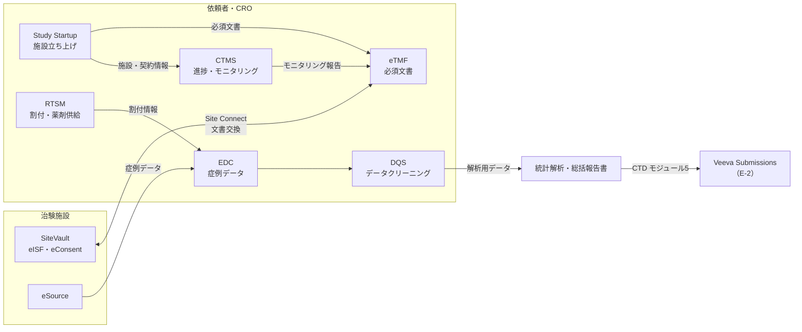
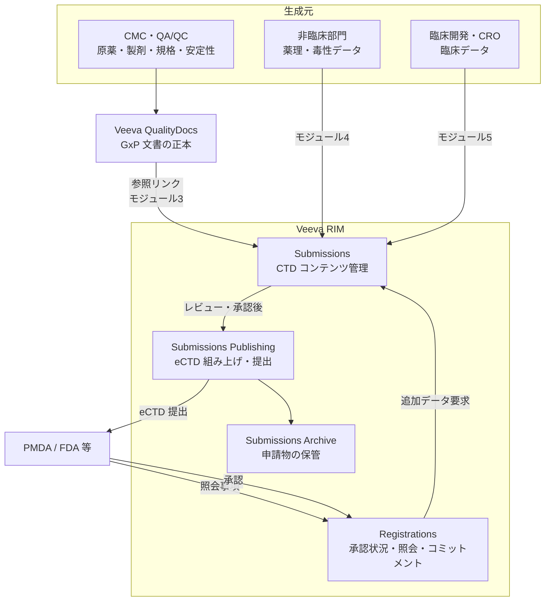
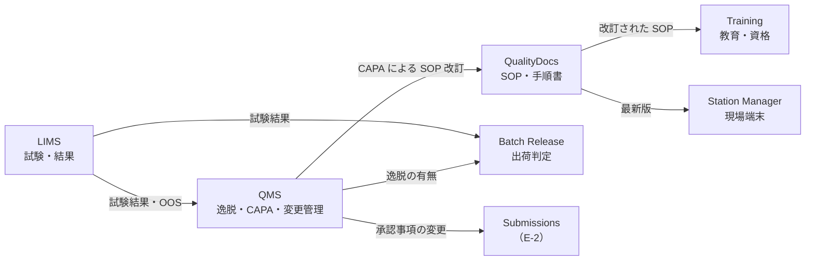
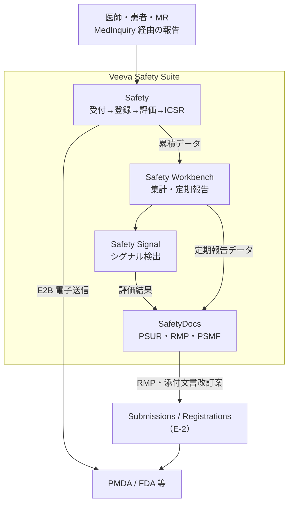

# 付録E　R&D 領域の製品 — 臨床・薬事・品質・安全性

> **参照元**：[03章](../chapters/03_landscape.md)

本付録は、承認前の開発業務と、承認後も続く品質・安全性業務を支える Veeva 製品（Veeva Development Cloud と Quality Cloud）を扱います。

| 節 | 領域 | 主な製品 |
|----|------|---------|
| E-1 | 臨床 | CTMS、eTMF、Study Startup、EDC、RTSM、SiteVault ほか |
| E-2 | 薬事（RIM） | Registrations、Submissions、Submissions Publishing、Submissions Archive |
| E-3 | 品質 | QualityDocs、QMS、LIMS、Training、Batch Release ほか |
| E-4 | 安全性 | Safety、SafetyDocs、Safety Workbench、Safety Signal |
| E-5 | R&D 製品間の接続 | 上記の連携パターン |

> E-1（臨床）と E-3 の QMS 以降は、公式製品情報に基づく製品レベルの整理です。業務フローの詳細化は今後の課題です。

---

## E-1 臨床（Clinical Platform）

臨床試験は、依頼者（製薬企業）・CRO・治験施設（医療機関）の三者で進みます。Veeva はこの三者それぞれに製品を持ち、同じ基盤上でつなぐことを狙っています。

### 製品群

| 区分 | 製品 | 役割 | 主な利用者 |
|------|------|------|-----------|
| 治験運営（Clinical Operations） | Veeva Study Startup | 施設選定・契約・IRB・必須文書収集による施設立ち上げ | 臨床オペレーション・CRO |
| | Veeva CTMS | 試験・施設・被験者登録・モニタリング訪問の進捗管理 | 臨床オペレーション・CRA |
| | Veeva eTMF | 治験必須文書（TMF）の電子管理、査察対応 | 臨床オペレーション・QA |
| | Veeva Payments | 治験施設への支払い | 臨床オペレーション・経理 |
| | Veeva Site Connect | 依頼者と施設の文書・情報交換の自動化 | 臨床オペレーション・施設 |
| | Veeva Study Training | 治験責任医師・スタッフのトレーニング | 臨床オペレーション・施設 |
| | Veeva Disclosures | 治験情報の公開（レジストリ登録・結果公開） | 臨床・薬事 |
| | Veeva OpenData Clinical | 治験責任医師・施設のリファレンスデータ | 施設選定 |
| 臨床データ（Clinical Data） | Veeva EDC | 症例データの電子収集・検証 | データマネジメント・施設 |
| | Veeva DQS | 試験データの集約・クリーニング | データマネジメント |
| | Veeva eCOA | 患者報告アウトカム等の電子収集 | 患者・施設 |
| | Veeva RTSM | 無作為化割付・治験薬供給管理 | 臨床オペレーション・サプライ |
| 治験施設向け | SiteVault（CTMS / eISF / eConsent） | 施設側の試験管理・電子ISF・電子同意 | 治験施設 |
| | Veeva eSource | 施設でのデータ収集と EDC への連携 | 治験施設 |

### データの流れ（概略）

- 治験の成果（総括報告書・臨床データ）は、CTD のモジュール5として薬事（E-2）へ渡ります。
- 治験は CRO に委託されることが多く、CRO が Veeva の臨床製品を使うか、自社システムを使うかで連携方式が変わります。

---
## E-2 薬事（Veeva RIM）

RIM（Regulatory Information Management）は、承認申請とその後のライフサイクル（一部変更・更新・当局照会）を管理する製品群です。

### 製品群

| 製品 | 役割 |
|------|------|
| **Veeva Registrations** | 製品×国ごとの承認状況、当局とのやり取り（照会・回答）、承認時のコミットメントを管理。**何がどの国で承認されているか** の正本 |
| **Veeva Submissions** | 申請コンテンツ（CTD モジュール1〜5）の計画・収集・レビュー・承認 |
| **Veeva Submissions Publishing** | 承認済みコンテンツを eCTD 形式に組み上げ、当局ゲートウェイ（PMDA・FDA ESG 等）へ提出 |
| **Veeva Submissions Archive** | 過去の申請物・当局との往復文書の保管と参照 |

> 旧資料の「Vault HA」「Active Dossier」について：当局照会・コミットメントの管理は Registrations の機能、Active Dossier（現在有効な申請文書セットの把握）は RIM 内の機能として扱います。独立製品ではありません。

### CTD 申請のデータフロー

### CTD の構成と担い手

| モジュール | 内容 | 主な作成者 |
|------------|------|-----------|
| 1（地域特異） | 申請書・各国固有書類 | 薬事 |
| 2（サマリー） | 品質・非臨床・臨床の要約（QOS 等） | 薬事が統括、各部門が作成 |
| 3（品質/CMC） | 原薬・製剤の製法・規格・安定性 | CMC・QA/QC |
| 4（非臨床） | 薬理・毒性・薬物動態の試験報告 | 非臨床（薬理・毒性）部門 |
| 5（臨床） | 臨床試験の報告書・データ | 臨床開発（CRO が作成支援） |

CTD・eCTD、PMDA/FDA の審査プロセスの詳細は [付録A](A_drug-development-and-cmc.md) を参照してください。

---
## E-3 品質（Veeva Quality Cloud）

### 製品群

| 製品 | 役割 | 管理対象 |
|------|------|---------|
| **Veeva QualityDocs** | GxP 文書のライフサイクル管理 | SOP・製造指図・試験法・バリデーション報告書 |
| **Veeva QMS** | 品質プロセスの管理 | 逸脱・CAPA・変更管理・苦情・監査・サプライヤー品質 |
| **Veeva Training** | ロール別の教育と資格の管理 | SOP の読了・訓練記録 |
| **Veeva LIMS** | 品質管理試験室の業務管理 | 検体・試験・結果・安定性試験 |
| **Veeva Batch Release** | 出荷判定に必要な情報の集約 | バッチごとの判定材料 |
| **Veeva Validation Management** | バリデーションのペーパーレス実行 | 計画・実行・報告 |
| **Veeva Station Manager** | 製造現場端末への文書配信 | 現場で参照する最新版の手順書 |
| **Veeva Product Surveillance** | 医療機器の市販後調査 | 医療機器の不具合・苦情 |
| **Veeva EHS** | 環境・安全衛生 | 事故・リスク評価 |

### 品質プロセスのつながり

- **変更管理（QMS）→ 薬事（Submissions）** の接続が重要です。製造方法や規格の変更が承認事項に関わる場合、一部変更申請・軽微変更届が必要になります。

### QualityDocs と Submissions の役割分担

同じ製造・品質文書でも、日常業務用と申請用では目的が異なります。

| 観点 | Veeva QualityDocs | Veeva Submissions |
|------|-------------------|-------------------|
| 管理対象 | 日常の GxP 文書（生きた文書） | CTD 用に整形・版を固定したコンテンツ |
| 更新頻度 | 高い（製造・品質業務に連動） | 申請タイミング中心 |
| 主な利用者 | CMC・製造・QA/QC | 薬事・CMC |
| 外部提出 | なし | 当局（eCTD） |

QualityDocs を単一の正本とし、Submissions は **参照リンク** で取り込むことで、二重管理を避けます。

---
## E-4 安全性（Veeva Safety Suite）

### 製品群

| 製品 | 役割 | 位置づけ |
|------|------|---------|
| **Veeva Safety** | 有害事象の受付・症例登録・評価・ICSR 作成・当局への電子送信 | ケース処理のエンジン |
| **Veeva SafetyDocs** | PSMF・RMP・PSUR 等の安全性文書の作成・レビュー・保管 | 安全性文書の管理庫 |
| **Veeva Safety Workbench** | 症例データの集計・分析・定期報告の作成支援 | 集計・分析の作業場 |
| **Veeva Safety Signal** | シグナルの検出・評価・追跡 | リスク発見の仕組み |

### 自発報告の処理（6ステップ）

| # | ステップ | 内容 | 製品 |
|---|---------|------|------|
| 1 | 受付・トリアージ | MR・医療機関・患者からの報告を受け、有効症例（患者・報告者・被疑薬・事象の4要素）と報告期限（重篤かつ未知は15日以内 等）を判定 | Safety |
| 2 | 症例登録 | 重複確認、MedDRA によるコーディング、薬剤・併用薬・既往歴の入力 | Safety |
| 3 | 医学評価 | 重篤性・因果関係・既知/未知を評価。不足情報は報告者に追加照会 | Safety |
| 4 | 当局報告 | ICSR を E2B(R3) 形式で作成し、QC 後に電子送信 | Safety |
| 5 | シグナル検出 | 累積症例を集計し、新たなリスクの兆候を評価 | Safety Workbench、Safety Signal |
| 6 | ラベリング・RMP への反映 | 添付文書改訂案・RMP 改訂案を作成し、薬事経由で当局へ | SafetyDocs → Submissions |

PV は「1症例を処理する」だけでなく、累積データからシグナルを見つけ、ラベリングと RMP の更新までつなげる役割を担います。

---
## E-5 R&D 製品間の接続パターン

| # | 接続 | 内容 |
|---|------|------|
| ① | QualityDocs → Submissions | GxP 文書を参照リンクで CTD モジュール3に取り込む（二重管理しない） |
| ② | QMS → Submissions / Registrations | 承認事項に関わる変更を一部変更申請・届出に回す |
| ③ | EDC / eTMF → Submissions | 臨床試験の成果をモジュール5として取り込む |
| ④ | Safety → SafetyDocs | 症例・シグナルを定期報告や RMP として文書化 |
| ⑤ | SafetyDocs → Submissions / Registrations | 添付文書・RMP の改訂を当局に申請 |
| ⑥ | Registrations → PromoMats / MedComms | 承認されたラベリング変更を販促・メディカル資料の改訂へ波及（[付録I](I_system-of-record.md)「R&D とコマーシャルの接続点」） |

---

**出典**（確認日：2026-10）

- [Veeva Products（製品一覧）](https://www.veeva.com/products/)
- [Veeva Vault Platform](https://www.veeva.com/products/vault-platform/)
