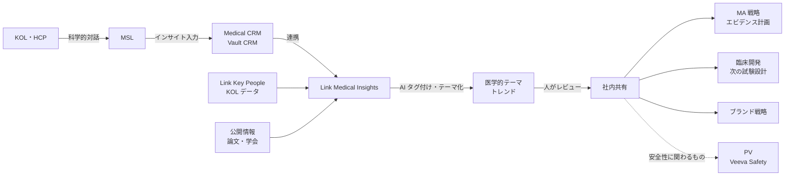
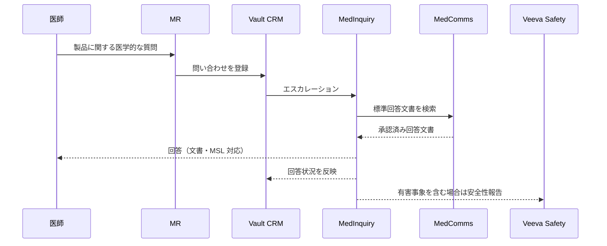

# 付録F　メディカル領域の製品 — Medical Affairs と Veeva Medical Suite

> **参照元**：[03章](../chapters/03_landscape.md)

本付録は、上市前後に医療現場と科学的に対話する Medical Affairs（MA）の業務と、それを支える Veeva Medical Suite・Veeva Link を扱います。

営業（MR）の活動と同じ CRM 基盤を使いながら、**非プロモーション（販促しない）** という規制上の線引きがあるのが、この領域の要点です。

---

## F-1 Medical Affairs と MSL

### Medical Affairs の役割

Medical Affairs は、科学・医療の立場から製品価値をつくり、外部と対話し、社内にインサイトを戻す専門職チームです。

| 軸 | 内容 |
|----|------|
| 外向き（Outside-in） | MSL が KOL・HCP と科学的な議論を行い、未充足ニーズ・実臨床の課題・安全性/有効性のインサイトを収集 |
| 内向き（Inside-out） | インサイトを開発戦略・エビデンス計画・ラベリング検討に反映 |
| エビデンス創出 | 観察研究・RWE・医師主導研究（IIT）・Phase IV の企画と支援 |
| 情報提供・教育 | 学会発表、論文、医療関係者からの問い合わせ対応、社内教育 |
| コンプライアンス | 営業から独立し、科学的・中立的な立場で活動 |

本社側の MA（戦略・計画）と、現場の MSL がセットで「医療現場と会社をつなぐ科学の窓口」を構成します。

### MR と MSL の違い

| 観点 | MR | MSL |
|------|----|-----|
| 活動の性質 | プロモーション（販促） | 非プロモーション（科学交流） |
| 主な相手 | HCP / HCO | KOL |
| 使う資料 | MLR 承認済みの販促資料（PromoMats） | 学術資料・回答文書（MedComms） |
| 目的 | 処方促進・製品理解 | インサイト収集・エビデンス創出支援 |
| 主なシステム | Vault CRM（営業機能） | Medical CRM、Veeva Link |

---
## F-2 Veeva Medical Suite の製品群

| 製品 | 役割 | 主な利用者 |
|------|------|-----------|
| **Medical CRM**（Vault CRM のメディカル機能） | MSL の KOL 交流の計画・記録、インサイト入力 | MSL |
| **Veeva MedInquiry** | 医療関係者からの問い合わせ（Medical Information）の受付・回答・追跡 | メディカルインフォメーション部門 |
| **Veeva MedComms** | メディカルコンテンツ（標準回答文書・学術スライド等）の作成・承認・配信 | Medical Affairs |
| **Veeva Publications** | 論文・学会発表の計画・執筆・管理 | パブリケーション担当 |
| **Veeva Link Key People** | KOL の詳細データ | MSL・MA 戦略 |
| **Veeva Link Workflow** | KOL エンゲージメント・学会対応の計画 | MA 戦略・MSL |
| **Veeva Link Medical Insights** | 現場インサイトの収集・AI によるテーマ化・社内共有 | MA・ブランド戦略 |

---
## F-3 Veeva Link

Veeva Link は、**KOL・アカウントに関する Veeva 独自データ** と、それを使う **業務アプリ** を組み合わせた製品群です。CRM が「自社の活動記録」を持つのに対し、Link は「外部の世界（誰が影響力を持ち、何が議論されているか）」の情報を提供します。

| モジュール | 内容 | ポイント |
|-----------|------|---------|
| **Link Key People** | KOL の研究・論文・学会発表・治験・ネットワーク等の詳細データ | 適切な専門家を素早く見つけて理解する。上位20社のうち15社が利用 |
| **Link Workflow** | KOL エンゲージメント計画、学会（Congress）対応のワークフロー | 部門・国をまたいだ KOL 対応の整合 |
| **Link Medical Insights** | MSL の現場インサイトを収集し、AI でテーマ化して社内共有 | 本付録 F-4 で詳述 |
| **Link Key Accounts** | 米国の主要アカウントと意思決定者のデータ（Employer Intelligence を含む） | コマーシャル寄り。**05 データ** で扱う |

### KOL データの2つの源泉

| データ | 提供元 | 性質 |
|-------|-------|------|
| HCP の基本属性（氏名・所属・専門） | Network / OpenData（日本は Ultmarc） | マスタデータ（05） |
| KOL としての影響力・研究活動 | Link Key People | 外部インテリジェンス |
| 自社との接点の履歴 | Medical CRM / Vault CRM | 自社活動記録 |

同じ医師を、この3つの源泉で見ていることになります。一意識別子（Veeva ID・DCF コード等）で突き合わせられることが前提です（05・06）。

---
## F-4 Link Medical Insights — インサイトの収集から活用まで

MSL が KOL との対話で得た気づき（インサイト）は、Medical Affairs の最も重要な成果物の一つです。しかし自由記述のメモとして CRM に散在すると、組織として活用できません。Link Medical Insights はこの課題に対応する製品です。

### 機能

| 機能 | 内容 |
|------|------|
| 収集 | CRM 内でのネイティブ入力と、Web アプリからの入力（Vault CRM 内での入力は 2026年下期提供予定） |
| AI タグ付け | 自由記述のメモに Veeva 独自のメタデータを自動付与 |
| テーマ化 | 複数のインサイトを医学的テーマにクラスタリングし、新たな傾向を発見 |
| 人のレビュー | AI の分析結果を人が確認・編集 |
| 共有 | 関係部門（MA・ブランド戦略・臨床開発）へ全社展開、現場の声が戦略に与えた影響の可視化 |

### データの流れ

**役割分担**：Medical CRM は「日々の交流の記録」、Link Medical Insights は「その上に乗る戦略的な分析レイヤー」です。

**注意**：インサイトに有害事象の情報が含まれる場合は、インサイトとしての分析とは別に、PV への報告義務が発生します（[付録E](E_rd-products.md) の E-4）。

---
## F-5 医療関係者からの問い合わせ対応（MedInquiry・MedComms）

医師などからの製品に関する問い合わせは、MR が受けても販促目的では回答できず、メディカル部門が科学的に回答します。

| 製品 | 役割 |
|------|------|
| MedInquiry | 問い合わせの受付・進捗・回答記録。CRM・コールセンター・Web など複数チャネルから受付 |
| MedComms | 回答に使う標準回答文書・学術資料の正本。承認・版管理・失効管理 |

販促資料が PromoMats で統制されるのと同様に、メディカル資料は MedComms で統制されます。

---
## F-6 パブリケーション（Publications）

論文・学会発表は、エビデンスを医療界に届ける Medical Affairs の中心業務です。Veeva Publications は、パブリケーション計画（どのデータを、いつ、どの学会・雑誌で発表するか）から執筆・レビュー・投稿までを管理します。なお、Link Key People の KOL データは論文・学会発表などの公開情報を源泉の一つとしています。

---

**出典**（確認日：2026-10）

- [Veeva Products（製品一覧）](https://www.veeva.com/products/)
- [Veeva Link Overview](https://www.veeva.com/products/veeva-link/overview/)
- [Veeva Link Medical Insights](https://www.veeva.com/products/veeva-link/medical-insights/)
