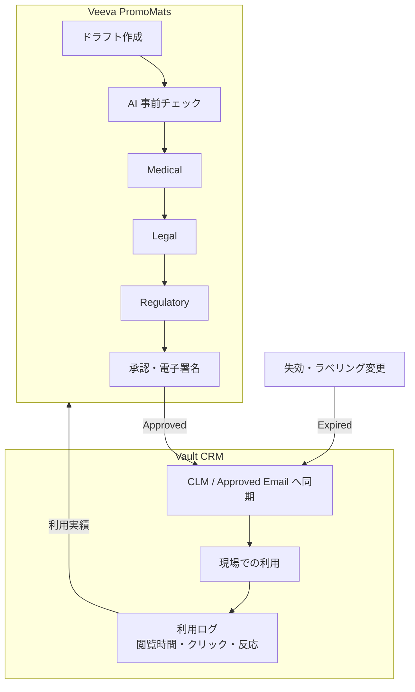
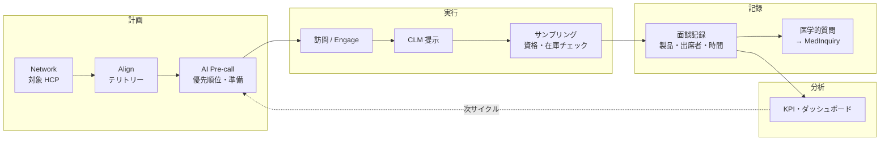
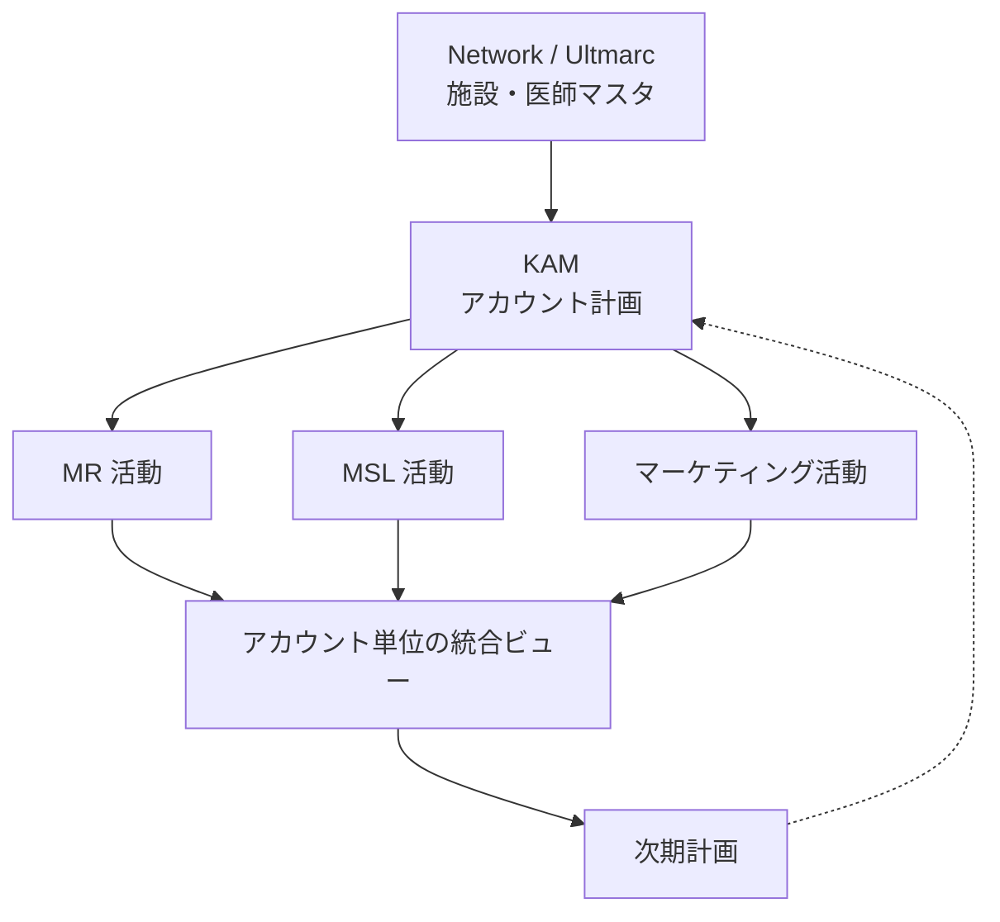

# 付録G　コマーシャル領域の製品 — 営業・マーケティングと Vault CRM Suite

> **参照元**：[03章](../chapters/03_landscape.md)

本付録は、上市後の営業（MR・KAM）とマーケティングの活動、およびそれを支える Vault CRM Suite と Veeva PromoMats を扱います。

この領域の Veeva の核心は、**「承認された販促資料しか現場で使えない」ことをシステムで保証する** 点にあります。

---

## G-1 Veeva の CRM は一般 CRM と何が違うか

| 観点 | 一般 CRM（消費財等） | Vault CRM（ライフサイエンス） |
|------|---------------------|-------------------------------|
| 顧客の概念 | Customer / Lead / Opportunity | HCP（医療従事者）/ HCO（医療機関） |
| 目的 | 売上最大化・チャネル最適化 | 規制遵守下での情報提供と活動管理 |
| コンテンツ | 自由に作って配布 | MLR 承認済みの資料のみ配信（PromoMats が統制） |
| データの中心 | 商談・購買履歴 | 面談記録・資格情報・サンプル適格性・同意 |
| 規制対応 | 業界任意 | サンプリング規制・承認外資料の使用禁止をシステムで強制 |

---
## G-2 Vault CRM Suite の製品群

| 製品 | 役割 | 主な利用者 |
|------|------|-----------|
| **Vault CRM** | HCP/HCO 管理・活動計画・面談記録・サンプリング。営業・マーケティング・メディカルを1つの CRM で統合 | MR・KAM・MSL |
| └ CLM | 承認済みスライドのオフライン提示と反応の記録 | MR |
| └ Approved Email | 承認済みテンプレートによるメール配信・開封追跡 | MR・マーケティング |
| └ Engage | ビデオ面談・チャットなどリモート接点 | MR・MSL |
| **Campaign Manager** | 対面と非対面を統合したキャンペーンの設計・実行 | マーケティング |
| **Events Management** | 講演会・学術イベントの企画・招待・参加・費用・コンプライアンス管理 | マーケティング・MA |
| **Service Center** | インサイドセールス・コールセンターによるインバウンド/アウトバウンド対応 | リモート営業 |
| **Align / Align+** | テリトリー設計、担当者割当、エンゲージメント計画 | 営業企画 |
| **Patient CRM** | 患者支援プログラムの管理 | 患者サービス |
| **Ostro** | 患者・医療従事者の質問に AI が即時回答 | 患者・HCP 向けサービス |
| **Veeva AI for Vault CRM** | Pre-call（訪問前の準備）、Content（資料提案）、Free Text（自由記述のチェック）、Voice（音声入力）の各エージェント | MR・MSL |

---
## G-3 登場人物と役割分担

| 実行者 | 相手 | 主な活動 | 主な製品 |
|--------|------|---------|---------|
| **MR** | HCP / HCO | 製品説明、CLM 提示、サンプリング、面談記録 | Vault CRM（CLM・Approved Email・Engage） |
| **MSL** | KOL | 科学交流、インサイト収集（[付録F](F_medical-products.md)） | Medical CRM、Link |
| **KAM** | 大規模病院・学会などのキーアカウント | アカウント計画、MR/MSL 活動の統括 | Vault CRM（Account Plan） |
| **マーケティング** | HCP / HCO 全体 | 資料作成、キャンペーン、イベント、効果分析 | PromoMats、Campaign Manager、Events |
| **MLR** | （社内） | 販促資料の審査・承認 | PromoMats |

### 活動フェーズ別の分担

| フェーズ | MR | MSL | KAM | マーケティング |
|---|---|---|---|---|
| 計画 | 対象 HCP の選定、テリトリー計画 | KOL 特定、交流計画 | アカウント計画 | キャンペーン・イベント計画 |
| 準備 | 承認済み CLM の同期 | 学術資料の取得 | アカウント向け資料の同期 | 資料作成・MLR 申請 |
| 実行 | 訪問・リモート面談、CLM 提示 | 科学的議論 | 病院・学会との調整 | メール配信・イベント招待 |
| 記録 | 面談記録・反応ログ | 交流記録・インサイト | アカウント活動ログ | 反応追跡・オプトアウト管理 |
| 分析 | KPI 確認、次回提案 | KOL エンゲージメント分析 | アカウント KPI・次期計画 | キャンペーン効果分析 |

MR・MSL・KAM は、Network が管理する **同じ HCP/HCO マスタ** を参照しており、KAM はアカウント単位で全員の活動を束ねて見ることができます。MR が受けた医学的な質問は MedInquiry 経由で MSL へエスカレーションされます（[付録F](F_medical-products.md) の F-5）。

---
## G-4 コンテンツガバナンス — PromoMats と MLR レビュー

### Veeva PromoMats

販促資料（スライド・パンフレット・メール・動画・Web）の作成・MLR レビュー・承認・配信・失効を一元管理する製品です。CRM で使われるすべての販促コンテンツの **正本** です。

### MLR レビュー

医薬品の広告・販促は薬機法や業界ガイドラインで厳しく規制されており、現場で使う全資料に事前承認が必要です。MLR は Medical（医学的正確性）・Legal（法務）・Regulatory（薬事規制）の三者による審査です。

| # | ステップ | 内容 |
|---|---------|------|
| 1 | 作成 | マーケティングがドラフトを作成し、メタデータ（製品・主張・市場）を入力 |
| 2 | 事前チェック | AI エージェント（Vault AI / Falcon MLR）による主張と根拠の照合 |
| 3 | レビュー | Medical・Legal・Regulatory がコメント・修正指示 |
| 4 | 修正・再レビュー | 合意まで反復 |
| 5 | 承認 | 電子署名で承認（米国では FDA 2253 提出書類の作成も） |
| 6 | 配信 | 承認と同時に CRM / CLM / Approved Email へ配信 |
| 7 | 失効 | 有効期限切れ・ラベリング変更時に失効させ、現場から自動撤回 |

### ライフサイクルと CRM の連動

| PromoMats の状態 | CRM / CLM での扱い |
|------------------|-------------------|
| Draft / In Review | 配信されない |
| Approved | 自動同期され、現場で利用可能 |
| Expired / Withdrawn | 自動撤回され、現場で表示できない |

**単純なデータコピーではなく、状態遷移に応じた制御付きの同期** である点が、システム設計上の要点です（[02章](../chapters/02_structure.md)「ライフサイクル状態による制御付き同期」）。

---
## G-5 オムニチャネルの実行 — CLM・Approved Email・Engage

### CLM（Closed Loop Marketing）

承認済みコンテンツを医師に提示し、その反応を記録して改善につなげる仕組みです。

1. **作成**：マーケティングがスライドを作成し、PromoMats で MLR 承認
2. **同期**：承認後、MR の端末に自動同期（オフライン利用可）
3. **提示**：面談中にスライドを提示。医師の関心に応じて順序を変える
4. **記録**：表示時間・クリック・反応ボタンが自動記録され、面談記録に反映
5. **改善**：スライドごとの利用率・反応を分析し、資料を改訂

例：MR が疾患説明スライドを提示 → 医師が「副作用」の項目をクリック → 反応が記録 → 次回面談で副作用関連の追加資料を提案。

### Approved Email と Engage

| チャネル | 内容 | 統制 |
|---------|------|------|
| Approved Email | MLR 承認済みテンプレートに MR が限定的な個別文を加えて送信 | テンプレートは PromoMats で承認 |
| Engage | ビデオ面談・チャット。面談中に CLM を共有 | 使える資料は承認済みのみ |
| Campaign Manager | 対面・メール・Web などを組み合わせたキャンペーン | 各チャネルの資料は承認済みのみ |

### MR の標準的な活動サイクル

---
## G-6 Key Account Management（KAM）

KAM は、大規模病院などの「キーアカウント」を単位に、MR・MSL・マーケティングの活動を統括します。

### 例：大学病院をキーアカウントとする場合

| # | 担い手 | 活動 |
|---|-------|------|
| 1 | KAM | 病院をキーアカウントに登録し、病院の KPI と意思決定者マップを作成 |
| 2 | MR | 一般の HCP に製品説明、CLM 提示 |
| 3 | MSL | 教授・KOL と科学交流、臨床ニーズのインサイト収集 |
| 4 | マーケティング | 院内勉強会・イベントの企画、反応分析 |
| 5 | KAM | 全活動を統合して見て、次四半期の計画を立案 |

---
## G-7 KPI とエンゲージメント指標

KPI は **活動（先行指標）→ 関係性（中間指標）→ 成果（遅行指標）** の因果の連鎖で設計します。

| 分類 | 代表的な指標 | 性質 |
|------|------------|------|
| 活動 | 訪問頻度、CLM 利用率、イベント参加率 | 先行（Leading） |
| 関係性 | 意思決定者カバー率、ステークホルダー接点率 | 中間 |
| プロジェクト | 共同プロジェクト数、院内プロトコル採用数 | 中間 |
| 財務 | 施設内シェア、処方数、前年比成長率 | 遅行（Lagging） |
| 患者・品質 | 対象疾患の患者数、治療成績への影響 | 遅行 |
| コンプライアンス | 活動記録の完全率、承認資料の利用率 | 通年 |

先行指標の悪化（訪問キャンセル増・CLM 利用率低下）で早めに介入し、遅行指標で結果を検証します。

| 仕組み | 内容 |
|-------|------|
| Account Plan | アカウントの進捗・チーム活動・KPI を1画面で把握 |
| MyInsights | テリトリー・アカウントの分析を CRM 内で可視化 |
| Nitro | CRM 活動データと外部データ（売上・処方）を統合した分析（05） |
| AI Pre-call Agent | 次回訪問の準備と提案を自動生成 |

---
## G-8 まとめ — エンドツーエンドの流れ

| フェーズ | 担い手 | 製品 | 成果物 |
|---------|-------|------|-------|
| コンテンツ準備 | マーケティング・MLR | PromoMats | 承認済み資料 |
| 対象の特定 | 全員 | Network（日本は Ultmarc）・Align | 対象 HCP/HCO |
| 活動実行 | MR・MSL・KAM | Vault CRM（CLM・Engage・Approved Email） | 面談記録・インサイト |
| 統括・分析 | KAM・マーケティング | Account Plan・Nitro | KPI・次期計画 |

**MLR 承認が前提となり、現場が実行し、KAM が統括する**。これを1つの基盤上で監査証跡付きで実現しているのが Veeva のコマーシャル領域の特徴です。

---

**出典**（確認日：2026-10）

- [Vault CRM Suite（日本）](https://www.veeva.com/jp/products/crm-suite/)
- [Veeva Commercial Content](https://www.veeva.com/products/commercial-content/)
- [Veeva Products（製品一覧）](https://www.veeva.com/products/)
