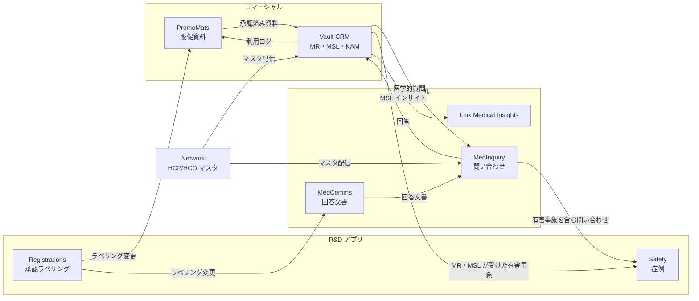

# 付録I　データ責任分界（System of Record）と接続点

Veeva の製品群の**中**で、どの製品がどのデータの正を持つか、R&D とコマーシャルがどこでつながるかをまとめる。製品群の外（ERP など）との境界は [function-allocation](../../../cross-cutting/function-allocation/function-allocation.md) にある。

## データ責任分界（System of Record）

「どのシステムがそのデータの正か」を決めることが設計の出発点です。

| データ領域 | System of Record | 参照先 |
|-----------|------------------|----|
| 治験の進捗・施設 | Veeva CTMS | 付録E |
| 治験必須文書 | Veeva eTMF | 付録E |
| 治験の症例データ | Veeva EDC | 付録E |
| GxP 文書（SOP・手順書） | Veeva QualityDocs | 付録E |
| 品質イベント（逸脱・CAPA・変更） | Veeva QMS | 付録E |
| 試験結果 | Veeva LIMS | 付録E |
| 申請コンテンツ | Veeva Submissions | 付録E |
| 各国の承認状況・当局コミットメント | Veeva Registrations | 付録E |
| 有害事象の症例・ICSR | Veeva Safety | 付録E |
| 安全性文書（PSUR・RMP） | Veeva SafetyDocs | 付録E |
| メディカルコンテンツ（回答文書） | Veeva MedComms | 付録F |
| 医療関係者からの問い合わせ | Veeva MedInquiry | 付録F |
| メディカルインサイト（分析済み） | Veeva Link Medical Insights | 付録F |
| KOL の外部データ | Veeva Link Key People | 付録F |
| 販促コンテンツ | Veeva PromoMats | 付録G |
| フィールド活動（面談・サンプリング・CLM 利用） | Vault CRM | 付録G |
| HCP/HCO マスタ | Veeva Network（日本は Ultmarc を取り込み） | 付録H |

**原則**：同じデータが複数のシステムにある場合、正でない側は参照専用にし、更新は正の側でだけ行います。これを業務ルールとして決めておかないと、版の不整合や更新漏れが起きます。

## R&D とコマーシャルの接続点

R&D アプリとコマーシャルアプリは同じ Vault Platform 上にありますが、業務も利用部門も別です。両者の接続点は、要件を設計するときの境界線になります。

## 接続点の詳細

| # | 接続 | 方向 | データ | 設計上の注意 |
|---|------|------|-------|-------------|
| ① | Network → CRM・MedInquiry・Events | 配信 | HCP/HCO 識別子・属性 | 下流は参照専用。変更は Network で |
| ② | PromoMats → CRM（CLM・Approved Email） | 配信 | 承認済み資料 | ライフサイクル連動（[02章](../chapters/02_structure.md)「ライフサイクル状態による制御付き同期」） |
| ③ | CRM → PromoMats | 還流 | 利用ログ（閲覧時間・クリック・反応） | 非同期バッチで十分 |
| ④ | CRM → MedInquiry → CRM | 往復 | 医学的な問い合わせと回答 | MR から MSL/メディカルへのエスカレーション |
| ⑤ | CRM・MedInquiry → Safety | 報告 | 有害事象情報 | **規制上の報告期限がある**。手作業に頼る場合は漏れ防止策が必須 |
| ⑥ | CRM（Medical CRM） → Link Medical Insights | 連携 | MSL のインサイト | CRM 内でのネイティブ入力は 2026年下期提供予定 |
| ⑦ | Registrations → PromoMats・MedComms | 波及 | 承認されたラベリング変更 | 影響する資料の特定と失効・改訂。**更新タイミングのずれが典型的な課題** |

## CRUD マトリクス（コマーシャル活動）

コマーシャル活動で「どのシステムがどのデータをどう操作するか」を示します（C: 作成、R: 参照、U: 更新、D: 削除）。

| 業務 | Vault CRM | Network | PromoMats | MedInquiry | Link | Events | Nitro |
|------|-----------|---------|-----------|------------|------|--------|-------|
| コンテンツ作成 | | | **C R U D** | | | | |
| MLR レビュー・承認 | | | R U | | | | |
| 対象 HCP の特定 | R | **C R U D** | | | R | | R |
| 活動計画 | **C R U** | R | | | R | R | R |
| 活動実行 | **C R U** | R | R | | | C R U | |
| 活動記録 | **C U** | R | U（利用ログ） | C U | C（インサイト） | R | R |
| 分析 | R | R | R | R | R | R | **C R U** |
| 次回計画 | **C R U** | R | | | R | C R U | R |

PromoMats がコンテンツの、Network が HCP/HCO データの、Vault CRM が活動データの中心です。

## RACI マトリクス（コマーシャル活動）

R: 実行責任、A: 最終責任、C: 相談、I: 情報共有

| 業務 | マーケティング | MLR | MR | MSL | KAM |
|------|--------------|-----|----|-----|-----|
| コンテンツ作成 | **R A** | C | | | |
| MLR レビュー | C | **R** | | | |
| コンテンツ承認 | I | **R A** | | | |
| 対象 HCP の特定 | C | | C | C | **R A** |
| 活動計画 | | | **R** | **R** | **A** |
| 活動実行 | | | **R A** | **R A** | **R** |
| 活動記録 | | | **R A** | **R A** | **R** |
| KPI 分析 | **R** | | I | I | **R A** |
| 次回計画 | C | | I | I | **R A** |

KAM がアカウント単位の最終責任を持ち、MLR が承認のゲートになる構造です。

---

**出典**（確認日：2026-11-15）

- [Veeva Vault Platform](https://www.veeva.com/products/vault-platform/)
- [Veeva Products（製品一覧）](https://www.veeva.com/products/)
- [Veeva Link Medical Insights](https://www.veeva.com/products/veeva-link/medical-insights/)
- ERP との境界：[function-allocation](../../../cross-cutting/function-allocation/function-allocation.md)
