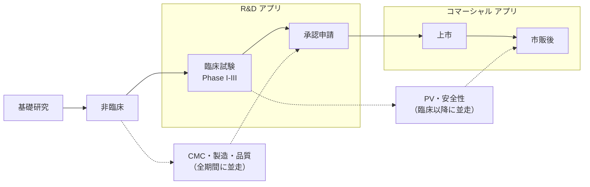
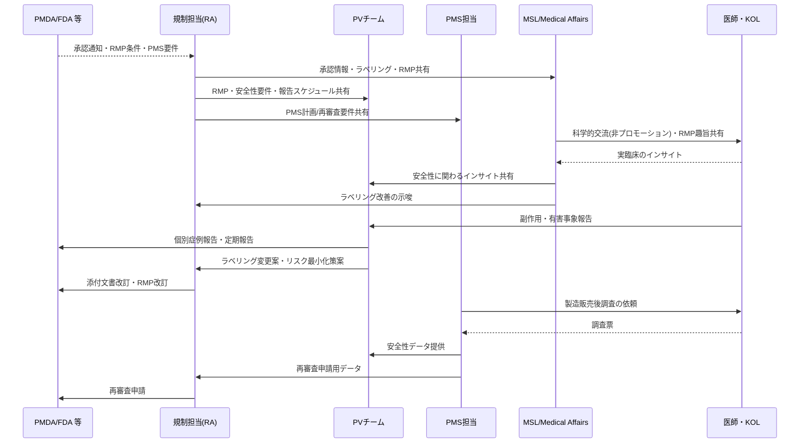

# 01 Veeva の定義と範囲

## 要旨

Veeva は、製薬などライフサイエンス業界に特化したクラウドソフトウェアと業界データの提供企業です。規制（GxP）対応を前提に、臨床・薬事・品質・安全性（R&D）からメディカル・営業・マーケティング（コマーシャル）までの業務アプリケーションを、共通基盤の Vault Platform の上に揃えています。製品は製薬企業の業務フェーズごとに作られています。

## 定義

Veeva Systems は、製薬・バイオ・医療機器などライフサイエンス業界に特化したクラウドソフトウェアとデータの提供企業です。汎用SaaSを業界向けに拡張するのではなく、**規制（GxP）対応を前提に業務アプリケーションとデータを業界専用に作り込んでいる** 点が特徴です。

## 成り立ち

### CRM の基盤移行

かつての Veeva CRM は Salesforce のプラットフォーム上で構築されていましたが、現在は Vault Platform 上の **Vault CRM** への移行が進んでいます。

- 2026年3月時点で Vault CRM の稼働顧客は125社超（日本を含む主要地域）
- 旧 Veeva CRM（Salesforce基盤）のサポート終了は **2029年12月31日**（当初の2030年9月から前倒し）

この移行によって、R&D 系とコマーシャル系が **同じ Vault Platform に揃う** ことになります。旧資料にあった「Vault と CRM の2系統」という整理は、現在は「1つの基盤上の R&D アプリとコマーシャルアプリ」と捉えるのが適切です。

### 製品名称の変化

製品名は「Vault ○○」から「Veeva ○○」への移行が進んでいます（例：Vault Safety → Veeva Safety、Vault QMS → Veeva QMS）。一方で **Vault CRM・Vault Platform・Vault AI** は「Vault」の名称のままです。社内文書や過去資料では旧名称が混在するため、本資料では現行名称を使い、必要に応じて旧名称を併記します。

## 範囲：製薬バリューチェーンと製品の対応

Veeva の製品は、製薬企業の業務フェーズごとに作られています。新薬が生まれてから患者に届き、市販後も管理され続けるまでの流れと、各フェーズで使われる Veeva 製品の対応を以下に示します。

各業務の詳細（CMC・CRO・規制当局・CTD）は [付録A](../appendix/A_drug-development-and-cmc.md) に置いています。

| 含むもの | 含まないもの（隣接領域） |
|---|---|
| 臨床・薬事・品質・安全性（R&D）、メディカル、営業・マーケティング（コマーシャル）、顧客マスタ・業界データ | 基礎研究（Veeva の主領域外）、受注・在庫・会計などの基幹業務（→ [erp](../../erp/README.md)）、製造の実行（→ [manufacturing](../../manufacturing/README.md)） |

### バリューチェーン全体像

新薬の開発には10〜15年を要し、数千の候補化合物から1つが製品化される選別プロセスです。

| フェーズ | 主な担い手 | 内容 | 期間目安 | 主な Veeva 製品 |
|----------|-----------|------|----------|-----------------|
| 基礎研究（探索） | 研究部門 | 疾患標的の特定、候補化合物の探索 | 2〜3年 | —（主領域外） |
| 非臨床試験 | 薬理・毒性・薬物動態部門（CMC開発も並行開始） | 動物・細胞で薬効・毒性・ADMEを評価 | 2〜6年 | QualityDocs（GLP文書）、LIMS |
| 臨床試験（Phase I〜III） | 臨床開発部門・CRO・治験施設 | 健康人→少数患者→多数患者で安全性・有効性を検証 | 3〜7年 | CTMS、eTMF、Study Startup、EDC、RTSM、eCOA、SiteVault |
| CMC・製造 | CMC・製造・QA/QC | 製法確立、スケールアップ、治験薬・商業生産、品質保証 | 開発全期間〜市販後 | QualityDocs、QMS、LIMS、Training、Batch Release |
| 承認申請・審査 | 薬事（RA） | CTD を作成し PMDA/FDA 等に申請、照会対応 | 1〜2年 | Submissions、Submissions Publishing、Registrations |
| 上市 | 営業・マーケティング・メディカル | 販売開始、医療従事者への情報提供 | — | Vault CRM、PromoMats、Medical CRM、Link |
| 市販後 | PV・PMS・Medical Affairs | 副作用監視、製造販売後調査、Phase IV、エビデンス創出 | 継続 | Safety、SafetyDocs、Safety Signal、MedInquiry |

- PV（ファーマコビジランス）は臨床試験段階から全フェーズに横断しますが、上市後に業務量が大きくなります。
- 顧客マスタ（Network / Ultmarc）と分析（Nitro）は、上市前の準備段階から全コマーシャル活動の土台になります。

### 部門と Veeva 製品の対応

同じ Vault Platform 上にあっても、利用部門は製品ごとに分かれています。

| 部門 | 主な利用製品 | 参照先 |
|------|-------------|--------|
| 臨床開発・臨床オペレーション | CTMS、eTMF、Study Startup、Payments、Site Connect | 付録E |
| データマネジメント・統計 | EDC、DQS、eCOA、RTSM | 付録E |
| 薬事（RA） | Registrations、Submissions、Submissions Publishing | 付録E |
| ファーマコビジランス（PV） | Safety、SafetyDocs、Safety Workbench、Safety Signal | 付録E |
| 品質保証・品質管理（QA/QC）・製造 | QMS、QualityDocs、LIMS、Training、Batch Release、Station Manager | 付録E |
| Medical Affairs・MSL | Medical CRM、Link、MedInquiry、MedComms、Publications | 付録F |
| 営業（MR・KAM） | Vault CRM（CLM・Approved Email・Engage）、Align | 付録G |
| マーケティング | PromoMats、Campaign Manager、Events Management | 付録G |
| コマーシャルエクセレンス・データ | Network、OpenData / Ultmarc、Nitro、HCP Access | 付録H |
| IT・システム統合 | Vault Platform、Vault API、Connections | 02章 |

### 承認後の引き継ぎ — R&D からコマーシャルへ

承認は、R&D 系の業務からコマーシャル系の業務へ主役が切り替わる節目です。規制担当（RA）が当局から受け取った承認条件を、メディカル・PV・PMS に引き継ぎます。

| 引き継ぎ先 | 受け取るもの | 使う Veeva 製品 |
|-----------|-------------|-----------------|
| MSL / Medical Affairs | 承認内容・ラベリング・RMP | Medical CRM、MedComms、Link |
| PV | RMP・安全性要件・報告スケジュール | Safety、SafetyDocs |
| PMS | 製造販売後調査計画・再審査要件 | （PMS 専用製品は公式一覧になし。Safety・EDC 等で運用） |
| 営業・マーケティング | 承認されたラベリング・製品情報 | PromoMats（販促資料の根拠）、Vault CRM |

**システム上の要点**：ラベリング（添付文書）の変更は、薬事（Registrations / Submissions）で管理され、販促資料（PromoMats）とメディカル資料（MedComms）の改訂、さらに CRM で配信中の資料の差し替えへと波及します。この連鎖は [付録I](../appendix/I_system-of-record.md)の「R&D とコマーシャルの接続点」で扱います。

## 用語集

| 用語 | 意味 |
|------|------|
| GxP | GMP（製造）・GCP（臨床）・GLP（非臨床）・GVP（安全性）など、医薬品の品質・安全性に関する規範の総称 |
| HCP / HCO | Healthcare Professional（医師・薬剤師等）/ Healthcare Organization（病院・薬局等） |
| KOL | Key Opinion Leader。特定領域で影響力を持つ医師・研究者 |
| MR / MSL / KAM | 医薬情報担当者（販促）/ メディカル・サイエンス・リエゾン（非販促の科学交流）/ キーアカウントマネージャー（大口施設の統括） |
| MLR | Medical・Legal・Regulatory による販促資料の審査 |
| CLM | Closed Loop Marketing。承認済み資料の提示と反応の記録 |
| CTD / eCTD | 承認申請書類の国際標準形式 / その電子版 |
| ICSR / E2B | 個別症例安全性報告 / その電子送信の国際規格 |
| RMP / PSUR | 医薬品リスク管理計画 / 定期的安全性最新報告 |
| TMF / ISF | 治験マスターファイル（依頼者側）/ 治験施設側の必須文書ファイル |
| System of Record | そのデータの「正」を持つシステム |
| Ultmarc | 日本アルトマーク。日本の医師・施設マスタ（MDB）の提供元 |

---

**出典**（確認日：2026-10）

- [Veeva Products（製品一覧）](https://www.veeva.com/products/)
- [Veeva Vault Platform](https://www.veeva.com/products/vault-platform/)
- [More than 125 Customers Worldwide Live on Vault CRM（2026-03-03）](https://www.veeva.com/resources/more-than-125-customers-worldwide-live-on-vault-crm-as-veeva-accelerates-the-industrys-agentic-transformation/)
- [Vault CRM Suite（日本）](https://www.veeva.com/jp/products/crm-suite/)
