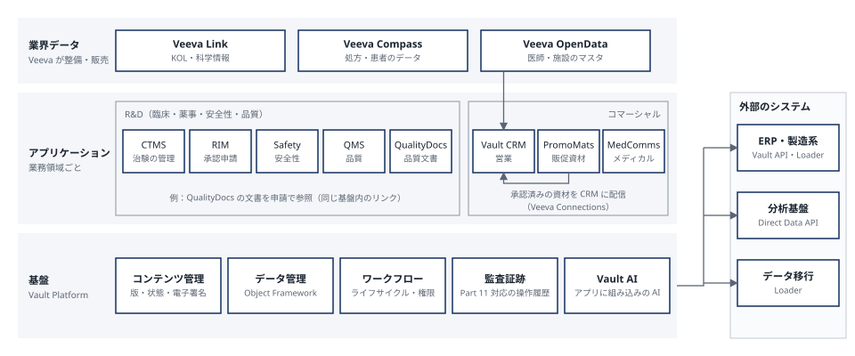

# 02 Veeva の構造

## 要旨

Veeva の製品は、共通基盤（Vault Platform）・業務アプリケーション・業界データの3層からなります。アプリケーションは同じ基盤の上にあるため、アプリ間の連携は「別システム間のインターフェース」ではなく「同じ基盤内のリンク」として実現されます。データは Vault Object Framework で構造化され、文書やデータのライフサイクル状態がアプリ間の同期を制御します。外部とは Vault API・Direct Data API・Veeva Connections でつながります。



*図1　Veeva の3層構造：業界データ・アプリケーション・共通基盤（本資料の整理）*

## 構成要素

製品は大きく3層で捉えると理解しやすくなります。

| 層 | 中身 | 代表例 |
|----|------|--------|
| **基盤（Platform）** | 全アプリケーションが共通で使うクラウド基盤。文書・データ・ワークフロー・権限・監査証跡・AIを提供 | Vault Platform、Veeva Connections、Vault AI |
| **アプリケーション** | 業務領域ごとのアプリ。R&D（臨床・薬事・安全性・品質）とコマーシャル（メディカル・営業/マーケティング）に大別 | Veeva CTMS、Veeva RIM、Veeva Safety、Veeva QMS、Vault CRM、Veeva PromoMats |
| **データ** | Veeva が自ら整備・販売する業界データ（医師・施設・KOL・処方・患者） | Veeva OpenData、Veeva Link、Veeva Compass |

## Vault Platform — すべての土台

Vault Platform は、Veeva のほぼ全アプリケーション（50以上）が載るクラウド基盤です。

| 要素 | 内容 |
|------|------|
| コンテンツ管理 | 文書のバージョン管理・ライフサイクル（Draft→In Review→Approved 等）・注釈・電子署名・文書生成 |
| データ管理 | Vault Object Framework による構造化データ（症例・申請・製品・施設など）の管理 |
| ワークフロー | レビュー・承認などの業務プロセス定義、ロールと権限 |
| 監査証跡 | GxP（21 CFR Part 11 等）に対応した操作履歴 |
| 連携 | Vault API、Direct Data API（大量データの高速取得）、Java SDK、Veeva Connections（アプリ間の製品化された連携） |
| AI | Vault AI（全アプリに組み込まれたAIエージェント） |

**理解のポイント**：アプリケーションは別製品でも同じ基盤の上にあるため、アプリ間の連携（例：QualityDocs の文書を Submissions が参照する）は「別システム間のインターフェース」ではなく「同じ基盤内のリンク」として実現されます。

## Vault のデータ構造

Vault は「文書管理」と「構造化データ管理」と「ワークフロー」を併せ持つ基盤です。

| オブジェクト | 説明 | 主な属性 |
|------------|------|---------|
| Document | コンテンツの基本単位。版とライフサイクルを持つ | Document Type、Lifecycle State、Version |
| Document Version | 同じ文書のメジャー/マイナー版 | Version Number、作成日、作成者 |
| Binder | 複数の文書を束ねる（CTD の構造など） | セクション、参照文書 |
| Object Record | 文書以外の構造化データ（症例・申請・製品・施設・品質イベント等）。Vault Object Framework で定義 | オブジェクトごとに異なる |
| Workflow | レビュー・承認などのプロセス | タスク、参加者 |
| Lifecycle | 状態と、状態ごとの権限・遷移条件 | State、Entry Action、権限 |

ワークフロー設計では「誰が、どの状態で、どの操作をできるか」を業務フローと対応させます。

## ライフサイクル状態による制御付き同期

Vault の文書はライフサイクル状態（Draft → In Review → Approved → Expired 等）を持ちます。連携は「データのコピー」ではなく「**状態遷移をきっかけにした制御**」として設計します。

| 例 | きっかけ | 連携先での動作 |
|----|---------|---------------|
| 販促資料の承認 | PromoMats で Approved | CRM の CLM に同期し、利用可能に |
| 販促資料の失効 | PromoMats で Expired | CRM から撤回し、表示不可に |
| ラベリング変更 | Registrations で承認 | 関連する PromoMats・MedComms の資料を改訂対象に |
| SOP の改訂 | QualityDocs で Effective | Training で読了タスクを発行、Station Manager で現場端末を更新 |

**注意**：状態遷移のタイミングと、CRM 端末側のキャッシュ（オフライン利用）更新のタイミングのずれを考慮します。

## API と連携方式

| 方式 | 用途 |
|------|------|
| **Vault API**（REST） | 文書・オブジェクトの作成・更新・取得、ワークフロー操作 |
| **VQL**（Vault Query Language） | SQL に似た構文で文書・オブジェクトを検索 |
| **Direct Data API** | 大量データの高速取得（分析基盤への連携向け） |
| **Loader** | 大量データの一括インポート/エクスポート、データ移行 |
| **Vault Java SDK** | Vault 内で動くカスタム処理の開発 |
| **Spark Messaging** | Vault 間・外部へのイベント通知（状態変化の連携） |
| **Veeva Connections**（Connections Hub） | Veeva アプリ間の製品化された標準連携（例：PromoMats–CRM のコンテンツ配信） |

### VQL の例

```sql
-- 承認済みの SOP を取得
SELECT id, name__v, status__v
FROM documents
WHERE status__v = 'Approved'
  AND type__v = 'SOP'
```

### シナリオ別の推奨方式

| シナリオ | 推奨方式 |
|---------|---------|
| Veeva アプリ同士の連携 | まず Veeva Connections（標準連携）を検討。独自開発は最後の手段 |
| 社内 ERP・製造系システムとのバッチ連携 | Vault API または Loader による非同期バッチ |
| 状態変化のリアルタイム通知 | Spark Messaging / Java SDK |
| データ基盤（DWH）への大量抽出 | Direct Data API |
| データ移行 | Loader |

### データ移行・統合時の注意点

- **メタデータの正規化**：Document Type・Lifecycle・分類を Vault 側の設定と事前に合わせる
- **版の扱い**：既存の版履歴を移行するか、業務側と合意する
- **E2B 送信の冪等性**：ICSR の重複送信を防ぐため、送信状態を厳密に管理する
- **権限**：連携用ユーザーには最小限のロールを与え、監査ログで追跡できるようにする
- **識別子の対応**：DCF コード・Veeva ID 等の突き合わせルールを事前に定義する（[付録H](../appendix/H_data-products.md) の H-5）
- **配信状態の整合**：PromoMats と CRM の状態のずれに注意する（本章「ライフサイクル状態による制御付き同期」）

## AI — Vault AI と Veeva Falcon

| 製品 | 位置づけ | 例 |
|------|---------|----|
| **Vault AI** | 各アプリに組み込まれた AI エージェント。標準エージェントを設定・拡張でき、独自エージェントも作れる | CRM：Pre-call・Content・Free Text・Voice ／ PromoMats：コンテンツチェック ／ Safety・Quality 向けエージェント |
| **Veeva Falcon** | 業務プロセスをエンドツーエンドで自動化するエージェント群（Veeva は「Agentic Labor」と呼ぶ） | Falcon Clinical（治験データの受付・品質チェック）、Falcon Regulatory（申請文書作成・当局対応）、Falcon Safety（症例受付・トリアージ）、Falcon MLR（販促資料の審査） |

**設計上の論点**：AI エージェントの出力を GxP 業務で使う場合、人による確認の位置づけ、監査証跡、バリデーションの考え方を決めておく必要があります。

## 監査証跡

面談記録、サンプリング記録、承認資料の利用記録は、21 CFR Part 11 など電子記録規制の対象になり得ます。「**誰が、いつ、何を、どの版で使ったか**」を追跡できることが、Veeva を使う最大の理由の一つであり、GxP の電子記録の要件と、Vault の版の更新への追随の考え方は gxp-compliance にまとめている（→ [gxp-compliance](../../../cross-cutting/gxp-compliance/chapters/03_landscape.md)）。連携設計でもこの追跡性を壊さないことが求められます。

---

**出典**（確認日：2026-10）

- [Veeva Products（製品一覧）](https://www.veeva.com/products/)
- [Veeva Vault Platform](https://www.veeva.com/products/vault-platform/)
- [Veeva Link Medical Insights](https://www.veeva.com/products/veeva-link/medical-insights/)
- 図1は、本章の内容をもとにした本資料の整理
