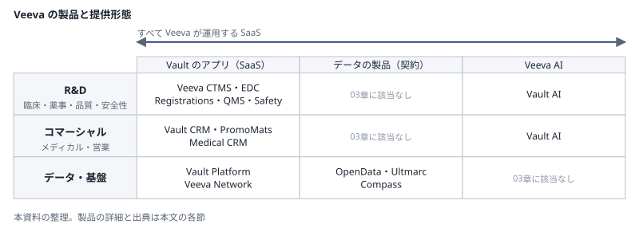

# 03 Veeva の製品と提供形態

## 要旨

Veeva の製品は、公式サイトの分類に沿って R&D（Veeva Development Cloud）、コマーシャル（Veeva Commercial Cloud）、データ（Veeva Data Cloud）、AI・基盤に分かれます。製品は業務フェーズと部門ごとに分かれており、領域ごとの詳細は付録E〜Hに置いています。すべての製品は Veeva が運用する SaaS として提供されます。市場の大きな動きは、2025年9月の Salesforce との提携の満了による Vault CRM への移行、2025年8月の IQVIA との和解、2025年12月からの AI エージェントの提供です（→ 下の「市場の動き」）。

> 製品構成・名称は Veeva 公式サイト（2026年10月時点）に基づきます。Veeva は製品の追加・改称が多いため、更新時は末尾の出典を再確認してください。

*図1　Veeva の製品と提供形態（縦は製品の区分、横は提供形態。本資料の整理）*

## 主要な製品

公式サイトの分類に沿って全製品を整理します。「参照先」列は、製品の詳細を説明している付録・章を示します。

### R&D 領域（Veeva Development Cloud）

| 分類 | 製品 | 役割 | 参照先 |
|------|------|------|----|
| **臨床（Clinical Operations）** | Veeva CTMS | 治験の開始から終了までの進捗・施設・モニタリング管理 | 付録E |
| | Veeva eTMF | 治験必須文書（TMF）の電子管理、査察対応 | 付録E |
| | Veeva Study Startup | 治験施設の立ち上げ（契約・IRB・必須文書）の迅速化 | 付録E |
| | Veeva Payments | 治験施設への支払い管理 | 付録E |
| | Veeva Site Connect | 依頼者と治験施設の文書・情報のやり取り | 付録E |
| | Veeva Study Training | 治験責任医師・スタッフのトレーニング管理 | 付録E |
| | Veeva Disclosures | 治験情報の公開（レジストリ登録）管理 | 付録E |
| | Veeva OpenData Clinical | 治験責任医師・施設のデータ | 付録E |
| **臨床（Clinical Data）** | Veeva EDC | 治験データ（症例報告）の電子収集 | 付録E |
| | Veeva DQS | 治験データの集約・データクリーニング | 付録E |
| | Veeva eCOA | 患者報告アウトカム等の電子収集 | 付録E |
| | Veeva RTSM | 無作為化・治験薬供給管理 | 付録E |
| **薬事（RIM）** | Veeva Registrations | 製品の各国承認状況、当局とのやり取り・コミットメント管理 | 付録E |
| | Veeva Submissions | 申請コンテンツ（CTD）の計画・作成・レビュー | 付録E |
| | Veeva Submissions Publishing | eCTD 形式へのパブリッシングと当局への電子提出 | 付録E |
| | Veeva Submissions Archive | 過去の申請物の保管・参照 | 付録E |
| **安全性（Safety Suite）** | Veeva Safety | 有害事象の症例（ICSR）管理・当局報告 | 付録E |
| | Veeva SafetyDocs | PSMF・RMP・PSUR など安全性文書の管理 | 付録E |
| | Veeva Safety Workbench | 安全性データの集計・分析・定期報告 | 付録E |
| | Veeva Safety Signal | シグナル検出・管理 | 付録E |
| **品質（Quality Cloud）** | Veeva QMS | 逸脱・CAPA・変更管理・苦情・監査など品質プロセス | 付録E |
| | Veeva QualityDocs | SOP・手順書など GxP 文書のライフサイクル管理 | 付録E |
| | Veeva Training | ロール別の教育・資格管理 | 付録E |
| | Veeva Validation Management | バリデーションのペーパーレス実行 | 付録E |
| | Veeva Batch Release | 出荷判定（バッチリリース）の迅速化 | 付録E |
| | Veeva LIMS | 品質管理試験室の試験・検体管理 | 付録E |
| | Veeva Station Manager | 製造現場の端末への正しい文書配信 | 付録E |
| | Veeva Product Surveillance | 医療機器の市販後調査 | 付録E |
| | Veeva EHS | 環境・安全衛生プロセス管理 | 付録E |
| **治験実施施設向け（無償提供を含む）** | SiteVault（CTMS / eISF / eConsent） | 医療機関側の治験管理・電子ISF・電子同意 | 付録E |
| | Veeva eSource | 医療機関での治験データ収集 | 付録E |

### コマーシャル領域（Veeva Commercial Cloud）

| 分類 | 製品 | 役割 | 参照先 |
|------|------|------|----|
| **メディカル（Medical Suite）** | Medical CRM（Vault CRM） | MSL の科学的交流の計画・記録 | 付録F |
| | Veeva MedInquiry | 医療関係者からの問い合わせの受付・回答 | 付録F |
| | Veeva MedComms | メディカルコンテンツ（回答文書・学術資料）の管理 | 付録F |
| | Veeva Publications | 論文・学会発表の計画・作成・管理 | 付録F |
| | Veeva Link Key People | KOL の詳細データ（研究・発表・ネットワーク） | 付録F |
| | Veeva Link Workflow | KOL エンゲージメント・学会対応の計画 | 付録F |
| | Veeva Link Medical Insights | MSL の現場インサイトの収集・AI によるテーマ化・社内共有 | 付録F |
| **営業・マーケティング（Vault CRM Suite）** | Vault CRM | MR・KAM・MSL の活動管理の中核（CLM・Approved Email・Engage を含む） | 付録G |
| | Campaign Manager | 対面・非対面を統合したキャンペーン | 付録G |
| | Events Management | 講演会・学術イベントの管理 | 付録G |
| | Service Center | インバウンド／アウトバウンドのリモート対応 | 付録G |
| | Align / Align+ | テリトリー・担当割当・エンゲージメント計画 | 付録G |
| | Patient CRM | 患者支援プログラムの管理 | 付録G |
| | Ostro | 患者・医療従事者向けAI回答 | 付録G |
| **コンテンツ** | Veeva PromoMats | 販促資料の MLR レビュー・承認・配信 | 付録G |
| **分析** | Veeva Nitro | コマーシャルデータの統合分析基盤（データウェアハウス） | 付録H |
| | Marketing Analytics | キャンペーン効果測定・顧客インサイト | 付録H |

### データ（Veeva Data Cloud）・マスタ

| 製品 | 役割 | 参照先 |
|------|------|----|
| Veeva Network（Network MDM） | HCP/HCO の顧客マスタデータ管理 | 付録H |
| Veeva OpenData Commercial | HCP/HCO のリファレンスデータ（**日本では提供なし**） | 付録H |
| Veeva HCP Access | 医療従事者への業界横断アクセス指標 | 付録H |
| Veeva Link Key Accounts | 米国の主要アカウント・意思決定者データ | 付録H |
| Veeva Compass（Patient / Prescriber / National） | 匿名化患者データ・処方データ（米国中心） | 付録H |

### AI・基盤

| 製品 | 役割 | 参照先 |
|------|------|----|
| Vault Platform | 全アプリの共通基盤 | 02章 |
| Veeva Connections（Connections Hub） | アプリ間・外部との製品化された連携 | 02章 |
| Vault AI | 各アプリに組み込まれたAIエージェント（CRM・PromoMats・Safety・Quality 等） | 02章 |
| Veeva Falcon | 業務プロセスを自動化するエージェント群（Clinical / Regulatory / Safety / MLR） | 02章 |
| Veeva Basics | 新興バイオ企業向けのパッケージ | 03章 |

## 業務と製品の対応（早見表）

| 業務フェーズ | 主な担い手 | 主な Veeva 製品 |
|--------------|-----------|-----------------|
| 研究・非臨床 | 研究部門 | （Veeva の主領域外。LIMS・QualityDocs が一部関与） |
| 臨床試験 | 臨床開発・CRO・治験施設 | CTMS、eTMF、Study Startup、EDC、RTSM、SiteVault |
| 製造・品質 | CMC・製造・QA/QC | QualityDocs、QMS、LIMS、Training、Batch Release |
| 承認申請 | 薬事（RA） | Submissions、Submissions Publishing、Registrations |
| 安全性監視 | PV | Safety、SafetyDocs、Safety Workbench、Safety Signal |
| メディカル活動 | Medical Affairs・MSL | Medical CRM、Link、MedInquiry、MedComms、Publications |
| 営業・マーケティング | MR・KAM・マーケティング | Vault CRM、PromoMats、Campaign Manager、Events、Align |
| 顧客マスタ・分析 | 全部門 | Network、OpenData（日本は Ultmarc）、Nitro、HCP Access |

詳細は [01章](01_definition.md) を参照してください。

## 領域別の製品詳細

| 付録 | 領域 |
|---|---|
| [付録E](../appendix/E_rd-products.md) | R&D：臨床・薬事（RIM）・品質・安全性 |
| [付録F](../appendix/F_medical-products.md) | メディカル：Medical Suite、Veeva Link |
| [付録G](../appendix/G_commercial-products.md) | コマーシャル：Vault CRM Suite、PromoMats/MLR、KAM、KPI |
| [付録H](../appendix/H_data-products.md) | データ：Network、OpenData、Ultmarc、識別子、Nitro・Compass |

## 提供形態

Veeva の製品は、すべて Veeva が運用する SaaS として提供される。利用企業が自社で運用する版はない（本資料の整理）。

| 形態 | ベンダーが管理するもの | 利用企業が管理するもの | 例 |
|---|---|---|---|
| Vault の各アプリケーション（SaaS） | Vault Platform、アプリの更新（年3回の定期リリース）、基盤のバリデーションの資料の提供 | 設定（ライフサイクル・ワークフロー・権限）、利用者、データ、自社の用途に対するバリデーション（→ gxp-compliance 03章） | Vault CRM、Vault QMS、Vault RIM、Vault eTMF |
| データの製品（契約で提供） | 医療従事者・医療機関のデータの収集と更新 | データの利用範囲、他のシステムへの取り込み | OpenData、Ultmarc、Compass |
| Veeva AI（Vault AI） | AI エージェントと、それが使うモデル（Amazon Bedrock 上の Anthropic・Amazon のモデル） | 設定、独自のエージェント、自社のモデルを使う場合はその契約（Amazon Bedrock、Microsoft Foundry） | Vault CRM・PromoMats の AI エージェント |

Veeva AI は、Vault 単位のサブスクリプションと使った量に応じた課金を組み合わせる、と同社は説明している。

## 市場の動き

| 時期 | できごと |
|---|---|
| 2022年 | Veeva が、Salesforce との提携を2025年9月の満了で更新しないと表明した |
| 2025年4月 | Veeva が、新規の顧客には Vault CRM を勧めるようにした。同月、AI の取り組み Veeva AI を発表した |
| 2025年8月13日 | Veeva と IQVIA が2017年からの訴訟をすべて和解した。互いのデータとソフトウェアを顧客の環境で組み合わせて使える契約を結んだ |
| 2025年9月 | Veeva と Salesforce の提携が満了した。Salesforce 上の Veeva CRM は新機能の追加のない「安定化モード」になり、既存の顧客の支援は5年の移行期間（2030年9月まで）とされている |
| 2025年10月 | Salesforce が製薬向けの Life Sciences Cloud for Customer Engagement の一般提供を始めた |
| 2025年12月4日 | Veeva が Vault CRM と PromoMats の AI エージェントの提供を始めた。2026年に安全性・品質・臨床・薬事・メディカルへ広げる予定 |
| 2026年3月3日 | Veeva が、Vault CRM の稼働顧客が125社を超えたと発表した |

Salesforce 上の Veeva CRM の支援の終了を2029年12月末に早めたとする二次資料があるが、本資料では Veeva の一次資料を確認していない。

## 本資料でまだ扱っていないもの

- 各製品の価格の水準
- Salesforce Life Sciences Cloud・IQVIA の製品との比較（→ crm 03章）
- Veeva AI の価格の詳細

---

**出典**（確認日：2026-11-14）

- [Veeva Products（製品一覧）](https://www.veeva.com/products/)
- [Veeva Vault Platform](https://www.veeva.com/products/vault-platform/)
- [More than 125 Customers Worldwide Live on Vault CRM（2026-03-03）](https://www.veeva.com/resources/more-than-125-customers-worldwide-live-on-vault-crm-as-veeva-accelerates-the-industrys-agentic-transformation/)
- [Vault CRM Suite（日本）](https://www.veeva.com/jp/products/crm-suite/)
- Salesforce との提携の終了と移行期間：R&D World（2025-08-12）— https://www.rdworldonline.com/?p=78849 、Everest Group — https://www.everestgrp.com/?p=92400
- IQVIA との和解（2025-08-13）：Veeva の SEC への提出書類（Boardroom Alpha の転載）— https://www.boardroomalpha.com/sec/veev-8-k-2025-08-18-0001393052-25-000058 、HLTH（データの相互利用の内容）— https://hlth.com/insights/news/iqvia-and-veeva-systems-end-eight-year-legal-battle-with-strategic-partnership-2025-08-20
- Veeva AI：Veeva AI の発表（2025-04-29、Vault 単位の課金）— https://www.pharmavoice.com/press-release/20250429-announcing-veeva-ai-1/ 、AI エージェントの予定とモデル（2025-10-14）— https://www.veeva.com/eu/resources/veeva-ai-agents-to-be-released-across-all-veeva-applications/ 、提供開始（2025-12-04）— https://www.aap.com.au/aapreleases/cision20251203ae38085 、Vault AI（年3回のリリース）— https://www.veeva.com/ap/?p=254075
- SaaS だけで提供される点、提供形態の表は本資料の整理
- 製品の区分は 2026-11 時点の各社の公表情報による。契約の判断の前には各社の最新の資料で確かめる
