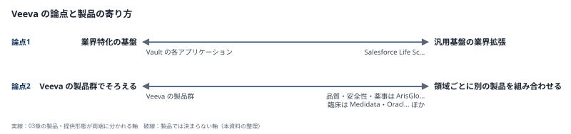

# 04 Veeva の主要な論点

## 要旨

Veeva を扱うときに出てくる軸は次の2つです。懸念や要望を聞いたときは、まずそれがどの軸の話かを特定します。

1. 業界特化の基盤か、汎用プラットフォームか
2. Veeva の製品群でそろえるか、領域ごとに別の製品を組み合わせるか

*図1　Veeva の論点と製品の寄り方（実線は03章の製品が両端に分かれる軸、破線は製品では決まらない軸。本資料の整理）*

## 論点1：業界特化の基盤か、汎用プラットフォームか

CRM 領域では、Salesforce が2024年に Life Sciences Cloud を本格投入し、Veeva の領域に直接参入しています。競争の本質は「業界特化の深さ」と「汎用プラットフォームの広さと速さ」の対比です。

| | 業界特化の基盤（Veeva） | 汎用基盤の業界拡張（Salesforce Life Sciences Cloud） |
|---|---|---|
| 得るもの | GxP にネイティブに対応。Vault と CRM の一体統制（PromoMats と CLM のネイティブ連携）。R&D からコマーシャルまで同一基盤で揃う。Vault API / VQL を中心とした統一インターフェースで設計できる | AI（Agentforce）の先行。Data Cloud と Informatica による外部データ（IQVIA・EMR・患者データ）の柔軟な統合。パートナー製品の多さ |
| 失うもの | 外部データとの連携の幅。ライセンスが高額で、カスタマイズに制限がある | コンテンツ統制をパートナー製品で組み立てる必要がある。パートナー製品ごとに API 仕様を把握する必要がある |

**製品・提供形態との対応**（→ 03章）

| | 業界特化の基盤（Veeva）に寄るもの | 汎用基盤の業界拡張（Salesforce Life Sciences Cloud）に寄るもの |
|---|---|---|
| 製品・提供形態 | Vault の各アプリケーション（Vault CRM、Vault QMS、Vault RIM、Vault EDC など） | Salesforce Life Sciences Cloud（→ crm 03章） |

典型的な懸念：「旧 Veeva CRM のサポート終了を機に、他社の CRM に移るべきか」「AI で他社に遅れていないか」「ライセンスが高い」

移行や共存を考える場合は、HCP/HCO の識別子のマッピングと、コンテンツの配布状態の整合性の維持が最大の課題になります。詳しい比較は [付録C](../appendix/C_veeva-vs-salesforce.md) を参照してください。

## 論点2：Veeva の製品群でそろえるか、領域ごとに別の製品を組み合わせるか

| | Veeva の製品群でそろえる | 領域ごとに別の製品を組み合わせる |
|---|---|---|
| 得るもの | 「文書承認 → 現場配信 → 活動記録 → 監査証跡」を1つの基盤で一貫して実現できる | 領域ごとに製品を選べる。Veeva への依存を下げられる |
| 失うもの | Veeva への依存が高まる | 複数製品の統合設計が必要になる。コンテンツ統制と GxP 保証を設計し直す必要がある |

**製品・提供形態との対応**（→ 03章）

| | Veeva の製品群でそろえるに寄るもの | 領域ごとに別の製品を組み合わせるに寄るもの |
|---|---|---|
| 製品・提供形態 | Veeva の製品群（R&D・コマーシャル・データ・AI） | 品質・安全性・薬事は ArisGlobal・Oracle Argus（→ quality-regulatory 03章）、臨床は Medidata・Oracle Clinical One（→ rd 03章）、CRM は Life Sciences Cloud（→ crm 03章） |

典型的な懸念：「Veeva に依存しすぎていないか」「この機能は他社製品に置き換えられるか」

代替のしやすさは機能によって異なります。Core CRM・QMS・Safety などは代替製品がありますが、Vault CRM と PromoMats の連携、CLM、RIM は代替が困難です。日本では、HCP/HCO データを Veeva OpenData ではなく Ultmarc との連携で得ているため、Veeva から離れる場合は Ultmarc との直接連携への移行が必要になり、HCP Access の指標は取得できなくなります。機能ごとの整理は [付録D](../appendix/D_veeva-dependency.md) を参照してください。

## 比較するときの注意

- 競争環境は変化が速い領域です。判断に使う場合は最新情報を確認してください。

---

**出典**（確認日：2026-11-14）

- 付録C・付録D（各付録の出典を参照）
- 各論点の「製品・提供形態との対応」は、03章の製品をもとにした本資料の整理
